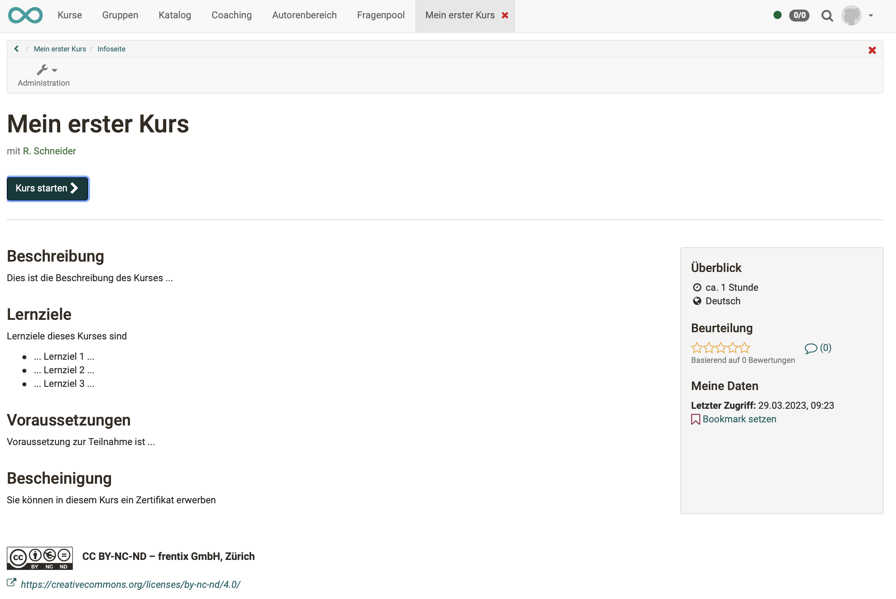
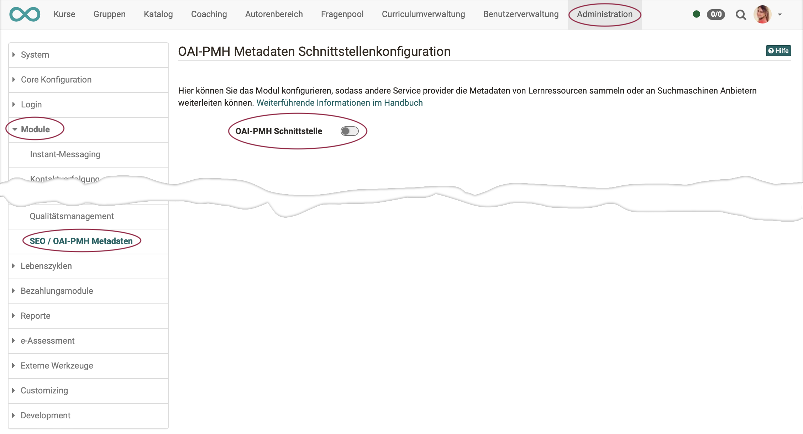
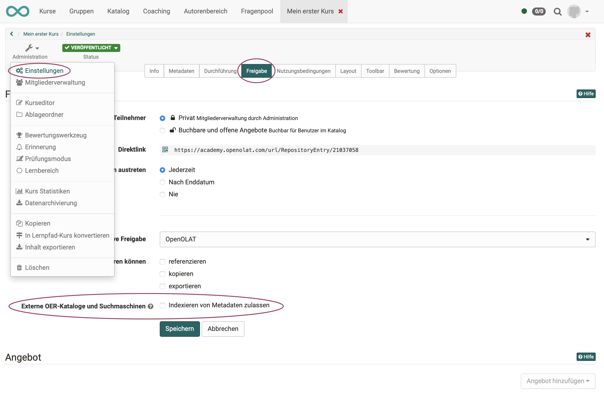
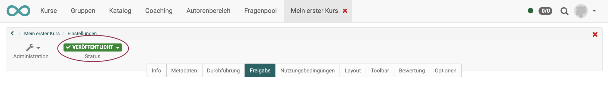
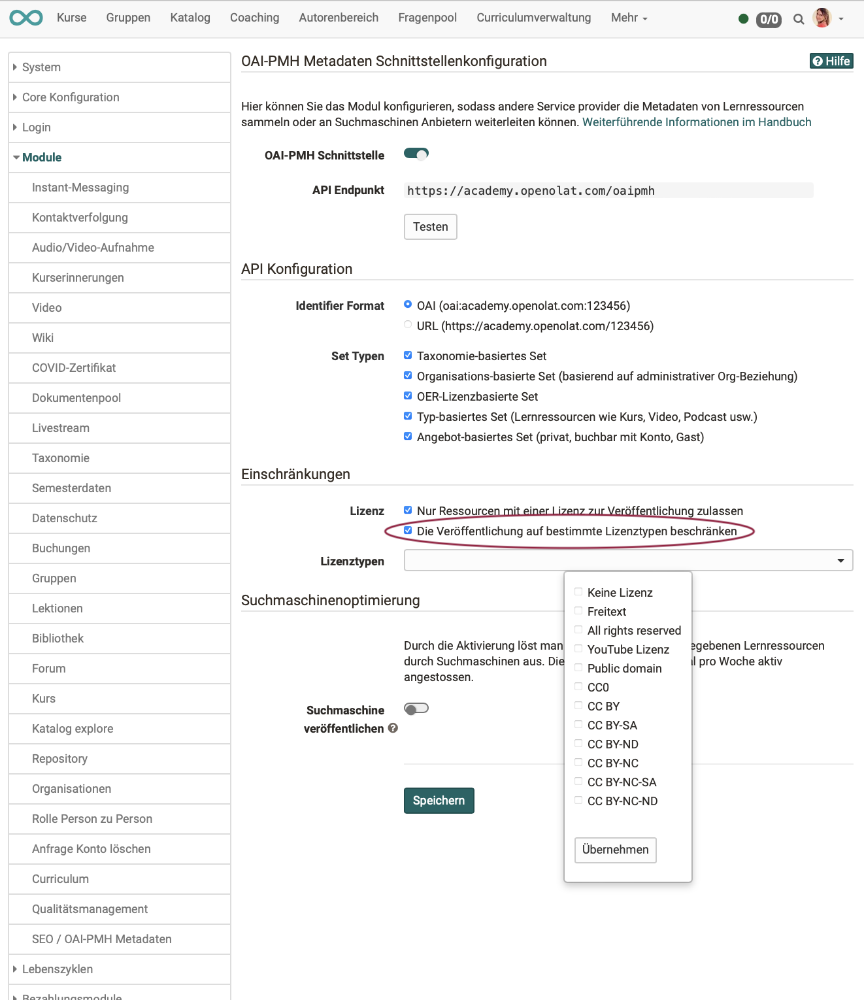
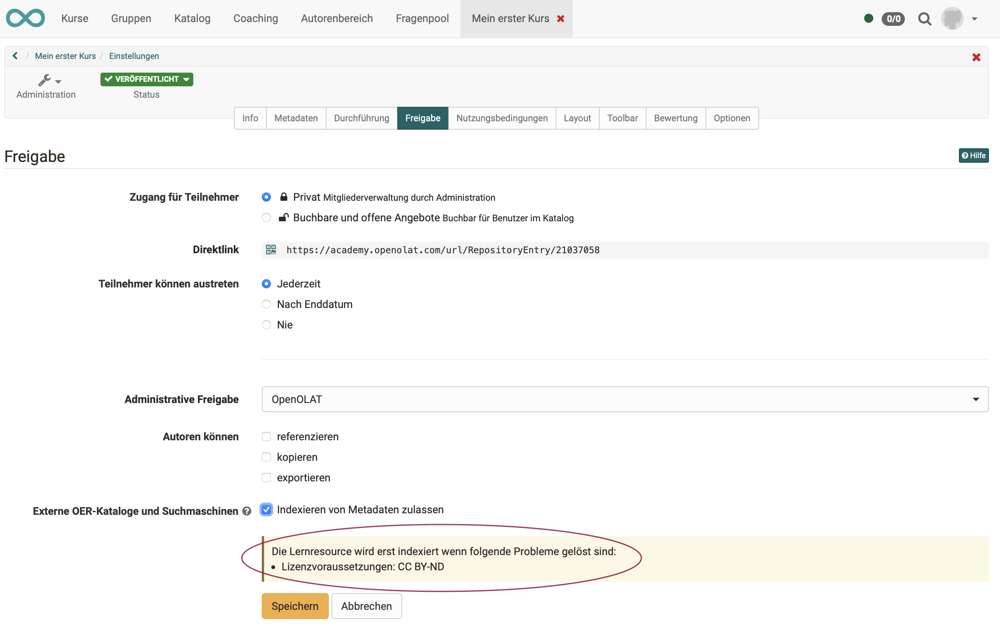
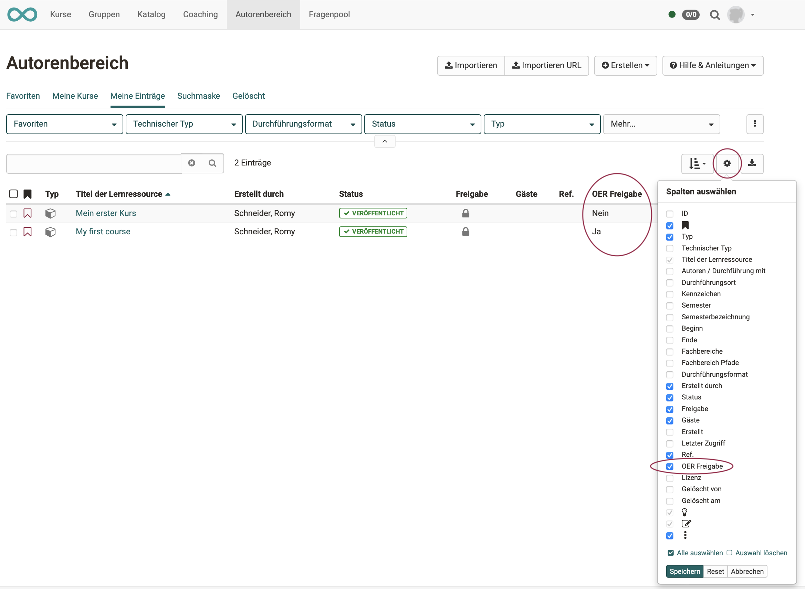
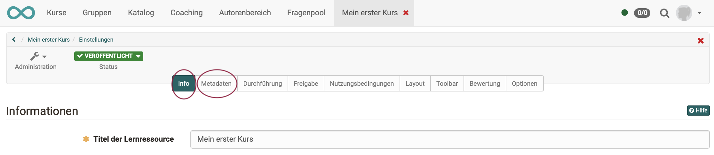

# Wie kann ich meine Kurse durch Suchmaschinen finden lassen? {: #oai_pmh} 

??? abstract "Ziel und Inhalt dieser Anleitung"

    Normalerweise ist OpenOlat ein geschützter Raum. In bestimmten Fällen sollen jedoch Suchmaschinen bestimmte Informationen finden.
    Die folgende Anleitung zeigt, wie OpenOlat dies ermöglicht.

??? abstract "Zielgruppe"

    [x] Autor:innen [ ] Betreuer:innen  [ ] Teilnehmer:innen

    [ ] Anfänger:innen [x] Fortgeschrittene  [x] Expert:innen

??? abstract "Erwartete Vorkenntnisse"

    * Sie haben bereits Erfahrung als Autor:in.

## Finden Suchmaschinen alle OpenOlat-Kurse?

Nein. Wer in OpenOlat lernen und arbeiten will, muss sich im Normalfall registrieren. OpenOlat ist nach aussen ein geschützter Raum, der von Suchmaschinen nicht durchsucht werden kann. Es muss deshalb ausdrücklich festgelegt werden, was Suchmaschinen finden dürfen.

Darüber hinaus gibt es evtl. auch noch den Wunsch, dass Suchmaschinen nicht nur finden <b>dürfen</b>, sondern bestimmte Angebote möglichst finden <b>sollen</b>. 

<b>Beispiel</b>:  Bestimmte in OpenOlat erstellte Infoseiten sollen als Werbung dienen und in Suchmaschinen erscheinen und ausgewertet werden.

## Was gibt OpenOlat für Suchmaschinen zum Durchsuchen frei?

Es kann eingestellt werden, dass

* alle Angaben der <b>Infoseite</b> zu den Kursen und Lernressourcen
* sofern die Besitzer:innen des Kurses / der Lernressource es erlauben
* und Systemadministrator:innen die Funktion generell zur Verfügung gestellt haben

an Suchmaschinen übergeben werden.

{ class="shadow lightbox" title="Infoseite eines Kurses" }

## Wie wird diese Funktion generell aktiviert?

Systemadministrator:innen schalten das Modul in der System-Administration ein, unter: 
`Administration > Module > SEO / OAI-PMH Metadaten`

Standardmässig ist dieses Modul auf jeder Instanz deaktiviert.

Wird OAI eingeschaltet, werden die SEO-Einstellungen sichtbar. (Ausschliesslich SEO aktivieren, ist nicht möglich.)

Wenn das Modul eingeschaltet wurde, ist der API-Endpoint verfügbar, wo alle veröffentlichten Ressourcen über XML verfügbar sind.

{ class="shadow lightbox" title="Modul SEO / OAI-PMH Metadaten in der System-Administration" }

## Wie wird diese Funktion für bestimmte Kurse / Lernressourcen aktiviert?

(Voraussetzung: Generelle Aktivierung der Funktion durch Systemadministrator:innen)

1.) Damit die Informationen an die Suchmaschinen weitergegeben werden, müssen die Besitzer:innen dies für ihren Kurs / ihre Lernressource erlauben. Dafür kreuzen sie bei "Externe OER-Kataloge und Suchmaschinen" die Checkbox "Indexieren von Metadaten zulassen" an, unter: 
`Kurs > Administration > Einstellungen > Tab "Freigabe"`

{ class="shadow lightbox" title="Tab Freigabe der Kurseinstellungen" }

2.) Es werden nur Kurse / Lernressourcen berücksichtigt, die den Status "Veröffentlicht" haben.

{ class="shadow lightbox" title="Kopfzeile eines Kurses" }

3.) (Optional) Es kann festgelegt werden, dass nur Kurse/Lernressourcen mit Lizenz indexierbar sind. Systemadministrator:innen legen fest, welche Lizenzen zum Indexieren erlaubt sind. Autor:innen können ihren Kurs / ihre Lernressource dann nur noch indexieren lassen, wenn eine dieser Lizenzen gewählt ist.

Option für Systemadministrator:innen:

{ class="shadow lightbox" title="Abschnitt Einschränkungen im Modul SEO / OAI-PMH Metadaten" }

Hinweis zur Beschränkung für Autor:innen:

{ class="shadow lightbox" title="Tab Freigabe der Kurseinstellungen" }

## Wie sehe ich im Autorenbereich, welche Kurse/Lernressourcen zur Indexierung freigegeben sind?

Im Autorenbereich kann durch <b>Einblenden der Spalte "OER Freigabe"</b> angezeigt werden, von welchen Kursen/Lernressourcen die Infoseiten für Suchmaschinen freigegeben sind.

{ class="shadow lightbox" title="Tab Meine Einträge im Autorenbereich" }

## Wie kann ich als Autor zur Suchmaschinenoptimierung beitragen?

Bei den Informationen auf den Infoseiten der Kurse und Lernressourcen handelt es sich um Angaben, die von den Autoren unter den <b>Einstellungen</b> im 

* <b>Tab Info</b> und 
* <b>Tab Metadaten</b>  

erfasst werden. Je mehr Angaben die Autoren also hier einpflegen und je besser die Beschreibungen sind, desto besser wird ein Angebot von Suchmaschinen gefunden.

{ class="shadow lightbox" title="Kurseinstellungen" }

## Wie mache ich eine Suchmaschinenoptimierung (SEO*) als Systemadministrator:in?
*Search Engine Optimization

Optionen zur SEO finden Sie als Systemadministrator:in auf derselben Seite, auf der Sie auch die Funktion generell einschalten, in der System-Administration unter: 
`Administration > Module > SEO / OAI-PMH Metadaten`

Weitere Informationen finden Sie im Administrationshandbuch: [Modul OAI PMH](../../manual_admin/administration/Modules_OAI.de.md)

## Wie gibt OpenOlat die Daten weiter?

OpenOlat verwendet das OAI-PMH zur Weitergabe von Metadaten an Suchmaschinen, Portale oder Kataloge. OAI-PMH steht für "Open Archives Initiative - Protocol for Metadata Harvesting".  Weitergehende Informationen sind auf der Open Archives Webseite zu finden.

Von OpenOlat werden die Daten an einem API Endpoint zur Verfügung gestellt und können dort von aussen abgegriffen werden.

Zu jeder Infoseite wird eine Resource-Infoseite erzeugt. (Die Resource-Infoseite holt sich die Daten der Infoseite.)

Diese Resource-Infoseite wird dann indexiert: Eine Suchmaschine benutzt einen Index für die Suche und die Resource-Infoseite wird in diesen Index der Suchmaschine integriert.

OpenOlat übergibt der Suchmaschine den Link auf die Resource-Infoseite. Dann durchsucht die Suchmaschine diese Resource-Infoseite und sammelt die Suchbegriffe.

## Weiterführende Informationen {: #further_information}

**Auf dieser Seite erwähnt** 
[Modul OAI PMH >](../../manual_admin/administration/Modules_OAI.de.md)

**Weiterführend** 
[Kurseinstellungen - Tab Freigabe >](../../manual_user/learningresources/Course_Settings_Share.de.md) 
[Kurseinstellungen - Tab Info >](../../manual_user/learningresources/Course_Settings_Info.de.md) 
[Lizenzen >](../../manual_admin/administration/Licenses.de.md)

[Zum Seitenanfang ^](#oai_pmh)
