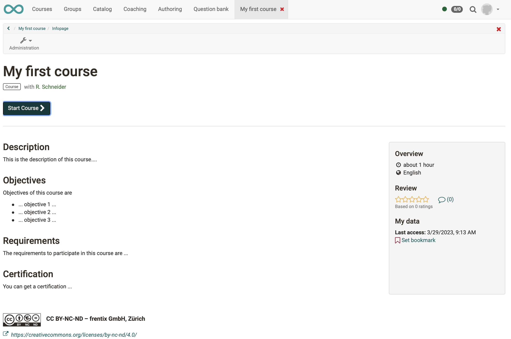
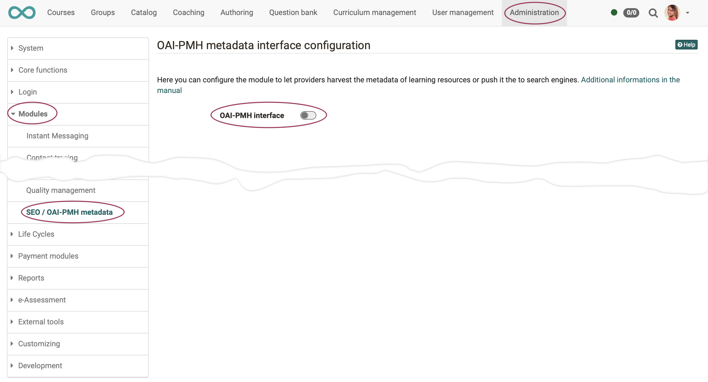
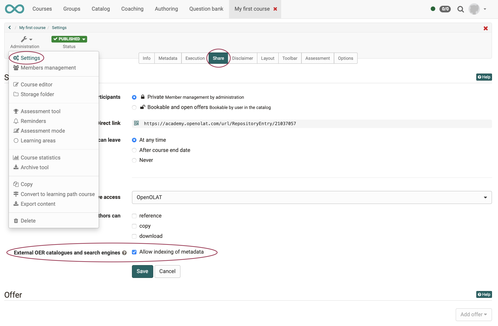
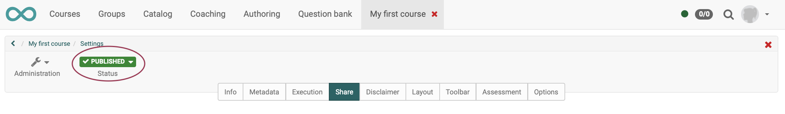
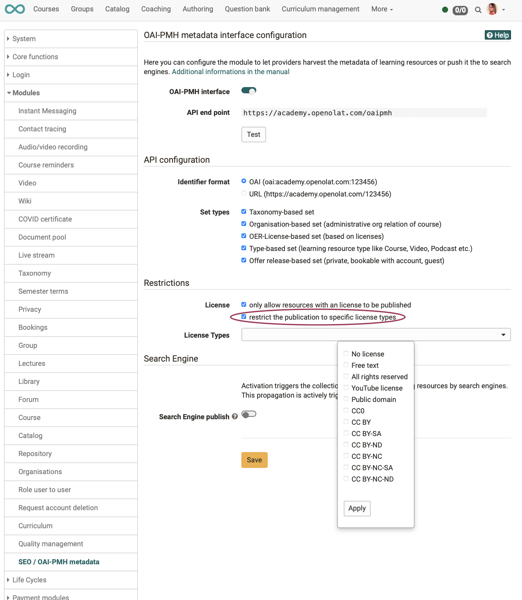
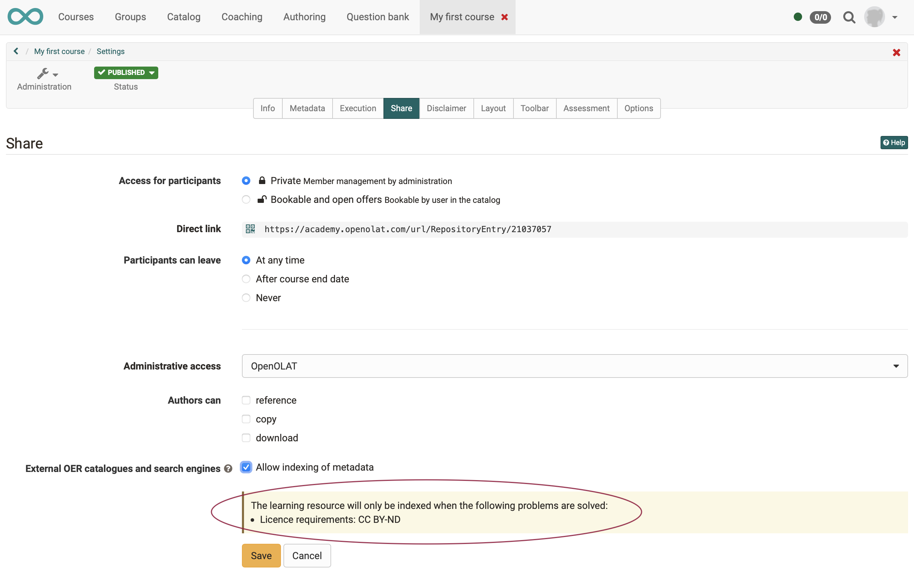
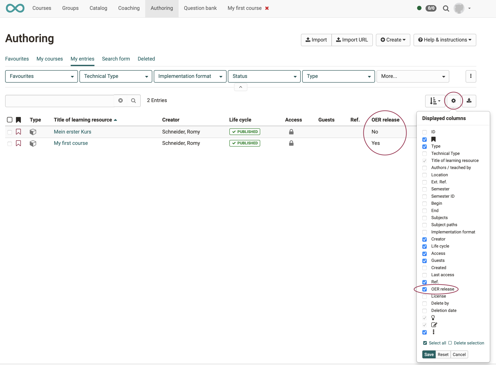
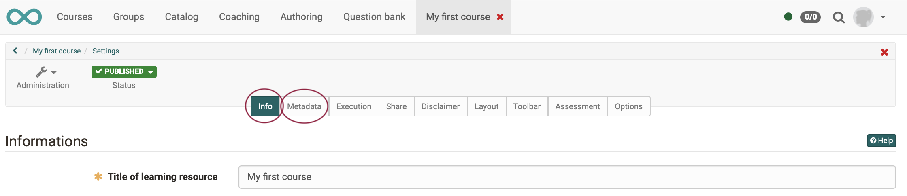

# How can I have my courses found by search engines? {: #oai_pmh} 

??? abstract "Objectives and content of this instruction"

    Normally OpenOlat is a protected space. In certain cases, however, search engines are supposed to find certain information. The following instruction explains, how OpenOlat makes this possible.

??? abstract "Target group"

    [x] Authors [ ] Coaches  [ ] Participants

    [ ] Beginners [x] Advanced users  [x] Experts

??? abstract "Expected previous knowledge"

    * You have already experience as author.

## Do search engines find all OpenOlat courses?

No. Anyone who wants to learn and work in OpenOlat must normally register. OpenOlat is externally a protected space that cannot be searched by search engines. Therefore, it must be explicitly defined what search engines are allowed to find.

In addition, there may also be the desire that search engines should not only be <b>allowed</b> to find, but <b>should find</b> certain offers if possible.

<b>Example</b>:  Certain info pages created in OpenOlat are intended to serve as advertisements and should appear in search engines to be evaluated.

## What does OpenOlat release for search engines to browse?

It is possible to set that

* all information on the <b>info page</b> of the courses and learning resources
* as long as the owners of the course / learning resource allow it
* and system administrators have made the function generally available

are transferred to search engines.

{ class="shadow lightbox" title="Info page of a course" }

## How is this function generally enabled?

System administrators switch the module on in the system administration, under: 
`Administration > Modules > SEO / OAI-PMH metadata`

By default, this module is disabled on every instance.

If OAI is enabled, the SEO settings become visible. (Enable SEO only, is not possible).

When the module is turned on, the API endpoint is available where all published resources are available via XML.

{ class="shadow lightbox" title="Module SEO / OAI-PMH metadata in the system administration" }

## How is this feature enabled for specific courses / learning resources?

(Prerequisite: General activation of the function by system administrators)

1) In order for the information to be shared with the search engines, the owners must allow this for their course / learning resource. To do so, they tick the checkbox "Allow indexing of metadata" at "External OER catalogues and search engines", under: 
`Course > Administration > Settings > Tab "Share"`

{ class="shadow lightbox" title="Share tab of the course settings" }

2) Only courses / learning resources that have the status "Published" are considered.

{ class="shadow lightbox" title="Header of a course" }

3) (Optional) It can be defined that only courses/learning resources with license are indexable. System administrators define which licenses are allowed for indexing. Authors can then only have their course/learning resource indexed if one of these licenses is selected.

Option for system administrators:

{ class="shadow lightbox" title="Restrictions section in the module SEO / OAI-PMH metadata" }

Note on the restriction for authors:

{ class="shadow lightbox" title="Share tab of the course settings" }

## How do I see in the authoring area which courses/learning resources are enabled for indexing?

In the authoring area, the <b>column "OER release" can be displayed</b> to show which courses/learning resources have their info pages released for search engines.

{ class="shadow lightbox" title="Tab My entries in the authoring area" }

## How can I contribute to search engine optimization as an author?

The information on the info pages of the courses and learning resources is recorded by the authors under the <b>settings</b> 

* in the <b>Info tab</b> and 
* the <b>Metadata tab</b>.

So the more information the authors enter here and the better the descriptions are, the better an offer will be found by search engines.

{ class="shadow lightbox" title="Course settings" }

## How do I do search engine optimization (SEO*) as a system administrator?
*Search Engine Optimization

As a system administrator, you find the options for SEO on the same page where you also switch the function on in general, in the system administration under: 
`Administration > Modules > SEO / OAI-PMH metadata`

For more information, see the administration manual: [Module OAI-PMH](../../manual_admin/administration/Modules_OAI.md)

## How does OpenOlat forward and share the data?

OpenOlat uses the OAI-PMH to pass metadata to search engines, portals or catalogs. OAI-PMH stands for "Open Archives Initiative - Protocol for Metadata Harvesting".  Further information can be found on the Open Archives website.

From OpenOlat, the data is made available at an API endpoint where it can be tapped from the outside.

A Resource Info Page is created for each Info Page. (The Resource Info Page fetches the Info Page data).

This Resource Info Page is then indexed: A search engine uses an index for searching and the Resource Info Page is integrated into this index of the search engine.

OpenOlat passes the link to the Resource Info Page to the search engine. Then the search engine searches this Resource Info Page and collects the search terms.

## Further information {: #further_information}

**Mentioned on this page** 
[Module OAI-PMH >](../../manual_admin/administration/Modules_OAI.md)

**Further reading** 
[Course settings - Tab Share >](../../manual_user/learningresources/Course_Settings_Share.md) 
[Course Settings - Tab Info >](../../manual_user/learningresources/Course_Settings_Info.md) 
[Licenses >](../../manual_admin/administration/Licenses.md)

[To the top of the page ^](#oai_pmh)
