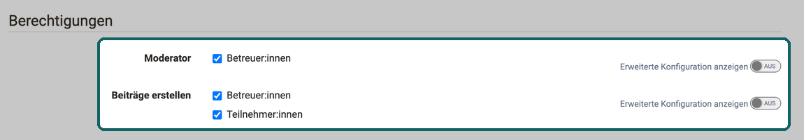
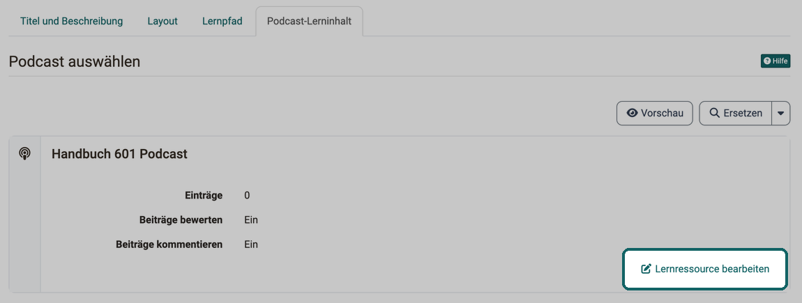
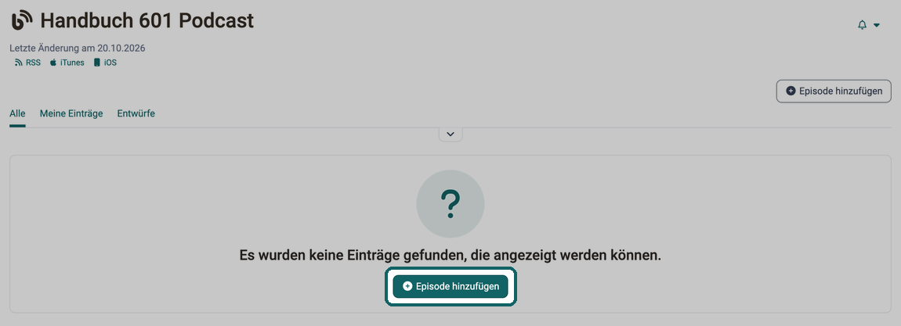
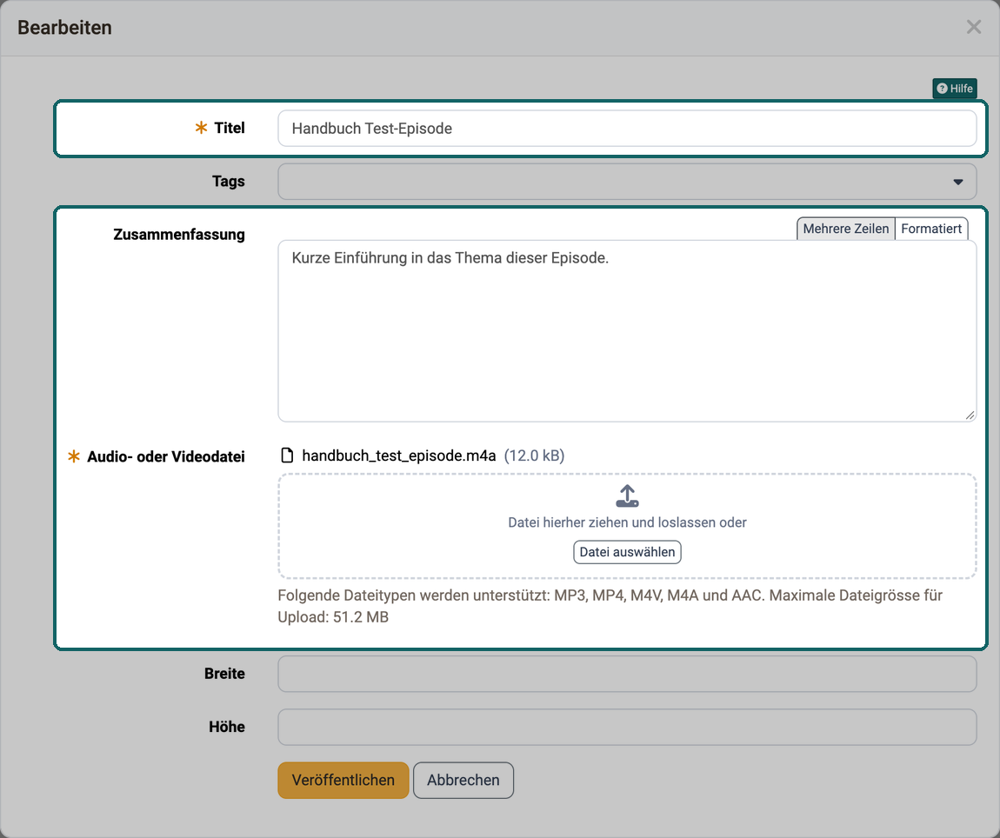

# Wie erstelle ich einen Podcast? {: #how_do_i_create_a_podcast}

Mit dieser Anleitung fügen Sie Ihrem Kurs in kurzer Zeit einen Podcast hinzu und erstellen die erste Episode.

## Voraussetzungen

<h3> a) Inhalte für den Podcast</h3>
Produzieren Sie die Audio- oder Videodatei für Ihre Podcast-Episode mit einer dafür vorgesehenen Aufnahmesoftware (z.B. [GarageBand](http://www.apple.com/ilife/garageband/ "GarageBand")) und speichern Sie sie in einem der angegebenen Formate: MP3, MP4, M4V, M4A oder AAC. Achten Sie auf die angegebene Maximalgrösse.

<h3> b) Ein OpenOlat-Kurs</h3>
Diese Anleitung geht davon aus, dass Sie den Podcast in einem Kurs einsetzen. Haben Sie noch keinen Kurs, legen Sie ihn zuerst an, wie unter [Wie erstelle ich meinen ersten OpenOlat-Kurs?](../my_first_course/my_first_course.de.md) beschrieben.

---

## Schritt 1: Kurseditor öffnen und Podcast-Kursbaustein einfügen

a) Öffnen Sie im Autorenbereich den Kurs, in den der Podcast kommt, zum Beispiel über den Tab "Meine Kurse" oder "Favoriten".

{ class="shadow lightbox" title="Tab Meine Kurse im Autorenbereich · 2026.10.20" }

b) Öffnen Sie im Kurs den Kurseditor: 
`Kurs > Administration > Kurseditor`

c) Wählen Sie im Kursmenü den Kursbaustein, unter dem der Podcast stehen soll. OpenOlat fügt neue Kursbausteine immer unterhalb des ausgewählten Kursbausteins ein.

d) Klicken Sie in der Kopfzeile des Kurseditors auf "Kursbausteine einfügen" oder nutzen Sie die Quick-Add-Funktion und wählen Sie in der Auswahlliste "Podcast".

Damit ist der Kursbaustein dem Kurs hinzugefügt.

e) Vergeben Sie im Tab "Titel und Beschreibung" einen passenden Titel und speichern Sie den Kursbaustein.

!!! info "Wichtig"

    Wenn Sie den Kurseditor bereits jetzt schliessen, zeigt das Kursmenü noch keinen Podcast, denn der Kursbaustein ist unvollständig: Es fehlt noch die Lernressource.

---

## Schritt 2: Podcast (Lernressource) erstellen

a) Wechseln Sie in den Tab "Podcast-Lerninhalt". Solange kein Podcast gewählt ist, bietet der Tab drei Wege an:

{ class="shadow lightbox" title="Tab Podcast-Lerninhalt im Kurseditor · 2026.10.20" }

* **Auswählen**: Sie verbinden den Kursbaustein mit einem Podcast, der bereits als Lernressource besteht.
* **Erstellen**: Sie legen einen neuen OpenOlat-Podcast an, in den Sie und die berechtigten Personen Episoden hochladen.
* **Per URL einbinden**: Sie binden einen externen Podcast über seinen Feed ein, siehe unten.

Einen Podcast, der Ihnen als Datei vorliegt, zum Beispiel aus einem Export, laden Sie über den Pfeil neben "Per URL einbinden" mit "Import" hoch. Ob ein Podcast ein OpenOlat-Podcast oder ein externer Podcast ist, steht beim Anlegen fest und lässt sich später nicht mehr ändern.

Im Folgenden erstellen Sie einen neuen OpenOlat-Podcast.

b) Klicken Sie auf "Erstellen".

c) Geben Sie im Dialog "Podcast erstellen" einen Titel für Ihre Podcast-Lernressource ein und bestätigen Sie mit "Erstellen".

Damit ist eine neue Podcast-Lernressource angelegt und mit dem Kursbaustein verbunden. Der Tab zeigt den Podcast nun mit der Zahl seiner Einträge und den Einstellungen "Beiträge bewerten" und "Beiträge kommentieren". Mit "Vorschau" sehen Sie sich den Podcast an, mit "Ersetzen" verbinden Sie den Kursbaustein mit einem anderen Podcast.

Einen bestehenden externen Podcast binden Sie statt mit "Erstellen" mit "Per URL einbinden" ein. Tragen Sie im Dialog im Feld "URL" die Adresse des Feeds ein und klicken Sie auf "Einbinden". Der Feed muss über das öffentliche Internet erreichbar sein, denn OpenOlat ruft ihn vom Server aus ab. Ist in der System-Administration unter `Administration > Login > Sicherheit` der Schutz "SSRF Mitigation" eingeschaltet, ruft OpenOlat keinen Feed aus dem lokalen Netz ab, etwa von einem Server im Netz Ihrer Organisation, siehe [Sicherheit](../../manual_admin/administration/Login_Security.de.md#ssrf).

!!! tip "Tipp"

    Alternativ erstellen Sie einen OpenOlat-Podcast wie jede andere Lernressource im Autorenbereich mit "Erstellen" und verbinden ihn danach im Kurseditor im Tab "Podcast-Lerninhalt" über "Auswählen" mit dem Kurs.

    So wird sichtbar, dass Lernressourcen kursübergreifend sind: Derselbe Podcast lässt sich in mehreren OpenOlat-Kursen einbinden und auch ohne Kurs verwenden.

---

## Schritt 3: Berechtigungen festlegen

a) Im Tab "Podcast-Lerninhalt" legen Sie unter "Berechtigungen" fest, wer Episoden hinzufügen und wer den Podcast moderieren darf. Für "Moderator" und "Beiträge erstellen" wählen Sie je die Rollen, zum Beispiel Betreuer:innen oder Teilnehmer:innen. Mit "Erweiterte Konfiguration anzeigen" vergeben Sie ein Recht zusätzlich an einzelne Benutzer:innen oder Gruppen, auch mit Beginn und Ende.

{ class="shadow lightbox" title="Abschnitt Berechtigungen im Tab Podcast-Lerninhalt · 2026.10.20" }

Die Berechtigung "Beiträge erstellen" erscheint nur bei einem OpenOlat-Podcast, denn in einen externen Podcast lädt niemand in OpenOlat Episoden hoch. Darüber legen Sie unter "Metadaten-Konfiguration" fest, ob der Kursbaustein Titel, Beschreibung und Bild des Podcasts anzeigt.

b) Personen mit der Berechtigung "Moderator" fügen ebenfalls Episoden hinzu. Zusätzlich bearbeiten und löschen sie Episoden anderer Personen, und sie löschen jeden Kommentar.

c) Publizieren Sie abschliessend den Kurs und schliessen Sie den Kurseditor, damit die Änderungen sichtbar werden.

---

## Schritt 4: Podcast mit Inhalt (Episoden) füllen

a) Klicken Sie im Kurseditor im Tab "Podcast-Lerninhalt" auf "Lernressource bearbeiten" ...

{ class="shadow lightbox" title="Tab Podcast-Lerninhalt mit gewähltem Podcast · 2026.10.20" }

... oder klicken Sie bei geschlossenem Kurseditor im Kurs auf den Kursbaustein Podcast.

b) Solange der Podcast keine Episoden hat, zeigt er die Meldung "Es wurden keine Einträge gefunden, die angezeigt werden können." Klicken Sie auf "Episode hinzufügen". Sie finden den Button in der leeren Liste und oben rechts.

{ class="shadow lightbox" title="Lernressource Podcast · 2026.10.20" }

c) Füllen Sie im Dialog "Bearbeiten" die Felder Ihrer Episode aus.

{ class="shadow lightbox" title="Dialog Bearbeiten für eine neue Episode · 2026.10.20" }

* Vergeben Sie einen Titel.
* Bei Bedarf wählen Sie unter "Tags" passende Tags.
* Einen Text zur Episode schreiben Sie bei Bedarf unter "Zusammenfassung".
* Unter "Audio- oder Videodatei" wählen Sie die Datei, am einfachsten ziehen Sie sie auf die Zielfläche (Drag and Drop). Ohne Datei lässt sich die Episode nicht veröffentlichen. Bei einem Video füllt OpenOlat "Breite" und "Höhe" nach dem Hochladen vor, wenn es die Grösse aus der Datei erkennt.

d) Klicken Sie am unteren Rand des Dialogs auf "Veröffentlichen".

!!! info "Wichtig"

    Weitere Episoden fügen Sie später auf dieselbe Weise oder direkt im Kurs hinzu. Personen mit der Berechtigung "Beiträge erstellen" fügen ihre Episoden im Kurs hinzu, sobald der Kurs publiziert ist.

---

## Schritt 5: Kurs publizieren und Status auf "Veröffentlicht" ändern

Gehen Sie dazu vor, wie unter [Wie erstelle ich meinen ersten OpenOlat-Kurs?](../my_first_course/my_first_course.de.md) beschrieben.

Der Podcast ist nun eingebunden und Teilnehmende können die erste Episode abspielen.

---

## Weiterführende Informationen {: #further_information}

**Auf dieser Seite erwähnt** 
[GarageBand >](http://www.apple.com/ilife/garageband/) 
[Wie erstelle ich meinen ersten OpenOlat-Kurs? >](../my_first_course/my_first_course.de.md) 
[Sicherheit >](../../manual_admin/administration/Login_Security.de.md)

**Weiterführend** 
[Kursbaustein "Podcast" >](../../manual_user/learningresources/Course_Element_Podcast.de.md) 
[Podcast konfigurieren >](../../manual_user/learningresources/Podcast_Configuration.de.md) 
[Podcasts anhören und ansehen >](../../manual_user/learningresources/Podcast_listen_and_watch.de.md)

[zum Seitenanfang ^](#how_do_i_create_a_podcast)

