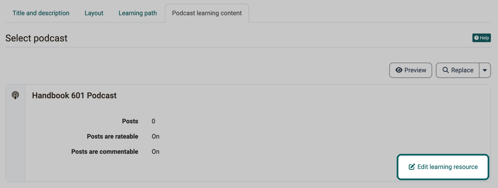
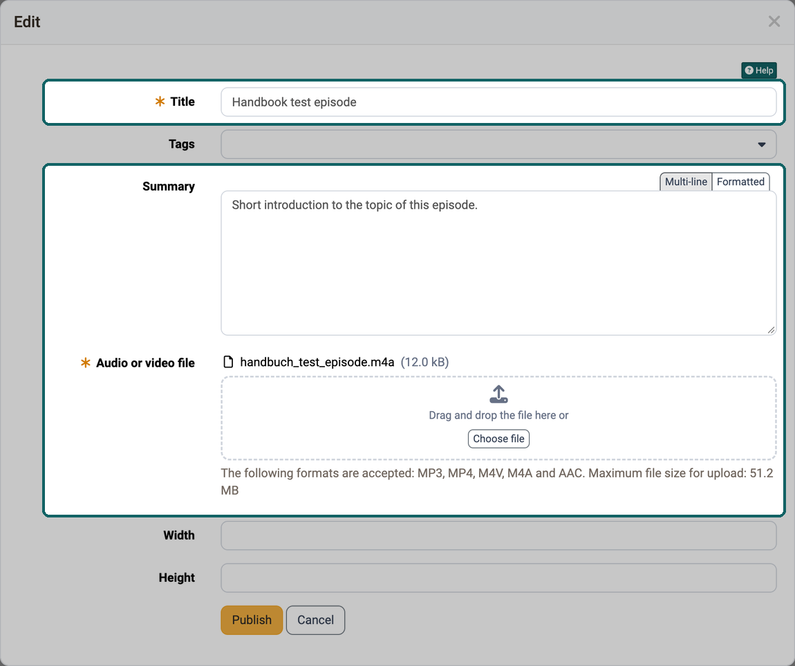

# How do I create a podcast? {: #how_do_i_create_a_podcast}

With this guide, you add a podcast to your course in a short time and create the first episode.

## Requirements

<h3> a) Content for the podcast</h3>
Produce the audio or video file for your podcast episode using a designated recording software (e.g. [GarageBand](http://www.apple.com/ilife/garageband/ "GarageBand")) and save it in one of the specified formats: MP3, MP4, M4V, M4A or AAC. Pay attention to the specified maximum size.

<h3> b) An OpenOlat course</h3>
These instructions assume that you use the podcast in a course. If you do not have a course yet, create it first as described in [How do I create my first OpenOlat course?](../my_first_course/my_first_course.md).

---

## Step 1: Open course editor and insert course element podcast

a) In Authoring, open the course in which the podcast goes, for example via the tab "My courses" or "Favourites".

{ class="shadow lightbox" title="Tab My courses in Authoring · 2026.10.20" }

b) In the course, open the course editor: 
`Course > Administration > Course editor`

c) In the course menu, select the course element below which the podcast should appear. OpenOlat always inserts new course elements below the selected course element.

d) Click "Insert course elements" in the header of the course editor or use the Quick-Add function and select "Podcast" in the selection list.

The course element has now been added to the course.

e) Assign a suitable title in the tab "Title and description" and save the course element.

!!! info "Important"

    If you close the course editor already now, the course menu shows no podcast yet, because the course element is incomplete: the learning resource is still missing.

---

## Step 2: Create a podcast (learning resource)

a) Switch to the tab "Podcast learning content". As long as no podcast is selected, the tab offers three options:

{ class="shadow lightbox" title="Tab Podcast learning content in the course editor · 2026.10.20" }

* **Select**: You connect the course element with a podcast that already exists as a learning resource.
* **Create**: You create a new OpenOlat podcast into which you and the authorised people upload episodes.
* **Embed via URL**: You embed an external podcast via its feed, see below.

A podcast that you have as a file, for example from an export, you upload with "Import" via the arrow next to "Embed via URL". Whether a podcast is an OpenOlat podcast or an external podcast is fixed when it is created and cannot be changed later.

In the following, you create a new OpenOlat podcast.

b) Click "Create".

c) In the "Create Podcast" dialog, enter a title for your podcast learning resource and confirm with "Create".

A new podcast learning resource is now created and connected with the course element. The tab now shows the podcast with the number of its posts and the settings "Posts are rateable" and "Posts are commentable". With "Preview" you look at the podcast, with "Replace" you connect the course element with another podcast.

You embed an existing external podcast with "Embed via URL" instead of "Create". In the dialog, enter the address of the feed in the "URL" field and click "Embed". The feed must be reachable via the public internet, because OpenOlat retrieves it from the server. If the "SSRF mitigation" protection is switched on in the system administration under `Administration > Login > Security`, OpenOlat does not retrieve a feed from the local network, for example from a server in the network of your organisation, see [Security](../../manual_admin/administration/Login_Security.md#ssrf).

!!! tip "Tip"

    Alternatively, you create an OpenOlat podcast like any other learning resource in Authoring with "Create" and then connect it with the course in the course editor in the tab "Podcast learning content" via "Select".

    This shows that learning resources are cross-course: the same podcast can be embedded in several OpenOlat courses and can also be used without a course.

---

## Step 3: Define user rights

a) In the tab "Podcast learning content", you define under "User rights" who may add episodes and who may moderate the podcast. For "Moderator" and "Create items" you select the roles, for example coaches or participants. With "Show advanced configuration" you additionally grant a right to individual users or groups, also with a start and an end.

{ class="shadow lightbox" title="Section User rights in the tab Podcast learning content · 2026.10.20" }

The "Create items" right only appears for an OpenOlat podcast, because nobody uploads episodes in OpenOlat into an external podcast. Above, under "Metadata config", you define whether the course element shows the title, description and image of the podcast.

b) People with the "Moderator" right also add episodes. In addition, they edit and delete episodes of other people, and they delete any comment.

c) Finally, publish the course and close the course editor so that the changes become visible.

---

## Step 4: Fill podcast with content (episodes)

a) In the course editor, click "Edit learning resource" in the tab "Podcast learning content" ...

{ class="shadow lightbox" title="Tab Podcast learning content with a selected podcast · 2026.10.20" }

... or, with the course editor closed, click the Podcast course element in the course.

b) As long as the podcast has no episodes, it shows the message "No entries were found that can be displayed." Click "Add episode". You find the button in the empty list and at the top right.

{ class="shadow lightbox" title="Podcast learning resource · 2026.10.20" }

c) Fill in the fields of your episode in the "Edit" dialog.

{ class="shadow lightbox" title="Dialog Edit for a new episode · 2026.10.20" }

* Assign a title.
* If required, select suitable tags under "Tags".
* Write a text about the episode under "Summary" if required.
* Under "Audio or video file", select the file; the easiest way is to drag and drop it onto the target area. Without a file, the episode cannot be published. For a video, OpenOlat prefills "Width" and "Height" after the upload if it recognises the size from the file.

d) Click "Publish" at the bottom of the dialog.

!!! info "Important"

    You add further episodes later the same way or directly in the course. People with the "Create items" right add their episodes in the course as soon as the course is published.

---

## Step 5: Publish course and change status to "Published"

To do this, proceed as described in [How do I create my first OpenOlat course?](../my_first_course/my_first_course.md).

The podcast is now embedded and participants can play the first episode.

---

## Further information {: #further_information}

**Mentioned on this page** 
[GarageBand >](http://www.apple.com/ilife/garageband/) 
[How do I create my first OpenOlat course? >](../my_first_course/my_first_course.md) 
[Security >](../../manual_admin/administration/Login_Security.md)

**Further reading** 
[Course Element "Podcast" >](../../manual_user/learningresources/Course_Element_Podcast.md) 
[Podcast - Configurations >](../../manual_user/learningresources/Podcast_Configuration.md) 
[Listen and watch to podcasts >](../../manual_user/learningresources/Podcast_listen_and_watch.md)

[to the top of the page ^](#how_do_i_create_a_podcast)

