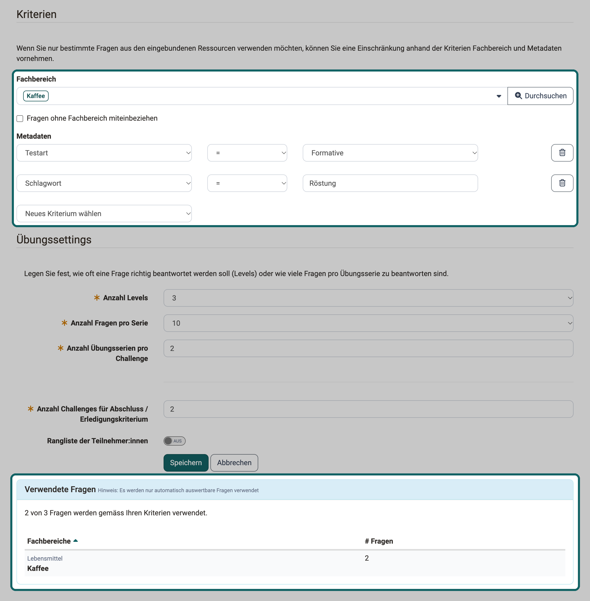

# Nutzen von Metadaten {: #question_metadata}

??? abstract "Ziel und Inhalt dieser Anleitung"

    Die Metadaten einer Frage im Fragenpool bestimmen, welche Fragen eine Übung automatisch auswählt und welche Fragen ein Suchfilter findet. Diese Anleitung zeigt, welche Angaben dafür zählen, wie Sie sie pflegen und wie Sie sie in den Suchfiltern des Fragenpools und im Kursbaustein "Übung" nutzen.

    Die Anleitung setzt die Rolle Autor:in voraus. Mit ihr zeigt die Hauptnavigation den Fragenpool und den Autorenbereich.

??? abstract "Zielgruppe"

    [x] Autor:innen [ ] Betreuer:innen  [ ] Teilnehmer:innen

    [ ] Anfänger:innen [x] Fortgeschrittene  [ ] Expert:innen

??? abstract "Erwartete Vorkenntnisse"

    * ["Wie gehe ich vor, wenn ich einen Test erstelle?"](../test_creation_procedure/test_creation_procedure.de.md)

---

Wer viele Fragen im Fragenpool sammelt, will später genau die passenden einsetzen: die Fragen eines Fachbereichs für eine Übung, die Fragen einer Stufe für einen Test. Die Metadaten verbinden die Frage mit dieser Auswahl. Die Suchfilter des Fragenpools finden Fragen anhand dieser Angaben, und der Kursbaustein "Übung" stellt daraus seine Übungsserien automatisch zusammen. Wer die Metadaten sorgfältig pflegt, bestimmt damit, welche Fragen eine Übung zieht und welche Fragen ein Filter findet.

## Diese Angaben steuern die Auswahl {: #relevant_metadata}

Fünf Angaben aus dem Bereich "Allgemein" der Metadaten wirken auf die Auswahl. An jedem Ort steht das Wort, das die Oberfläche dort zeigt:

| Metadaten der Frage | Suchfilter im Fragenpool | Kriterium im Kursbaustein "Übung" |
|---|---|---|
| "Fachbereich" | "Fachbereich" | "Fachbereich" |
| "Stufe" | "Stufe" | "Level" |
| "Schlagworte" | "Schlagworte" | "Schlagwort" |
| "Sprache" | "Sprache" | "Sprache" |
| "Testart" | "Testart" | "Testart" |

Dieselbe Angabe heisst im Fragenpool "Stufe" und im Kursbaustein "Übung" "Level". Gemeint ist in beiden Fällen die Stufe, die Sie der Frage in den Metadaten zuweisen, zum Beispiel eine Schwierigkeitsstufe. Mit den Levels der Lernkartei, die in der Übung den Lernstand der Teilnehmenden zeigen, hat dieses Kriterium nichts zu tun.

Die Felder "Fachbereich" und "Stufe" erscheinen nur, wenn Systemadministrator:innen sie für den Fragenpool eingeschaltet haben. Welche Fachbereiche und Stufen zur Wahl stehen, legen die Poolverwalter:innen fest, siehe [Fragenpool: Administration](../../manual_user/area_modules/Question_Bank_Administration.de.md).

[Zum Seitenanfang ^](#question_metadata)

## Schritt 1: Metadaten der Fragen pflegen {: #maintain_metadata}

Eine Auswahl ist nur so gut wie die Angaben an den Fragen. Pflegen Sie die Metadaten deshalb, bevor Sie nach Fragen filtern oder eine Übung einrichten.

Öffnen Sie die Frage im Fragenpool und blenden Sie die Metadaten ein: 
`Fragenpool > Mein Fragenpool > Meine Fragen > "Titel der Frage" > Metadaten > Allgemein`

Tragen Sie im Bereich "Allgemein" die Angaben ein und speichern Sie mit "OK":

* **Fachbereich:** Wählen Sie den Fachbereich aus der Taxonomie des Fragenpools.
* **Stufe:** Wählen Sie eine der Stufen, die die Poolverwalter:innen angelegt haben.
* **Schlagworte:** Schreiben Sie frei. Verwenden Sie für dasselbe Thema immer dasselbe Wort, sonst findet ein Filter oder ein Kriterium nur einen Teil der Fragen.
* **Sprache:** OpenOlat trägt beim Erstellen einer Frage das Kürzel Ihrer Sprache ein, zum Beispiel "de". Behalten Sie diese Schreibweise bei, denn das Kriterium "Sprache" der Übung vergleicht den Wert genau.
* **Testart:** Wählen Sie "Summative", "Formative" oder "Beide".

Die Felder und wann Sie sie bearbeiten dürfen, beschreibt die Seite [Fragenpool: Detailansicht einer Frage und Metadaten](../../manual_user/area_modules/Item_Detailed_View.de.md#metadata_general).

Gleiche Angaben für viele Fragen tragen Sie in einem Schritt ein: Markieren Sie die Fragen in der Liste und klicken Sie auf "Metadaten ändern". Im Dialog setzen Sie das Häkchen bei jeder Angabe, die Sie ändern wollen. Mehr dazu unter [Fragenpool: Fragen verwenden](../../manual_user/area_modules/Question_bank_possible_operations.de.md#metadata).

[Zum Seitenanfang ^](#question_metadata)

## Schritt 2: Fragen mit den Suchfiltern finden {: #search_filters}

Mit den Suchfiltern stellen Sie eine Fragenliste nach Ihren Angaben zusammen, etwa alle summativen Fragen eines Fachbereichs auf einer bestimmten Stufe. Aus dieser Liste erstellen Sie einen Test oder geben die Fragen frei.

Die Filter stehen über jeder Fragenliste des Fragenpools, zum Beispiel unter: 
`Fragenpool > Mein Fragenpool > Meine Fragen`

Die Filter "Fachbereich", "Stufe" und "Testart" sind beim Öffnen der Liste eingeblendet. Die Filter "Schlagworte" und "Sprache" holen Sie über den Button "Mehr..." rechts neben den Filtern dazu. Wählen Sie die Werte und klicken Sie auf "Übernehmen". Die Liste zeigt danach nur noch Fragen, die allen aktiven Filtern entsprechen.

Brauchen Sie dieselbe Auswahl öfter, speichern Sie sie mit "Filter speichern" unter einem eigenen Namen. OpenOlat zeigt die gespeicherte Auswahl danach oben über der Liste. Wie Filter funktionieren, beschreibt die Seite [Mit Tabellen arbeiten](../../manual_user/basic_concepts/Table_Concept.de.md). Die Suche im Fragenpool beschreibt die Seite [Fragenpool: Suchfunktion](../../manual_user/area_modules/Question_Pool_Search.de.md).

[Zum Seitenanfang ^](#question_metadata)

## Schritt 3: Fragen im Kursbaustein "Übung" automatisch auswählen {: #practice_criteria}

Der Kursbaustein "Übung" stellt seine Übungsserien selbst zusammen. Mit den Kriterien legen Sie fest, aus welchen Fragen er dabei wählt. So üben die Teilnehmenden zum Beispiel nur die Fragen eines Fachbereichs auf der Stufe, die zum Kurs passt.

Die Kriterien stehen in der Konfiguration des Kursbausteins: 
`Kurs > Administration > Kurseditor > Kursbaustein "Übung" > Tab "Konfiguration"`

1\. Binden Sie unter "Ressourcen" die Fragen ein, mit "Aus Fragenpool hinzufügen" oder "Lernressource Test hinzufügen".

2\. Wählen Sie unter "Kriterien" die Fachbereiche, aus denen die Fragen stammen sollen. Sollen auch Fragen ohne Fachbereich vorkommen, setzen Sie das Häkchen bei "Fragen ohne Fachbereich miteinbeziehen".

3\. Wählen Sie unter "Metadaten" in der Auswahlliste "Neues Kriterium wählen" eine Angabe: "Testart", "Schlagwort", "Sprache" oder "Level". Legen Sie in der neuen Zeile fest, ob die Angabe dem Wert entsprechen soll ("=") oder nicht ("!="), und geben Sie den Wert an.

{ class="shadow lightbox" title="Kursbaustein Übung im Kurseditor, Tab Konfiguration · 2026.11.02" }

4\. Prüfen Sie im Bereich "Verwendete Fragen", wie viele Fragen Ihre Kriterien erfüllen. Der Satz dort lautet zum Beispiel "12 von 40 Fragen werden gemäss Ihren Kriterien verwendet."

5\. Speichern Sie die Konfiguration und publizieren Sie den Kurs.

Beachten Sie beim Festlegen der Kriterien:

* **Mehrere Kriterien:** Kriterien zu verschiedenen Angaben gelten zusammen. Eine Frage kommt nur vor, wenn sie jedes davon erfüllt.
* **Schlagwort:** Das Kriterium trifft jede Frage, deren Schlagworte den eingegebenen Text enthalten. "Anatomie" trifft also auch eine Frage mit dem Schlagwort "Anatomie Grundlagen".
* **Sprache:** Das Kriterium vergleicht genau. Geben Sie den Wert so ein, wie er in den Metadaten der Fragen steht, zum Beispiel "de".
* **Testart:** "Beide" ist ein eigener Wert. Eine Frage mit der Testart "Beide" erfüllt das Kriterium "Testart = Summative" nicht.
* **Kriterium "!=":** Bei "Testart", "Sprache" und "Level" kommen damit auch Fragen vor, bei denen die Angabe fehlt.

Die Übung wählt die Fragen bei jeder Übungsserie neu aus. Ergänzen oder ändern Sie später die Metadaten einer Frage im Fragenpool, wirkt das ohne weiteren Schritt auf die nächste Übungsserie. Weitere Einstellungen der Übung beschreibt die Seite [Kursbaustein "Übung"](../../manual_user/learningresources/Course_Element_Practice.de.md#criteria).

[Zum Seitenanfang ^](#question_metadata)

## Weiterführende Informationen {: #further_information}

**Auf dieser Seite erwähnt** 
[Wie gehe ich vor, wenn ich einen Test erstelle? >](../test_creation_procedure/test_creation_procedure.de.md) 
[Fragenpool: Administration >](../../manual_user/area_modules/Question_Bank_Administration.de.md) 
[Fragenpool: Detailansicht einer Frage und Metadaten >](../../manual_user/area_modules/Item_Detailed_View.de.md) 
[Fragenpool: Fragen verwenden >](../../manual_user/area_modules/Question_bank_possible_operations.de.md) 
[Mit Tabellen arbeiten >](../../manual_user/basic_concepts/Table_Concept.de.md) 
[Fragenpool: Suchfunktion >](../../manual_user/area_modules/Question_Pool_Search.de.md) 
[Kursbaustein "Übung" >](../../manual_user/learningresources/Course_Element_Practice.de.md)

**Weiterführend** 
[Fragenpool: Fragen erstellen >](../../manual_user/area_modules/Question_Bank_Create_Questions.de.md) 
[Fragenpool: Fragen importieren >](../../manual_user/area_modules/Question_Bank_Import_Questions.de.md) 
[Fragenpool: Übersicht >](../../manual_user/area_modules/Question_Bank/index.de.md)

[Zum Seitenanfang ^](#question_metadata)
