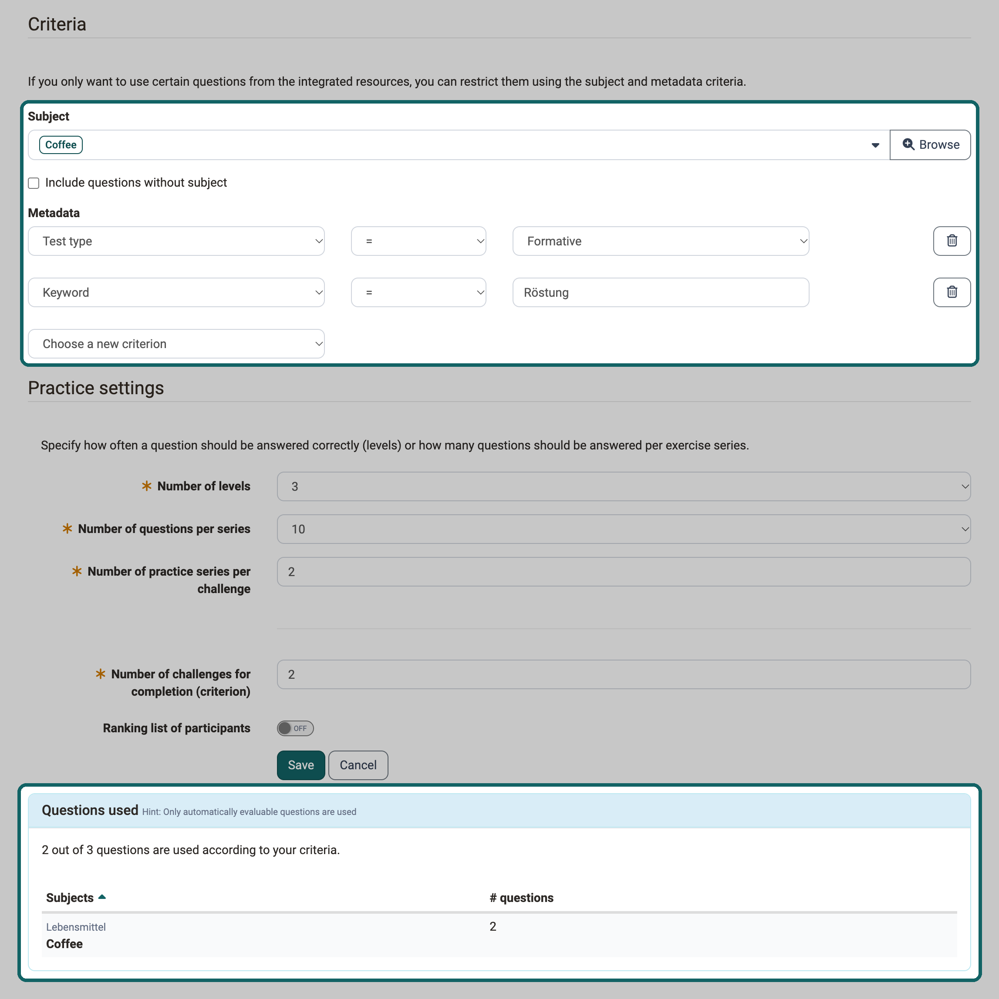

# Benefits of metadata {: #question_metadata}

??? abstract "Goal and content of these instructions"

    The metadata of a question in the question bank determine which questions a practice selects automatically and which questions a search filter finds. These instructions show which entries count, how you maintain them and how you use them in the search filters of the question bank and in the course element "Practice".

    The instructions require the role Author. With this role, the main navigation shows the question bank and Authoring.

??? abstract "Target group"

    [x] Authors [ ] Coaches  [ ] Participants

    [ ] Beginners [x] Advanced users  [ ] Experts

??? abstract "Expected previous knowledge"

    * ["How do I proceed when I create a test?"](../test_creation_procedure/test_creation_procedure.md)

---

Anyone who collects many questions in the question bank later wants to use exactly the right ones: the questions of one subject for a practice, the questions of one level for a test. The metadata connect the question with this selection. The search filters of the question bank find questions by these entries, and the course element "Practice" uses them to put together its practice series automatically. Whoever maintains the metadata carefully thereby determines which questions a practice draws and which questions a filter finds.

## These entries control the selection {: #relevant_metadata}

Five entries from the "General" section of the metadata affect the selection. Each place shows the word that the user interface uses there:

| Metadata of the question | Search filter in the question bank | Criterion in the course element "Practice" |
|---|---|---|
| "Subject" | "Subject" | "Subject" |
| "Level" | "Level" | "Level" |
| "Keywords" | "Keywords" | "Keyword" |
| "Language" | "Language" | "Language" |
| "Test type" | "Test type" | "Test type" |

The criterion "Level" in the course element "Practice" means the level that you assign to the question in its metadata, for example a difficulty level. It has nothing to do with the levels of the flashcard box, which show the learning status of the participants in the practice.

The fields "Subject" and "Level" only appear if system administrators have switched them on for the question bank. Which subjects and levels are available is set by the question bank managers, see [Question Bank: Administration](../../manual_user/area_modules/Question_Bank_Administration.md).

[To the top of the page ^](#question_metadata)

## Step 1: Maintain the metadata of the questions {: #maintain_metadata}

A selection is only as good as the entries on the questions. Therefore maintain the metadata before you filter for questions or set up a practice.

Open the question in the question bank and display the metadata: 
`Question bank > My question bank > My questions > "Title of the question" > Metadata > General`

Fill in the entries in the "General" section and save with "OK":

* **Subject:** Select the subject from the taxonomy of the question bank.
* **Level:** Select one of the levels that the question bank managers have created.
* **Keywords:** Write freely. Always use the same word for the same topic, otherwise a filter or a criterion only finds some of the questions.
* **Language:** When a question is created, OpenOlat enters the code of your language, for example "en". Keep this spelling, because the criterion "Language" of the practice compares the value exactly.
* **Test type:** Select "Summative", "Formative" or "Both".

The page [Question bank: Details of a question and metadata](../../manual_user/area_modules/Item_Detailed_View.md#metadata_general) describes the fields and when you may edit them.

You enter the same values for many questions in one step: select the questions in the list and click on "Change metadata". In the dialog, tick each entry that you want to change. More on this under [Question bank: Use questions](../../manual_user/area_modules/Question_bank_possible_operations.md#metadata).

[To the top of the page ^](#question_metadata)

## Step 2: Find questions with the search filters {: #search_filters}

With the search filters you put together a list of questions by your entries, for example all summative questions of one subject at a certain level. From this list you create a test or share the questions.

The filters are located above every question list of the question bank, for example under: 
`Question bank > My question bank > My questions`

The filters "Subject", "Level" and "Test type" are displayed when the list opens. You add the filters "Keywords" and "Language" with the button "More..." to the right of the filters. Select the values and click on "Apply". The list then only shows questions that match all active filters.

If you need the same selection more often, save it with "Save filter" under a name of its own. OpenOlat then shows the saved selection at the top above the list. The page [Working with tables](../../manual_user/basic_concepts/Table_Concept.md) describes how filters work. The page [Question Bank: Search](../../manual_user/area_modules/Question_Pool_Search.md) describes the search in the question bank.

[To the top of the page ^](#question_metadata)

## Step 3: Select questions automatically in the course element "Practice" {: #practice_criteria}

The course element "Practice" puts together its practice series itself. With the criteria you determine from which questions it selects. This way participants practise, for example, only the questions of one subject at the level that suits the course.

The criteria are located in the configuration of the course element: 
`Course > Administration > Course editor > Course element "Practice" > Tab "Configuration"`

1\. Under "Resources", integrate the questions with "Add from question bank" or "Add learning resource test".

2\. Under "Criteria", select the subjects from which the questions should come. If questions without a subject should also appear, tick "Include questions without subject".

3\. Under "Metadata", select an entry in the selection list "Choose a new criterion": "Test type", "Keyword", "Language" or "Level". In the new row, specify whether the entry should match the value ("=") or not ("!="), and enter the value.

{ class="shadow lightbox" title="Course element Practice in the course editor, tab Configuration · 2026.11.02" }

4\. In the "Questions used" section, check how many questions meet your criteria. The sentence there reads, for example, "12 out of 40 questions are used according to your criteria."

5\. Save the configuration and publish the course.

When you define the criteria, note:

* **Several criteria:** Criteria on different entries apply together. A question only appears if it meets each of them.
* **Keyword:** The criterion matches every question whose keywords contain the text entered. "Anatomy" therefore also matches a question with the keyword "Anatomy basics".
* **Language:** The criterion compares exactly. Enter the value as it appears in the metadata of the questions, for example "en".
* **Test type:** "Both" is a value of its own. A question with the test type "Both" does not meet the criterion "Test type = Summative".
* **Criterion "!=":** For "Test type", "Language" and "Level", questions without this entry also appear.

The practice selects the questions anew for every practice series. If you later add to or change the metadata of a question in the question bank, this affects the next practice series without any further step. The page [Course Element "Practice"](../../manual_user/learningresources/Course_Element_Practice.md#criteria) describes the further settings of the practice.

[To the top of the page ^](#question_metadata)

## Further information {: #further_information}

**Mentioned on this page** 
[How do I proceed when I create a test? >](../test_creation_procedure/test_creation_procedure.md) 
[Question Bank: Administration >](../../manual_user/area_modules/Question_Bank_Administration.md) 
[Question bank: Details of a question and metadata >](../../manual_user/area_modules/Item_Detailed_View.md) 
[Question bank: Use questions >](../../manual_user/area_modules/Question_bank_possible_operations.md) 
[Working with tables >](../../manual_user/basic_concepts/Table_Concept.md) 
[Question Bank: Search >](../../manual_user/area_modules/Question_Pool_Search.md) 
[Course Element "Practice" >](../../manual_user/learningresources/Course_Element_Practice.md)

**Further reading** 
[Question Bank: Create Questions >](../../manual_user/area_modules/Question_Bank_Create_Questions.md) 
[Question Bank: Import Questions >](../../manual_user/area_modules/Question_Bank_Import_Questions.md) 
[Question Bank: Overview >](../../manual_user/area_modules/Question_Bank/index.md)

[To the top of the page ^](#question_metadata)
