# Wie gehe ich vor, wenn ich einen Test erstelle? {: #test_creation_procedure}

??? abstract "Ziel und Inhalt dieser Anleitung"

    Ob Sie einen neuen Kurs aufbauen, einen Test in einen bestehenden Kurs einbinden oder Fragen zuerst im Fragenpool sammeln: Für jede dieser Ausgangslagen zeigt diese Anleitung einen eigenen Weg zum fertigen Test. Vergleichen Sie die drei Wege und wählen Sie den, der zu Ihrer Situation passt.

    Alle drei Wege setzen die Rolle Autor:in voraus. Mit ihr zeigt die Hauptnavigation den Autorenbereich und den Fragenpool.

??? abstract "Zielgruppe"

    [x] Anfänger:innen [x] Fortgeschrittene  [ ] Expert:innen

??? abstract "Erwartete Vorkenntnisse"

    * ["Wie erstelle ich meinen ersten OpenOlat-Kurs?"](../my_first_course/my_first_course.de.md)

---

## Das Zusammenwirken der Bestandteile

Ein Test in OpenOlat besteht aus mehreren Bestandteilen, die ineinandergreifen. Wenn Sie sie auseinanderhalten, finden Sie jede Einstellung am richtigen Ort.

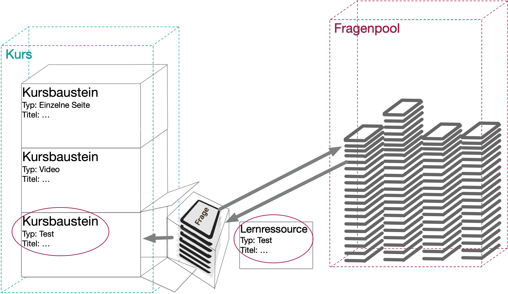{ class="lightbox" title="Kurs, Kursbaustein, Lernressource und Fragenpool" }

**Kurs:**  Sie setzen ihn im Kurseditor aus Kursbausteinen zusammen.

**Kursbaustein:**  Die meisten Kursbausteine sind Behälter, in die Sie eine Lernressource einfügen. In den Kursbaustein "Test" fügen Sie zum Beispiel eine Lernressource "Test" ein. Halten Sie diese beiden "Tests" auseinander: Den Kursbaustein konfigurieren Sie im Kurseditor, die Lernressource im Testeditor.

**Fragen:**  Eine Test-Lernressource besteht aus einzelnen Fragen verschiedener Fragetypen, zum Beispiel Single Choice oder Multiple Choice.

**Fragenpool:**  Im Fragenpool sammeln Sie einzelne Fragen, um sie in mehreren Tests zu verwenden. Beim Erstellen einer Test-Lernressource übernehmen Sie vorhandene Fragen aus dem Fragenpool, OpenOlat kopiert sie dabei in den Test. Weitere Fragen erstellen Sie bei Bedarf direkt in der Lernressource.  
Eine in der Lernressource erstellte Frage gibt es nur in dieser Test-Lernressource. Für die Mehrfachnutzung übernehmen Sie sie im Testeditor mit "Zum Pool exportieren" in den Fragenpool.

 

Jeder dieser Bestandteile hat eigene Einstellungen (Konfigurationen). Einen Test konfigurieren Sie deshalb auf vier Ebenen. Kurs und Test-Lernressource öffnen Sie im Autorenbereich, die Klickwege unten beginnen beim geöffneten Kurs oder Test.

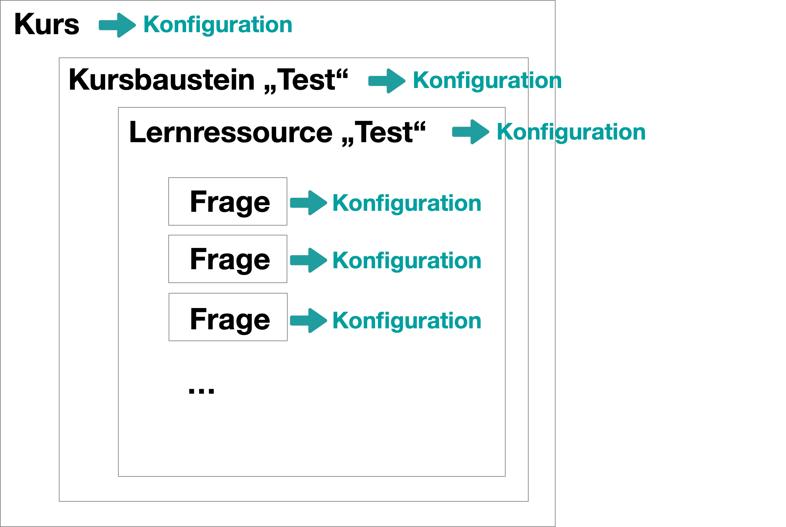{ width=450px class="lightbox" title="Konfigurationsebenen eines Tests" }

**Konfiguration des Kurses:** 
`Kurs > Administration > Einstellungen`

**Konfiguration des Kursbausteins:** 
`Kurs > Administration > Kurseditor > "Kursbaustein" > Tabs des Kursbausteins`

**Konfiguration der Lernressource:** 
`Test-Lernressource > Administration > Einstellungen`

**Konfiguration einer Frage:** 
`Test-Lernressource > Administration > Testeditor > "Frage" in der Baumstruktur > Tabs der Frage`

 

:octicons-device-camera-video-24: **Video-Einführung**: [Funktionsprinzipien](<https://www.youtube.com/embed/M-JkSAFN298>){:target="_blank"}

:octicons-device-camera-video-24: **Video-Einführung**: [Kurse erstellen und bearbeiten](<https://www.youtube.com/embed/SfOSyDG0qvE>){:target="_blank"}

:octicons-device-camera-video-24: **Video-Einführung**: [Überblick Testing](<https://www.youtube.com/embed/fkqH41-8CaI>){:target="_blank"}

:octicons-device-camera-video-24: **Video-Einführung**: [Wie funktionieren Tests in OpenOlat?](<https://www.youtube.com/embed/M0p3UKaEOlg>){:target="_blank"}

 

---

## Vorgehen Möglichkeit 1

Beginnen Sie ganz von vorn, noch ohne Kurs und ohne Fragen, führt dieser Weg in vier Etappen vom neuen Kurs zum fertigen Test. 

 

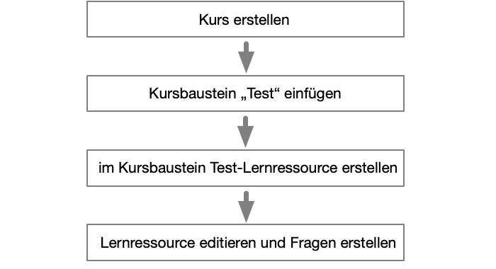{ class="lightbox" title="Vorgehen Möglichkeit 1" }

 

> <h3>Kurs erstellen</h3>

 

!!! note "Hinweis"

    Haben Sie noch keinen Kurs erstellt, führt Sie die Anleitung ["Wie erstelle ich meinen ersten OpenOlat-Kurs?"](../my_first_course/my_first_course.de.md) Schritt für Schritt durch.

1\. Erstellen Sie einen neuen Kurs über `Autorenbereich > Erstellen > Kurs`.

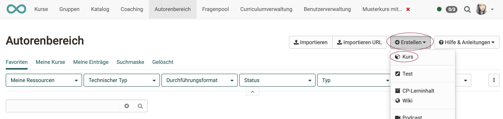{ class="lightbox" title="Autorenbereich" }

2\. Geben Sie im Dialog "Kurs erstellen" einen Titel ein und legen Sie erste Einstellungen des Kurses fest. Wählen Sie unter "Kursdesign" das passende Design, zum Beispiel "Mit Lernpfad".

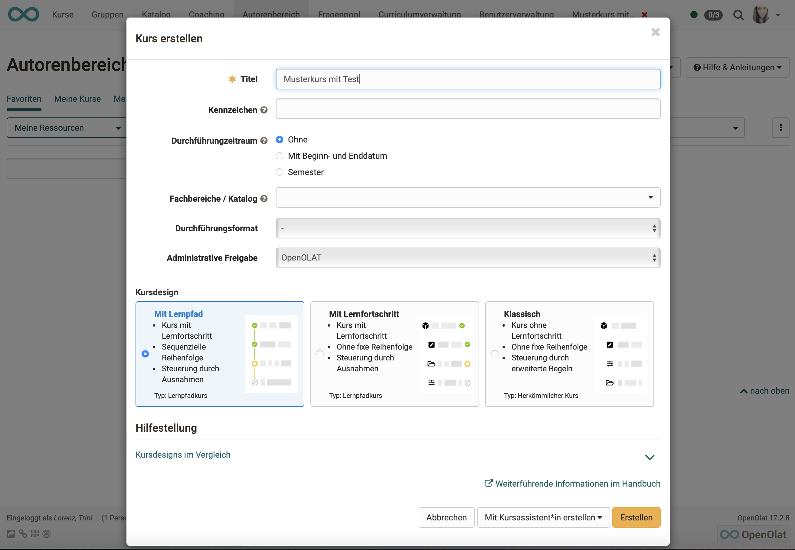{ class="lightbox" title="Dialog Kurs erstellen" }

3\. Soll ein Assistent Sie durch die weitere Einrichtung führen, klicken Sie statt auf "Erstellen" auf "Mit Kursassistent:in erstellen" und wählen "Einfacher Kurs" oder "Prüfungskurs". 
Ein Prüfungskurs ist ein normaler Kurs, wahlweise Lernpfadkurs oder herkömmlicher Kurs. Sein Assistent richtet in einem Durchgang die Prüfung mit dem Test ein, auf Wunsch auch Nachprüfung, Zertifikat, Betreuer:innen und Teilnehmer:innen. Das spart Ihnen später Arbeit.

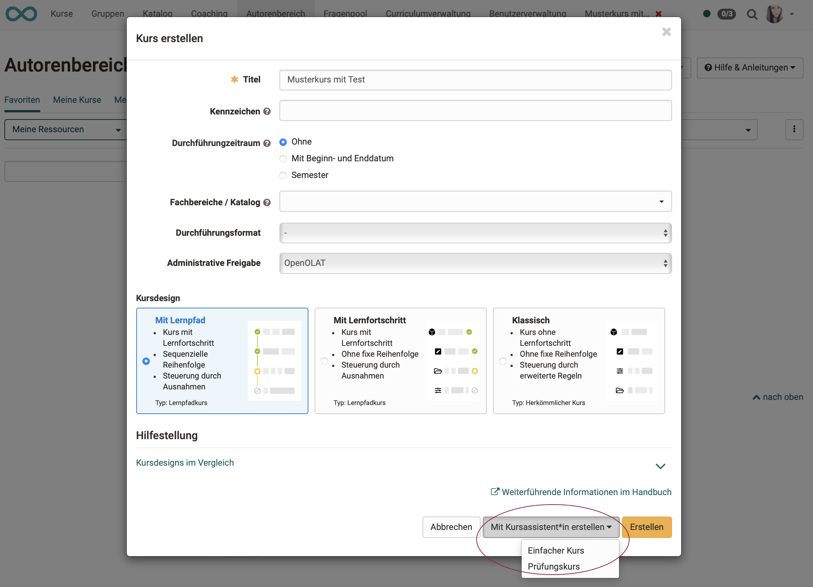{ class="lightbox" title="Dialog Kurs erstellen mit Kursassistent:in" }

4\. Klicken Sie auf "Erstellen". OpenOlat öffnet danach die Einstellungen des Kurses (Konfiguration des Kurses).

!!! tip "Tipp"

    Alle Angaben ausser dem Kursdesign passen Sie auch später unter `Kurs > Administration > Einstellungen` an.

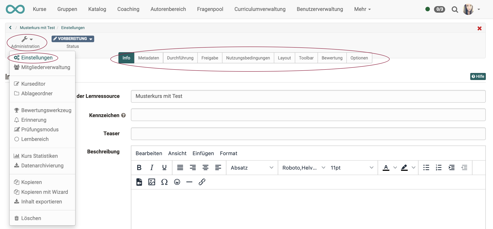{ class="lightbox" title="Einstellungen des Kurses" }

 

> <h3>Kursbaustein "Test" einfügen</h3>

 

5\. Öffnen Sie den Kurseditor über `Kurs > Administration > Kurseditor`. Klicken Sie auf "Kursbausteine einfügen" und wählen Sie den Typ "Test" oder "Selbsttest". OpenOlat fügt einen Kursbaustein dieses Typs in den Kurs ein.

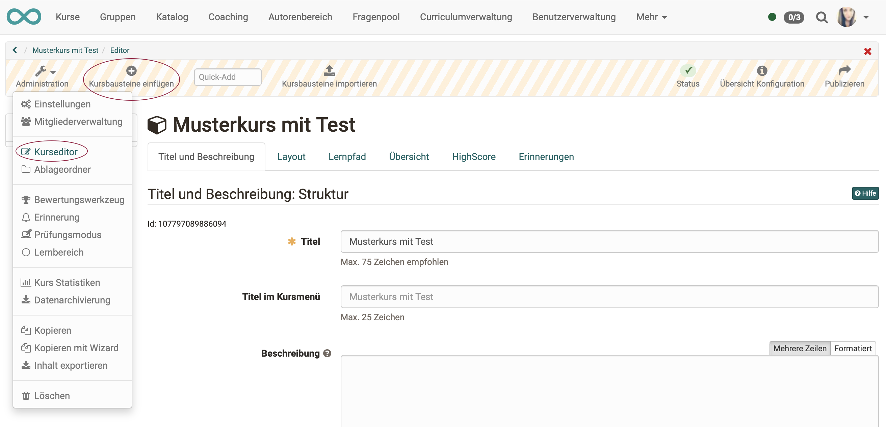{ class="lightbox" title="Kurseditor" }

 

> <h3>im Kursbaustein Test-Lernressource erstellen</h3>

 

6\. Klicken Sie links im Kursmenü auf den neuen Kursbaustein.

7\. Öffnen Sie rechts den Tab "Test-Konfiguration", beim Selbsttest "Selbsttest-Konfiguration", und klicken Sie auf "Erstellen". So entsteht eine neue Test-Lernressource, die direkt mit dem Kursbaustein verbunden ist.

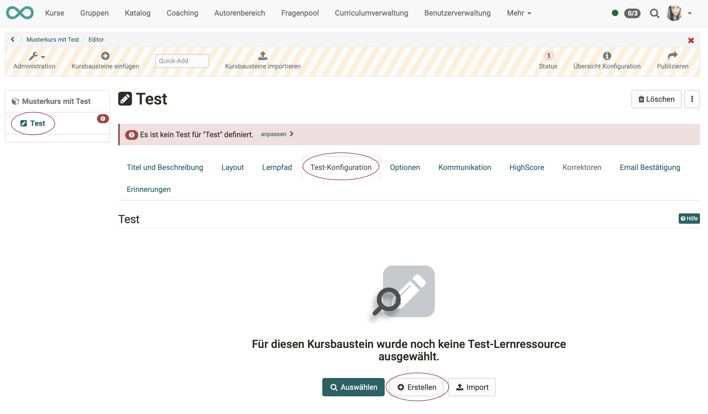{ class="lightbox" title="Kursbaustein Test im Kurseditor" }

8\. Geben Sie im Dialog "Test erstellen" einen Titel für die Test-Lernressource ein und klicken Sie auf "Erstellen".

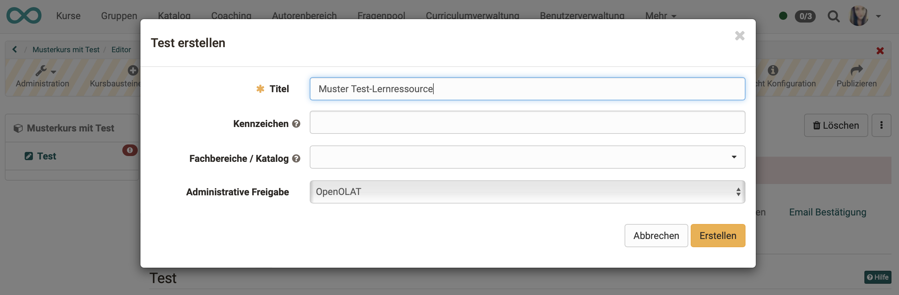{ class="lightbox" title="Dialog Test erstellen" }

 

> <h3>Lernressource editieren und Fragen erstellen</h3>

 

9\. Der Tab "Test-Konfiguration" zeigt jetzt die neue Test-Lernressource. Mit "Lernressource bearbeiten" öffnen Sie sie, um Fragen zu ergänzen.

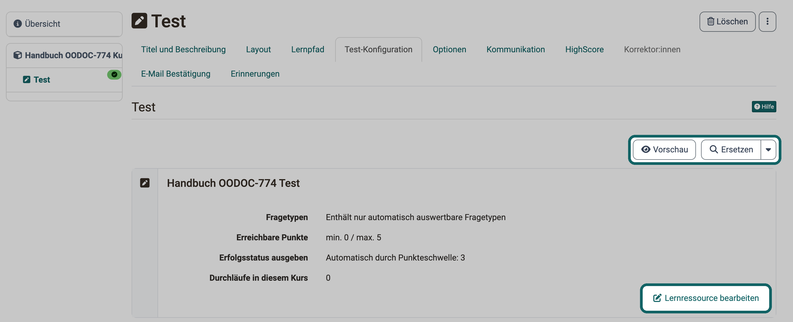{ class="shadow lightbox" title="Tab Test-Konfiguration im Kursbaustein Test · 2026.11.10" }

10\. Eine neue Test-Lernressource enthält bereits eine Single-Choice-Frage. Verwenden Sie sie als Muster, passen Sie sie an oder löschen Sie sie.

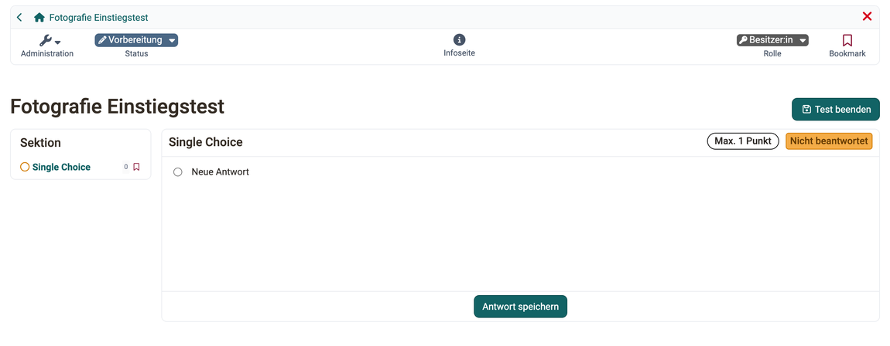{ class="lightbox" title="Test-Lernressource · 2026.09.28" }

11\. Öffnen Sie den Testeditor über `Test-Lernressource > Administration > Testeditor`. Der Testeditor gehört zur Lernressource, den Kurs bearbeiten Sie weiterhin im Kurseditor.

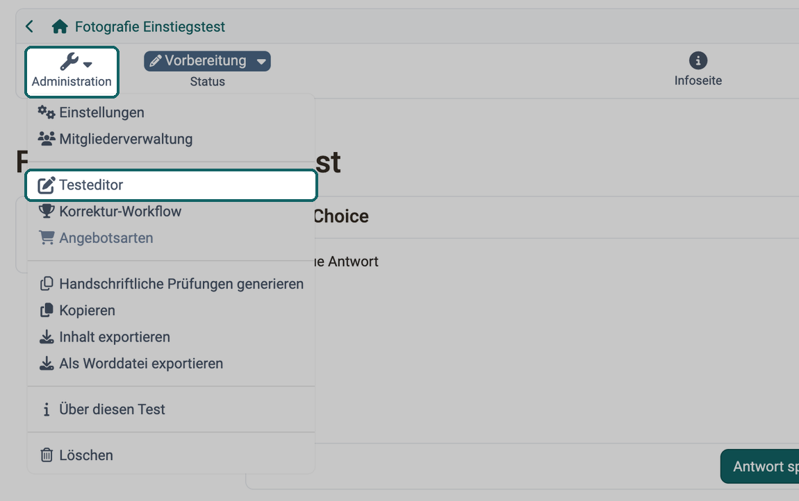{ class="lightbox" title="Menü Administration einer Test-Lernressource · 2026.09.28" }

12\. Klicken Sie auf "Elemente hinzufügen" und wählen Sie den passenden Fragetyp, zum Beispiel "Multiple Choice".

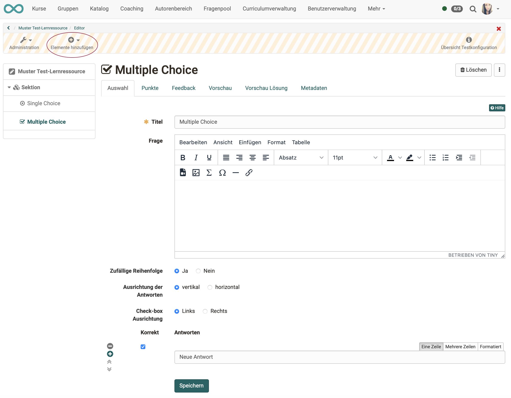{ class="lightbox" title="Testeditor" }

13\. Geben Sie im Tab "Auswahl" den Titel der Frage, die Fragestellung und die möglichen Antworten ein. Weitere Antworten ergänzen Sie über das Pluszeichen.

14\. Im Tab "Punkte" legen Sie die Bewertungsmethode und die Punktzahl fest.

15\. Im Tab "Feedback" hinterlegen Sie bei Bedarf Rückmeldungen zur Frage. Im Tab "Vorschau" prüfen Sie die Frage.

Weitere Fragen fügen Sie nach demselben Prinzip hinzu, die Einstellungen unterscheiden sich je nach Fragetyp. Mit Sektionen oder [Test-Parts](../../manual_user/learningresources/Configure_tests.de.md#testpart) gliedern Sie den Test weiter.

!!! warning "Achtung"

    Überlegen Sie sich vor dem Erstellen, welcher Fragetyp Ihren Zweck am besten erfüllt. Den Fragetyp einer erstellten Frage können Sie nachträglich nicht mehr ändern.

!!! tip "Tipp"

    Brauchen Sie mehrere Fragen mit denselben Antworten, etwa einer Skala von 1 bis 5, kopieren Sie eine fertige Frage: Im Testeditor wählen Sie dazu im Menü mit den drei Punkten "Duplizieren". Danach passen Sie nur noch die Fragestellung an.

 

---

## Vorgehen Möglichkeit 2

Besteht der Kurs schon und kennen Sie sich als Autor:in etwas aus, beginnen Sie mit der Lernressource "Test" und binden sie danach in den Kurs ein.

 

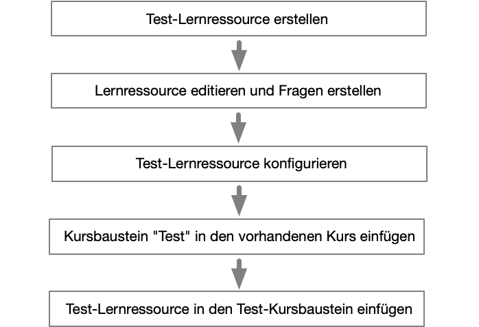{ class="lightbox" title="Vorgehen Möglichkeit 2" }

 

> <h3>Test-Lernressource erstellen</h3>

 

1\. Erstellen Sie eine Test-Lernressource über `Autorenbereich > Erstellen > Test`.

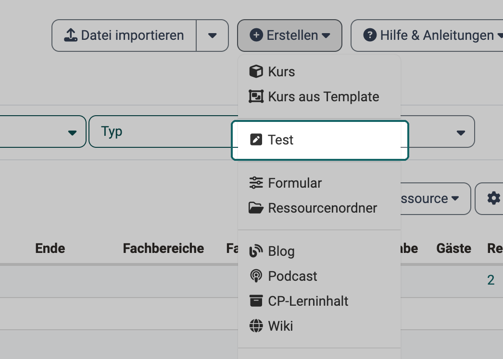{ class="shadow lightbox" title="Menü Erstellen im Autorenbereich · 2026.11.10" }

2\. Geben Sie im Dialog "Test erstellen" den Titel des Tests ein und klicken Sie auf "Erstellen".

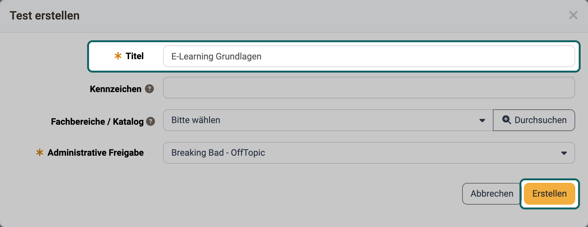{ class="shadow lightbox" title="Dialog Test erstellen · 2026.11.10" }

3\. OpenOlat öffnet danach die Einstellungen der Test-Lernressource. Legen Sie in den Tabs bei Bedarf weitere Einstellungen fest.

Dieselben Einstellungen passen Sie auch später unter `Test-Lernressource > Administration > Einstellungen` an.

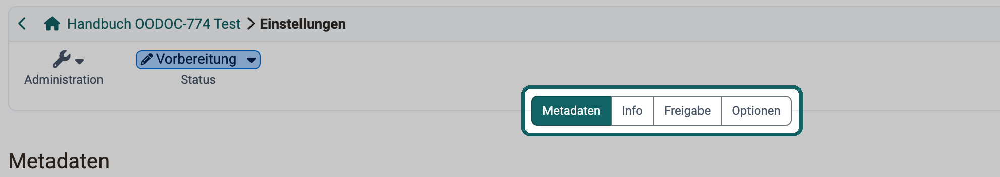{ class="shadow lightbox" title="Einstellungen der Test-Lernressource · 2026.11.10" }

:octicons-device-camera-video-24: **Video-Einführung**: [Test-Lernressource erstellen](<https://www.youtube.com/embed/WUs-upCf2tQ>){:target="_blank"}

 

> <h3>Lernressource editieren und Fragen erstellen</h3>

 

4\. Öffnen Sie den Testeditor über `Test-Lernressource > Administration > Testeditor`.

{ class="shadow lightbox" title="Menü Administration einer Test-Lernressource · 2026.09.28" }

5\. Klicken Sie auf "Elemente hinzufügen" und wählen Sie den passenden Fragetyp, zum Beispiel "Multiple Choice".

6\. Geben Sie im Tab "Auswahl" den Titel der Frage, die Fragestellung und die möglichen Antworten ein. Weitere Antworten ergänzen Sie über das Pluszeichen.

7\. Im Tab "Punkte" legen Sie die Bewertungsmethode und die Punktzahl fest.

8\. Im Tab "Feedback" hinterlegen Sie bei Bedarf Rückmeldungen zur Frage. Im Tab "Vorschau" prüfen Sie die Frage.

Weitere Fragen fügen Sie nach demselben Prinzip hinzu, die Einstellungen unterscheiden sich je nach Fragetyp. Mit Sektionen oder [Test-Parts](../../manual_user/learningresources/Configure_tests.de.md#testpart) gliedern Sie den Test weiter.

:octicons-device-camera-video-24: **Video-Einführung**: [Fragen erstellen](<https://www.youtube.com/embed/2ZrINPQ6tYw>){:target="_blank"}

!!! info "Wichtig"

    Eine neue Test-Lernressource enthält bereits eine Single-Choice-Frage. Bearbeiten oder löschen Sie diese Frage, damit sie nicht ungewollt im Test bleibt.

!!! warning "Achtung"

    Überlegen Sie sich vor dem Erstellen, welcher Fragetyp Ihren Zweck am besten erfüllt. Den Fragetyp einer erstellten Frage können Sie nachträglich nicht mehr ändern.

!!! tip "Tipp"

    Brauchen Sie mehrere Fragen mit denselben Antworten, etwa einer Skala von 1 bis 5, kopieren Sie eine fertige Frage: Im Testeditor wählen Sie dazu im Menü mit den drei Punkten "Duplizieren". Danach passen Sie nur noch die Fragestellung an.

 

> <h3>Test-Lernressource konfigurieren</h3>

 

9\. Klicken Sie im Testeditor links auf das oberste Element, den Titel des Tests. Rechts erscheinen die Tabs mit den Einstellungen für den ganzen Test.

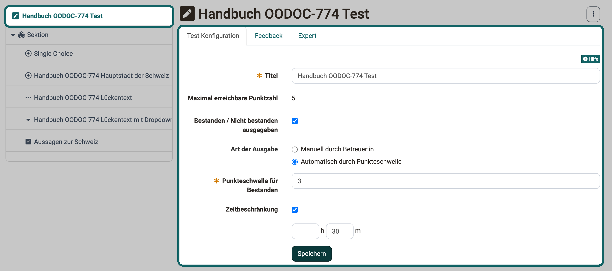{ class="shadow lightbox" title="Tab Test Konfiguration im Testeditor · 2026.11.10" }

10\. **Test Konfiguration:** Legen Sie fest, ab wie vielen Punkten der Test bestanden ist und ob eine Zeitbeschränkung gilt.

Im Tab "Feedback" hinterlegen Sie bei Bedarf eine allgemeine Rückmeldung für bestandene und für nicht bestandene Tests. Sie gilt, wenn OpenOlat das Bestehen automatisch über die Punkteschwelle ausgibt.

11\. **Expert:** Legen Sie weitere Details des Testablaufs fest, zum Beispiel die Navigation oder die Anzeige von Lösungen.

12\. Zum Schluss verlassen Sie den Testeditor mit einem Klick auf den Titel des Tests in der Krümelnavigation.

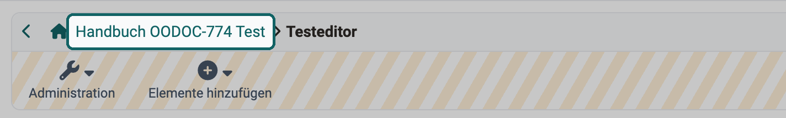{ class="shadow lightbox" title="Krümelnavigation im Testeditor · 2026.11.10" }

:octicons-device-camera-video-24: **Video-Einführung**: [Kursbausteine konfigurieren](<https://www.youtube.com/embed/SAkzzoOQEoQ>){:target="_blank"}

!!! tip "Tipp"

    Feedback hinterlegen Sie für einzelne Fragen im Tab "Feedback" der Frage und für den ganzen Test im Tab "Feedback" des obersten Elements.

 

> <h3>Kursbaustein "Test" in den vorhandenen Kurs einfügen</h3>

 

13\. Öffnen Sie im Autorenbereich den Kurs, in den der Test gehört. Ihre Kurse finden Sie in den Tabs "Meine Kurse" und "Meine Einträge".

14\. Öffnen Sie den Kurseditor über `Kurs > Administration > Kurseditor`. Klicken Sie auf "Kursbausteine einfügen" und wählen Sie den Typ "Test" oder "Selbsttest".

 

> <h3>Test-Lernressource in den Test-Kursbaustein einfügen</h3>

 

15\. Öffnen Sie im neuen Kursbaustein den Tab "Test-Konfiguration" und klicken Sie auf "Auswählen". 
Im Dialog "Test-Lernressource auswählen" wählen Sie den vorbereiteten Test.

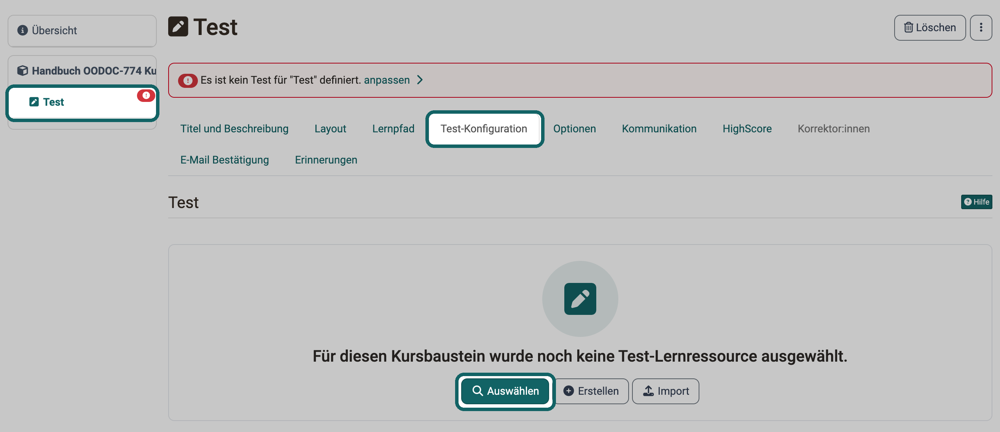{ class="shadow lightbox" title="Tab Test-Konfiguration im Kursbaustein Test · 2026.11.10" }

16\. Der Tab "Test-Konfiguration" zeigt nun den eingebundenen Test. Mit "Vorschau" sehen Sie ihn an, mit "Lernressource bearbeiten" öffnen Sie ihn zum Bearbeiten. Sobald Teilnehmende den Test gestartet haben, ist die Bearbeitung begrenzt.

{ class="shadow lightbox" title="Tab Test-Konfiguration mit eingebundenem Test · 2026.11.10" }

17\. Konfigurieren Sie bei Bedarf die weiteren Tabs des Kursbausteins. Einen Teil der Einstellungen der Test-Lernressource übersteuern Sie hier für diesen Kurs. Das lohnt sich, wenn Sie dieselbe Test-Lernressource in verschiedenen Kursen verwenden.

18\. Damit Teilnehmende den Test bearbeiten können, publizieren Sie den Kurs. Schliessen Sie dazu den Kurseditor, zum Beispiel mit einem Klick auf den Namen des Kurses in der Krümelnavigation, und wählen Sie im folgenden Dialog "Manuell publizieren" oder "Automatisch publizieren".

Alternativ klicken Sie im Kurseditor rechts in der Toolbar auf "Publizieren" oder schliessen den Kurseditor über das kleine rote Kreuz rechts oben.

19\. Setzen Sie danach den Status des Kurses auf "Veröffentlicht", damit Teilnehmende den Test bearbeiten können. 
Wer Zugang erhält, bestimmen Sie unter `Kurs > Administration > Mitgliederverwaltung`.

20\. Sobald Testergebnisse vorliegen, bewerten Betreuer:innen die Teilnehmenden im Bewertungswerkzeug. Beim Selbsttest entfällt dieser Schritt. 
Wie das geht, beschreibt die Seite [Tests bewerten](../../manual_user/learningresources/Assessing_tests.de.md).

 

---

## Vorgehen Möglichkeit 3

Teilen Sie sich die Arbeit mit Kolleg:innen und erstellen Sie als Fachexpert:in Fragen, die in mehreren Tests zum Einsatz kommen? 
Dann beginnen Sie im Fragenpool: Die Fragen dort stehen für jeden Test bereit, in den Sie sie übernehmen.

 

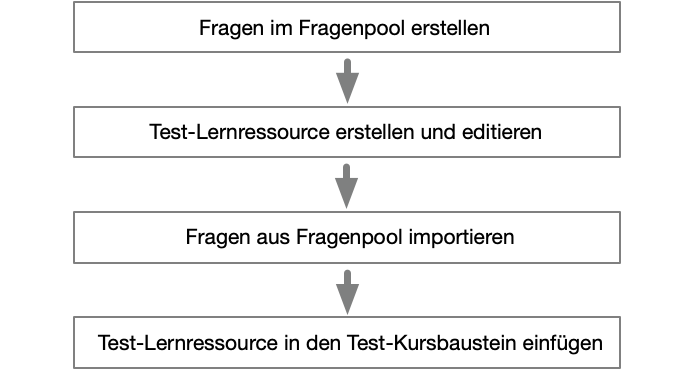{ class="lightbox" title="Vorgehen Möglichkeit 3" }

 

> <h3>Fragen im Fragenpool erstellen</h3>

 

1\. Öffnen Sie den Fragenpool in der Hauptnavigation. Mit der Rolle Autor:in steht er dort neben dem Autorenbereich.

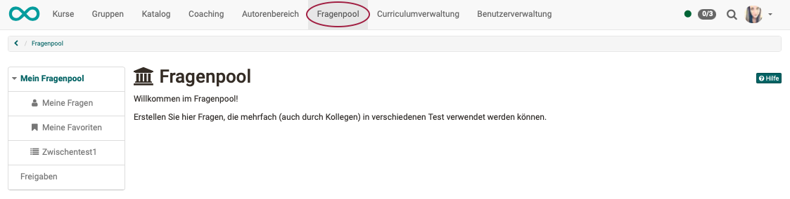{ class="lightbox" title="Fragenpool in der Hauptnavigation" }

2\. Wählen Sie unter "Mein Fragenpool" den Eintrag "Meine Fragen" und klicken Sie auf "Frage erstellen". Geben Sie einen Titel ein und wählen Sie unter "Fragetyp" den passenden Typ, zum Beispiel "Multiple Choice".

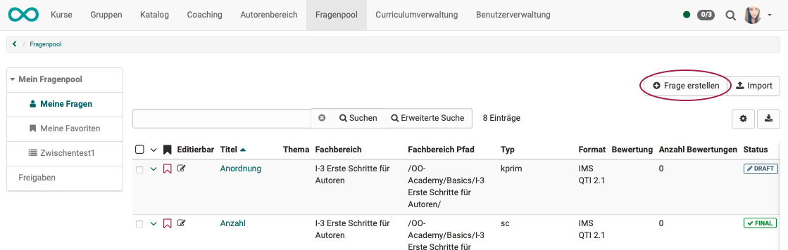{ class="lightbox" title="Fragenpool" }

3\. Geben Sie im Tab "Auswahl" den Titel der Frage, die Fragestellung und die möglichen Antworten ein. Weitere Antworten ergänzen Sie über das Pluszeichen.

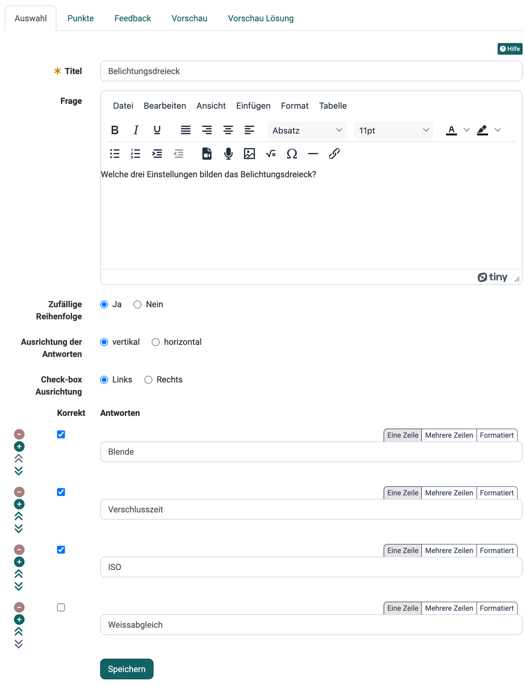{ class="lightbox" title="Frage im Fragenpool · 2026.09.28" }

4\. Im Tab "Punkte" legen Sie die Bewertungsmethode und die Punktzahl fest.

5\. Im Tab "Feedback" hinterlegen Sie bei Bedarf Rückmeldungen zur Frage. Im Tab "Vorschau" prüfen Sie die Frage.

Weitere Fragen erstellen Sie nach demselben Prinzip, die Einstellungen unterscheiden sich je nach Fragetyp.

!!! warning "Achtung"

    Überlegen Sie sich vor dem Erstellen, welcher Fragetyp Ihren Zweck am besten erfüllt. Den Fragetyp einer erstellten Frage können Sie nachträglich nicht mehr ändern.

!!! tip "Tipp"

    Brauchen Sie mehrere Fragen mit denselben Antworten, etwa einer Skala von 1 bis 5, kopieren Sie eine fertige Frage und passen Sie nur noch die Fragestellung an.

Damit Sie die Fragen später über die Suchfilter wiederfinden und der Kursbaustein "Übung" sie automatisch auswählt, pflegen Sie zu jeder Frage im Fragenpool die Metadaten, etwa Fachbereich, Stufe und Schlagworte. Wie das geht, zeigt die Anleitung [Nutzen von Metadaten](../question_metadata/question_metadata.de.md).

 

> <h3>Test-Lernressource erstellen und editieren</h3>

 

6\. Erstellen Sie eine Test-Lernressource über `Autorenbereich > Erstellen > Test`.

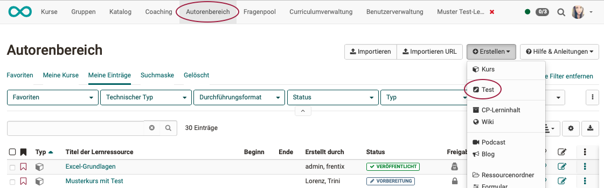{ class="lightbox" title="Autorenbereich" }

!!! note "Hinweis"

    Die neue Test-Lernressource finden Sie im Autorenbereich im Tab "Meine Einträge", denn der Tab "Meine Kurse" listet nur Kurse. In der Spalte "Typ" erkennen Sie sie am Symbol für Test-Lernressourcen.
    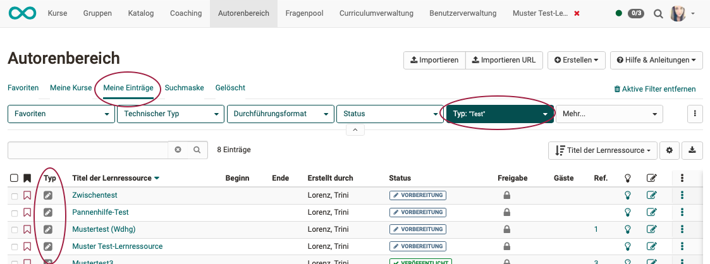{ class="lightbox" title="Tab Meine Einträge im Autorenbereich" }

7\. Öffnen Sie den Testeditor über `Test-Lernressource > Administration > Testeditor`.

{ class="lightbox" title="Menü Administration einer Test-Lernressource · 2026.09.28" }

8\. Den Testeditor erkennen Sie an der schraffierten Kopfzeile. Unter "Elemente hinzufügen" fügen Sie hier neue Fragen hinzu.

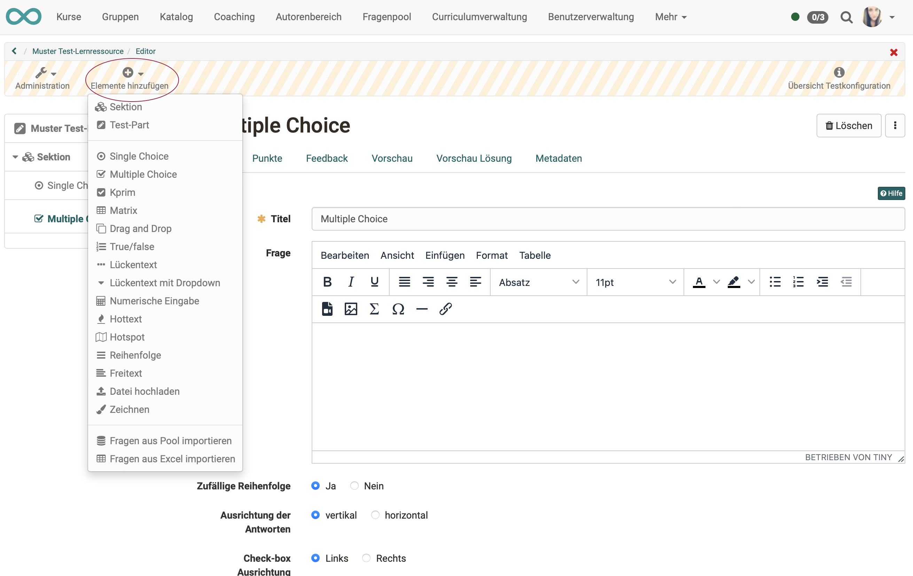{ class="lightbox" title="Testeditor" }

 

> <h3>Fragen aus Fragenpool importieren</h3>

 

9\. Ihre Fragen aus dem Fragenpool übernehmen Sie im selben Menü mit "Fragen aus Pool importieren". OpenOlat kopiert sie in den Test; dort sind sie zunächst schreibgeschützt. Wie Sie eine solche Frage bearbeiten, steht unter [Fragen aus dem Fragenpool verwenden](../../manual_user/learningresources/Test_editor_QTI_2.1/index.de.md#questions_from_pool).

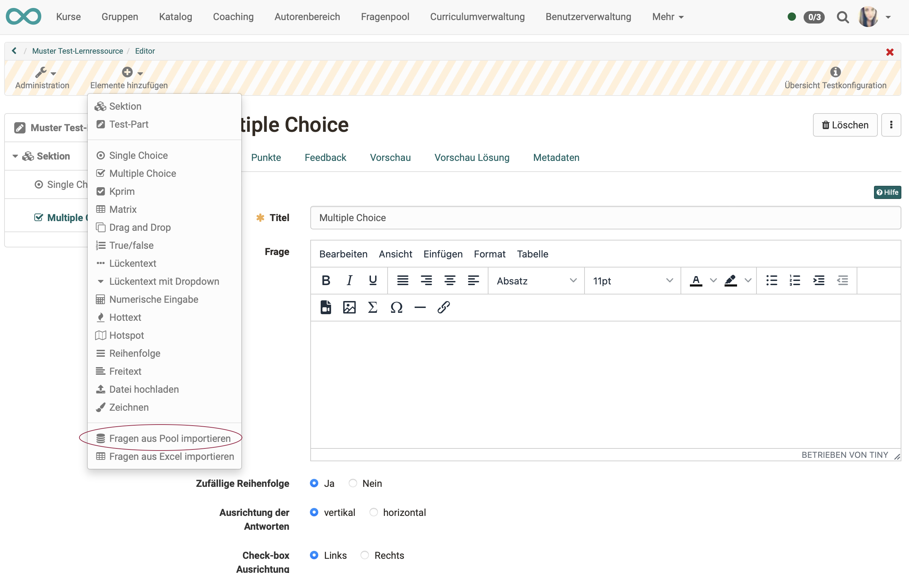{ class="lightbox" title="Menü Elemente hinzufügen im Testeditor" }

10\. Der Dialog "Fragen auswählen" zeigt Ihre Fragen unter "Meine Favoriten" und "Meine Fragen", je nach Konfiguration auch unter "Meine Listen" und "Meine Shares". Ein Klick auf den Titel einer Frage fügt sie direkt ein. Für mehrere Fragen setzen Sie die Häkchen und klicken auf "Auswählen".

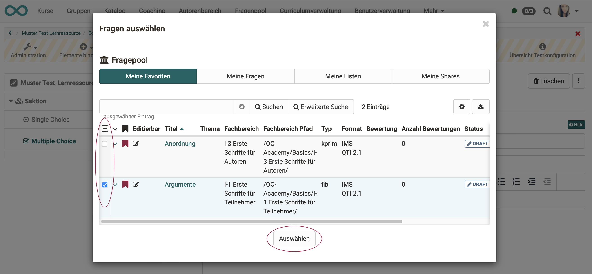{ class="lightbox" title="Dialog Fragen auswählen" }

11\. Mit Sektionen oder [Test-Parts](../../manual_user/learningresources/Configure_tests.de.md#testpart) gliedern Sie die Fragen im Test bei Bedarf weiter. Sind alle Fragen in der Test-Lernressource, verlassen Sie den Testeditor.

 

> <h3>Test-Lernressource in den Test-Kursbaustein einfügen</h3>

 

12\. Öffnen Sie im Autorenbereich den Kurs, in den die Test-Lernressource gehört. Ihre Kurse finden Sie in den Tabs "Meine Kurse" und "Meine Einträge".

13\. Öffnen Sie den Kurseditor über `Kurs > Administration > Kurseditor`. Klicken Sie auf "Kursbausteine einfügen" und wählen Sie den Typ "Test" oder "Selbsttest".

14\. Öffnen Sie im neuen Kursbaustein den Tab "Test-Konfiguration" und klicken Sie auf "Auswählen". 
Im Dialog "Test-Lernressource auswählen" wählen Sie den vorbereiteten Test.

15\. Der Tab "Test-Konfiguration" zeigt nun den eingebundenen Test. Mit "Vorschau" sehen Sie ihn an, mit "Lernressource bearbeiten" öffnen Sie ihn zum Bearbeiten. Sobald Teilnehmende den Test gestartet haben, ist die Bearbeitung begrenzt.

16\. Konfigurieren Sie bei Bedarf die weiteren Tabs des Kursbausteins. Einen Teil der Einstellungen der Test-Lernressource übersteuern Sie hier für diesen Kurs. Das lohnt sich, wenn Sie dieselbe Test-Lernressource in verschiedenen Kursen verwenden.

17\. Damit Teilnehmende den Test bearbeiten können, publizieren Sie den Kurs. Schliessen Sie dazu den Kurseditor, zum Beispiel mit einem Klick auf den Namen des Kurses in der Krümelnavigation, und wählen Sie im folgenden Dialog "Manuell publizieren" oder "Automatisch publizieren".

Alternativ klicken Sie im Kurseditor rechts in der Toolbar auf "Publizieren" oder schliessen den Kurseditor über das kleine rote Kreuz rechts oben.

18\. Setzen Sie danach den Status des Kurses auf "Veröffentlicht", damit Teilnehmende den Test bearbeiten können. 
Wer Zugang erhält, bestimmen Sie unter `Kurs > Administration > Mitgliederverwaltung`.

19\. Sobald Testergebnisse vorliegen, bewerten Betreuer:innen die Teilnehmenden im Bewertungswerkzeug. Beim Selbsttest entfällt dieser Schritt. 
Wie das geht, beschreibt die Seite [Tests bewerten](../../manual_user/learningresources/Assessing_tests.de.md).

 

---

## Checkliste {: #checklist}

Bevor Teilnehmende den Test bearbeiten, prüfen Sie diese Punkte:

- [x] Kurs vorhanden?

- [x] Kursbaustein "Test" oder "Selbsttest" vorhanden?

- [x] Lernressource "Test" erstellt?

- [x] Vorhandene Fragen aus dem Fragenpool in die Lernressource übernommen?

- [x] Zusätzliche Fragen in der Lernressource erstellt?

- [x] Test-Lernressource konfiguriert?

- [x] Test-Kursbaustein konfiguriert?

- [x] Kurs publiziert und Status "Veröffentlicht" gesetzt?

---

## Weiterführende Informationen {: #further_information}

**Auf dieser Seite erwähnt** 
[Wie erstelle ich meinen ersten OpenOlat-Kurs? >](../my_first_course/my_first_course.de.md) 
[Test konfigurieren >](../../manual_user/learningresources/Configure_tests.de.md) 
[Tests bewerten >](../../manual_user/learningresources/Assessing_tests.de.md) 
[Nutzen von Metadaten >](../question_metadata/question_metadata.de.md) 
[Testeditor >](../../manual_user/learningresources/Test_editor_QTI_2.1/index.de.md)

**Weiterführend** 
[Kursbaustein "Test" >](../../manual_user/learningresources/Course_Element_Test/index.de.md) 
[Fragenpool: Übersicht >](../../manual_user/area_modules/Question_Bank/index.de.md) 
[Wie wechsle ich einen Test aus? >](../exchange_tests/exchange_tests.de.md)

**youtube** 
[Funktionsprinzipien](<https://www.youtube.com/embed/M-JkSAFN298>) 
[Kurse erstellen und bearbeiten](<https://www.youtube.com/embed/SfOSyDG0qvE>) 
[Überblick Testing](<https://www.youtube.com/embed/fkqH41-8CaI>) 
[Wie funktionieren Tests in OpenOlat?](<https://www.youtube.com/embed/M0p3UKaEOlg>) 
[Test-Lernressource erstellen](<https://www.youtube.com/embed/WUs-upCf2tQ>) 
[Fragen erstellen](<https://www.youtube.com/embed/2ZrINPQ6tYw>) 
[Kursbausteine konfigurieren](<https://www.youtube.com/embed/SAkzzoOQEoQ>) 
[Tests erstellen/bearbeiten](<https://www.youtube.com/embed/eNNdDdQDlfs>)

[Zum Seitenanfang ^](#test_creation_procedure)
