# How do I proceed when I create a test? {: #test_creation_procedure}

??? abstract "Objectives and content of this instruction"

    Whether you build a new course, add a test to an existing course or first collect questions in the question bank: for each of these starting points, these instructions show a separate way to the finished test. Compare the three ways and choose the one that fits your situation.

    All three ways require the role Author. With this role, the main navigation shows Authoring and the question bank.

??? abstract "Target group"

    [x] Beginners [x] Advanced users  [ ] Experts

??? abstract "Expected previous knowledge"

    * ["How do I create my first OpenOlat course?"](../my_first_course/my_first_course.md)

---

## The interaction of the components

A test in OpenOlat consists of several components that work together. If you keep them apart, you find every setting in the right place.

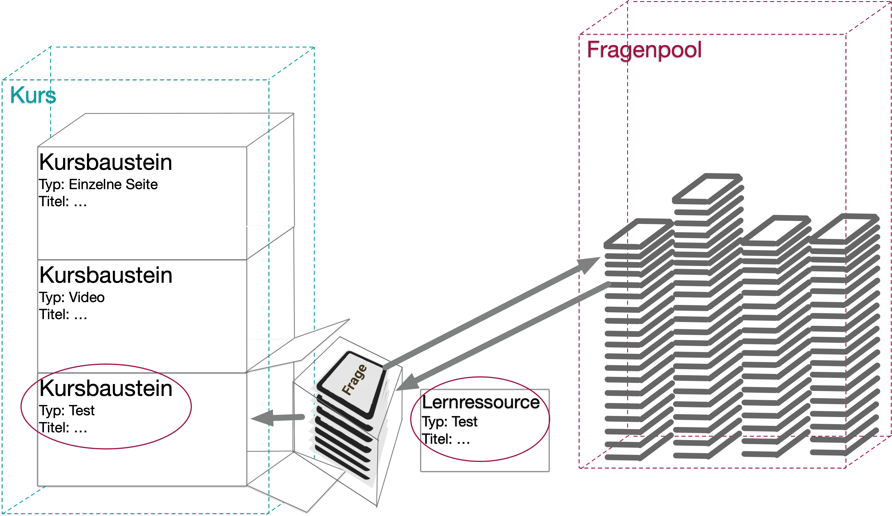{ class="lightbox" title="Course, course element, learning resource and question bank" }

**Course:**  You assemble it from course elements in the course editor.

**Course element:**  Most course elements are containers into which you insert a learning resource. For example, you insert a learning resource "Test" into the course element "Test". Keep these two "Tests" apart: you configure the course element in the course editor and the learning resource in the test editor.

**Questions:**  A test learning resource consists of individual questions of different question types, for example single choice or multiple choice.

**Question bank:**  In the question bank you collect individual questions to use them in several tests. When you create a test learning resource, you adopt existing questions from the question bank, and OpenOlat copies them into the test. You create additional questions directly in the learning resource if required.  
A question created in the learning resource only exists in this test learning resource. For multiple use, you transfer it to the question bank in the test editor with "Export to pool".

 

Each of these components has its own settings (configurations). You therefore configure a test on four levels. You open the course and the test learning resource in Authoring; the click paths below start at the opened course or test.

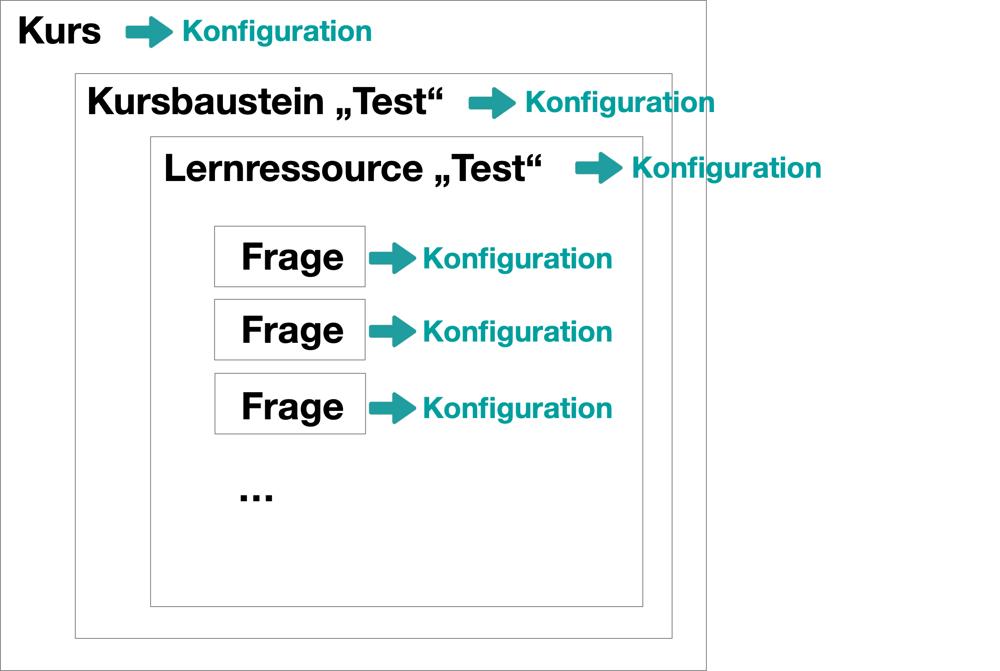{ width=450px class="lightbox" title="Configuration levels of a test" }

**Configuration of the course:** 
`Course > Administration > Settings`

**Configuration of the course element:** 
`Course > Administration > Course editor > "Course element" > Tabs of the course element`

**Configuration of the learning resource:** 
`Test learning resource > Administration > Settings`

**Configuration of a question:** 
`Test learning resource > Administration > Test editor > "Question" in the tree structure > Tabs of the question`

 

:octicons-device-camera-video-24: **Video introduction (German)**: [Funktionsprinzipien](<https://www.youtube.com/embed/M-JkSAFN298>){:target="_blank"}

:octicons-device-camera-video-24: **Video introduction (German)**: [Kurse erstellen und bearbeiten](<https://www.youtube.com/embed/SfOSyDG0qvE>){:target="_blank"}

:octicons-device-camera-video-24: **Video introduction (German)**: [Überblick Testing](<https://www.youtube.com/embed/fkqH41-8CaI>){:target="_blank"}

:octicons-device-camera-video-24: **Video introduction (German)**: [Wie funktionieren Tests in OpenOlat?](<https://www.youtube.com/embed/M0p3UKaEOlg>){:target="_blank"}

 

---

## Procedure Option 1

If you start from scratch, without a course and without questions, this way leads you in four stages from the new course to the finished test. 

 

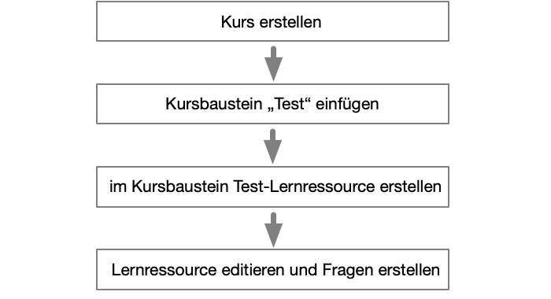{ class="lightbox" title="Procedure option 1" }

 

> <h3>Create a course</h3>

 

!!! note "Note"

    If you have not created a course yet, the instructions ["How do I create my first OpenOlat course?"](../my_first_course/my_first_course.md) guide you step by step.

1\. Create a new course via `Authoring > Create > Course`.

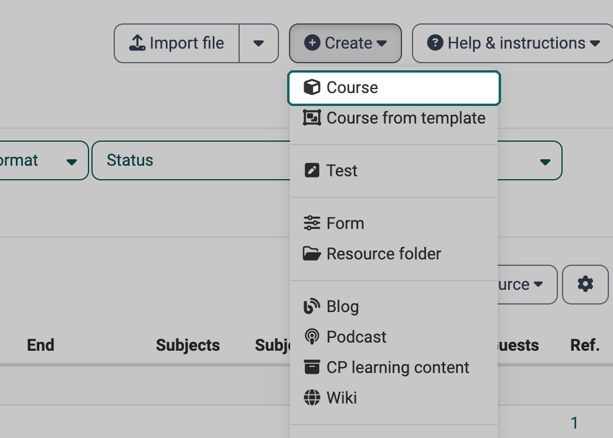{ class="shadow lightbox" title="Create menu in Authoring · 2026.11.10" }

2\. In the "Create course" dialog, enter a title and define initial settings of the course. Under "Course design", select the appropriate design, for example "With learning path".

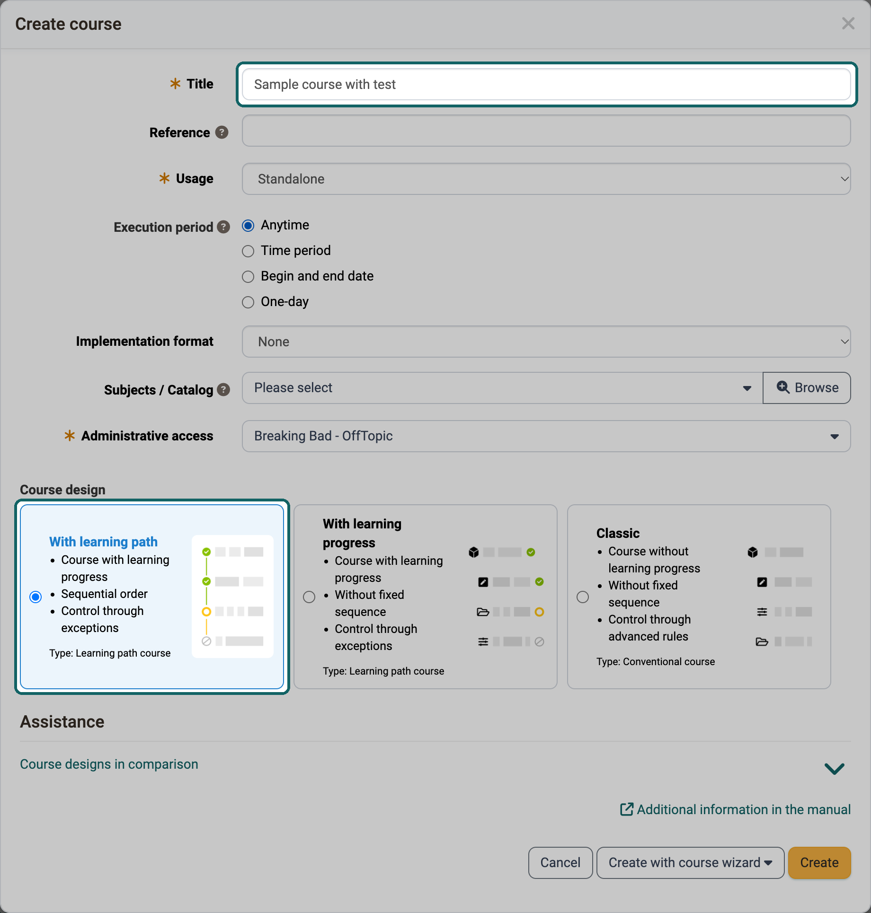{ class="shadow lightbox" title="Dialog Create course · 2026.11.10" }

3\. If you want a wizard to guide you through the further setup, click "Create with course wizard" instead of "Create" and select "Simple course" or "Exam course". 
An exam course is a normal course, either a learning path course or a conventional course. Its wizard sets up the exam with the test in one pass, and on request also the re-exam, the certificate, coaches and participants. This saves you work later.

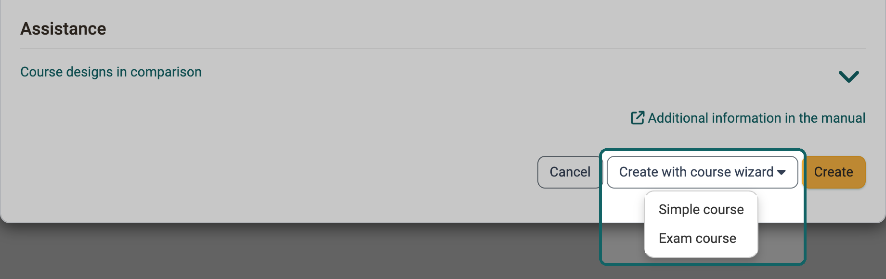{ class="shadow lightbox" title="Dialog Create course with course wizard · 2026.11.10" }

4\. Click "Create". OpenOlat then opens the settings of the course (configuration of the course).

!!! tip "Tip"

    You can also adjust all details except the course design later under `Course > Administration > Settings`.

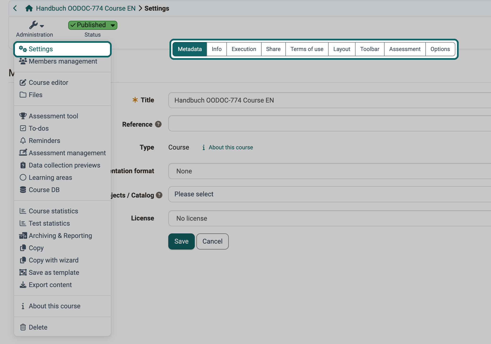{ class="shadow lightbox" title="Settings of the course · 2026.11.10" }

 

> <h3>Insert course element "Test"</h3>

 

5\. Open the course editor via `Course > Administration > Course editor`. Click "Insert course elements" and select the type "Test" or "Self-test". OpenOlat inserts a course element of this type into the course.

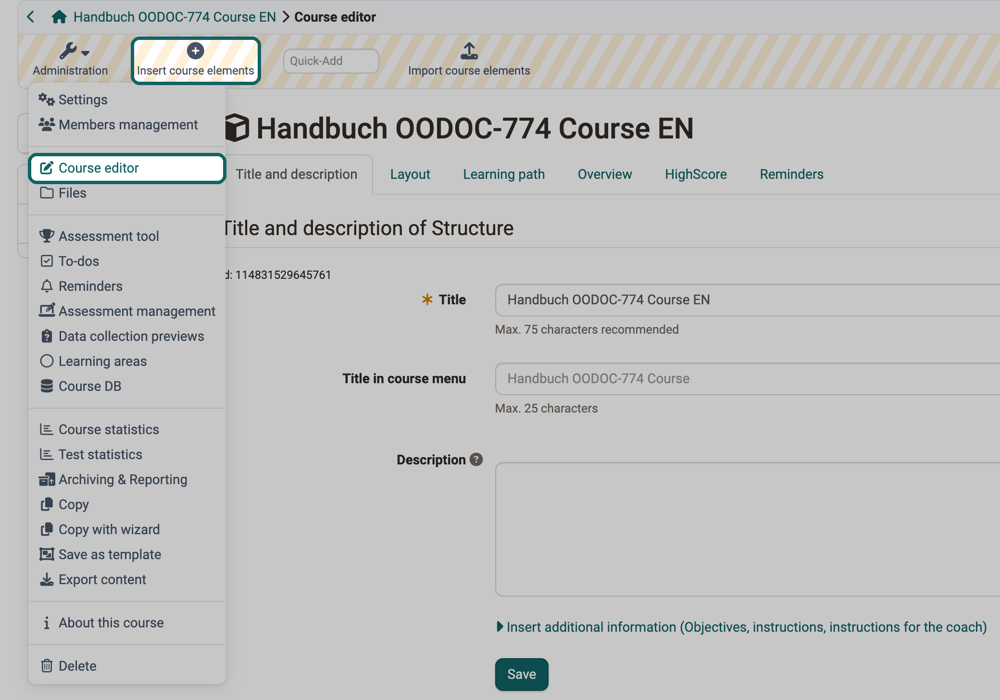{ class="shadow lightbox" title="Course editor · 2026.11.10" }

 

> <h3>Create a test learning resource within the course element</h3>

 

6\. Click the new course element in the course menu on the left.

7\. On the right, open the "Test configuration" tab, for a self-test "Self-test configuration", and click "Create". This creates a new test learning resource that is directly linked to the course element.

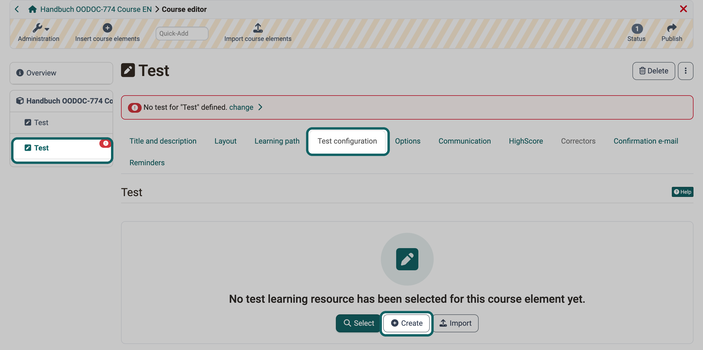{ class="shadow lightbox" title="Course element Test in the course editor · 2026.11.10" }

8\. In the "Create test" dialog, enter a title for the test learning resource and click "Create".

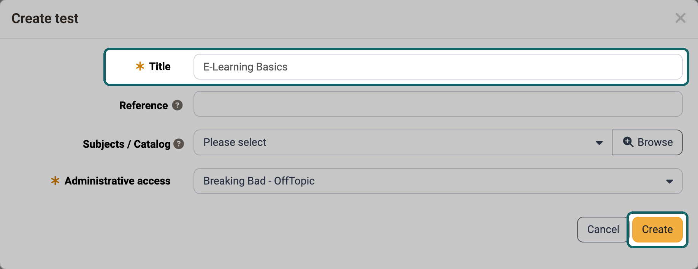{ class="shadow lightbox" title="Dialog Create test · 2026.11.10" }

 

> <h3>Edit learning resource and create questions</h3>

 

9\. The "Test configuration" tab now shows the new test learning resource. With "Edit learning resource" you open it to add questions.

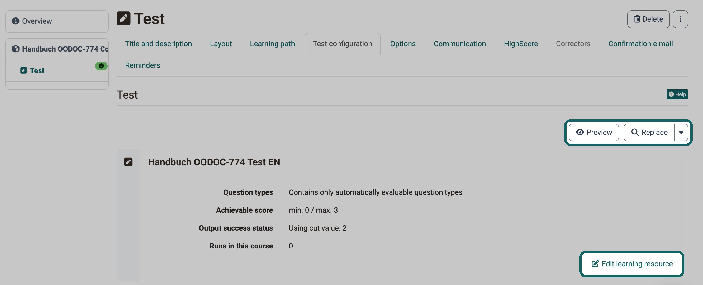{ class="shadow lightbox" title="Tab Test configuration in the course element Test · 2026.11.10" }

10\. A new test learning resource already contains a single choice question. Use it as a sample, adjust it or delete it.

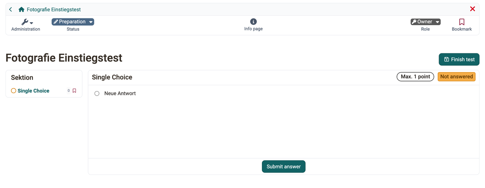{ class="lightbox" title="Test learning resource · 2026.09.28" }

11\. Open the test editor via `Test learning resource > Administration > Test editor`. The test editor belongs to the learning resource; you continue to edit the course in the course editor.

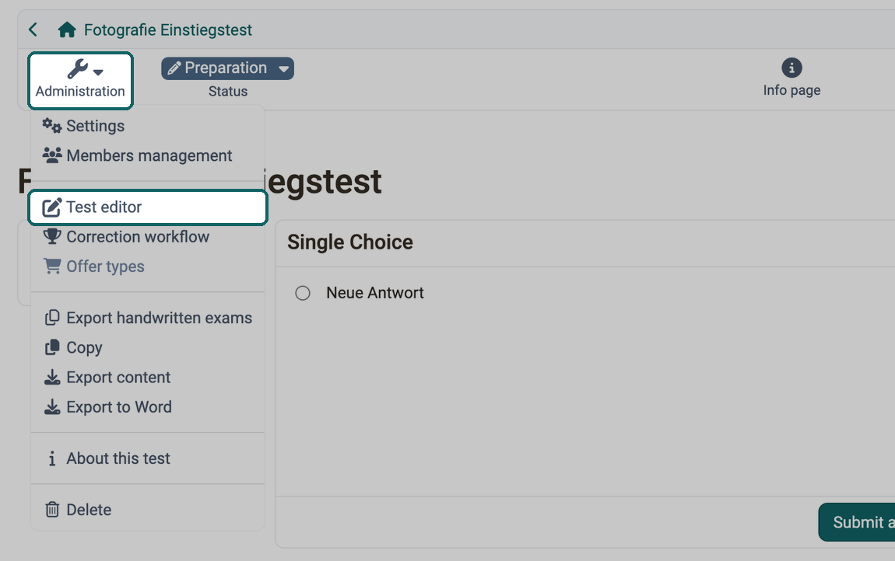{ class="lightbox" title="Administration menu of a test learning resource · 2026.09.28" }

12\. Click "Add elements" and select the appropriate question type, for example "Multiple choice".

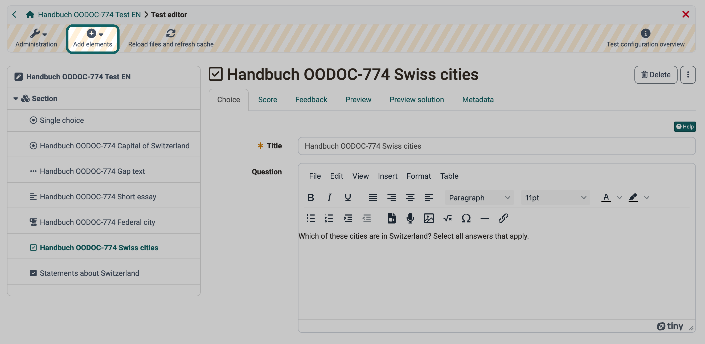{ class="shadow lightbox" title="Test editor · 2026.11.10" }

13\. In the "Choice" tab, enter the title of the question, the question wording and the possible answers. You add further answers via the plus sign.

14\. In the "Score" tab you define the method of assessment and the score.

15\. In the "Feedback" tab you add feedback to the question if required. In the "Preview" tab you check the question.

You add more questions according to the same principle; the settings differ depending on the question type. With sections or [test parts](../../manual_user/learningresources/Configure_tests.md#testpart) you structure the test further.

!!! warning "Attention"

    Consider before creating which question type serves your purpose best. You cannot change the question type of a created question afterwards.

!!! tip "Tip"

    If you need several questions with the same answers, for example a scale from 1 to 5, copy a finished question: in the test editor, select "Duplicate" in the menu with the three dots. Then you only adjust the question wording.

 

---

## Procedure Option 2

If the course already exists and you have some experience as an author, start with the learning resource "Test" and then include it in the course.

 

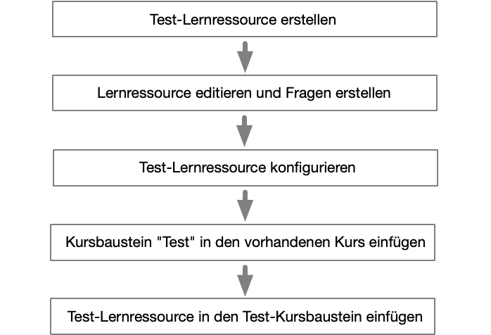{ class="lightbox" title="Procedure option 2" }

 

> <h3>Create a test learning resource</h3>

 

1\. Create a test learning resource via `Authoring > Create > Test`.

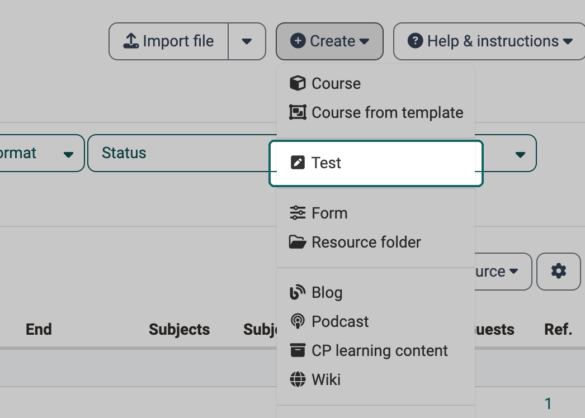{ class="shadow lightbox" title="Create menu in Authoring · 2026.11.10" }

2\. In the "Create test" dialog, enter the title of the test and click "Create".

{ class="shadow lightbox" title="Dialog Create test · 2026.11.10" }

3\. OpenOlat then opens the settings of the test learning resource. Define further settings in the tabs if required.

You can also adjust the same settings later under `Test learning resource > Administration > Settings`.

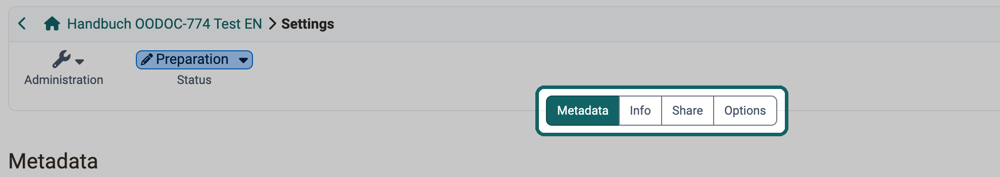{ class="shadow lightbox" title="Settings of the test learning resource · 2026.11.10" }

:octicons-device-camera-video-24: **Video introduction (German)**: [Test-Lernressource erstellen](<https://www.youtube.com/embed/WUs-upCf2tQ>){:target="_blank"}

 

> <h3>Edit learning resource and create questions</h3>

 

4\. Open the test editor via `Test learning resource > Administration > Test editor`.

{ class="shadow lightbox" title="Administration menu of a test learning resource · 2026.09.28" }

5\. Click "Add elements" and select the appropriate question type, for example "Multiple choice".

6\. In the "Choice" tab, enter the title of the question, the question wording and the possible answers. You add further answers via the plus sign.

7\. In the "Score" tab you define the method of assessment and the score.

8\. In the "Feedback" tab you add feedback to the question if required. In the "Preview" tab you check the question.

You add more questions according to the same principle; the settings differ depending on the question type. With sections or [test parts](../../manual_user/learningresources/Configure_tests.md#testpart) you structure the test further.

:octicons-device-camera-video-24: **Video introduction (German)**: [Fragen erstellen](<https://www.youtube.com/embed/2ZrINPQ6tYw>){:target="_blank"}

!!! info "Important"

    A new test learning resource already contains a single choice question. Edit or delete this question so that it does not remain in the test unintentionally.

!!! warning "Attention"

    Consider before creating which question type serves your purpose best. You cannot change the question type of a created question afterwards.

!!! tip "Tip"

    If you need several questions with the same answers, for example a scale from 1 to 5, copy a finished question: in the test editor, select "Duplicate" in the menu with the three dots. Then you only adjust the question wording.

 

> <h3>Configure learning resource "Test"</h3>

 

9\. In the test editor, click the top item on the left, the title of the test. On the right, the tabs with the settings for the whole test appear.

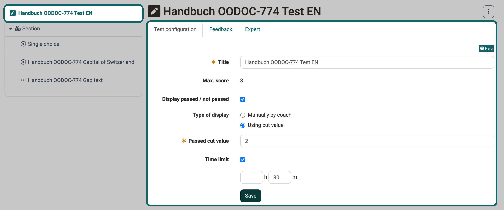{ class="shadow lightbox" title="Tab Test configuration in the test editor · 2026.11.10" }

10\. **Test configuration:** Define from how many points the test is passed and whether a time limit applies.

In the "Feedback" tab you add, if required, a general feedback for passed and for failed tests. It applies when OpenOlat outputs the passed status automatically via the score threshold.

11\. **Expert:** Define further details of the test procedure, for example the navigation or the display of solutions.

12\. Finally, leave the test editor by clicking the title of the test in the bread-crumb navigation.

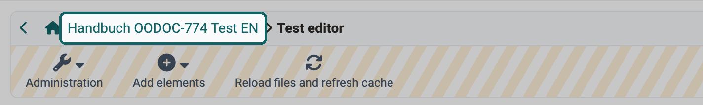{ class="shadow lightbox" title="Bread-crumb navigation in the test editor · 2026.11.10" }

:octicons-device-camera-video-24: **Video introduction (German)**: [Kursbausteine konfigurieren](<https://www.youtube.com/embed/SAkzzoOQEoQ>){:target="_blank"}

!!! tip "Tip"

    You add feedback for individual questions in the "Feedback" tab of the question and for the whole test in the "Feedback" tab of the top item.

 

> <h3>Insert course element "Test" into the existing course</h3>

 

13\. In Authoring, open the course the test belongs to. You find your courses in the tabs "My courses" and "My entries".

14\. Open the course editor via `Course > Administration > Course editor`. Click "Insert course elements" and select the type "Test" or "Self-test".

 

> <h3>Insert learning resource "Test" into the course element "Test"</h3>

 

15\. In the new course element, open the "Test configuration" tab and click "Select". 
In the "Select test learning resource" dialog, select the prepared test.

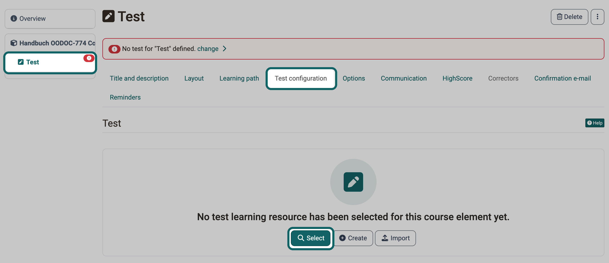{ class="shadow lightbox" title="Tab Test configuration in the course element Test · 2026.11.10" }

16\. The "Test configuration" tab now shows the included test. With "Preview" you view it, with "Edit learning resource" you open it for editing. As soon as participants have started the test, editing is limited.

{ class="shadow lightbox" title="Tab Test configuration with embedded test · 2026.11.10" }

17\. Configure the other tabs of the course element if required. Here you override part of the settings of the test learning resource for this course. This is worthwhile if you use the same test learning resource in different courses.

18\. So that participants can work on the test, publish the course. To do this, close the course editor, for example by clicking the name of the course in the bread-crumb navigation, and select "Publish manually" or "Publish automatically" in the dialog that follows.

Alternatively, click "Publish" on the right of the toolbar in the course editor, or close the course editor via the small red cross in the upper right corner.

19\. Then set the status of the course to "Published" so that participants can work on the test. 
You decide who gets access under `Course > Administration > Members management`.

20\. Once test results are available, coaches assess the participants in the assessment tool. For a self-test, this step does not apply. 
How this works is described on the page [Assessing tests](../../manual_user/learningresources/Assessing_tests.md).

 

---

## Procedure Option 3

Do you share the work with colleagues and create, as a subject matter expert, questions that are used in several tests? 
Then start in the question bank: the questions there are available for every test you adopt them into.

 

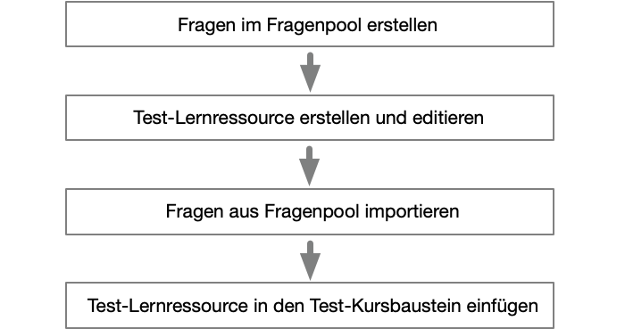{ class="lightbox" title="Procedure option 3" }

 

> <h3>Create questions in the question bank</h3>

 

1\. Open the question bank in the main navigation. With the role Author, it appears there next to Authoring.

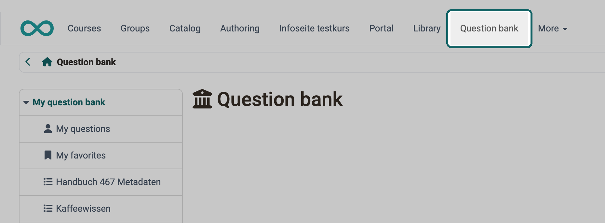{ class="shadow lightbox" title="Question bank in the main navigation · 2026.11.10" }

2\. Under "My question bank", select the entry "My questions" and click "Create question". Enter a title and select the appropriate type under "Type", for example "Multiple-Choice".

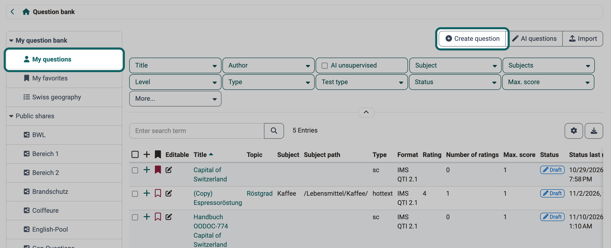{ class="shadow lightbox" title="My questions in the question bank · 2026.11.10" }

3\. In the "Choice" tab, enter the title of the question, the question wording and the possible answers. You add further answers via the plus sign.

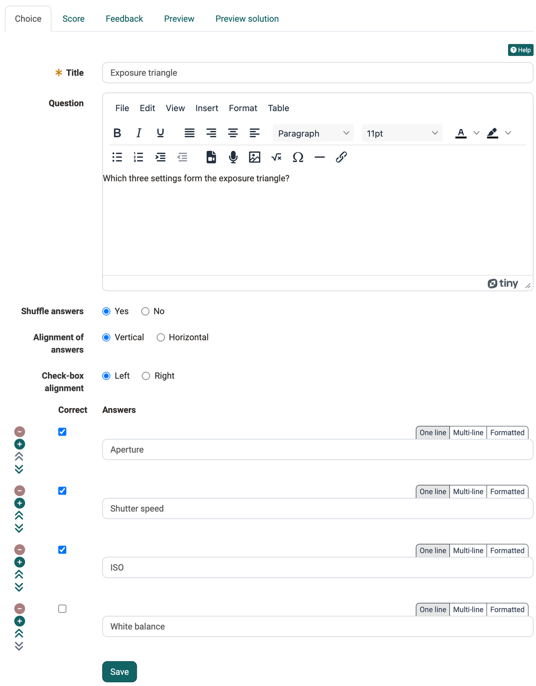{ class="lightbox" title="Question in the question bank · 2026.09.28" }

4\. In the "Score" tab you define the method of assessment and the score.

5\. In the "Feedback" tab you add feedback to the question if required. In the "Preview" tab you check the question.

You create more questions according to the same principle; the settings differ depending on the question type.

!!! warning "Attention"

    Consider before creating which question type serves your purpose best. You cannot change the question type of a created question afterwards.

!!! tip "Tip"

    If you need several questions with the same answers, for example a scale from 1 to 5, copy a finished question and only adjust the question wording.

So that you find the questions again later via the search filters and the course element "Practice" selects them automatically, maintain the metadata of every question in the question bank, for example subject, level and keywords. The instructions [Benefits of metadata](../question_metadata/question_metadata.md) show how this works.

 

> <h3>Create and edit test learning resource</h3>

 

6\. Create a test learning resource via `Authoring > Create > Test`.

{ class="shadow lightbox" title="Create menu in Authoring · 2026.11.10" }

!!! note "Note"

    You find the new test learning resource in Authoring in the "My entries" tab, because the "My courses" tab only lists courses. In the "Type" column you recognize it by the icon for test learning resources.
    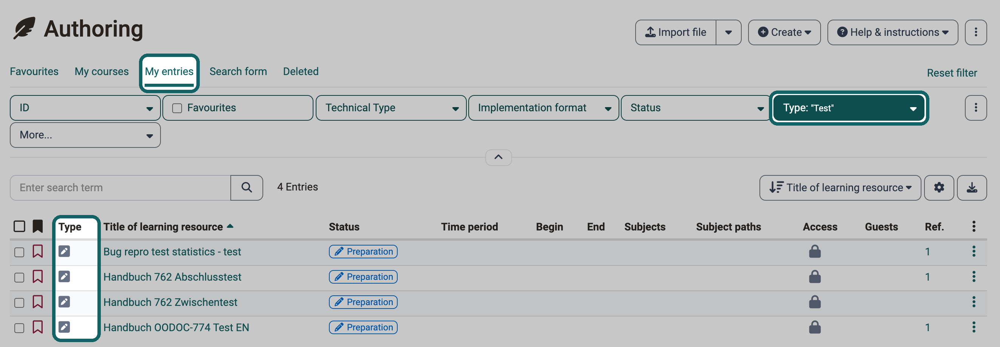{ class="shadow lightbox" title="Tab My entries in Authoring · 2026.11.10" }

7\. Open the test editor via `Test learning resource > Administration > Test editor`.

{ class="lightbox" title="Administration menu of a test learning resource · 2026.09.28" }

8\. You recognize the test editor by the shaded header. Here you add new questions under "Add elements".

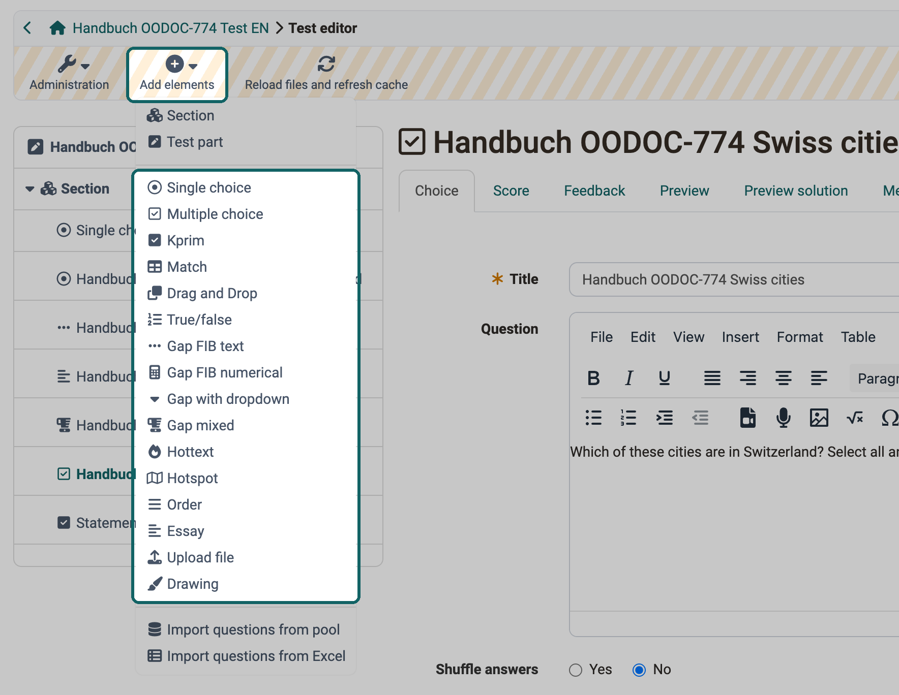{ class="shadow lightbox" title="Menu Add elements in the test editor · 2026.11.10" }

 

> <h3>Import questions from the question bank</h3>

 

9\. You adopt your questions from the question bank in the same menu with "Import questions from pool". OpenOlat copies them into the test; there they are initially read-only. How to edit such a question is described under [Using questions from the question bank](../../manual_user/learningresources/Test_editor_QTI_2.1/index.md#questions_from_pool).

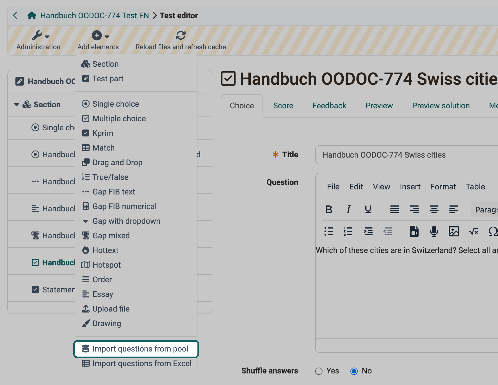{ class="shadow lightbox" title="Menu Add elements in the test editor · 2026.11.10" }

10\. The "Choose questions" dialog shows your questions under "My favorites" and "My questions", depending on the configuration also under "My lists" and "My shares". A click on the title of a question inserts it directly. For several questions, tick the checkboxes and click "Select".

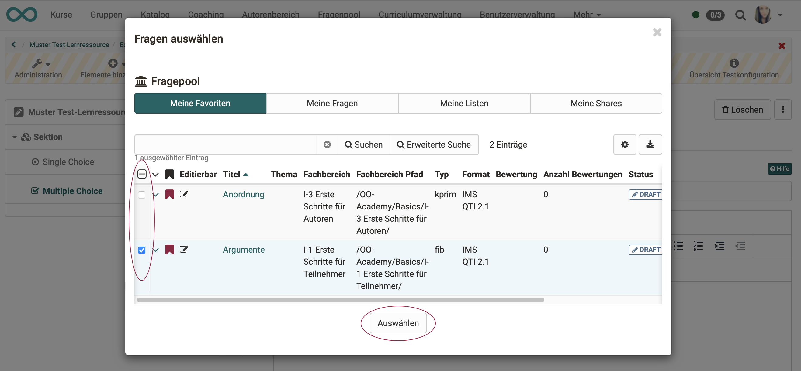{ class="lightbox" title="Dialog Choose questions" }

11\. With sections or [test parts](../../manual_user/learningresources/Configure_tests.md#testpart) you structure the questions in the test further if required. Once all questions are in the test learning resource, leave the test editor.

 

> <h3>Insert test learning resource into the test course element</h3>

 

12\. In Authoring, open the course the test learning resource belongs to. You find your courses in the tabs "My courses" and "My entries".

13\. Open the course editor via `Course > Administration > Course editor`. Click "Insert course elements" and select the type "Test" or "Self-test".

14\. In the new course element, open the "Test configuration" tab and click "Select". 
In the "Select test learning resource" dialog, select the prepared test.

15\. The "Test configuration" tab now shows the included test. With "Preview" you view it, with "Edit learning resource" you open it for editing. As soon as participants have started the test, editing is limited.

16\. Configure the other tabs of the course element if required. Here you override part of the settings of the test learning resource for this course. This is worthwhile if you use the same test learning resource in different courses.

17\. So that participants can work on the test, publish the course. To do this, close the course editor, for example by clicking the name of the course in the bread-crumb navigation, and select "Publish manually" or "Publish automatically" in the dialog that follows.

Alternatively, click "Publish" on the right of the toolbar in the course editor, or close the course editor via the small red cross in the upper right corner.

18\. Then set the status of the course to "Published" so that participants can work on the test. 
You decide who gets access under `Course > Administration > Members management`.

19\. Once test results are available, coaches assess the participants in the assessment tool. For a self-test, this step does not apply. 
How this works is described on the page [Assessing tests](../../manual_user/learningresources/Assessing_tests.md).

 

---

## Checklist {: #checklist}

Before participants work on the test, check these points:

- [x] Course available?

- [x] Course element "Test" or "Self-test" available?

- [x] Learning resource "Test" created?

- [x] Existing questions from the question bank adopted into the learning resource?

- [x] Additional questions created in the learning resource?

- [x] Test learning resource configured?

- [x] Test course element configured?

- [x] Course published and status "Published" set?

---

## Further information {: #further_information}

**Mentioned on this page** 
[How do I create my first OpenOlat course? >](../my_first_course/my_first_course.md) 
[Configure tests >](../../manual_user/learningresources/Configure_tests.md) 
[Assessing tests >](../../manual_user/learningresources/Assessing_tests.md) 
[Benefits of metadata >](../question_metadata/question_metadata.md) 
[Test editor >](../../manual_user/learningresources/Test_editor_QTI_2.1/index.md)

**Further reading** 
[Course Element "Test" >](../../manual_user/learningresources/Course_Element_Test/index.md) 
[Question Bank: Overview >](../../manual_user/area_modules/Question_Bank/index.md) 
[How do I exchange a test? >](../exchange_tests/exchange_tests.md)

**youtube** 
[Funktionsprinzipien](<https://www.youtube.com/embed/M-JkSAFN298>) 
[Kurse erstellen und bearbeiten](<https://www.youtube.com/embed/SfOSyDG0qvE>) 
[Überblick Testing](<https://www.youtube.com/embed/fkqH41-8CaI>) 
[Wie funktionieren Tests in OpenOlat?](<https://www.youtube.com/embed/M0p3UKaEOlg>) 
[Test-Lernressource erstellen](<https://www.youtube.com/embed/WUs-upCf2tQ>) 
[Fragen erstellen](<https://www.youtube.com/embed/2ZrINPQ6tYw>) 
[Kursbausteine konfigurieren](<https://www.youtube.com/embed/SAkzzoOQEoQ>) 
[Tests erstellen/bearbeiten](<https://www.youtube.com/embed/eNNdDdQDlfs>)

[To the top of the page ^](#test_creation_procedure)
