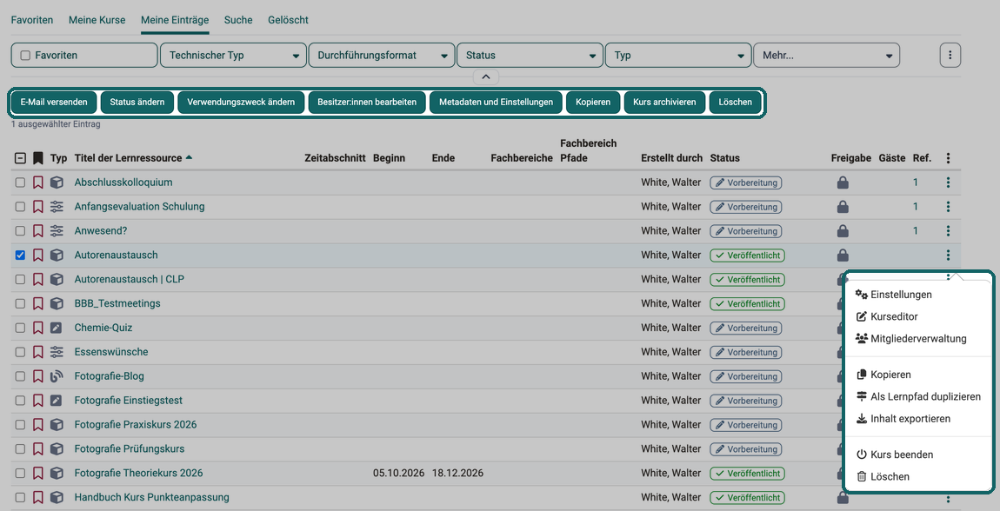
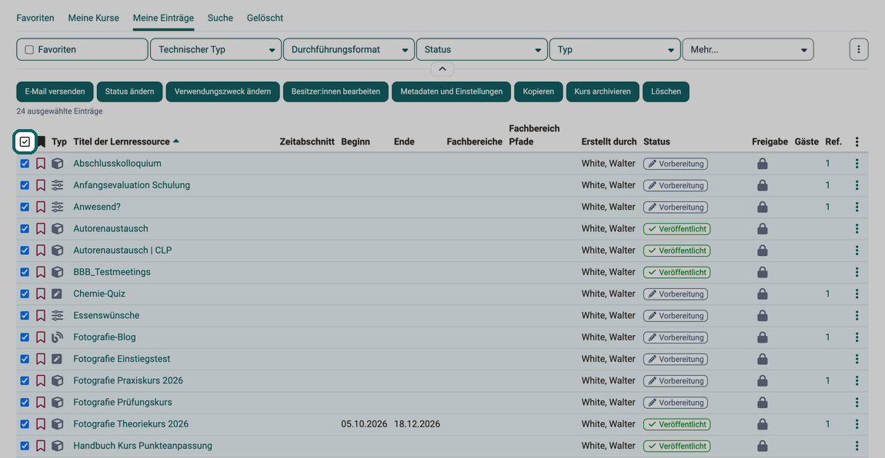
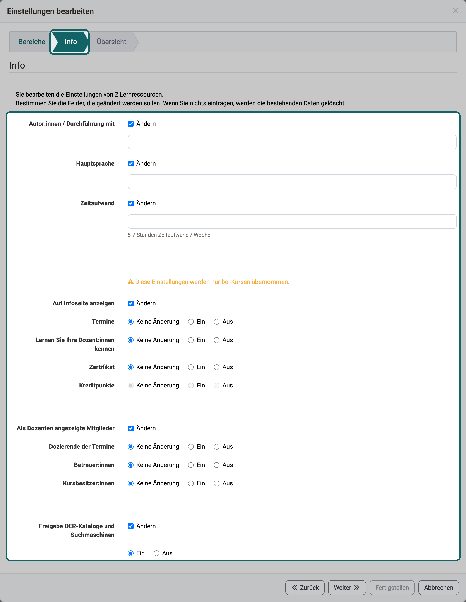
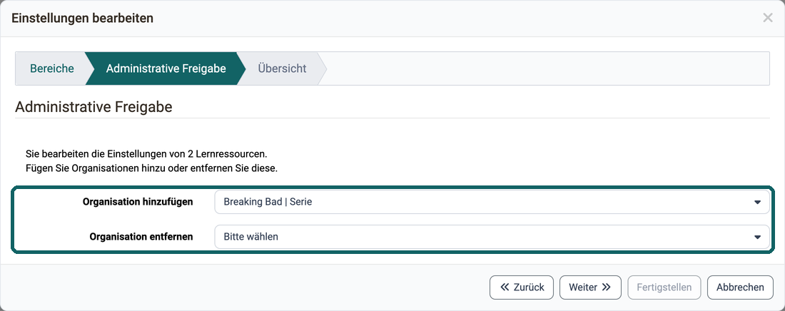

# Autorenbereich - Sammelaktionen {: #authoring_bulk_actions}

Wollen Sie mehrere Lernressourcen gleich behandeln, etwa allen Kursen einer Reihe denselben Status geben, erledigen Sie das im Autorenbereich in einem Schritt statt Kurs für Kurs. Wählen Sie die Lernressourcen dazu in der ersten Spalte der Tabelle aus. Sobald mindestens eine ausgewählt ist, erscheinen über der Tabelle die Buttons für Sammelaktionen (Bulk Actions), von "E-Mail versenden" bis "Löschen". Die Buttons für Sammelaktionen und das Menü unter den 3 Punkten sehen Autor:innen, Lernressourcenverwalter:innen und Administrator:innen.

Bei Klick auf die 3 Punkte am Ende einer Tabellenzeile erscheint ein Menü mit Aktionen nur für die Lernressource dieser Zeile.

{ class="shadow lightbox" title="Tab Meine Einträge im Autorenbereich · 2026.09.28" }

!!! tip "Tipp"

    Wenn Sie die **Checkbox in der Titelzeile der Tabelle** wählen, werden alle Lernressourcen auf einmal ausgewählt. Verteilt sich die Tabelle auf mehrere Seiten, öffnet die Checkbox ein Menü: "Alle Zeilen der Seite auswählen" wählt die Lernressourcen der angezeigten Seite aus, "Alle ... Zeilen auswählen" alle Lernressourcen der Tabelle.

    { class="shadow lightbox" title="Tab Meine Einträge im Autorenbereich · 2026.09.28" }

---

### E-Mail versenden [:octicons-tag-16:{ title="ab Release 11.5 (OO-2674)" }](https://track.frentix.com/issue/OO-2674){:target="_blank"} {: #send_mail}

Wollen Sie die Mitglieder mehrerer Kurse mit einer Nachricht erreichen, etwa vor einer Änderung im Kursangebot, wählen Sie die Kurse aus und klicken Sie auf "E-Mail versenden". Im Dialog legen Sie fest, wer die E-Mail erhält: alle Kursbesitzer:innen, alle Kursbetreuer:innen und alle Teilnehmenden stehen zur Wahl.

Fügen Sie einen Betreff und die Nachricht hinzu. Bei Bedarf ergänzen Sie einen Anhang und eine Kopie an sich selbst.

!!! info "Wichtig"

    Sie können die E-Mail an alle Kurse schicken, die Ihnen angezeigt werden. Dazu gehören auch Kurse, welche für **alle Autor:innen** sichtbar sind. Sie müssen also nicht zwingend Mitglied des Kurses sein, um diese Funktion zu nutzen.

### Status ändern [:octicons-tag-16:{ title="ab Release 17.1 (OO-5011)" }](https://track.frentix.com/issue/OO-5011){:target="_blank"} {: #change_status}

Sollen mehrere Lernressourcen gleichzeitig veröffentlicht oder beendet werden, setzen Sie ihren Status in einem Schritt. Klicken Sie auf "Status ändern", wählen Sie den Publikationsstatus, der für alle ausgewählten Lernressourcen gelten soll, und klicken Sie auf "Ändern".

### Besitzer:innen bearbeiten [:octicons-tag-16:{ title="ab Release 15.4 (OO-5025)" }](https://track.frentix.com/issue/OO-5025){:target="_blank"} {: #modify_owners}

Wechselt die Verantwortung für mehrere Lernressourcen, etwa beim Stellenwechsel einer Autorin, passen Sie die Besitzer:innen aller ausgewählten Lernressourcen gemeinsam an. Der Assistent führt durch vier Schritte: Im ersten zeigt er alle Besitzer:innen der ausgewählten Lernressourcen, und Sie entfernen sie gleichzeitig aus mehreren Lernressourcen. Im zweiten fügen Sie neue Besitzer:innen hinzu, im dritten prüfen Sie die Änderungen. Im letzten Schritt wählen Sie, ob OpenOlat eine E-Mail-Benachrichtigung versendet.

### Metadaten und Einstellungen [:octicons-tag-16:{ title="ab Release 17.2 (OO-6441)" }](https://track.frentix.com/issue/OO-6441){:target="_blank"} {: #metadata_settings}

Gehören mehrere Lernressourcen zusammen, etwa die Kurse einer Weiterbildungsreihe, **vereinheitlichen** Sie ihre **Metadaten** und Einstellungen in einem Durchgang, statt jede Lernressource einzeln zu bearbeiten. Nach Klick auf "Metadaten und Einstellungen" öffnet sich der Assistent (Wizard) "Einstellungen bearbeiten". Er ändert nur die ausgewählten Lernressourcen, bei denen Sie Besitzer:in, Lernressourcenverwalter:in oder Administrator:in sind.

Im ersten Schritt "Bereiche" wählen Sie aus, was Sie bearbeiten wollen. Der Assistent führt danach nur durch die gewählten Bereiche und schliesst mit dem Schritt "Übersicht", der die geplanten Änderungen auflistet. In "Metadaten", "Info", "Autorenrechte", "Durchführung" und "Toolbar" übernimmt OpenOlat nur die Felder, bei denen Sie das Kontrollkästchen "Ändern" markieren. Lassen Sie in "Metadaten", "Info" oder "Durchführung" ein markiertes Feld leer, werden die bestehenden Daten gelöscht.

Die Bereiche in der Reihenfolge des Assistenten:

* "Metadaten": "Durchführungsformat" (nur bei Kursen, z.B. "Prüfungskurs") sowie "Lizenz" mit "Lizenzgeber" (bei eingeschalteten Lizenzen).
* "Info": "Autor:innen / Durchführung mit", "Hauptsprache", "Zeitaufwand", die Anzeigeeinstellungen der Infoseite und "Freigabe OER-Kataloge und Suchmaschinen", siehe [Bereich "Info"](#bulk_info).
* "Fachbereiche": Fachbereiche hinzufügen oder entfernen. Bei eingeschaltetem Katalog heisst der Bereich "Fachbereiche / Katalog".
* "Durchführung": "Durchführungszeitraum" und "Durchführungsort" einheitlich setzen. Beim Durchführungszeitraum stehen "Jederzeit", "Zeitabschnitt", "Beginn- und Enddatum" und "Eintägig" zur Wahl; was die Optionen bewirken, beschreiben die [Kurseinstellungen](../learningresources/Course_Settings_Execution.de.md#execution_period). Mit "Eintägig" tragen Sie im Feld "Datum" einen Tag ein, die "Übersicht" zeigt dann "Durchführungszeitraum: Eintägig:" mit diesem Datum. [:octicons-tag-16:{ title="ab Release 21.1.0 (OO-9807)" }](https://track.frentix.com/issue/OO-9807){:target="_blank"}
* "Administrative Freigabe": Organisationen hinzufügen oder entfernen, siehe [Bereich "Administrative Freigabe"](#bulk_administrative_access).
* "Autorenrechte": die Rechte "Referenzieren", "Kopieren" und "Exportieren" für alle anderen Autor:innen hinzufügen oder entfernen.
* "Toolbar": Werkzeuge der Toolbar ein- oder ausschalten.

"Durchführung" und "Toolbar" bietet der Assistent nur an, wenn mindestens ein Kurs ausgewählt ist, und übernimmt die Änderungen nur bei Kursen.

#### Bereich "Info" [:octicons-tag-16:{ title="ab Release 21.1.0 (OO-9757)" }](https://track.frentix.com/issue/OO-9757){:target="_blank"} {: #bulk_info}

Sollen mehrere Kurse auf ihrer Infoseite dieselben Angaben zeigen, etwa die Termine und das Zertifikat, legen Sie diese Angaben im Bereich "Info" für alle gleichzeitig fest, statt jeden Kurs einzeln zu öffnen. Was die Anzeigeeinstellungen auf der Infoseite bewirken, beschreibt der Abschnitt [Anzeigeeinstellungen](../learningresources/Course_Settings_Info.de.md#display_settings) in den Kurseinstellungen.

{ class="shadow lightbox" title="Schritt Info im Assistenten Einstellungen bearbeiten · 2026.10.21" }

Jedes Feld und jede Gruppe trägt das Kontrollkästchen "Ändern". Erst wenn Sie es ankreuzen, erscheinen die Eingabefelder. Der Bereich zeigt in dieser Reihenfolge:

* "Autor:innen / Durchführung mit", "Hauptsprache" und "Zeitaufwand": Textfelder für alle Arten von Lernressourcen. Der Eintrag ersetzt den bisherigen Wert bei allen ausgewählten Lernressourcen.
* "Auf Infoseite anzeigen": "Termine", "Lernen Sie Ihre Dozent:innen kennen", "Zertifikat" und "Kreditpunkte".
* "Als Dozenten angezeigte Mitglieder": "Dozierende der Termine", "Betreuer:innen" und "Kursbesitzer:innen".
* "Freigabe OER-Kataloge und Suchmaschinen": "Ein" oder "Aus" für alle ausgewählten Lernressourcen. Das Feld erscheint nur, wenn das Modul OAI-PMH eingeschaltet ist.

Bei den Einstellungen unter "Auf Infoseite anzeigen" und "Als Dozenten angezeigte Mitglieder" wählen Sie je Einstellung "Keine Änderung", "Ein" oder "Aus". "Keine Änderung" ist vorgewählt und lässt die Einstellung in jedem Kurs, wie sie ist. Setzen Sie "Lernen Sie Ihre Dozent:innen kennen" auf "Ein", verlangt der Assistent unter "Als Dozenten angezeigte Mitglieder" mindestens eine Rolle auf "Ein". Die Rollen ändert OpenOlat nur in Kursen, in denen "Lernen Sie Ihre Dozent:innen kennen" eingeschaltet ist oder mit diesem Durchgang eingeschaltet wird.

!!! info "Wichtig"

    Die Einstellungen unter "Auf Infoseite anzeigen" und "Als Dozenten angezeigte Mitglieder" übernimmt OpenOlat nur bei Kursen. Ist unter den ausgewählten Lernressourcen kein Kurs, bleiben sie gesperrt. "Kreditpunkte" lässt sich nur ändern, wenn bei mindestens einem ausgewählten Kurs Kreditpunkte eingeschaltet sind. Einstellungen, die eine externe Verwaltung vorgibt, bleiben ebenfalls gesperrt.

#### Bereich "Administrative Freigabe" {: #bulk_administrative_access}

Sollen mehrere Lernressourcen einer anderen Organisation zugeordnet werden, etwa nach einer Umstrukturierung, passen Sie ihre Administrative Freigabe hier für alle gleichzeitig an. Was die Administrative Freigabe bewirkt, beschreibt die Seite [Kurseinstellungen - Tab Freigabe](../learningresources/Course_Settings_Share.de.md#section_share). Den Bereich gibt es nur, wenn das Modul Organisationen eingeschaltet ist.

{ class="shadow lightbox" title="Schritt Administrative Freigabe im Assistenten Einstellungen bearbeiten" }

Der Bereich hat zwei Felder:

* "Organisation hinzufügen" bietet die Organisationen an, in denen Sie Autor:in, Lernressourcenverwalter:in oder Administrator:in sind.
* "Organisation entfernen" bietet die Organisationen an, denen die ausgewählten Lernressourcen zugeordnet sind.

Eine Lernressource bleibt immer mindestens einer Organisation zugeordnet. OpenOlat entfernt eine Organisation deshalb nur, wenn der Lernressource danach noch eine ihrer bisherigen Organisationen bleibt. Wählen Sie nur Organisationen zum Entfernen aus und bliebe eine Lernressource danach ohne Organisation, zeigt der Bereich den Hinweis "Einige Organisationen können nicht aus den Lernressourcen entfernt werden, da sie die einzige Organisation der Lernressource sind."

Eine Organisation, die Sie im selben Durchlauf hinzufügen, zählt dabei nicht mit. Wählen Sie die neue Organisation zum Hinzufügen und die bisherige zum Entfernen, fügt OpenOlat die neue hinzu und behält die bisherige, ohne einen Hinweis anzuzeigen. Um Lernressourcen in eine andere Organisation zu verschieben, führen Sie den Assistenten deshalb zweimal aus:

1. Wählen Sie im ersten Durchlauf unter "Organisation hinzufügen" die neue Organisation und schliessen Sie den Assistenten ab.
2. Wählen Sie im zweiten Durchlauf unter "Organisation entfernen" die bisherige Organisation.

Administrator:innen ordnen Kurse zudem in der System-Administration im Tab "Lernressourcen" einer Organisation zu, beschrieben unter [Modul Organisationen](../../manual_admin/administration/Modules_Organisations.de.md#edit_learning_resources).

#### Schritt "Übersicht" {: #bulk_overview}

Bevor OpenOlat etwas ändert, prüfen Sie im Schritt "Übersicht", was der Assistent übernehmen wird. Die Übersicht listet je Bereich jede markierte Änderung mit ihrem neuen Wert auf, im Bereich "Info" etwa "Termine: ein". Daneben steht, für welche Lernressourcen die Änderung gilt: "Alle", eine Anzahl wie "1 Lernressource" oder "Keine", wenn sich bei keiner Lernressource etwas ändert. Ein Klick auf die Angabe zeigt die Titel der betroffenen Lernressourcen. Eine Einstellung auf "Keine Änderung" erscheint nicht in der Übersicht. Hat ein Bereich keine markierte Änderung, steht dort "Keine Änderungen vorgenommen." Erst mit "Fertigstellen" übernimmt OpenOlat die Änderungen. Mit "Abbrechen" und danach "Daten nicht speichern" verwerfen Sie sie.

### Kopieren {: #copy}

Eine Kopie lohnt sich, wenn Sie Lernressourcen für ein neues Semester wiederverwenden oder eine Sicherheitskopie erstellen wollen. Mit dem Button "Kopieren" über der Tabelle kopieren Sie mehrere Lernressourcen auf einmal. Mit "Kopieren" im Menü unter den 3 Punkten am Ende einer Zeile kopieren Sie nur die Lernressource dieser Zeile.

Kopierte Lernressourcen finden Sie danach im Tab "Meine Einträge". OpenOlat ergänzt den Titel um den Zusatz "(Kopie)", den Titel können Sie danach beliebig ändern.

### Löschen {: #delete}

Brauchen Sie Lernressourcen nicht mehr, räumen Sie den Autorenbereich auf, indem Sie sie löschen. Löschen dürfen die Besitzer:innen der Lernressource sowie Lernressourcenverwalter:innen und Administrator:innen.

Mit dem Button "Löschen" über der Tabelle löschen Sie mehrere Lernressourcen auf einmal. Eine einzelne Lernressource löschen Sie auch über die 3 Punkte am Ende ihrer Tabellenzeile und die Option "Löschen".

Zur Sicherheit bestätigen Sie die Aktion noch einmal. Die Besitzer:innen der Lernressource werden, sofern konfiguriert, per E-Mail benachrichtigt.

Nach dem Löschen erscheinen die Lernressourcen nur noch im [Tab "Gelöscht"](../area_modules/Authoring.de.md#authoring-deleted) (Papierkorb-Funktion) für die jeweiligen Besitzer:innen sowie Lernressourcenverwalter:innen und Administrator:innen.

Als Besitzer:in können Sie gelöschte Lernressourcen wiederherstellen. Das dauerhafte Löschen der Lernressourcen ist nur durch Administrator:innen oder Lernressourcenverwalter:innen möglich.

### Lernressource öffnen {: #open_resource}

Um mit einer Lernressource zu arbeiten, klicken Sie in der Tabelle auf ihren Titel. OpenOlat öffnet dann die Lernressource.

### Einstellungen [:octicons-tag-16:{ title="ab Release 21.1 (OO-9780)" }](https://track.frentix.com/issue/OO-9780){:target="_blank"} {: #settings}

Wollen Sie die Angaben einer Lernressource ändern, öffnen Sie ihre Einstellungen direkt aus der Tabelle. Klicken Sie dazu im Menü unter den 3 Punkten auf "Einstellungen". OpenOlat öffnet die Einstellungen der Lernressource im Tab "Metadaten". Die Informationen, die auf der Infoseite erscheinen, etwa Beschreibung, Lernziele und Voraussetzungen, bearbeiten Sie im Tab "Info".

Die Infoseite selbst öffnen Sie in der Lernressource über den Link "Infoseite" in der Toolbar.

Mehr dazu finden Sie auf der Seite "[Infoseite einrichten](../learningresources/Course_Settings_Info.de.md#configure_info)".

### Editor öffnen {: #open_editor}

Um den Inhalt einer Lernressource zu bearbeiten, öffnen Sie ihren Editor direkt aus der Tabelle. Der Eintrag im Menü unter den 3 Punkten nennt den Editor beim Namen: bei einem Kurs "Kurseditor", bei einem Test "Testeditor", bei einem Formular "Formulareditor" und bei einem Video "Videoeditor". Bei allen übrigen Lernressourcen, etwa CP-Lerninhalt, Wiki, Blog, Podcast oder Glossar, heisst der Eintrag "Inhalt editieren".

Den Eintrag sehen Sie nur bei Lernressourcen, die sich bearbeiten lassen und die weder im Status "Beendet" noch im Papierkorb sind.

Denselben Editor öffnet das Stiftsymbol in der Spalte "Inhalt editieren". Diese Spalte blenden Sie bei Bedarf selbst ein, siehe [Spalten konfigurieren](Authoring.de.md#configure_columns). Der Tooltip des Symbols nennt den Editor beim Namen.

### Weitere Optionen für einzelne Lernressourcen {: #row_menu}

Ein Klick auf die **3 Punkte** am Ende einer Tabellenzeile öffnet ein Menü mit mehreren Optionen.

Aktionen im Menü unter den 3 Punkten beziehen sich immer auf die **einzelne Lernressource** dieser Zeile. Mit den Buttons über der Tabelle führen Sie dagegen Aktionen für **mehrere Lernressourcen** aus.

Die Einträge "Einstellungen", der Eintrag zum Editor und "Mitgliederverwaltung" erscheinen nur, wenn Sie Besitzer:in der Lernressource, Lernressourcenverwalter:in oder Administrator:in sind.

!!! info "Wichtig"

    Wollen Sie Lernressourcen für externe OER-Kataloge und Suchmaschinen freigeben, finden Sie die Aktion "Freigabe externer OER-Katalog" im Menü unter den 3 Punkten nicht mehr [:octicons-tag-16:{ title="ab Release 21.1.0 (OO-9751)" }](https://track.frentix.com/issue/OO-9751){:target="_blank"}. Auch über der Tabelle gibt es dafür keine Sammelaktion. Eine einzelne Lernressource geben Sie in ihren Einstellungen mit dem Häkchen "Indexieren von Metadaten zulassen" frei: `Lernressource > Administration > Einstellungen > Tab "Freigabe"`. Nur dort warnt OpenOlat, wenn die Lernressource noch nicht veröffentlicht ist oder eine verlangte Lizenz fehlt, beschrieben unter [Externe OER-Kataloge und Suchmaschinen](../learningresources/Course_Settings_Share.de.md#section_share_oer). Mehrere Lernressourcen geben Sie mit der Sammelaktion "Metadaten und Einstellungen" frei, im Bereich "Info" über das Feld "Freigabe OER-Kataloge und Suchmaschinen", siehe [Bereich "Info"](#bulk_info). Der gleichnamige Filter "Freigabe externer OER-Katalog", den Sie über der Tabelle unter "Mehr..." einblenden, zeigt nur die freigegebenen oder die nicht freigegebenen Lernressourcen an und ändert keine Freigabe.

### Mitgliederverwaltung {: #members_management}

Hier organisieren Sie die Mitglieder einer Lernressource. Mehr Informationen dazu finden Sie im Kapitel [Mitgliederverwaltung](../learningresources/Members_management.de.md).

### Inhalt exportieren {: #export_content}

Hiermit exportieren Sie Ihre Lernressourcen als ZIP-Datei, zum Beispiel als Backup oder für den Import in einem anderen System.

### Als Lernpfad duplizieren {: #duplicate_as_learning_path}

Handelt es sich in der Tabellenzeile um einen herkömmlichen Kurs, zeigt das Menü zusätzlich die Option "Als Lernpfad duplizieren" an. OpenOlat erstellt dann eine Kopie als [Lernpfadkurs](../learningresources/Learning_path_course.de.md), die Ursprungsversion bleibt als herkömmlicher Kurs erhalten.

### Kopieren mit Wizard [:octicons-tag-16:{ title="ab Release 16.0 (OO-4416)" }](https://track.frentix.com/issue/OO-4416){:target="_blank"} {: #copy_with_wizard}

Handelt es sich in der Tabellenzeile um einen Lernpfadkurs, zeigt das Menü zusätzlich die Option "Kopieren mit Wizard" an. Der Assistent führt Schritt für Schritt durch die Kopie und lässt Sie wählen, welche Teile des Kurses übernommen werden, beschrieben unter [Kopieren eines Kurses mit Wizard](../learningresources/Course_Copy_Wizard.de.md).

[Zum Seitenanfang ^](#authoring_bulk_actions)

---

## Weiterführende Informationen {: #further_information}

**Auf dieser Seite erwähnt** 
[Kurseinstellungen - Tab Durchführung >](../learningresources/Course_Settings_Execution.de.md) 
[Kurseinstellungen - Tab Info >](../learningresources/Course_Settings_Info.de.md) 
[Kurseinstellungen - Tab Freigabe >](../learningresources/Course_Settings_Share.de.md) 
[Modul Organisationen >](../../manual_admin/administration/Modules_Organisations.de.md) 
[Autorenbereich - Übersicht >](Authoring.de.md) 
[Mitgliederverwaltung >](../learningresources/Members_management.de.md) 
[Lernpfadkurs - Überblick >](../../manual_user/learningresources/Learning_path_course.de.md) 
[Kopieren eines Kurses mit Wizard >](../learningresources/Course_Copy_Wizard.de.md)

**Weiterführend** 
[Kurs erstellen >](../../manual_user/learningresources/Creating_Course.de.md) 
[Wie erstelle ich meinen ersten OpenOlat-Kurs? >](../../manual_how-to/my_first_course/my_first_course.de.md) 
[Kursbausteine im Kurseditor >](../../manual_user/learningresources/General_Configuration_of_Course_Elements.de.md) 
[Wie kann ich meine Kurse durch Suchmaschinen finden lassen? >](../../manual_how-to/oai_pmh/oai_pmh.de.md)

[Zum Seitenanfang ^](#authoring_bulk_actions)
