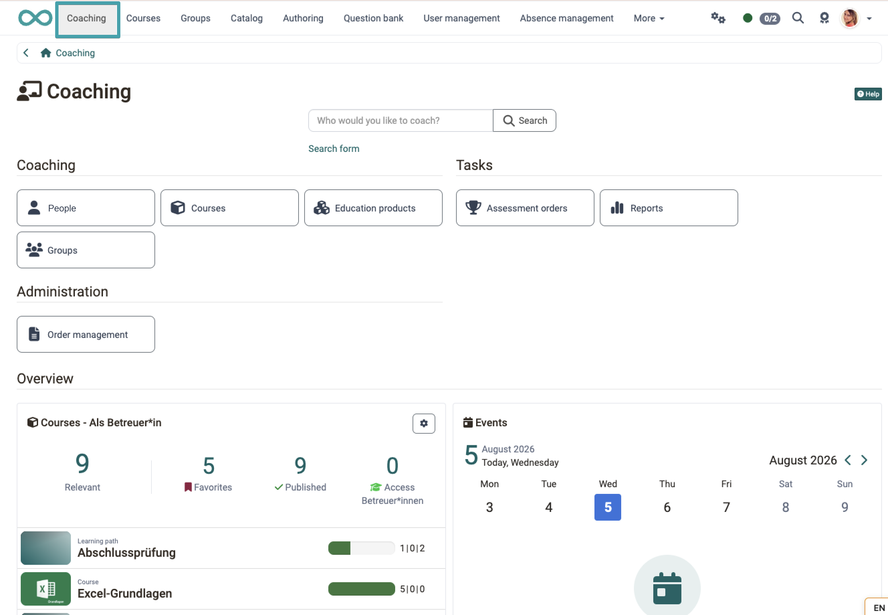
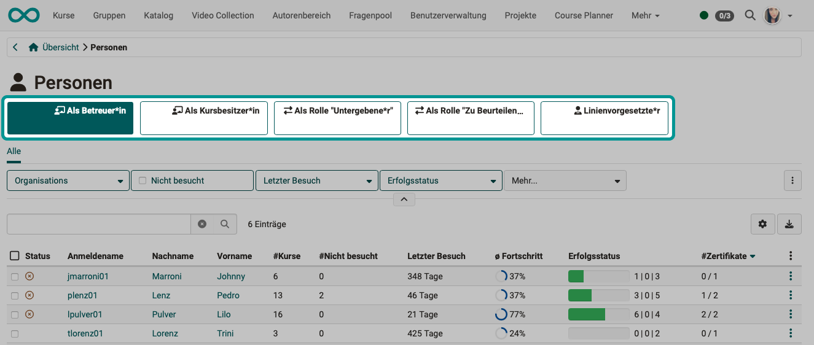
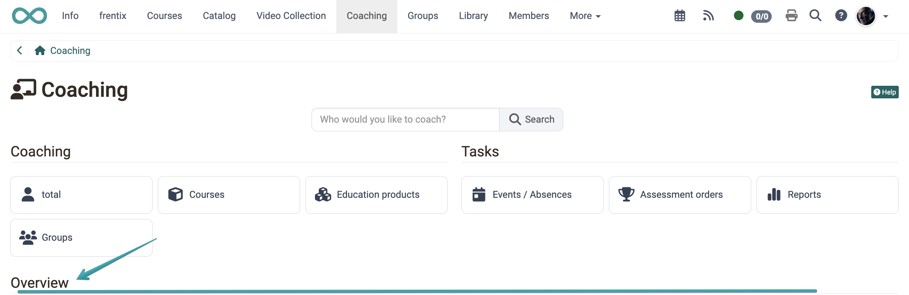
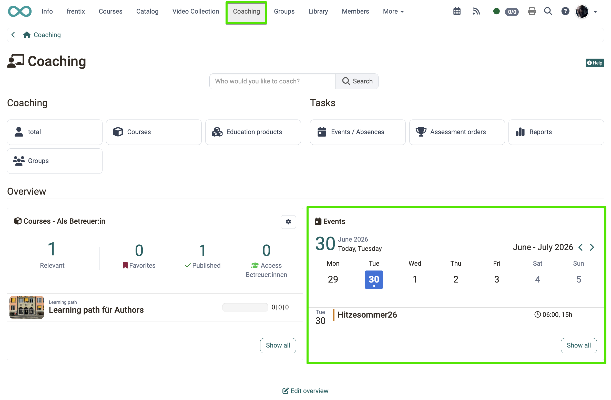
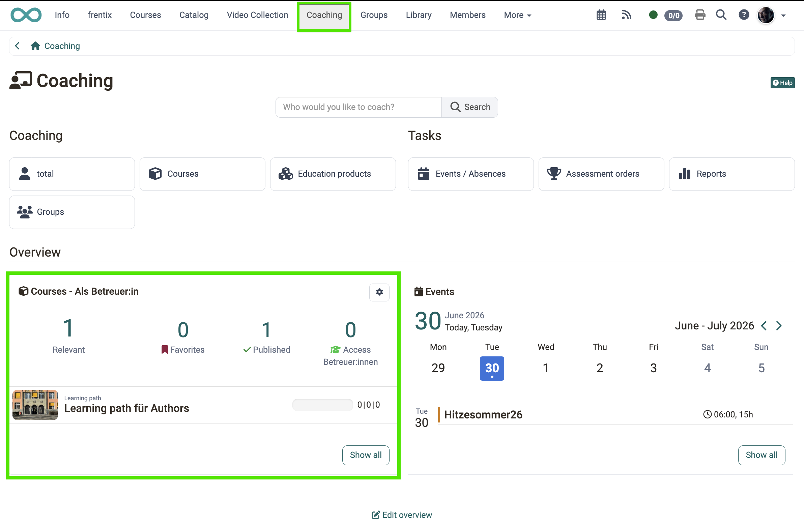

# Coaching - Overview {: #coaching}

## Profile

Name | Coaching Tool
---------|----------
Available since | Release 10.0 (2014)

## What is the Coaching Tool for? {: #purpose}

The Coaching Tool is used for the **cross-course** organization and administration of courses, participants and groups, as well as the correction of assessment modules, the absence management and the external corrector flow of OpenOlat tests.

With the Coaching Tool, course owners, course coaches, group coaches, education managers and other authorised persons have the possibility to see and manage all course or group participants assigned to them at a glance. They can then quickly go from these overviews to the assessment tool for individual participants in different ways.

{ class="shadow lightbox" title="Coaching entry page" }

---

## The tools [:octicons-tag-16:{ title="from Release 20.0 (OO-8374)" }](https://track.frentix.com/issue/OO-8374) {: #tools}

You can find access to the data of the persons you coach and the tools under the buttons

* People
* Courses
* Educational products
* Groups
* Pending confirmations
* Events / Absences
* Assessment orders
* Reports
* Order management

!!! note "Note"

    Your menu will often not contain all the options shown here. Depending on the activated modules and roles, a different composition is displayed. Here in the manual, the maximum selection is shown for explanation.

[To the top of the page ^](#coaching)

---

## When is the Coaching Tool available? [:octicons-tag-16:{ title="from Release 21.0.1 (OO-9661)" }](https://track.frentix.com/issue/OO-9661) {: #availability}

You are looking for the "Coaching" entry in the main menu and cannot find it? OpenOlat shows it to everyone who coaches, corrects or manages other people. The Coaching Tool itself is an integral part of OpenOlat and cannot be switched off in the administration.

The "Coaching" entry appears as soon as at least one of these points applies to you:

* **Coaching in a course**: You are a coach in a course with the status "Access for coach", "Published" or "Finished".
* **Ownership of a learning resource**: You are the owner of a course or of another learning resource. The status does not matter; only learning resources in the trash are excluded.
* **Organisation role**: You are a line manager or an education manager, and the Organisations module is switched on.
* **Events**: You are entered as a teacher for an event or are a master coach in an implementation of the Course Planner, and the Events and absences module is switched on.
* **User relation**: A user relation assigns another person to you, for example as a mentor.
* **Correction workflow**: You are entered as a corrector for a test, and the correction workflow is switched on system-wide.
* **Administrative role**: You are an administrator, principal, learning resource manager or absence manager.

Guests never see the entry. Anyone who is only a participant in courses does not see it either.

Which buttons Coaching then shows you is described in the section [The tools](#tools).

[To the top of the page ^](#coaching)

---

## Who typically uses the Coaching Tool? {: #users}

The Coaching Tool is used by

* Coaches who supervise participants in multiple courses
* Education managers
* Line managers
* Individuals with defined person-to-person relations, e.g. mentor - mentee

Additionally, administrative roles have access.

[To the top of the page ^](#coaching)

---

## The scopes {: #focus_elements}

The Coaching Tool often displays a list of the people you are coaching.
If, for example, you are only a direct coach in one course but also an education manager, you can access all other participants based on this role.

You can select one of your roles using the scopes above the list. This will give you a preselection. The list will then only contain people you are responsible for in this role.

{ class="shadow lightbox" title="People list in Coaching" }

[To the top of the page ^](#coaching)

---

## Widgets {: #widgets}

### Overview [:octicons-tag-16:{ title="from Release 20.3 (OO-9305)" }](https://track.frentix.com/issue/OO-9305) {: #widget_overview}

A separator area labelled **"Overview"** visually separates the widget area described below from the buttons/launchers above it.

{ class="shadow lightbox" title="Coaching entry page" }

---

### The Events widget [:octicons-tag-16:{ title="from Release 20.3 (OO-8865)" }](https://track.frentix.com/issue/OO-8865) {: #widget_events}

The **Events** widget appears as a tile on the Coaching overview and shows the upcoming events from today until the end of the current week at a glance.

Displayed are only events in which you are entered as a lecturer yourself, and only from courses with their own event configuration. Events from educational products do not appear here.

!!! info "Important"

    The widget with the same name **Events** in the Course Planner shows different events: there you see events from educational products for which you are administrator, absence manager, owner or coach. See [Course Planner: Dashboard](Course_Planner_Dashboard.md#widget_events).

The widget only appears if the module Events and absences is switched on system-wide.

#### Header and day display

The widget header shows the current date with month, year and the label **Today, \<weekday\>**. Today's date is highlighted. The weekend is visually toned down.

#### Week navigation

Use the `<` and `>` buttons to navigate through the events week by week. A week always runs from Monday to Sunday. Initially, the current week from today onwards is displayed.

A dot below the day figure marks the days on which events take place. The day column stays in place while you scroll, even if the week holds many events. [:octicons-tag-16:{ title="from Release 21.0 (OO-9515)" }](https://track.frentix.com/issue/OO-9515)

#### Event list

Each event shows the following information:

- Weekday and date
- Status indicator
- Reference and title
- Location (with location icon)
- Time and duration (with clock icon)

!!! note "Note"
    In the narrow (mobile) view, the location column is omitted. Only the time is shown.

{ class="shadow lightbox" title="Overview on the Coaching entry page" }

#### Empty state

If there are no events in the displayed week, the message "No events until the end of the week" appears. Use the "Previous event" and "Next event" buttons to jump to the nearest event in the past or future.

!!! info "Important"
    The widget is absent entirely if you are not entered as a lecturer on a single event and are not a master coach. If the displayed week holds no event, the empty state appears instead.

#### Full view

Use the **Show all** button [:octicons-tag-16:{ title="from Release 20.3 (OO-9244)" }](https://track.frentix.com/issue/OO-9244) to go to the **Events / Absences** tool.

!!! note "Note"
    The widget is a quick overview of the current week. The full **Events / Absences** tool additionally offers the tabs Cockpit, Absences, Notices, Appeals and User search.

[To the top of the page ^](#coaching)

---

### The Course widget [:octicons-tag-16:{ title="from Release 20.2 (OO-8863)" }](https://track.frentix.com/issue/OO-8863) {: #widget_courses}

The **Courses - As coach** widget shows the courses you coach.

{ class="shadow lightbox" title="Overview on the Coaching entry page" }

Use the defined filter **"Relevant"** (selected by default) or one of the other filter variants to get a corresponding preselection [:octicons-tag-16:{ title="from Release 20.3 (OO-9195)" }](https://track.frentix.com/issue/OO-9195):

* **Favourites** (selected by default)
* **All** (not selected by default)
* **Relevant** (selected by default, main key figure)
* **Published** (selected by default)
* **Access for coach** (selected by default)
* **Finished** (not selected by default)

Use the **Show all** button to go to the full course list in the **Courses** tool.

[To the top of the page ^](#coaching)

---

### Edit overview [:octicons-tag-16:{ title="from Release 20.3 (OO-9273)" }](https://track.frentix.com/issue/OO-9273) {: #overview_customize}

Below the widgets, the button **"Edit overview"** takes you to the edit mode. Use it to rearrange the tiles, to hide them and to bring them back. The operation is the same on all overview pages and is described there once: [Overview pages and widgets >](../basic_concepts/Dashboard_Concept.md#customize)

[To the top of the page ^](#coaching)

---

## Further information {: #further_information}

**Further reading** 
[Coaching: User search >](../area_modules/Coaching_User_Search.md) 
[Coaching: People >](../area_modules/Coaching_People.md) 
[Coaching: Courses >](../area_modules/Coaching_Courses.md) 
[Coaching: Educational products >](../area_modules/Coaching_Educational_Products.md) 
[Coaching: Events / Absences >](../area_modules/Coaching_Events_Absences.md) 
[Coaching: Assessment orders >](../area_modules/Coaching_Assessment_Orders.md) 
[Coaching: Reports >](../area_modules/Coaching_Reports.md) 
[Coaching: Groups >](../area_modules/Coaching_Groups.md) 
[Coaching: Order management >](../area_modules/Coaching_Order_Management.md)

[To the top of the page ^](#coaching)
