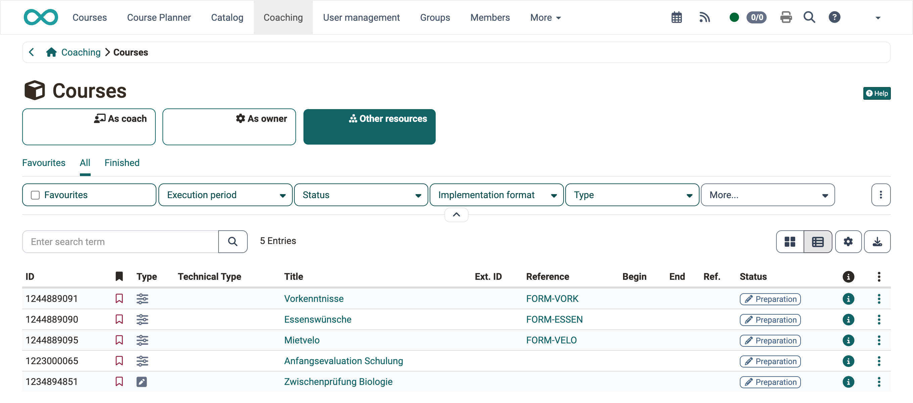
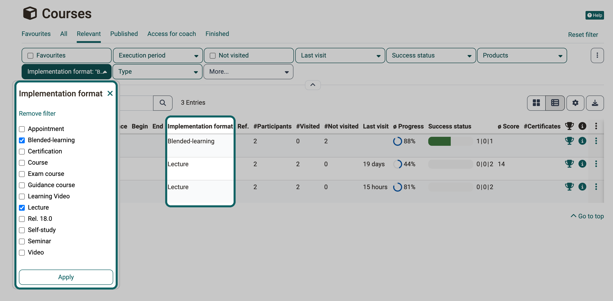
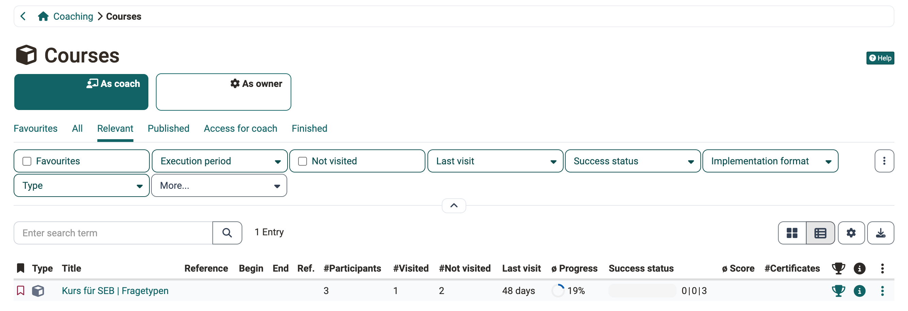

# Coaching - Courses {: #courses}

{ class="shadow lightbox" title="Courses in Coaching, focus Other resources · 2026.10.27" }

### WHICH courses does the list show? {: #courses_which}

The menu item "Courses" in the Coaching Tool shows the learning resources you are responsible for. Above the list, you use the focus to choose which resources the list loads:

* **As coach**: courses in which you are coach.
* **As owner**: courses with the usage "Standalone" or "Use in Course Planner" that you own.
* **Other resources** [:octicons-tag-16:{ title="from Release 20.1.5 (OO-8870)" }](https://track.frentix.com/issue/OO-8870){:target="_blank"}: learning resources with the usage "Embedding" or "Template" that you own, for example a test, a wiki or a course template.

A focus only appears if you own at least one matching learning resource with a status from "Preparation" to "Finished". The focus selection itself becomes visible as soon as more than one focus applies to you. In the example shown above, all three focus entries are available, "Other resources" is selected.

* The participants from all courses you coach are displayed. (In contrast to the [assessment tool](../learningresources/Assessment_tool_overview.md) of the course. There, only participants of the current course are displayed.)
* Coaches only see the participants they coach.
* The participants you coach are grouped and assigned to the roles you have as coach in relation to them.
* In the list for coaches, you only see courses that are published, finished or at least accessible for coaches.

!!! tip "This is where you find your embedded resources and your templates"

    The focus "Other resources" is intended for people without author rights. You see it if you have neither the role Author nor Learning resource manager nor Administrator. With one of these roles, you manage the same resources in [Authoring](Authoring.md); the focus is then not offered to you. For all other owners, it is the only way to a learning resource that is embedded in someone else's course.

[To the top of the page ^](#courses)

---

### Predefined filter tabs and filters [:octicons-tag-16:{ title="from Release 20.0.4 (OO-8677)" }](https://track.frentix.com/issue/OO-8677) {: #courses_filters}

Predefined filter tabs are available above the list. They narrow down which courses are displayed. In the focus entries "As coach" and "As owner", six tabs are available:

* **Favourites**: only the courses you have marked as a favourite.
* **All**: all courses regardless of status.
* **Relevant** [:octicons-tag-16:{ title="from Release 20.2.2 (OO-9167)" }](https://track.frentix.com/issue/OO-9167) (selected by default when opening): courses with the status "Published" and "Access for coach", i.e. the currently active courses that may require action.
* **Published**: only courses with the status "Published".
* **Access for coach**: only courses with the status "Access for coach".
* **Finished**: only courses with the status "Finished".

In the focus "Other resources", only the three tabs "Favourites", "All" and "Finished" are available. The default when opening is "All" here. The tabs "Relevant", "Published" and "Access for coach" are not available here, because OpenOlat does not load course statistics for embedded resources and templates. For the same reason, the filters for visits, assessments, number of participants and certificates are missing. Available here are the filters "Favourites", "Execution period", "Status", "Implementation format" and "Type". If your resources belong to educational products, the filter "Products" is added. Only courses carry an implementation format, course templates included. Tests, wikis and other learning resources drop out of the list when the filter "Implementation format" is active.

If you coach many courses, the filter "Implementation format" brings together the courses with a similar coaching effort, for example the self-study courses whose progress you check continuously. The filter is available in all focus entries and narrows down the list to courses of one or more formats, for example to all lectures [:octicons-tag-16:{ title="from Release 21.0.6 (OO-9879)" }](https://track.frentix.com/issue/OO-9879){:target="_blank"}. All formats that the system administration has defined under `Administration > Modules > Course`, tab "Implementation formats" are available for selection, see [Module Course](../../manual_admin/administration/Modules_Course.md#implementation_formats). The format of a course is selected in the course under `Course > Administration > Settings`, tab "Metadata", see [Implementation format](../learningresources/Course_Settings_Metadata.md#educational_type). Courses without a selected format do not appear when the filter is active.

{ class="shadow lightbox" title="Courses in Coaching, filter Implementation format · 2026.10.27" }

For more information on working with filters and filter tabs in general, see [Working with tables](../basic_concepts/Table_Concept.md). A tab of this view can also be set as a [personal landing page](../personal_menu/Settings.md#landing_page).

[To the top of the page ^](#courses)

---

### Course search {: #courses_search}

With the search field above the list, you narrow down the courses by title, reference or external ID. The search does not distinguish between upper and lower case. Without further characters, it finds all courses that contain the search term at any position.

If you do not know the exact spelling, use the asterisk `*` as a wildcard. It stands for any number of characters [:octicons-tag-16:{ title="from Release 20.3.7 (OO-9630)" }](https://track.frentix.com/issue/OO-9630){:target="_blank"}:

* `Blog*` finds courses whose title begins with "Blog".
* `*2026` finds courses whose title ends with "2026".
* `ab*cd` finds courses whose title begins with "ab" and ends with "cd", regardless of what lies in between.

The wildcard thus behaves in the same way as in the [Courses](Courses.md) area.

[To the top of the page ^](#courses)

---

### WHAT does the list show? [:octicons-tag-16:{ title="from Release 20.1.1 (OO-8806)" }](https://track.frentix.com/issue/OO-8806) {: #courses_what}

!!! tip "Tip"

    By clicking on the small buttons at the top right above the list, you can switch between list view and table view at any time.

{ class="shadow lightbox" title="Courses in Coaching in table view · 2026.10.27" }

You see at a glance, for example,

* in which courses (learning resources) you are coach,
* how many participants are in these courses
* and how far the processing of these courses has progressed overall.

From this list, you can switch directly to a course and its assessment tool. 
Clicking on a course name takes you directly to the course. There, you can navigate further to individual participants and view performance summaries or the absence management.

You can choose which columns are displayed by clicking on the gear icon at the top right.

* **ID** (unique number)
* **Bookmark**
* **Type** (icon for the type of the learning resource, a cube for courses)
* **Technical Type** (e.g. "Learning path" or "Conventional course")
* **Title**
* **Ext. ID** (external ID, which may follow a different system than the ID automatically assigned by OpenOlat)
* **Reference**
* **Begin** (begin of the implementation period of this course)
* **End** (end of the implementation period of this course)
* **Implementation format** (format selected in the course under `Course > Administration > Settings`, tab "Metadata", for example "Lecture"; hidden by default)
* **Ref.** (number of references, only with an active Course Planner)
* **Status** ("Review", "Published", "Finished")
* **Participants** (number of all participants)
* **Visited** (number of participants who have already visited this course)
* **Not visited** (number of participants who have never visited this course)
* **Last visit** (time when participants last visited the course)
* **ø Progress** (average of the progress values of all participants who have already visited the course)
* **Success status** (graphically and in numbers: "Passed" | "Not passed" | "Undefined")
* **Passed**
* **Not passed**
* **Undefined**
* **ø Score** (average score of all participants who have already worked on this course)
* **Certificates** (number of certificates already issued in this course)
* **Assessment tool** (clickable icon that leads directly to the assessment tool of this course)
* **Info page** (clickable info icon, a circle with "i". A click opens the info page of the course in this row with the details entered in the course under `Course > Administration > Settings`.) [:octicons-tag-16:{ title="from Release 21.1 (OO-9758)" }](https://track.frentix.com/issue/OO-9758){:target="_blank"}

At the right edge of each row, the three-dot menu opens the actions for this entry: "Assessment tool", "Info page" and "Open in new tab". The menu contains the entry "Assessment tool" only for courses and tests.

In the focus "Other resources", the list shows no participant, progress and certificate columns and no assessment tool, neither as a column nor in the three-dot menu. Available here are the columns ID, Bookmark, Type, Technical Type, Title, Ext. ID, Reference, Begin, End, Implementation format, Ref., Status and Info page.

!!! tip "Exact numbers for the success status"

    Hover the mouse over the graphic bar in the "Success status" column. A tooltip shows the exact numbers with their share in percent, for example "Passed: 12 (60%) | Not passed: 3 (15%) | Undefined: 5 (25%)" [:octicons-tag-16:{ title="from Release 20.3.0 (OO-9229)" }](https://track.frentix.com/issue/OO-9229){:target="_blank"}.

[To the top of the page ^](#courses)

---

## Further information {: #further_information}

**Mentioned on this page** 
[Assessment tool - Overview >](../learningresources/Assessment_tool_overview.md) 
[Authoring - Overview >](Authoring.md) 
[Module Course (Admin) >](../../manual_admin/administration/Modules_Course.md) 
[Course Settings: Tab Metadata >](../learningresources/Course_Settings_Metadata.md) 
[Working with tables >](../basic_concepts/Table_Concept.md) 
[Personal Configuration: Settings >](../personal_menu/Settings.md) 
[Finding courses >](Courses.md)

**Further reading** 
[Coaching: User search >](../../manual_user/area_modules/Coaching_User_Search.md) 
[Coaching: People >](../../manual_user/area_modules/Coaching_People.md) 
[Coaching: Educational products >](../../manual_user/area_modules/Coaching_Educational_Products.md) 
[Coaching: Events / Absences >](../../manual_user/area_modules/Coaching_Events_Absences.md) 
[Coaching: Assessment orders >](../area_modules/Coaching_Assessment_Orders.md) 
[Coaching: Reports >](../../manual_user/area_modules/Coaching_Reports.md) 
[Coaching: Groups >](../../manual_user/area_modules/Coaching_Groups.md) 
[Coaching: Order management >](../../manual_user/area_modules/Coaching_Order_Management.md) 
[Roles >](../../manual_user/basic_concepts/Roles.md)

[To the top of the page ^](#courses)
