# Coaching - Personen {: #people}

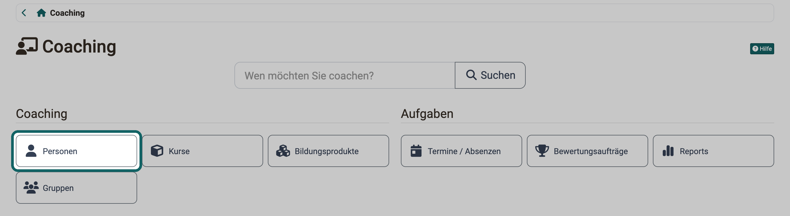{ class="shadow lightbox" title="Einstiegsseite Coaching · 2026.10.26" }

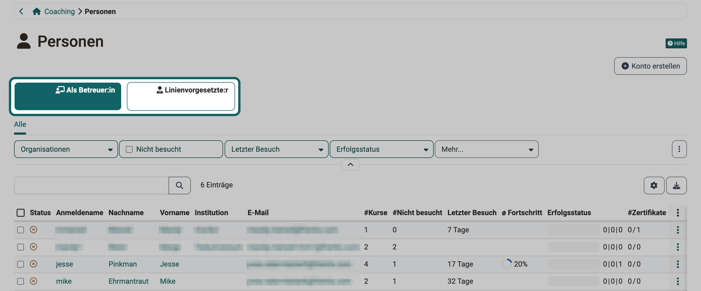{ class="shadow lightbox" title="Personenliste im Coaching · 2026.10.26" }

## WEN zeigt die Liste? [:octicons-tag-16:{ title="ab Release 20.0.0 (OO-8374)" }](https://track.frentix.com/issue/OO-8374){:target="_blank"} {: #people_who}

Der Menüpunkt "Personen" im Coaching Tool zeigt die Liste **aller von Ihnen betreuten** Teilnehmenden.

  * Es werden die Teilnehmenden aus **allen** betreuten Kursen angezeigt. (Im Unterschied zum [Bewertungswerkzeug](../learningresources/Assessment_tool_overview.de.md) des Kurses. Dort werden nur Teilnehmende des aktuellen Kurses angezeigt.)
  * Jeder Coach (Betreuer:in) sieht nur die von ihr/ihm betreuten Teilnehmenden.
  * Die betreuten Teilnehmenden sind **gruppiert und den Rollen zugeordnet**, die Sie als Betreuende:r gegenüber dieser Person haben. 
  Im oben gezeigten Beispiel kann die betreuende Person vorsortierte Listen abrufen, die ihren Rollen entsprechen:
    * als Betreuer:in
    * als Kursbesitzer:in
    * als Linienvorgesetzte:r
    * als Ausbildungsverantwortliche:r

!!! info "Hinweis zu den Rollen Linienvorgesetzte:r und Ausbildungsverantwortliche:r"

    Diese Rollen werden im Coaching Tool nur angezeigt, wenn Administrator:innen in der System-Administration das [Modul Organisationen](../../manual_admin/administration/Modules_Organisations.de.md) aktiviert haben.

!!! info "Hinweis zu weiteren Personenbeziehungen"

    Haben Sie zusätzlich [eigene Rollen und Beziehungen](../../manual_user/basic_concepts/Assign_Roles.de.md#role_assignment_relations) definiert, erscheinen auch diese hier als eigene, vorgruppierte Liste.

[Zum Seitenanfang ^](#people)

---

## WAS zeigt die Liste? [:octicons-tag-16:{ title="ab Release 20.0.3 (OO-8591)" }](https://track.frentix.com/issue/OO-8591){:target="_blank"} {: #people_what}

Sie können die angezeigten Spalten selbst festlegen, indem Sie rechts oben über der Liste auf das Zahnrad-Icon klicken. Die verfügbaren Spalten können je nach gewählter Rolle variieren.

Mit dem Suchfeld oberhalb der Liste grenzen Sie die Personen nach Namen und weiteren Kontoangaben ein. Mehrere Suchbegriffe trennen Sie mit Leerzeichen oder Komma; eine Person erscheint, wenn alle Begriffe auf sie zutreffen. Der Stern `*` steht für beliebig viele beliebige Zeichen, zum Beispiel `Mei*` für alle Namen, die mit "Mei" beginnen. Der Platzhalter verhält sich gleich wie in der [Kurssuche des Coaching Tools](Coaching_Courses.de.md#courses_search) [:octicons-tag-16:{ title="ab Release 20.3.7 (OO-9630)" }](https://track.frentix.com/issue/OO-9630){:target="_blank"}.

* **Status**
* **Anmeldename**
* **Nachname, Vorname** Ein Klick auf den Anmeldenamen, Nachnamen oder Vornamen einer Person führt zur Übersicht aller Kurse dieser Teilnehmer:in. So erhält die/der Lehrende Zugriff auf die Assessmentbereiche eines Kurses der Person inklusive des Zugriffes auf den jeweiligen Leistungsnachweis, das Bewertungswerkzeug des Kurses sowie die jeweiligen Lektionen. Auch das Suchfeld über dieser Kursliste kennt den Stern `*` als Platzhalter.
* **E-Mail**
* **Geschlecht**
* **Geburtsdatum**
* **Organisation**  Nur bei aktiviertem Modul Organisationen: Zu welcher Organisationseinheit gehört die Person? _(Diese Information ist besonders für Ausbildungsverantwortliche interessant.)_
* **Kurse**  In wie vielen der von Ihnen betreuten Kurse ist ein:e Benutzer:in Mitglied?
* **Nicht besucht**  In wie vielen der von Ihnen betreuten Kurse ist ein:e Benutzer:in Mitglied, hat den Kurs aber noch nie besucht?
* **Letzter Besuch**  Vor wie vielen Tagen war der letzte Besuch in einem der von Ihnen betreuten Kurse?
* **durchschnittlicher Fortschritt**  Durchschnitt über alle von Ihnen betreuten Kurse
* **Erfolgsstatus**
    * "Bestanden"/"Nicht bestanden"/"keine Angabe" in grafischer Darstellung
    * "Bestanden"/"Nicht bestanden"/"keine Angabe" in Zahlen
* **Zertifikate**  Anzahl der erhaltenen Zertifikate / Anzahl der möglichen Zertifikate
* **Weitere Aktionen** _(Icon mit 3 Punkten)_ 
    * Kontaktieren (per E-Mail)

!!! tip "Genaue Zahlen zum Erfolgsstatus"

    Fahren Sie mit der Maus über den grafischen Balken in der Spalte "Erfolgsstatus". Ein Tooltip zeigt die genauen Zahlen: "Bestanden: X / Nicht bestanden: Y / Keine Angabe: Z" [:octicons-tag-16:{ title="ab Release 20.3.0 (OO-9229)" }](https://track.frentix.com/issue/OO-9229){:target="_blank"}.

[Zum Seitenanfang ^](#people)

---

## Kontaktieren betreuter Personen [:octicons-tag-16:{ title="ab Release 20.0.3 (OO-8591)" }](https://track.frentix.com/issue/OO-8591){:target="_blank"} {: #contact}

Um einer bestimmten Person eine E-Mail zu schreiben, klicken Sie auf die 3 Punkte am Ende ihrer Zeile und wählen "Kontaktieren".

Um eine E-Mail an mehrere Personen zu schreiben, markieren Sie die betreffenden Personen in der ersten Spalte. Anschliessend erscheint über der Liste ein Button "Kontaktieren".

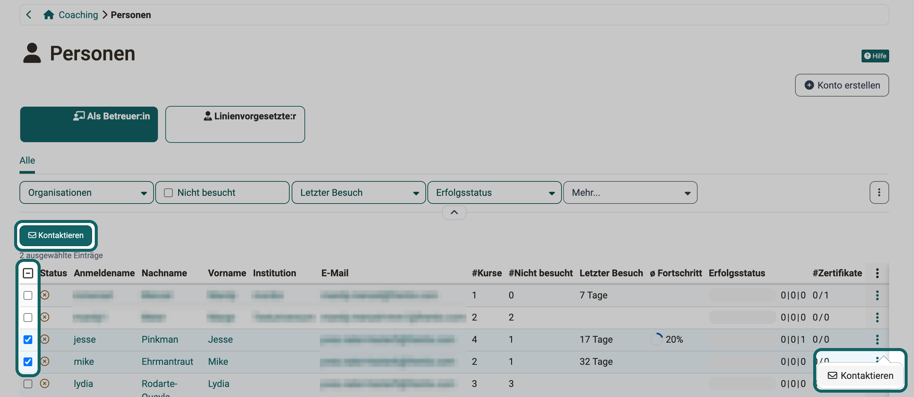{ class="shadow lightbox" title="Personenliste im Coaching · 2026.10.26" }

[Zum Seitenanfang ^](#people)

---

## Die Detailansicht einer Person {: #person_detail_view}

Wollen Sie wissen, wie weit eine betreute Person in ihren Kursen ist, wann sie an einem Kurs teilnimmt oder seit wann sie in einen Kurs eingebucht ist, finden Sie die Antwort in ihrer Detailansicht. Sie öffnen die Detailansicht in der Personenliste mit einem Klick auf den Namen oder den Anmeldenamen der Person. Wie die Detailansicht aufgebaut ist, hängt vom Fokus-Button ab, unter dem Sie die Person geöffnet haben.

### Unter "Als Betreuer:in" und "Als Kursbesitzer:in" {: #person_detail_view_coach}

Betreuen Sie eine Person in Ihren Kursen, zeigt Ihnen die Detailansicht vor allem ihre Kurse, damit Sie von dort direkt in Leistungsnachweis und Bewertungswerkzeug eines Kurses springen. Tabs gibt es in dieser Ansicht nicht. Ist das Modul Course Planner eingeschaltet, stehen unter den Angaben zur Person die Umschalter "Alle Kurse" und "Bildungsprodukte"; "Bildungsprodukte" zeigt die Durchführungen der Person. In dieser Rolle sehen Sie dort auch Durchführungen in Vorbereitung im eigenen Tab "Vorbereitung", und die Spalten "Fortschritt" und "Stundenplan" erscheinen immer.

Termine und Absenzen der Personen, die Sie betreuen, finden Sie in dieser Rolle im Werkzeug [Coaching - Termine und Absenzen](Coaching_Events_Absences.de.md). Es zeigt die Termine aller Ihrer betreuten Kurse, nicht die einer einzelnen Person.

### Unter "Linienvorgesetzte:r", "Ausbildungsverantwortliche:r" und eigenen Rollen [:octicons-tag-16:{ title="ab Release 20.0.4 (OO-8687)" }](https://track.frentix.com/issue/OO-8687){:target="_blank"} {: #person_detail_view_tabs}

Sind Sie für eine Person als Linienvorgesetzte:r, als Ausbildungsverantwortliche:r oder in einer [eigenen Rolle](../../manual_user/basic_concepts/Assign_Roles.de.md#role_assignment_relations) zuständig, ordnet die Detailansicht alle Auskünfte über die Person nach Themen in Tabs. So finden Sie Lernstand, Termine und Buchungen der Person, ohne in die einzelnen Kurse zu wechseln. Jeder Tab erscheint nur, wenn Administrator:innen Ihrer Rolle das zugehörige Recht erteilt haben; die Rechte zeigt der Abschnitt [Kontrollaufgaben](#linemanager_educationmanager_observe). Die Tabs stehen unter den Angaben zur Person in der folgenden Reihenfolge.

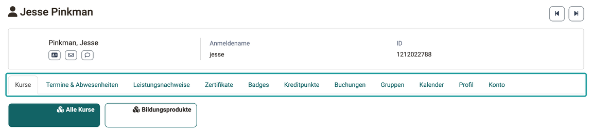{ class="shadow lightbox" title="Detailansicht einer Person im Coaching" }

#### Kurse {: #tab_courses}

Hier sehen Sie, wie weit die Person in ihren Kursen ist. Je nach den Rechten Ihrer Rolle zeigt die Liste Fortschritt, Bestanden und Punkte und, bei eingeschaltetem Modul Termine und Absenzen, die Zahl der Einheiten und Absenzen je Kurs. Der Tab zeigt den Lernstand, nicht den Zeitplan: Wann ein Termin stattfindet, steht im Tab "Termine & Abwesenheiten", wann die Person eingebucht wurde, im Tab "Buchungen". Ist das Modul Course Planner eingeschaltet, wechseln Sie mit dem Umschalter "Bildungsprodukte" zu den Durchführungen der Person, siehe [Die Bildungsprodukte einer Person](#linemanager_educationmanager_products). Voraussetzung für den Tab ist das Recht "Kurse und CPL-Produkte anzeigen".

#### Termine & Abwesenheiten {: #tab_lectures}

Hier sehen Sie, wann die Person an einem Kurs ist. Die erste Liste nennt je Kurs die geplanten und die besuchten Einheiten (Spalten "Einheiten" und "Anwesend") sowie die Absenzen. Klicken Sie auf einen Kurs, sehen Sie die einzelnen Termine mit "Datum", "Von", "Bis", "Termin" und "Dozenten". Das ist die einzige Stelle der Detailansicht, die Datum und Uhrzeit eines Termins nennt.

Voraussetzung sind das eingeschaltete [Modul Termine und Absenzen](../../manual_admin/administration/Modules_Events_and_Absences.de.md) und das Recht "Termine und Absenzen anzeigen". Als Linienvorgesetzte:r oder Ausbildungsverantwortliche:r sehen Sie zudem nur Kurse, die einer Organisationseinheit zugewiesen sind, in der Sie diese Rolle tragen. Das Recht allein genügt also nicht. Das ist die häufigste Ursache für eine leere Liste, obwohl das Recht gesetzt ist.

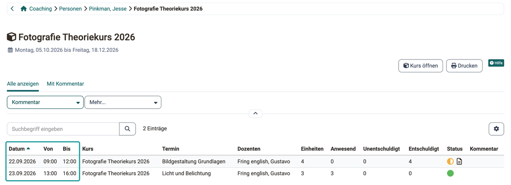{ class="shadow lightbox" title="Tab Termine & Abwesenheiten einer Person" }

!!! tip "Warum fehlt ein Kurs unter Termine & Abwesenheiten?"

    Prüfen Sie die Ursachen in dieser Reihenfolge. Die erste greift vor allen anderen.

    1. Im Kurs ist die [Termin- und Absenzenverwaltung](../learningresources/Course_Settings_Execution.de.md#lecture_enabled) ausgeschaltet. Dann fehlt der Kurs, auch wenn Recht, Rolle und Organisationseinheit stimmen.
    2. Für den Kurs sind keine [Termine erfasst](../learningresources/Events_and_absences.de.md).
    3. Der Kurs gehört zu keiner Organisationseinheit, in der Sie Linienvorgesetzte:r oder Ausbildungsverantwortliche:r sind.
    4. Der Kurs hat weder den Status "Veröffentlicht" noch den Status "Beendet".
    5. Die Person ist im Kurs nicht Teilnehmer:in.

#### Leistungsnachweise {: #tab_statements}

Hier sehen Sie die Leistungsnachweise der Person, also je Kurs ihre Resultate aus den bewertbaren Kursbausteinen mit Punkten und Status. Voraussetzung ist das Recht "Leistungsnachweise anzeigen".

#### Zertifikate {: #tab_certificates}

Hier sehen Sie, welche Zertifikate die Person erhalten hat. Der Tab erscheint mit demselben Recht wie der Tab "Leistungsnachweise".

#### Badges {: #tab_badges}

Hier sehen Sie, welche Badges die Person erhalten hat. Voraussetzung ist das Recht "Badges anzeigen".

#### Kreditpunkte [:octicons-tag-16:{ title="ab Release 21.1.0 (OO-9490)" }](https://track.frentix.com/issue/OO-9490){:target="_blank"} {: #tab_credit_points}

Hier sehen Sie, wie viele Kreditpunkte die Person in jedem Kreditpunktesystem hat und aus welchen Buchungen sie stammen. Der Tab zeigt dieselbe Ansicht wie die Seite [Meine Kreditpunkte](../personal_menu/Credit_Points.de.md) der Person: je Kreditpunktesystem die Kachel "Kreditpunkteguthaben", bei einem Kreditpunktesystem mit Gültigkeitsdauer zusätzlich die Kachel "Nächster Kreditpunkteverfall", und darunter die Tabelle "Transaktionen".

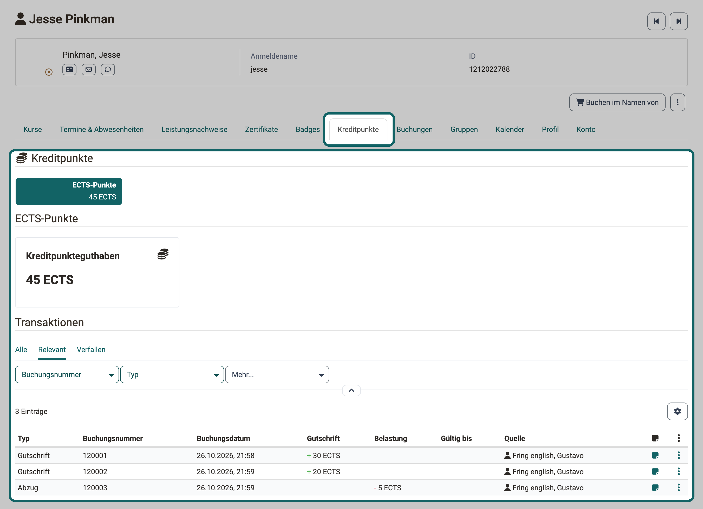{ class="shadow lightbox" title="Tab Kreditpunkte einer Person im Coaching · 2026.10.26" }

Der Tab ist nur lesend. Die Buttons "Kreditpunkte hinzufügen" und "Kreditpunkte entfernen" fehlen, und im Menü einer Transaktion steht nur "Detail der Transaktion". Kreditpunkte gutschreiben, abziehen oder stornieren können Administrator:innen in der Benutzerverwaltung. Ist ein Kreditpunktesystem auf Organisationen beschränkt, sehen Sie es nur, wenn Sie selbst einer dieser Organisationen angehören.

Voraussetzung sind das eingeschaltete [Modul Kreditpunkte](../../manual_admin/administration/e-Assessment_Credit_Points.de.md) und das Recht "Kreditpunkte anzeigen", das Administrator:innen [an der Organisation](../../manual_admin/administration/Modules_Organisations.de.md#edit_linemanager) oder an einer [eigenen Rolle](../../manual_user/basic_concepts/Assign_Roles.de.md#role_assignment_relations) setzen. Ab Werk ist das Recht aus. Fehlt eine der beiden Voraussetzungen, fehlt der Tab ganz, ohne Hinweis.

#### Buchungen {: #tab_bookings}

Hier sehen Sie, wann und über welches Angebot die Person in einen Kurs oder eine Durchführung gekommen ist. Die Liste nennt je Buchung das "Auftragsdatum", das "Angebot", den "Inhalt" und den "Status". Voraussetzung sind das eingeschaltete [Modul Katalog](../../manual_admin/administration/Modules_Catalog_2.0.de.md) und das Recht "Buchungen anzeigen". Tragen Sie zusätzlich das Recht "Ausstehende Kursbuchungen" und sind das Modul Course Planner und die Angebotsart "Rechnung" eingeschaltet, steht neben "Buchungsaufträge" der Umschalter "Ausstehende Mitgliedschaften", siehe [Ausstehende Mitgliedschaften genehmigen](#linemanager_educationmanager_confirm_membership).

#### Gruppen {: #tab_groups}

Hier sehen Sie, in welchen Gruppen die Person Mitglied ist. Voraussetzung ist das Recht "Gruppen anzeigen".

#### Kalender {: #tab_calendar}

Hier sehen Sie auf einen Blick, wann die Person verplant ist. Der Kalender führt ihren persönlichen Kalender, die Kurskalender der Kurse, in denen sie Teilnehmer:in ist, und die Kalender ihrer Gruppen mit dem Werkzeug Kalender zusammen. Welche davon erscheinen, hängt davon ab, welche Kalender Administrator:innen in der [Core-Konfiguration](../../manual_admin/administration/Core_functions.de.md#calendar_administration) eingeschaltet haben. Ein Termin aus der Termin- und Absenzenverwaltung erscheint nur, wenn er an einem Kurs hängt und der Kurs seine Termine mit dem Kurskalender synchronisiert. Voraussetzung für den Tab ist das Recht "Kurskalender anzeigen".

!!! tip "Warum fehlt ein Kurs im Kalender?"

    Prüfen Sie die Ursachen in dieser Reihenfolge.

    1. Für den Kurs sind keine Termine erfasst.
    2. Der Termin ist im Course Planner an einer Durchführung ohne verknüpften Kurs erfasst. Solche Termine erscheinen in keinem Kalender.
    3. Im Kurs ist die Option [Kurs Kalender synchronisieren](../learningresources/Course_Settings_Execution.de.md#course_calendar_sync) ausgeschaltet.
    4. Die Person hat eine ausstehende Mitgliedschaft und ist im Kurs noch nicht Teilnehmer:in.
    5. Der Kurs hat weder den Status "Freigabe Betreuer:innen" noch "Veröffentlicht" noch "Beendet".

    An Ihrer Berechtigung liegt es nicht. Der Kalender zeigt die Kurse der Person unabhängig davon, zu welcher Organisationseinheit sie gehören.

Die Tabs "Termine & Abwesenheiten" und "Kalender" können für denselben Kurs Verschiedenes zeigen, weil sie nicht dasselbe prüfen. "Termine & Abwesenheiten" verlangt den Status "Veröffentlicht" oder "Beendet" und bei Linienvorgesetzten und Ausbildungsverantwortlichen die passende Organisationseinheit. Der Kalender begnügt sich mit dem Status "Freigabe Betreuer:innen" und fragt nicht nach der Organisationseinheit. Zudem folgt der Kalender der Einstellung "Termin- und Absenzenverwaltung" im Kurs nicht: Ist sie ausgeschaltet, fehlt der Kurs unter "Termine & Abwesenheiten", während seine Termine im Kalender weiterhin erscheinen können.

#### Profil {: #tab_profile}

Hier sehen Sie die Profilangaben der Person. Mit dem Recht "Profil anzeigen" ist der Tab nur lesend, mit dem Recht "Profil editieren" können Sie die Angaben auch bearbeiten. Hat die Person zusätzliche Rollen, bleibt der Tab nur lesend, siehe [Erweiterte Personensicht](#linemanager_educationmanager_extended_view).

#### Konto {: #tab_account}

Hier sehen Sie, wann das Konto der Person angelegt wurde und wann sie sich zuletzt angemeldet hat, und Sie können den Status des Kontos ändern, etwa um es zu deaktivieren. Voraussetzung ist das Recht "Konten deaktivieren".

[Zum Seitenanfang ^](#people)

---

## Coaching-Aufgaben als Linienvorgesetzte / Ausbildungsverantwortliche [:octicons-tag-16:{ title="ab Release 20.0.0 (OO-7839)" }](https://track.frentix.com/issue/OO-7839){:target="_blank"} {: #linemanager_educationmanager}

Linienvorgesetzte und Ausbildungsverantwortliche finden im Coaching Tool unter Personen einen zusätzlichen Button, unter dem sie alle Personen finden, für die sie in ihrer Rolle zuständig sind.

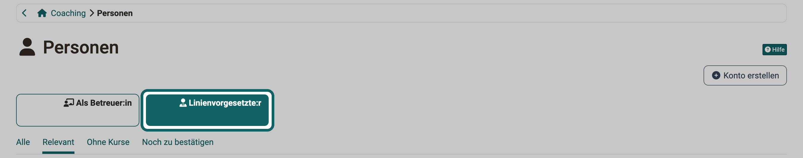{ class="shadow lightbox" title="Personenliste im Coaching · 2026.10.26" }

### Erweiterte Personensicht [:octicons-tag-16:{ title="ab Release 20.3.0 (OO-9168)" }](https://track.frentix.com/issue/OO-9168){:target="_blank"} {: #linemanager_educationmanager_extended_view}

In der Personenliste unter dem Fokus "Linienvorgesetzte:r" bzw. "Ausbildungsverantwortliche:r" werden alle Benutzer:innen der Organisation angezeigt, unabhängig von deren Rolle.

Hat eine Person zusätzliche Rollen (mehr als die Rolle Autor:in), erscheint in der Detailansicht ein Hinweis mit Icon: **"Aufgrund zusätzlicher organisatorischer Rollen ist die Verwaltung für diese Person eingeschränkt."** In diesem Fall gilt:

* Die Tabs **Profil** und **Konto** sind nur lesend zugänglich.
* Die Aktion **Passwort zurücksetzen** steht nicht zur Verfügung.

[Zum Seitenanfang ^](#people)

---

### Voraussetzungen {: #linemanager_educationmanager_conditions}

Den zusätzlichen Button "Linienvorgesetzte:r" bzw. "Ausbildungsverantwortliche:r" sehen Sie, wenn die Voraussetzungen 1 und 2 erfüllt sind. Was Sie unter dem Button sehen und tun können, bestimmt Voraussetzung 3.

**Voraussetzung 1:**
Das Modul "Organisationen" muss in der System-Administration aktiviert sein.  `Administration > Module > Organisationen`

**Voraussetzung 2:**
Die betreffende Person muss die Rolle zugewiesen bekommen haben.  `Benutzerverwaltung > Person auswählen > Tab Rollen`

**Voraussetzung 3:**
Administrator:innen erteilen Ihrer Rolle in der System-Administration die Rechte, die Sie brauchen. Ohne Recht fehlt der zugehörige Tab oder Button. Um ausstehende Mitgliedschaften zu genehmigen, braucht Ihre Rolle das Recht "Buchungen anzeigen" und das darunter eingerückte Recht "Ausstehende Kursbuchungen". Das zweite lässt sich erst setzen, wenn das erste gesetzt ist: 
`Administration > Module > Organisationen > Tab Organisationsstruktur > "Organisationseinheit (oberste Ebene)" > Tab Linienvorgesetzte:r bzw. Ausbildungsverantwortliche > Optionen "Buchungen anzeigen" und "Ausstehende Kursbuchungen"` 
Was jedes Recht bewirkt, beschreibt [Modul Organisationen: Die Rechte im Einzelnen](../../manual_admin/administration/Modules_Organisations.de.md#rights_linemanager).

---

### Konto für Mitarbeiter:innen anlegen [:octicons-tag-16:{ title="ab Release 20.0.1 (OO-8491)" }](https://track.frentix.com/issue/OO-8491){:target="_blank"} {: #linemanager_educationmanager_create_account}

Im Coaching Tool finden Sie als Linienvorgesetzte:r bzw. Ausbildungsverantwortliche:r rechts oben den **Button "Konto erstellen"**. Sie öffnen damit ein Formular zum Erfassen der notwendigen Angaben, um noch nicht registrierte Personen in OpenOlat aufzunehmen.

Ob dieser Button zur Verfügung steht, wird in der System-Administration festgelegt: 
`Administration > Module > Organisationen > Tab Organisationsstruktur > "Organisationseinheit (oberste Ebene)" > Tab Linienvorgesetzte:r bzw. Ausbildungsverantwortliche > Option "Konten erstellen"`

Ein durch Linienvorgesetzte oder Ausbildungsverantwortliche angelegtes Konto enthält automatisch eine Zuordnung der neu registrierten Person zur Organisationseinheit der Linienvorgesetzten bzw. Ausbildungsverantwortlichen.

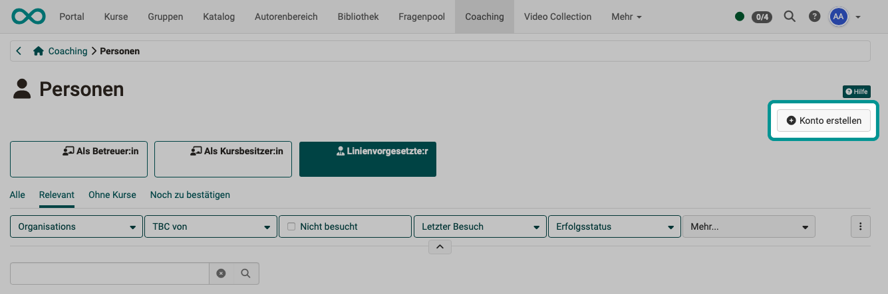{ class="shadow lightbox" title="Personenliste im Coaching" }

---

### Teilnehmer:innen im Auftrag einbuchen {: #linemanager_educationmanager_book_participants}

Möchten Sie als Linienvorgesetzte:r bzw. Ausbildungsverantwortliche:r eine bereits in OpenOlat registrierte Person in eine Durchführung einbuchen, wählen Sie die Person im Coaching Tool und klicken auf den **Button "Buchen im Namen von"**. Dort wählen Sie die Durchführung, an der die Person teilnehmen soll. Zur Wahl stehen nur Durchführungen, keine Kurse oder anderen Lernressourcen. Angebote mit PayPal oder PayPal Checkout erscheinen dort nicht.

Ob dieser Button zur Verfügung steht, wird in der System-Administration festgelegt: 
`Administration > Module > Organisationen > Tab Organisationsstruktur > "Organisationseinheit (oberste Ebene)" > Tab Linienvorgesetzte:r bzw. Ausbildungsverantwortliche > Option "Im Namen von jemandem buchen"`

Personen mit einer [eigenen Rolle](../../manual_user/basic_concepts/Assign_Roles.de.md#role_assignment_relations) sehen den Button ebenfalls, wenn der Rolle dasselbe Recht zugeteilt ist.

Verwendet das Angebot Formulare, führt OpenOlat Sie durch den [Assistenten der Buchung](catalog2.0_angebote.de.md#offer_booking_wizard). Sie füllen die Formulare stellvertretend aus. Die Antworten gehören zum Buchungsauftrag der gebuchten Person, nicht zu Ihrem. [:octicons-tag-16:{ title="ab Release 21.1 (OO-9742)" }](https://track.frentix.com/issue/OO-9742){:target="_blank"}

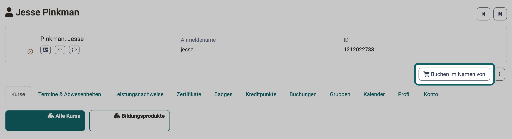{ class="shadow lightbox" title="Detailansicht einer Person im Coaching · 2026.10.26" }

**Beispiel 1:** 
Eine neue Mitarbeiterin soll im nächsten Monat einige Einführungskurse absolvieren.

**Beispiel 2:** 
Ihre Mitarbeiter:innen sind verpflichtet, Sicherheitskurse oder Compliancekurse zu machen. Weil sie als Linienvorgesetzte:r oder Ausbildungsverantwortliche:r verantwortlich sind, buchen Sie alle Personen selbst ein.

---

### Ausstehende Mitgliedschaften genehmigen [:octicons-tag-16:{ title="ab Release 20.1.5 (OO-8892)" }](https://track.frentix.com/issue/OO-8892){:target="_blank"} {: #linemanager_educationmanager_confirm_membership}

Oft entscheiden Linienvorgesetzte und Ausbildungsverantwortliche, ob Lernende an einer Bildungsmassnahme teilnehmen können. In OpenOlat kann ihnen die Möglichkeit eingerichtet werden, ausstehende Mitgliedschaften zu akzeptieren oder abzulehnen.

Wählen Sie dazu im Coaching Tool die betreffende Person. Hat sie eine ausstehende Mitgliedschaft, zeigt ihre Detailansicht einen Hinweis mit dem Link "Zur Bestätigung gehen". Er öffnet im Tab "Buchungen" die Liste "Ausstehende Mitgliedschaften". Ein Klick auf das Plus-Symbol am Anfang einer Zeile klappt die Details der Mitgliedschaft auf.

Rechts oben in den aufgeklappten Details entscheiden Sie mit den Buttons "Akzeptieren" und "Ablehnen" über die Mitgliedschaft.

Alternativ benutzen Sie den Link in der Benachrichtigung. Sind das Modul Course Planner und die Angebotsart "Rechnung" eingeschaltet, führt zusätzlich der Button "Ausstehende Bestätigungen" auf der Coaching-Übersicht zu einer Liste aller offenen Mitgliedschaften; ihr Suchfeld kennt den Stern `*` als Platzhalter.

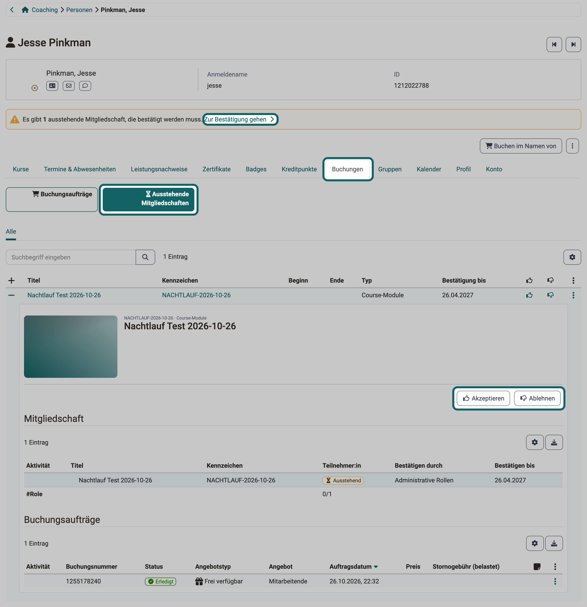{ class="shadow lightbox" title="Tab Buchungen einer Person im Coaching · 2026.10.26" }

!!! info "Wie kommt es zu ausstehenden Mitgliedschaften?"

    Im Coaching erscheinen ausstehende Mitgliedschaften in Durchführungen, die über ein Angebot gebucht wurden, bei dem unter "Mitgliedschaft" die Option "Mit Bestätigung" gewählt ist. Gebucht hat entweder die Person selbst im Katalog, Sie mit "Buchen im Namen von" oder jemand im Course Planner, der beim Hinzufügen der Person im Schritt "Buchungsauftrag" ein solches Angebot gewählt hat.

    Fügt jemand die Person im Course Planner mit "Ohne Buchungsauftrag" hinzu und wählt im Schritt "Mitgliedschaft" die Option "Mit Bestätigung", ist die Mitgliedschaft zwar ausstehend. Im Coaching erscheint sie aber weder im Hinweis noch in der Liste, weil kein Buchungsauftrag dazu besteht.

    Mehr dazu: [Bestätigung der Mitgliedschaft im Course Planner >](../../manual_user/area_modules/Course_Planner_Implementations.de.md#confirm_membership)

---

### Kontrollaufgaben {: #linemanager_educationmanager_observe}

Sind Sie Linienvorgesetzte:r oder Ausbildungsverantwortliche:r können Sie sich über die Lernfortschritte innerhalb Ihrer Organisationseinheit jederzeit im Coaching Tool informieren. Auch eine automatische Benachrichtigung über alle erhaltenen Zertifikate ist möglich.

Grundsätzlich werden Ihnen als Linienvorgesetzte:r oder Ausbildungsverantwortliche:r Leserechte gewährt, die Bearbeitung ist jedoch eingeschränkt und bleibt den Betreuenden und Kursbesitzer:innen vorbehalten.

**Beispiele:** 

* Sie sehen, wer welche Kurse besucht, können aber nicht auf Checklisten, Aufgaben usw. innerhalb der Kurse zugreifen, um die Eintragungen der Teilnehmenden zu sehen.
* Sie können sich erhaltene Badges und andere Leistungsdaten anzeigen lassen, aber selbst keine Badges vergeben.
* Sie können sich Absenzen anzeigen lassen, aber nicht selbst erfassen. Dies müssen die Kursbesitzer:innen/Betreuer:innen. Das Erstellen von Absenzenreports ist dagegen möglich.
* Sie können das Kreditpunkteguthaben und die Transaktionen einer Person einsehen, aber keine Kreditpunkte gutschreiben, abziehen oder stornieren. So sehen Sie zum Beispiel, ob jemand genug Kreditpunkte für die Rezertifizierung in einem Zertifikatsprogramm gesammelt hat. [:octicons-tag-16:{ title="ab Release 21.1 (OO-9490)" }](https://track.frentix.com/issue/OO-9490){:target="_blank"}

In der Detailansicht einer Person finden Sie diese Angaben in eigenen Tabs: die besuchten Kurse im Tab [Kurse](#tab_courses), die erhaltenen Badges im Tab [Badges](#tab_badges), die Absenzen im Tab [Termine & Abwesenheiten](#tab_lectures) und die Kreditpunkte im Tab [Kreditpunkte](#tab_credit_points). Welcher Tab zu welchem Recht gehört, beschreibt der Abschnitt [Die Detailansicht einer Person](#person_detail_view_tabs).

Möchten Sie als Linienvorgesetzte:r oder Ausbildungsverantwortliche:r bestimmte Rechte, können Sie diese von Administrator:innen einrichten lassen. Der nachstehende Screenshot zeigt, welche Optionen von Administrator:innen konfiguriert werden können. (Für Ausbildungsverantwortliche bestehen die gleichen Optionen.)

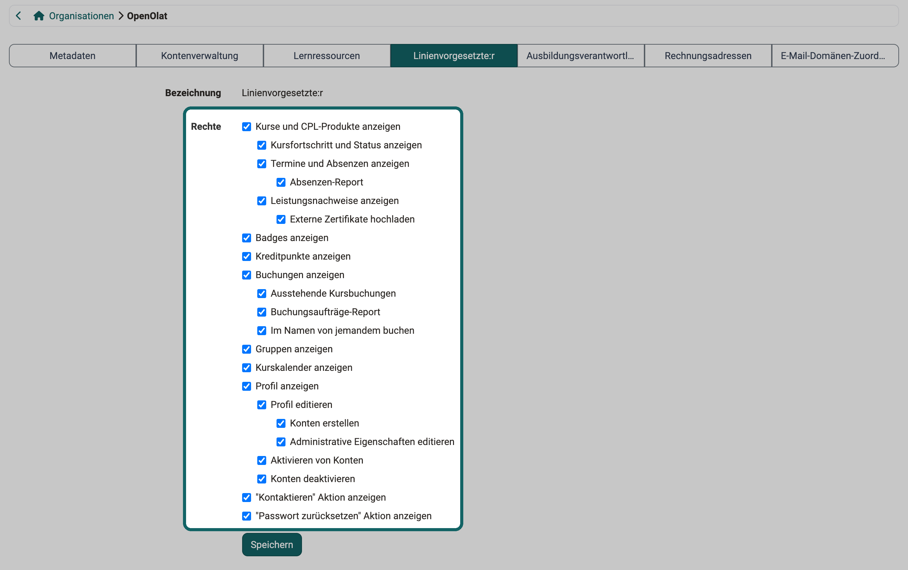{ class="shadow lightbox" title="Tab Linienvorgesetzte:r einer Organisation · 2026.10.26" }

Was jedes dieser Rechte bewirkt, beschreibt das Administrationshandbuch unter [Modul Organisationen: Linienvorgesetzte](../../manual_admin/administration/Modules_Organisations.de.md#edit_linemanager).

### Die Bildungsprodukte einer Person [:octicons-tag-16:{ title="ab Release 21.0 (OO-9374)" }](https://track.frentix.com/issue/OO-9374){:target="_blank"} {: #linemanager_educationmanager_products}

Öffnen Sie eine Person und wechseln Sie zu "Bildungsprodukte". Die Liste zeigt die Durchführungen dieser Person. Sie folgt derselben Logik wie die Liste unter [Coaching - Bildungsprodukte](../area_modules/Coaching_Educational_Products.de.md#filter), bietet aber weniger Filter und Spalten:

* Als Filter-Tabs stehen "Alle", "Relevant" und "Beendet" zur Verfügung. "Relevant" ist vorausgewählt.
* Die Tabs "Favoriten" und "Vorbereitung" gibt es hier nicht. Durchführungen in Vorbereitung sehen nur Betreuer:innen und Kursbesitzer:innen.
* Eine Spalte "Status" gibt es nicht. Abgebrochene Durchführungen erscheinen im Tab "Beendet", lassen sich dort aber nicht einzeln herausfiltern.
* Die Spalten "Fortschritt" und "Stundenplan" erscheinen nur, wenn Administrator:innen Ihrer Rolle die entsprechenden Rechte erteilt haben.

[Zum Seitenanfang ^](#people)

---

## Weiterführende Informationen {: #further_information}

**Auf dieser Seite erwähnt** 
[Bewertungswerkzeug >](../../manual_user/learningresources/Assessment_tool_overview.de.md) 
[Modul Organisationen >](../../manual_admin/administration/Modules_Organisations.de.md) 
[Eigene Rollen und Beziehungen definieren >](../../manual_user/basic_concepts/Assign_Roles.de.md) 
[Coaching: Kurse >](../../manual_user/area_modules/Coaching_Courses.de.md) 
[Coaching: Termine / Absenzen >](../area_modules/Coaching_Events_Absences.de.md) 
[Modul Termine und Absenzen >](../../manual_admin/administration/Modules_Events_and_Absences.de.md) 
[Kurseinstellungen - Tab Durchführung >](../learningresources/Course_Settings_Execution.de.md) 
[Termine und Absenzen im Kurs >](../learningresources/Events_and_absences.de.md) 
[e-Assessment Administration: Kreditpunkte >](../../manual_admin/administration/e-Assessment_Credit_Points.de.md) 
[Persönliche Erfolge/Leistungen: Kreditpunkte >](../personal_menu/Credit_Points.de.md) 
[Modul Katalog >](../../manual_admin/administration/Modules_Catalog_2.0.de.md) 
[Core-Konfiguration: Übersicht >](../../manual_admin/administration/Core_functions.de.md) 
[Katalog 2.0 - Angebote >](../area_modules/catalog2.0_angebote.de.md) 
[Course Planner: Durchführungen >](../../manual_user/area_modules/Course_Planner_Implementations.de.md) 
[Coaching: Bildungsprodukte >](../area_modules/Coaching_Educational_Products.de.md)

**Weiterführend** 
[Coaching: Personensuche >](../../manual_user/area_modules/Coaching_User_Search.de.md) 
[Coaching: Bewertungsaufträge >](../area_modules/Coaching_Assessment_Orders.de.md) 
[Coaching: Reports >](../../manual_user/area_modules/Coaching_Reports.de.md) 
[Coaching: Gruppen >](../../manual_user/area_modules/Coaching_Groups.de.md) 
[Coaching: Auftragsverwaltung >](../../manual_user/area_modules/Coaching_Order_Management.de.md) 
[Rollen >](../../manual_user/basic_concepts/Roles.de.md)

[Zum Seitenanfang ^](#people)
