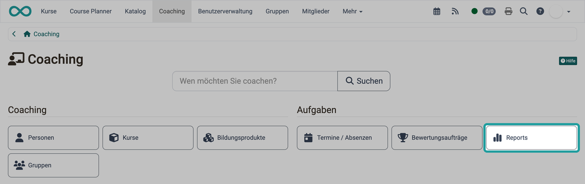
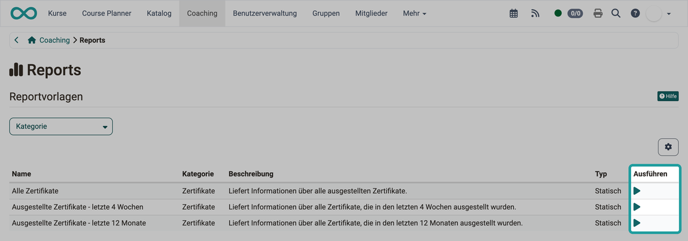
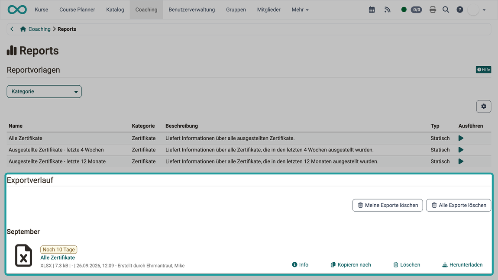

# Coaching - Reports {: #reports}

Sie möchten auswerten, welche der Personen, die Sie betreuen, ein Zertifikat erhalten haben, oder ihre Absenzen und offenen Buchungsaufträge überblicken? Im Bereich "Reports" des Coaching Tools erzeugen Sie dafür aus einer Reportvorlage eine Excel-Datei. Die Vorlagen sind nach Kategorien gegliedert, etwa Zertifikate, Absenzen und Buchungsaufträge, und Sie sehen nur die Vorlagen, die Sie ausführen dürfen.

## Wer kann Zertifikats-Reports ausführen? [:octicons-tag-16:{ title="ab Release 20.0 (OO-8371)" }](https://track.frentix.com/issue/OO-8371) {: #access}

Die Reportvorlagen der Kategorie "Zertifikate" stehen folgenden Rollen zur Verfügung:

* Betreuer:innen von Kursen
* Betreuer:innen von Bildungsprodukten
* Linienvorgesetzten
* Ausbildungsverantwortlichen

Der Report enthält die Zertifikatsdaten der Personen, für die Sie in dieser Rolle zuständig sind.

!!! note "Sie sehen den Button Reports nicht?"
    Den Button "Reports" zeigt das Coaching Tool Betreuer:innen von Kursen, Besitzer:innen von Lernressourcen, Linienvorgesetzten und Ausbildungsverantwortlichen. Wann der Eintrag "Coaching" im Hauptmenü erscheint, beschreibt die Seite [Coaching - Übersicht](../Coaching/index.de.md#availability). Wie Rollen vergeben werden, zeigt die Seite [Rollen zuweisen](../../basic_concepts/Assign_Roles.de.md).

[Zum Seitenanfang ^](#reports)

---

## So erstellen Sie einen Excel-Report [:octicons-tag-16:{ title="ab Release 20.0 (OO-8368)" }](https://track.frentix.com/issue/OO-8368) {: #create_report}

1. Öffnen Sie im Hauptmenü `Coaching > Reports`. Der Button "Reports" steht im Abschnitt "Aufgaben".
2. Klicken Sie in der Tabelle "Reportvorlagen" bei der gewünschten Vorlage auf das Symbol "Report generieren" in der Spalte "Ausführen".
3. OpenOlat erzeugt den Report als Excel-Datei (.xlsx) und listet ihn im Abschnitt "Exportverlauf" auf.
4. Klicken Sie beim erzeugten Report auf "Herunterladen".

{ class="shadow lightbox" title="Startseite des Coaching Tools" }

[Zum Seitenanfang ^](#reports)

---

## Reportvorlagen {: #templates}

In der Tabelle "Reportvorlagen" wählen Sie, welchen Report Sie erzeugen. Sie zeigt für jede Vorlage Name, Kategorie, Beschreibung und Typ ("Statisch" oder "Dynamisch") sowie die Spalte "Ausführen". Mit dem Filter "Kategorie" grenzen Sie die Liste ein.

{ class="shadow lightbox" title="Reportvorlagen im Bereich Reports" }

### Vorlagen der Kategorie Zertifikate {: #certificate_templates}

| Name | Beschreibung |
|------|--------------|
| Alle Zertifikate | Liefert Informationen über alle ausgestellten Zertifikate. |
| Ausgestellte Zertifikate - letzte 4 Wochen | Liefert Informationen über alle Zertifikate, die in den letzten 4 Wochen ausgestellt wurden. |
| Ausgestellte Zertifikate - letzte 12 Monate | Liefert Informationen über alle Zertifikate, die in den letzten 12 Monaten ausgestellt wurden. |

Die erzeugte Excel-Datei enthält das Worksheet "Einzelkurse" und, falls das Modul Course Planner aktiv ist, zusätzlich das Worksheet "Produkte". Den Aufbau der Worksheets zeigt die Seite [Reports: Zertifikate](../../area_modules/Reports_Certficates.de.md).

### Vorlagen der Kategorien Buchungsaufträge und Absenzen {: #booking_absence_templates}

Diese Vorlagen sehen Linienvorgesetzte und Ausbildungsverantwortliche, denen ihre Organisation das Recht "Buchungsaufträge-Report" oder "Absenzen-Report" gibt. Administrator:innen vergeben diese Rechte in der System-Administration unter `Administration > Module > Organisationen`, siehe [Modul Organisationen](../../../manual_admin/administration/Modules_Organisations.de.md#rights_linemanager).

| Name | Beschreibung |
|------|--------------|
| Offene Buchungsaufträge - letzte 4 Wochen | Enthält die offenen Buchungsaufträge der letzten 4 Wochen. |
| Offene Buchungsaufträge - letzte 12 Monate | Enthält die offenen Buchungsaufträge der letzten 12 Monate. |
| Absenzen - letzte 4 Wochen | Enthält die Absenzen der letzten 4 Wochen. |
| Absenzen - letzte 12 Monate | Enthält die Absenzen der letzten 12 Monate. |

Die Spalten des Reports zu den Buchungsaufträgen beschreibt die Seite [Reports: Buchungsaufträge](../Reports_BookingOrders.de.md).

[Zum Seitenanfang ^](#reports)

---

## Exportverlauf {: #generated_reports}

Im Abschnitt "Exportverlauf" finden Sie die Excel-Dateien, die Sie erzeugt haben. Jede Datei steht nach der Erstellung 10 Tage zum Herunterladen bereit, die verbleibenden Tage zeigt OpenOlat bei der Datei an. Mit den Buttons "Info", "Kopieren nach", "Löschen" und "Herunterladen" neben der Datei zeigen Sie Details an, kopieren die Datei, löschen sie oder laden sie herunter. Die Liste enthält nur Reports, die Sie selbst erzeugt haben. Die Buttons "Meine Exporte löschen" und "Alle Exporte löschen" entfernen deshalb beide alle Dateien der Liste auf einmal.

{ class="shadow lightbox" title="Exportverlauf im Bereich Reports" }

[Zum Seitenanfang ^](#reports)

---

## Weiterführende Informationen {: #further_information}

**Auf dieser Seite erwähnt** 
[Coaching - Übersicht >](../Coaching/index.de.md) 
[Rollen zuweisen >](../../basic_concepts/Assign_Roles.de.md) 
[Reports: Zertifikate >](../../area_modules/Reports_Certficates.de.md) 
[Modul Organisationen >](../../../manual_admin/administration/Modules_Organisations.de.md) 
[Reports: Buchungsaufträge >](../Reports_BookingOrders.de.md)

**Weiterführend** 
[Coaching: Personensuche >](../../../manual_user/area_modules/Coaching_User_Search.de.md) 
[Coaching: Personen >](../../../manual_user/area_modules/Coaching_People.de.md) 
[Coaching: Kurse >](../../../manual_user/area_modules/Coaching_Courses.de.md) 
[Coaching: Bildungsprodukte >](../../../manual_user/area_modules/Coaching_Educational_Products.de.md) 
[Coaching: Termine / Absenzen >](../../../manual_user/area_modules/Coaching_Events_Absences.de.md) 
[Coaching: Bewertungsaufträge >](../../area_modules/Coaching_Assessment_Orders.de.md) 
[Coaching: Gruppen >](../../../manual_user/area_modules/Coaching_Groups.de.md) 
[Coaching: Auftragsverwaltung >](../../../manual_user/area_modules/Coaching_Order_Management.de.md) 
[Bewertungswerkzeug >](../../learningresources/Assessment_tool_overview/index.de.md)

[Zum Seitenanfang ^](#reports)
