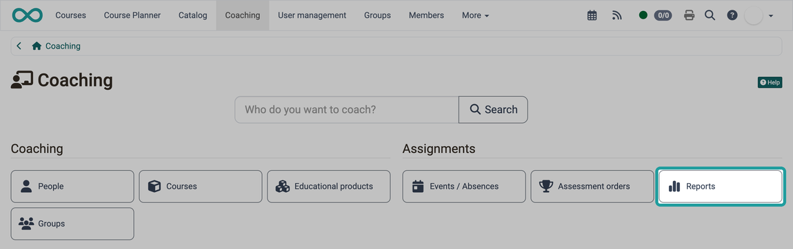
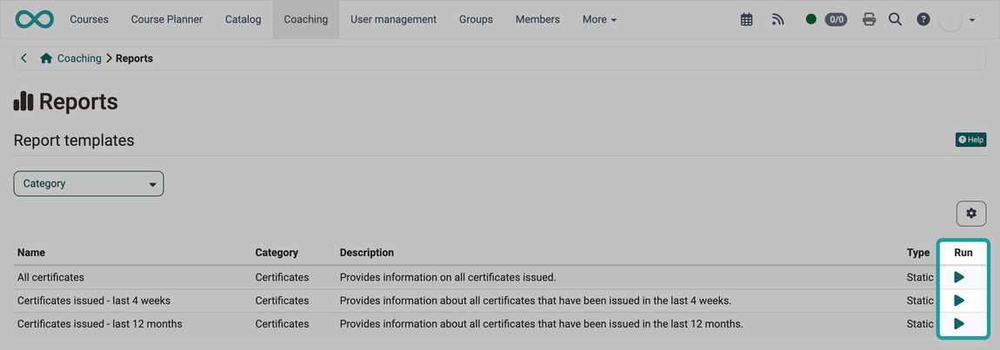
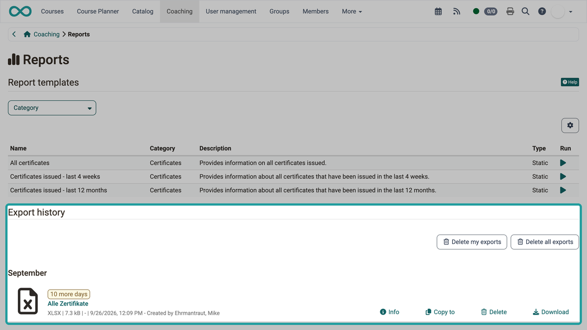

# Coaching - Reports {: #reports}

Do you want to evaluate which of the persons you coach have received a certificate, or get an overview of their absences and open booking orders? In the "Reports" area of the Coaching Tool, you generate an Excel file from a report template for this purpose. The templates are grouped into categories, such as Certificates, Absences and Booking orders, and you only see the templates you are allowed to run. [:octicons-tag-16:{ title="from Release 21.0 (OO-9620)" }](https://track.frentix.com/issue/OO-9620)

## Who can run certificate reports? [:octicons-tag-16:{ title="from Release 20.0 (OO-8371)" }](https://track.frentix.com/issue/OO-8371) {: #access}

The report templates of the category "Certificates" are available to the following roles:

* Coaches of courses
* Coaches of educational products
* Line managers
* Education managers

The report contains the certificate data of the persons you are responsible for in this role.

!!! note "You do not see the Reports button?"
    The Coaching Tool shows the "Reports" button to coaches of courses, owners of learning resources, line managers and education managers. The page [Coaching - Overview](../Coaching/index.md#availability) describes when the "Coaching" entry appears in the main menu. The page [Assign roles](../../basic_concepts/Assign_Roles.md) explains how roles are assigned.

[To the top of the page ^](#reports)

---

## How to create an Excel report [:octicons-tag-16:{ title="from Release 20.0 (OO-8368)" }](https://track.frentix.com/issue/OO-8368) {: #create_report}

1. Open `Coaching > Reports` in the main menu. The "Reports" button is in the "Assignments" section.
2. In the "Report templates" table, click the "Generate report" icon in the "Run" column of the desired template.
3. OpenOlat generates the report as an Excel file (.xlsx) and lists it in the "Export history" section.
4. Click "Download" next to the generated report.

{ class="shadow lightbox" title="Start page of the Coaching Tool" }

[To the top of the page ^](#reports)

---

## Report templates {: #templates}

In the "Report templates" table, you choose which report you generate. It shows the name, category, description and type ("Static" or "Dynamic") of each template as well as the "Run" column. Use the "Category" filter to narrow down the list.

{ class="shadow lightbox" title="Report templates in the Reports area" }

### Templates of the category Certificates {: #certificate_templates}

| Name | Description |
|------|-------------|
| All certificates | Provides information on all certificates issued. |
| Certificates issued - last 4 weeks | Provides information about all certificates that have been issued in the last 4 weeks. |
| Certificates issued - last 12 months | Provides information about all certificates that have been issued in the last 12 months. |

The generated Excel file contains the worksheet "Individual courses" and, if the Course Planner module is active, an additional worksheet "Products". The page [Reports: Certificates](../../area_modules/Reports_Certficates.md) shows the structure of the worksheets.

### Templates of the categories Booking orders and Absences {: #booking_absence_templates}

These templates are shown to line managers and education managers whose organisation grants them the right "Booking orders report" or "Absence report". Administrators assign these rights in the system administration under `Administration > Modules > Organisations`, see [Module Organisations](../../../manual_admin/administration/Modules_Organisations.md#rights_linemanager).

| Name | Description |
|------|-------------|
| Open booking orders - Last 4 weeks | Contains the open booking orders of the last 4 weeks. |
| Open booking orders - Last 12 months | Contains the open booking orders of the last 12 months. |
| Absences - Last 4 weeks | Contains the absences of the last 4 weeks. |
| Absences - Last 12 months | Contains the absences of the last 12 months. |

The page [Reports: Booking orders](../Reports_BookingOrders.md) describes the columns of the booking orders report.

[To the top of the page ^](#reports)

---

## Export history {: #generated_reports}

The "Export history" section contains the Excel files you have generated. Each file is available for download for 10 days after creation, and OpenOlat shows the remaining days next to the file. With the "Info", "Copy to", "Delete" and "Download" buttons next to the file, you view details, copy the file, delete it or download it. The list only contains reports that you generated yourself. The "Delete my exports" and "Delete all exports" buttons therefore both remove all files of the list at once.

{ class="shadow lightbox" title="Export history in the Reports area" }

[To the top of the page ^](#reports)

---

## Further information {: #further_information}

**Mentioned on this page** 
[Coaching - Overview >](../Coaching/index.md) 
[Assign roles >](../../basic_concepts/Assign_Roles.md) 
[Reports: Certificates >](../../area_modules/Reports_Certficates.md) 
[Module Organisations >](../../../manual_admin/administration/Modules_Organisations.md) 
[Reports: Booking orders >](../Reports_BookingOrders.md)

**Further reading** 
[Coaching: User search >](../../../manual_user/area_modules/Coaching_User_Search.md) 
[Coaching: People >](../../../manual_user/area_modules/Coaching_People.md) 
[Coaching: Courses >](../../../manual_user/area_modules/Coaching_Courses.md) 
[Coaching: Educational products >](../../../manual_user/area_modules/Coaching_Educational_Products.md) 
[Coaching: Events / Absences >](../../../manual_user/area_modules/Coaching_Events_Absences.md) 
[Coaching: Assessment orders >](../../area_modules/Coaching_Assessment_Orders.md) 
[Coaching: Groups >](../../../manual_user/area_modules/Coaching_Groups.md) 
[Coaching: Order management >](../../../manual_user/area_modules/Coaching_Order_Management.md) 
[Assessment tool >](../../learningresources/Assessment_tool_overview/index.md)

[To the top of the page ^](#reports)
