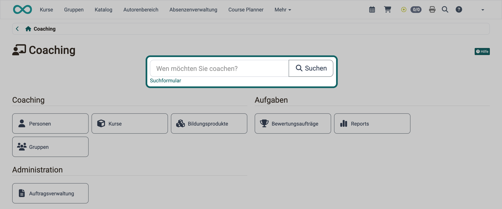
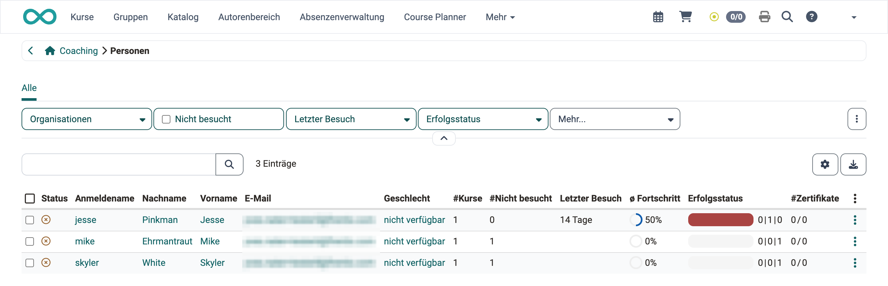
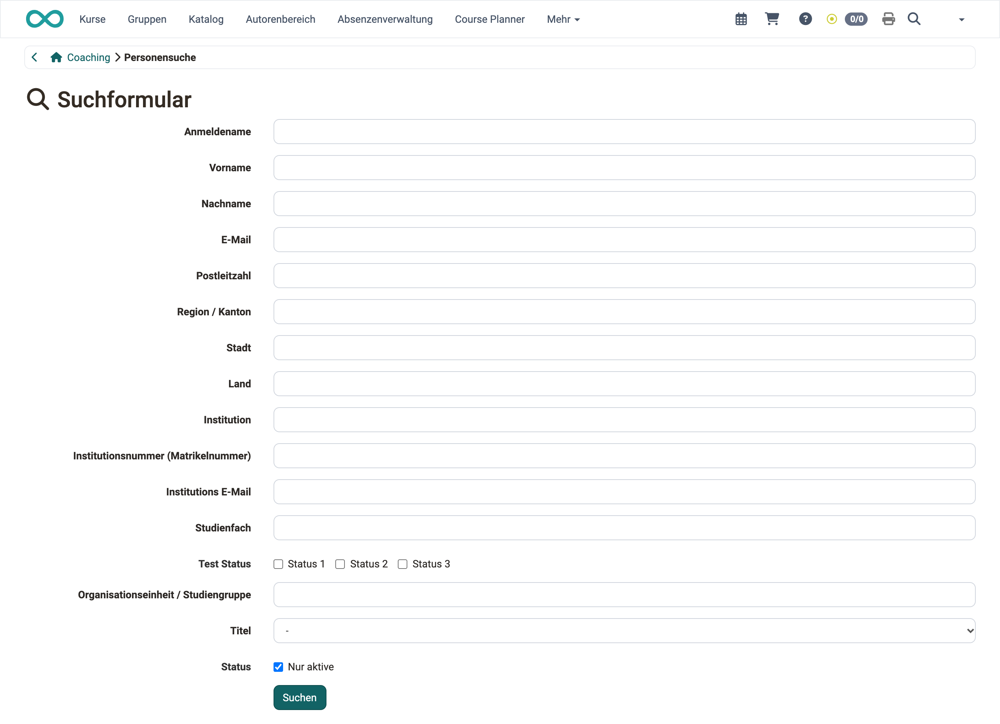

# Coaching - Personensuche {: #user_search}

Als Betreuer:in finden Sie über das Suchfeld auf der Einstiegsseite im Coaching jede Person, die Sie betreuen, und öffnen von dort ihre Kurse.

{ class="shadow lightbox" title="Einstiegsseite Coaching · 2026.10.22" }

Geben Sie einen Namen oder einen Teil davon ein. Mehrere Suchbegriffe trennen Sie mit Leerzeichen oder Komma; eine Person erscheint, wenn alle Begriffe auf sie zutreffen. Der Stern `*` steht für beliebig viele beliebige Zeichen, zum Beispiel `Mei*` für alle Namen, die mit "Mei" beginnen. Der Stern verhält sich gleich wie in der Kurssuche im Coaching [:octicons-tag-16:{ title="ab Release 20.3.7 (OO-9630)" }](https://track.frentix.com/issue/OO-9630){:target="_blank"}.

!!! tip "Tipp"

    Klicken Sie ohne Eingabe eines Namens auf "Suchen", erhalten Sie die Liste aller Personen, die Sie betreuen. Über der Liste grenzen Sie mit den Filtern "Organisationen", "Nicht besucht", "Letzter Besuch" und "Erfolgsstatus" ein; den Filter "Zertifikate" fügen Sie über "Mehr..." hinzu. Den Filter "Organisationen" gibt es nur, wenn Ihre Instanz Organisationen nutzt.

{ class="shadow lightbox" title="Liste Personen im Coaching · 2026.10.22" }

 
Den Link "Suchformular" sehen nur Administrator:innen, Lernressourcenverwalter:innen und Principals. Über das Suchformular suchen Sie nach dem Anmeldenamen und weiteren Kontoangaben; auch in seinen Feldern steht der Stern `*` für beliebig viele Zeichen.

{ class="shadow lightbox" title="Suchformular der Personensuche im Coaching · 2026.10.22" }
