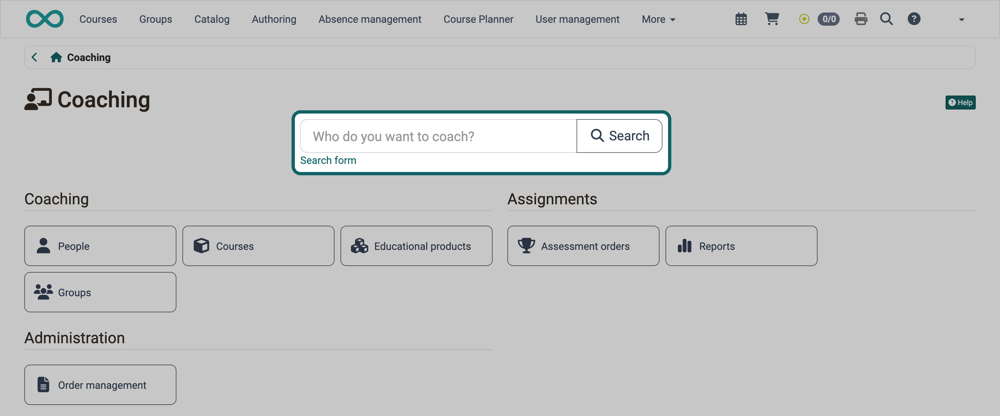
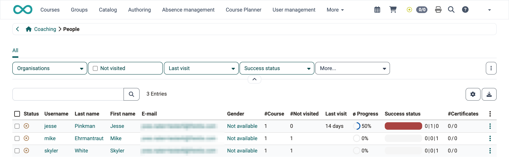
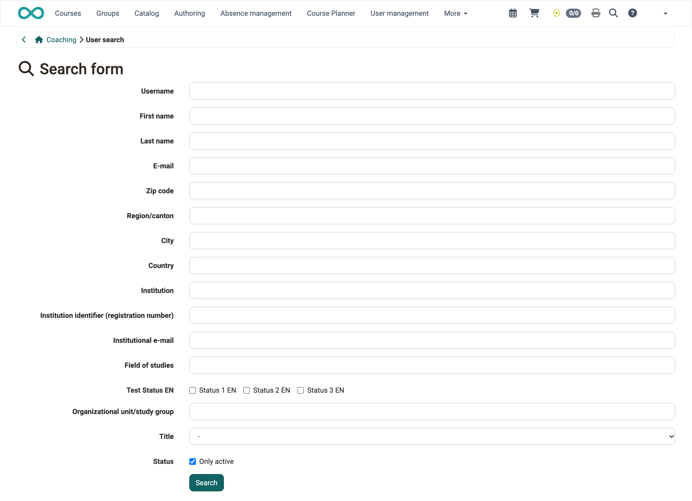

# Coaching - User search {: #user_search}

As a coach, you find every person you coach with the search field on the entry page of Coaching and open their courses from there.

{ class="shadow lightbox" title="Coaching entry page · 2026.10.22" }

Enter a name or a part of it. Separate several search terms with a space or a comma; a person appears when all terms apply to them. The asterisk `*` stands for any number of characters, for example `Mei*` for all names beginning with "Mei". The asterisk behaves in the same way as in the course search in Coaching [:octicons-tag-16:{ title="from Release 20.3.7 (OO-9630)" }](https://track.frentix.com/issue/OO-9630){:target="_blank"}.

!!! tip "Tip"

    If you click "Search" without entering a name, you get the list of all people you coach. Above the list, you narrow it down with the filters "Organisations", "Not visited", "Last visit" and "Success status"; you add the filter "Certificates" with "More...". The filter "Organisations" only exists when your instance uses organisations.

{ class="shadow lightbox" title="People list in Coaching · 2026.10.22" }

 
Only administrators, learning resource managers and principals see the "Search form" link. Use the search form to search by username and further account details; the asterisk `*` also stands for any number of characters in its fields.

{ class="shadow lightbox" title="Search form of the user search in Coaching · 2026.10.22" }
