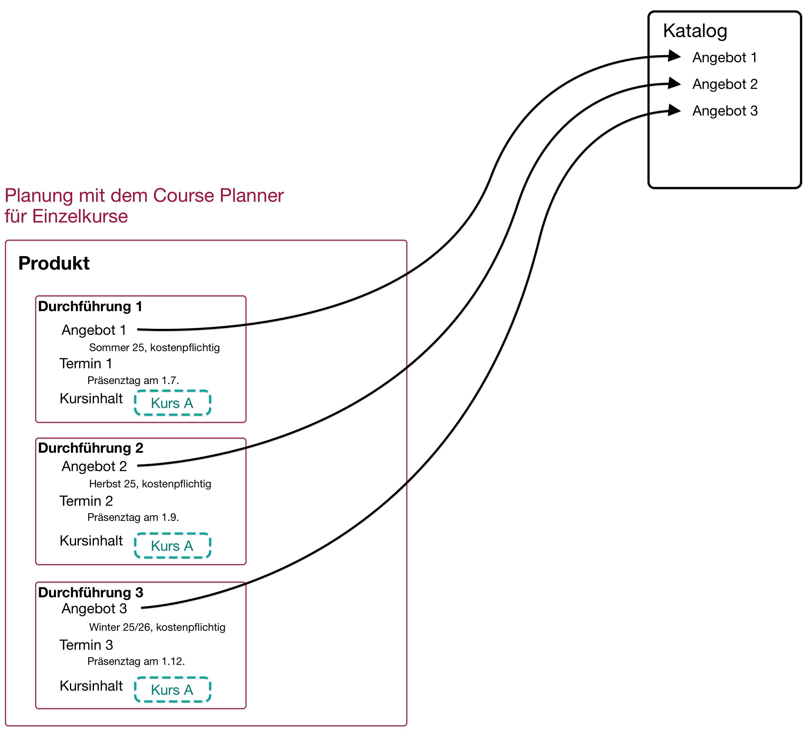
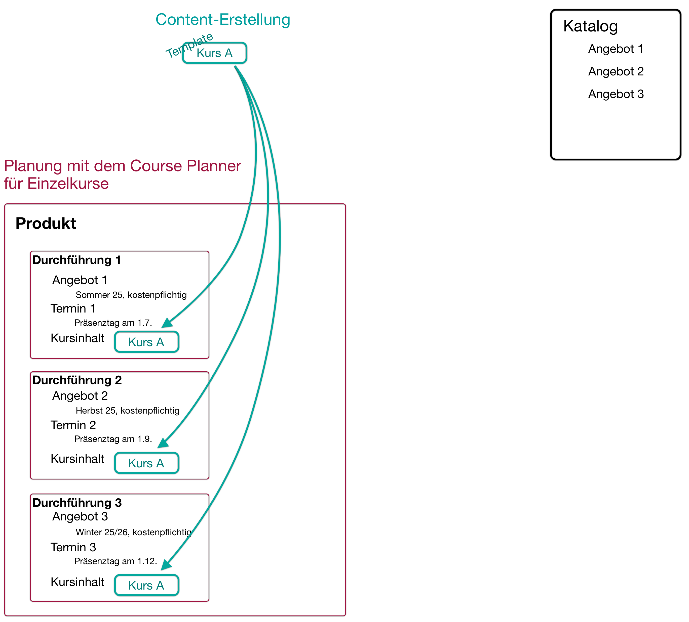
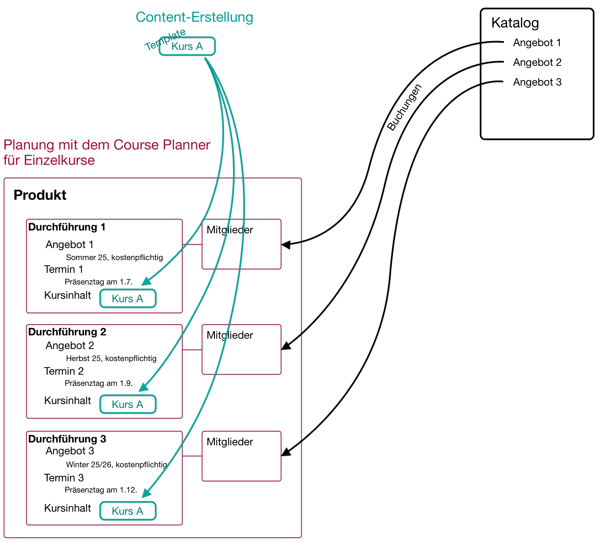
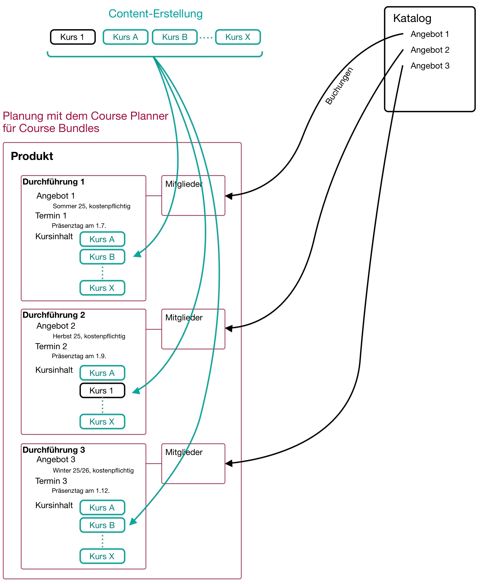
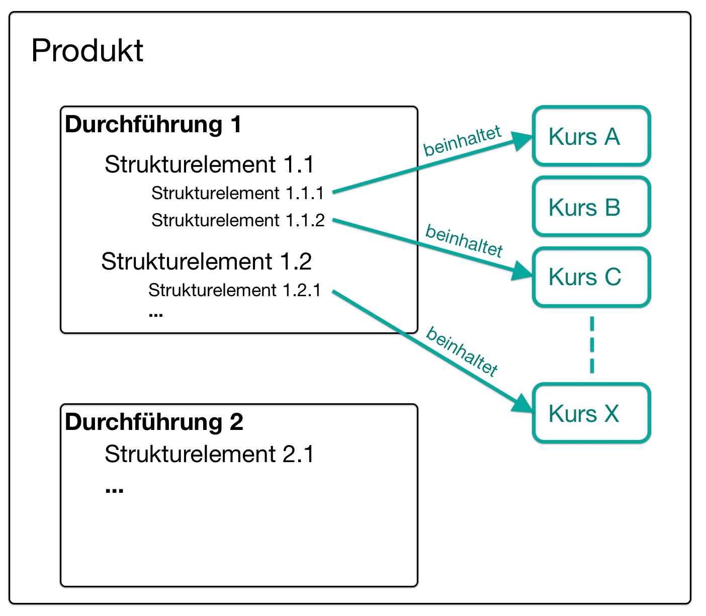
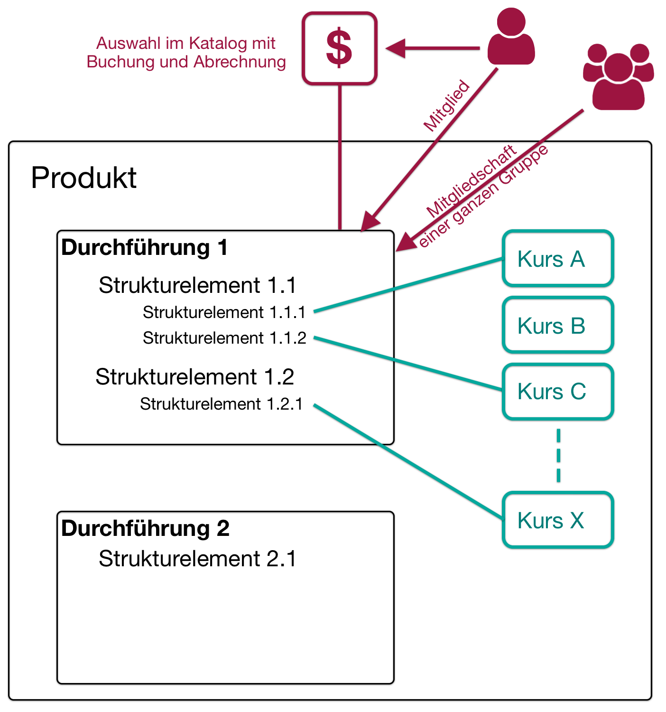
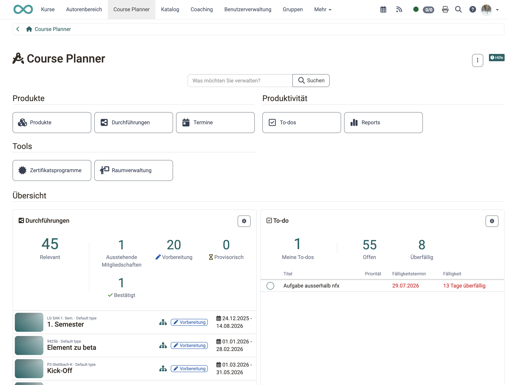

# Course Planner: Übersicht [:octicons-tag-16:{ title="ab Release 20.0 (OO-7834)" }](https://track.frentix.com/issue/OO-7834){:target="_blank"} {: #course_planner}

Wozu jeder Button der Startseite dient und wo er beschrieben ist, zeigt der Abschnitt [Startseite und Bereiche](#start_page).

## Steckbrief

Name | Course Planner
---------|----------
Verfügbar seit | Release 13.0 (2018)
Umbau | Release 20.0 (OO-7834)

## Wozu dient der Course Planner? {: #purpose}

Der Course Planner ist ein Modul für das Kursmanagement. Ziel ist es, automatisiert und effizient vom Angebot ausgehend Kurse zu erstellen und durchzuführen.

Mit dem Course Planner kann die Planungsarbeit von der Inhaltserstellung (im Autorenbereich) getrennt werden.

Sie können natürlich auch ohne Course Planner OpenOlat-Kurse erstellen. Mit dem Course Planner steht Ihnen jedoch ein Werkzeug zur Verfügung, das die organisatorischen Aufgaben zusammenführt.

| ohne Course Planner              | mit Course Planner                                        |
| -------------------------------- | --------------------------------------------------------- |
| nur eigenständige einzelne Kurse | einzelne oder mehrere Kurse mit mehreren Durchführungen   |
| alles wird einzeln in den  Kursen administriert und verwaltet | zentrale Administration |
| x                                | funktionale Trennung zwischen Administration und Inhalt   |
| x                                | zentrale Planung mehrerer Kurse                           |
| x                                | zentrale Mitgliederverwaltung mehrerer Kurse              |
| x                                | zentrale Ausschreibung mehrerer Kurse                     |
| x                                | zentrale Steuerung und Verwaltung mehrerer Kurse          |

Mit dem Course Planner gemanaged werden können

* Einzelkurse
* Course Bundles
* strukturierte Bildungsgänge/Produkte

[Zum Seitenanfang ^](#course_planner)

---

## Planungsaufgaben {: #planning}

Die Planungsaufgaben umfassen:

- verschiedene Angebotstypen erstellen (z.B. kostenpflichtig / nicht kostenpflichtig)
- mehrere Kursdurchführungen mit jeweils eigenem Zeitfenster planen
- Angebote im Katalog platzieren
- Platzkontingente in den Kursen definieren
- automatische Kurserstellung aus Template vorbereiten
- automatisierte Statusänderungen im Kurs einrichten

[Zum Seitenanfang ^](#course_planner)

---

## Planung für Einzelkurse {: #planning_single_courses}

Mit dem Course Planner können für einen Kurs mehrere Durchführungen erstellt und im Katalog angeboten werden.

Diese administrative Planungsarbeit kann von einem/einer Kursplaner:in auch schon gemacht werden, wenn der Kurs noch nicht erstellt wurde oder noch nicht in endgültiger Version vorliegt.

{ class="shadow lightbox" title="Planung für Einzelkurse" }

Unabhängig von diesen administrativen Aufgaben (durchgeführt von einem/einer Kursplaner:in) kann ein Kurs von Autor:innen als Template erstellt und dann in alle Durchführungen eingebunden werden. 

Die Instanzierung der Kurse kann auch automatisch auf einen bestimmbaren Termin vorgenommen werden.

{ class="shadow lightbox" title="Planung für Einzelkurse" }

Die Mitglieder können z.B. direkt durch Selbstbuchung eines Angebots im Katalog zu den einzelnen Durchführungen hinzugefügt werden.

!!! info "Beachten Sie:"

    Kursmitglied im Template-Kurs sind dann lediglich noch die Kurs-Besitzer:innen mit Autor:innen-Rolle.

{ class="shadow lightbox" title="Planung für Einzelkurse" }

[Zum Seitenanfang ^](#course_planner)

---

## Planung für Course Bundles {: #planning_course_bundles}

So wie für einen Einzelkurs mehrere Durchführungen erstellt werden können, können auch für ein ganzes Kurspaket (Course Bundle) Durchführungen erstellt und im Katalog angeboten werden.

Wenn gewünscht, kann in den einzelnen Durchführungen die Zusammenstellung der Kurse/Lernressourcen auch modifiziert werden und abweichend von der Standarddurchführung ("Kopiervorlage") zusammengesetzt sein.

{ class="shadow lightbox" title="Planung für Course Bundles" }

[Zum Seitenanfang ^](#course_planner)

---

## Planung für strukturierte Bildungsgänge {: #planning_structured_product}

Strukturierte Produkte/Bildungsgänge weisen gegenüber Course Bundles zusätzlich eine Gliederung in Baumstruktur auf. Sie enthalten Strukturelemente. 

Auch wenn Teilnehmer:innen ein Bildungsprodukt absolvieren sollen, werden sie zu Mitgliedern einer bestimmten Durchführung gemacht. (Nicht zu Mitgliedern einzelner Kurse oder zu Mitgliedern der Bildungsprodukt-Vorlage.) 

{ class="shadow lightbox" title="Strukturiertes Produkt" }

Ausserdem kann auch eine Abrechnung für die Durchführung eingerichtet werden.

{ class="shadow lightbox" title="Strukturiertes Produkt" }

[Zum Seitenanfang ^](#course_planner)

---

## Wer kann den Course Planner nutzen? [:octicons-tag-16:{ title="ab Release 20.3.0 (OO-8916)" }](https://track.frentix.com/issue/OO-8916){:target="_blank"} {: #users}

Nach der Aktivierung des Course Planners durch einen/eine Systemadministrator:in steht er allen Benutzer:innen mit der Rolle "Kursplaner:in" zur Verfügung. (Bei Verwendung von Organisationseinheiten, kann die Rolle Kursplaner:innen auch auf bestimmte Organisationseinheiten beschränkt sein.) 

Administrator:innen und Principals haben ebenfalls Zugriff. (Auch diese Rollen sind evtl. auf Organisationseinheiten beschränkt.)

Principals haben dabei ausschliesslich lesenden Zugriff auf den gesamten Course Planner: Aktionen wie "Status ändern", "Entfernen" oder "Instanzieren" stehen ihnen nicht zur Verfügung. Öffnen Principals einen Kurs direkt aus dem Course Planner heraus, gilt dieselbe Leserechte-Beschränkung auch für die Kursansicht.

!!! info "Hinweis für die Einschränkung als Principal"
    Die Lese-Einschränkung ist dann aktiv, wenn der Principal auch nur diese Rolle ausübt. Es kann Querverbindungen geben, wenn ein User z.B. mehrere Rollen in einem Produkt hat. Dann kann dieser User aktiv werden, wo es die Rolle entsprechend zulässt. z.B. in einem To-do welches "ihm" zugewiesen ist.

Begrenzt auf ein bestimmtes Produkt können die Produktbesitzer:innen und Elementbesitzer:innen im Rahmen ihres Zuständigkeitsbereichs zugreifen.

!!! info "Weitere OpenOlat Rollen"
    Autor:innen und Lernressourcenverwalter:innen haben keinen Zugriff auf den Course Planner. Ihre Rolle, Rechte und Aufgaben fokussieren auf die Content-Erstellung, weniger auf die Planung, Terminierung und Administration von Kursen und Durchführungen.

[Zum Seitenanfang ^](#course_planner)

---

## Rollen und Rechte im Course Planner {: #roles_rights}

Der Zugriff im Course Planner richtet sich nach drei Verantwortungsbereichen:

* **fachlich-strukturelle Verantwortung**: Aufbau und Pflege von Produkten, Durchführungen und Elementen
* **administrative Verantwortung**: Verwaltung der Mitglieder, zum Beispiel durch ein Sekretariat
* **inhaltliche Verantwortung**: Inhalte, Termine und Aufgaben der einzelnen Elemente

Je nach Rolle ist einer, sind zwei oder alle drei Bereiche abgedeckt:

* **Kursplaner:in** (Organisationsrolle): deckt alle drei Bereiche ab und hat uneingeschränkten Zugriff auf alle Produkte und Zertifikatsprogramme der eigenen Organisation.
* **Administrator:in**: hat im Course Planner dieselben Rechte wie eine Kursplaner:in.
* **Produktbesitzer:in**: übernimmt dieselben Aufgaben wie eine Kursplaner:in, jedoch beschränkt auf die Produkte, bei denen sie als Produktbesitzer:in eingetragen ist (unabhängig von der Organisation).
* **Elementbesitzer:in**: trägt die inhaltliche Verantwortung für die eigenen Elemente (unabhängig von der Organisation). Sie hat vollen Zugriff auf die Inhalte und Termine des eigenen Elements, kann Mitglieder und Einstellungen jedoch nur lesen und die Struktur nicht verändern.
* **Principal**: hat ausschliesslich lesenden Zugriff auf den gesamten Course Planner (siehe Abschnitt oben).

Zusätzlich haben Besitzer:innen von Zertifikatsprogrammen Zugang zum Course Planner.

### Rechte-Matrix {: #rights_matrix}

Die folgende Übersicht zeigt, welche Aktionen die einzelnen Rollen auf den Objekten des Course Planners ausführen können.

Legende: :material-check: Zugang beziehungsweise Aktion verfügbar · :material-cancel: kein Zugriff · die übrigen Angaben nennen die jeweils verfügbaren Aktionen.

|  | Administrator:in | Kursplaner:in | Produktbesitzer:in | Principal | Elementbesitzer:in | Kursbesitzer:in | Klassenlehrer:in | Betreuer:in | Teilnehmer:in |
| --- | --- | --- | --- | --- | --- | --- | --- | --- | --- |
| Zugang zum Course Planner | :material-check: | :material-check: | :material-check: | :material-check: | :material-check: | :material-cancel: | :material-cancel: | :material-cancel: | :material-cancel: |
| Produkt (aktiv) | Erstellen, Lesen, Bearbeiten, Löschen | Erstellen, Lesen, Bearbeiten, Löschen | Lesen, Bearbeiten | Lesen | Lesen | :material-cancel: | :material-cancel: | :material-cancel: | :material-cancel: |
| Produkt (gelöscht) | Lesen | :material-cancel: | :material-cancel: | :material-cancel: | :material-cancel: | :material-cancel: | :material-cancel: | :material-cancel: | :material-cancel: |
| Durchführung | Erstellen, Lesen, Bearbeiten, Löschen | Erstellen, Lesen, Bearbeiten, Löschen | Erstellen, Lesen, Bearbeiten, Löschen | Lesen | :material-cancel: | :material-cancel: | :material-cancel: | :material-cancel: | :material-cancel: |
| Element | Erstellen, Lesen, Bearbeiten, Löschen | Erstellen, Lesen, Bearbeiten, Löschen | Erstellen, Lesen, Bearbeiten, Löschen | Lesen | Lesen, Bearbeiten | :material-cancel: | :material-cancel: | :material-cancel: | :material-cancel: |
| Termin | Erstellen, Lesen, Bearbeiten, Löschen | Erstellen, Lesen, Bearbeiten, Löschen | Erstellen, Lesen, Bearbeiten, Löschen | Lesen | Erstellen, Lesen, Bearbeiten, Löschen | :material-cancel: | :material-cancel: | :material-cancel: | :material-cancel: |
| Template | Hinzufügen, Lesen, Instanzieren, Entfernen | Hinzufügen, Lesen, Instanzieren, Entfernen | Hinzufügen, Lesen, Instanzieren, Entfernen | Lesen | Hinzufügen, Lesen, Instanzieren, Entfernen | :material-cancel: | :material-cancel: | :material-cancel: | :material-cancel: |
| Kurs | Hinzufügen, Lesen, Entfernen | Hinzufügen, Lesen, Entfernen | Hinzufügen, Lesen, Entfernen | Lesen | Hinzufügen, Lesen, Entfernen | :material-cancel: | :material-cancel: | :material-cancel: | :material-cancel: |
| To-do | Erstellen, Lesen, Bearbeiten, Löschen | Erstellen, Lesen, Bearbeiten, Löschen | Erstellen, Lesen, Bearbeiten, Löschen | Lesen | Erstellen, Lesen, Bearbeiten, Löschen | :material-cancel: | :material-cancel: | :material-cancel: | :material-cancel: |
| To-do (zugewiesen oder delegiert) | :material-check: | :material-check: | :material-check: | :material-cancel: | :material-check: | :material-check: | :material-cancel: | :material-cancel: | :material-cancel: |
| Raumverwaltung [:octicons-tag-16:{ title="ab Release 21.0.3 (OO-9721)" }](https://track.frentix.com/issue/OO-9721){:target="_blank"} | Lesen | Lesen | :material-cancel: | :material-cancel: | :material-cancel: | :material-cancel: | :material-cancel: | :material-cancel: | :material-cancel: |

!!! info "Kurs- und Gruppenrollen im Course Planner"
    Kursbesitzer:in, Klassenlehrer:in, Betreuer:in und Teilnehmer:in sind Kurs- beziehungsweise Gruppenrollen. Im Course Planner selbst haben sie keine eigenen Verwaltungsrechte; ihre Aufgaben liegen in der Durchführung des Kurses. Eine Ausnahme bilden To-dos: Kursbesitzer:innen lassen sich einem To-do zuweisen oder als delegierte Person eintragen. In der persönlichen To-do-Liste ändern sie dann dessen Status, alle übrigen Angaben bearbeiten die Rollen mit Bearbeitungsrecht im Course Planner.

[Zum Seitenanfang ^](#course_planner)

---

## Wo finde ich den Course Planner? {: #access}

Wenn Sie die Rolle und Rechte eines/einer Kursplaner:in besitzen, finden Sie den Course Planner in der Hauptnavigation.

!!! tip "Voraussetzung"

    Um den Course Planner verwenden zu können, muss er von einem/einer Systemadministrator:in aktiviert worden sein. Steht die Option nicht in der Hauptnavigation zur Verfügung, wenden Sie sich bitte an Ihren/Ihre Systemadministrator:in oder den Support Ihrer OpenOlat-Instanz.

[Zum Seitenanfang ^](#course_planner)

---

## Startseite und Bereiche [:octicons-tag-16:{ title="ab Release 21.0 (OO-9418)" }](https://track.frentix.com/issue/OO-9418){:target="_blank"} {: #start_page}

Öffnen Sie den Course Planner, gelangen Sie auf seine Startseite. Oben stehen die Suche und die Buttons zu den Funktionen, gegliedert in die drei Bereiche "Produkte", "Produktivität" und "Tools". Darunter zeigt der Abschnitt "Übersicht" Widgets zu Durchführungen, Terminen und To-dos.

{ class="shadow lightbox" title="Startseite des Course Planners" }

Suchen Sie eine Funktion, sagt Ihnen die Übersicht in einem Satz, wozu sie dient, und führt Sie mit dem Link zu ihrer Beschreibung. Die Tabellen folgen der Startseite: Jede Tabelle entspricht einem Bereich, mit dessen Titel aus der Oberfläche und in derselben Reihenfolge. Welche Buttons Sie sehen, hängt von Ihrer Rolle ab und davon, welche Module die System-Administration eingeschaltet hat.

**Produkte**

| Button | Wozu |
|---|---|
| [Produkte](../Course_Planner_Products.de.md) | Bildungsprodukte anlegen und verwalten. Ein Produkt ist ein Lernangebot, das Sie in einer oder mehreren Durchführungen anbieten. |
| [Durchführungen](../Course_Planner_Implementations.de.md) | Die Durchführungen aller Produkte anlegen und verwalten. Jede Durchführung findet zu einer eigenen Zeit und mit eigenen Teilnehmer:innen statt. |
| [Termine](../Course_Planner_Events.de.md) | Die Termine Ihrer Durchführungen sehen und planen, zum Beispiel die Kurstage eines Moduls. |

**Produktivität**

| Button | Wozu |
|---|---|
| [To-dos](../Course_Planner_Todos.de.md) | Die To-dos aller Elemente an einem Ort verfolgen, etwa die Ihnen zugewiesenen und die überfälligen. |
| [Reports](../Course_Planner_Reports/index.de.md) | Aus Vorlagen Excel-Reports zu den Buchungsaufträgen Ihrer Produkte und Durchführungen erzeugen. |

**Tools**

| Button | Wozu |
|---|---|
| [Zertifikatsprogramme](../Course_Planner_Certification_Programs.de.md) | Ein Zertifikat für den Besuch einer Durchführung oder mehrerer Kurse vergeben und die Rezertifizierung der Mitglieder verwalten. |
| [Raumverwaltung](../Course_Planner_Rooms.de.md) | Die Raumplanung und die Räume Ihrer Organisation lesen, etwa welche Räume für Termine gebucht sind und wo sich Buchungen überschneiden. Räume und Gebäude pflegen Systemadministrator:innen in der System-Administration unter `Administration > Module > Räume`. |

Die folgenden zwei Funktionen stehen ausserhalb der drei Bereiche. Ihre Tabelle trägt deshalb einen Titel, den die Oberfläche nicht zeigt.

**Weitere Funktionen der Startseite**

| Funktion | Wozu |
|---|---|
| [Suche und Übersicht](../Course_Planner_Dashboard.de.md) | Durchführungen, Kurse und Termine suchen und die Widgets im Abschnitt "Übersicht" nach Ihren Bedürfnissen anpassen. |
| [Importieren](../Course_Planner_Import_Export/index.de.md) | Produkte, Durchführungen und Mitgliedschaften aus einer Excel-Datei einlesen, über den Eintrag "Importieren" im Mehr-Menü (⋮) oben rechts. Den Export starten Sie in den Listen "Produkte", "Durchführungen" und "Termine". |

[Zum Seitenanfang ^](#course_planner)

---

## Weiterführende Informationen {: #further_information}

[Wie erstelle ich meinen ersten OpenOlat-Kurs? >](../../../manual_how-to/my_first_course/my_first_course.de.md) 
[Wie kann ich mit dem Course Planner einen Kurs in mehreren Durchführungen planen und durchführen? >](../../../manual_how-to/course_planner_courses/course_planner_courses.de.md) 
[Wie kann ich mit dem Course Planner ein Produkt aus mehreren Kursen planen und durchführen? >](../../../manual_how-to/course_planner_curriculum/course_planner_curriculum.de.md) 
[Modul Course Planner (Administrationshandbuch) >](../../../manual_admin/administration/Modules_Course_Planner.de.md) 
[Welche Rechte haben die Rollen innerhalb eines Kurses? >](../../basic_concepts/Authorisation_Concept.de.md)

[Zum Seitenanfang ^](#course_planner)
