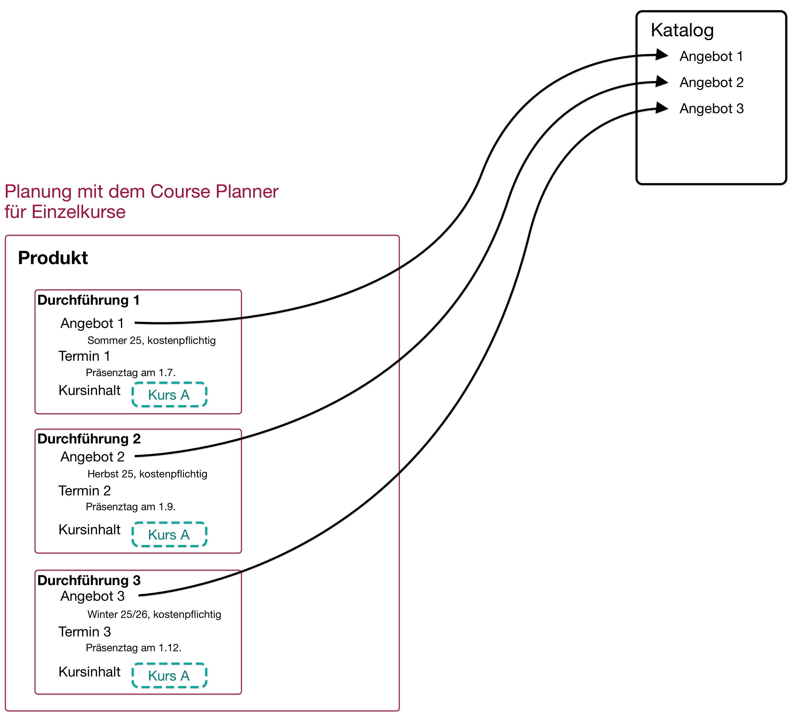
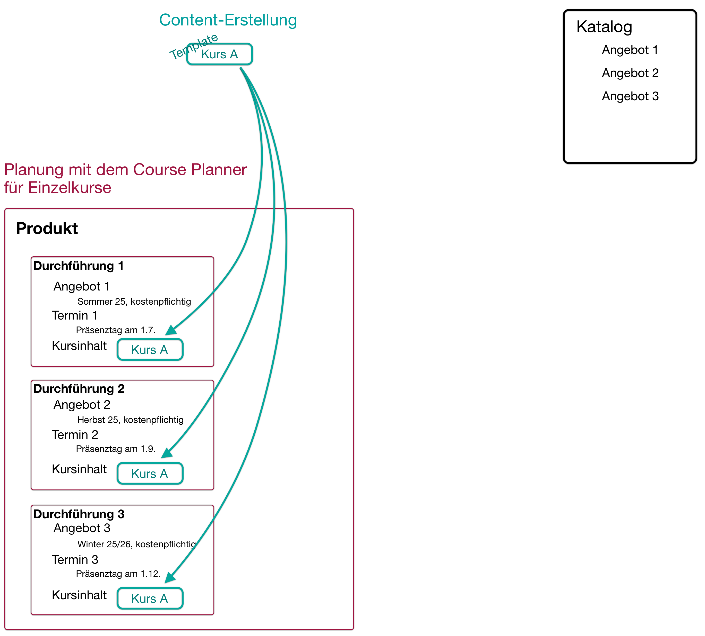
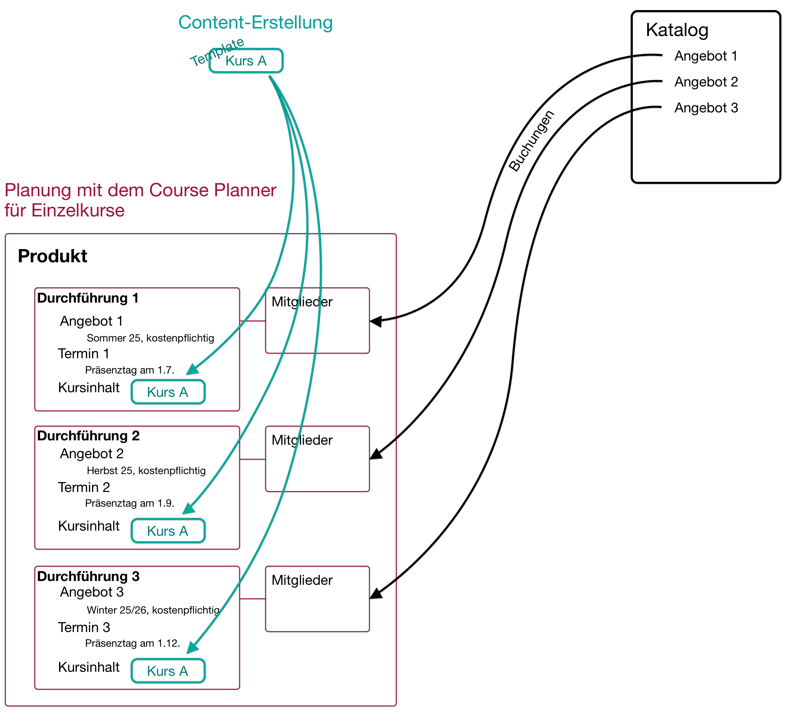
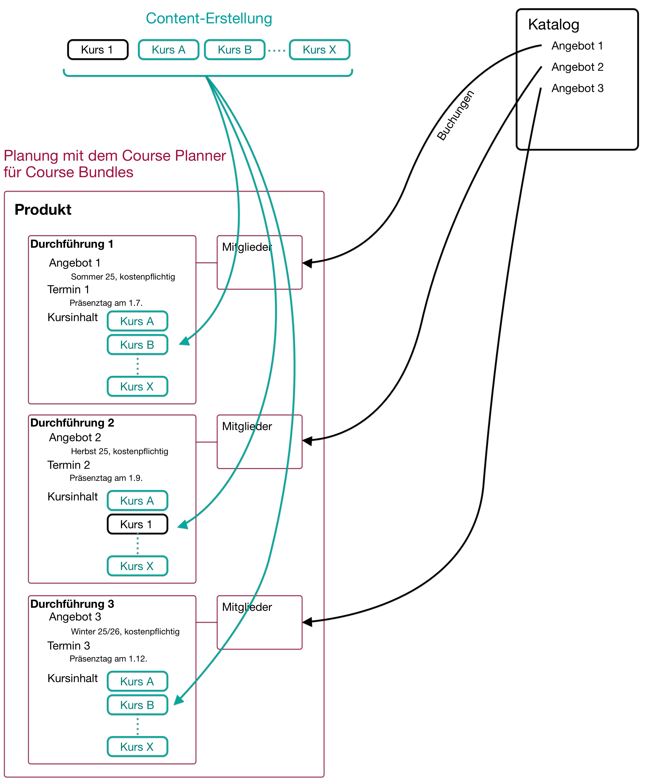
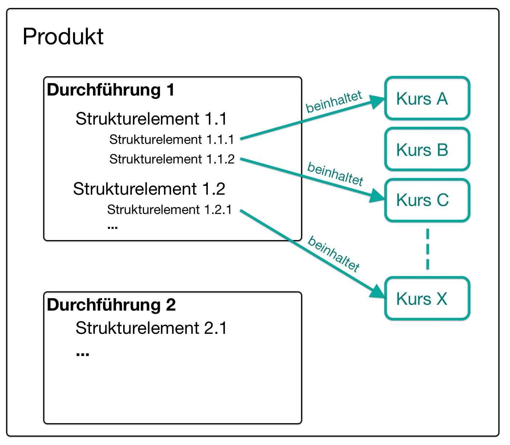
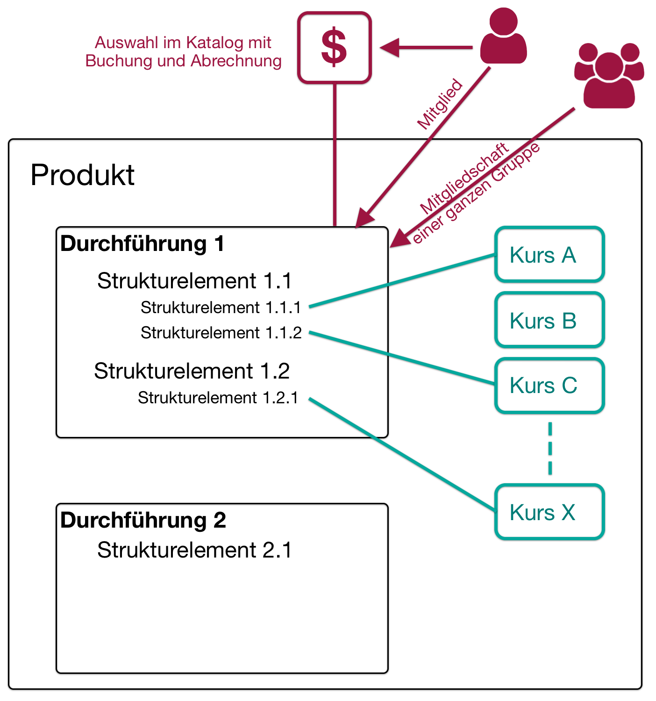
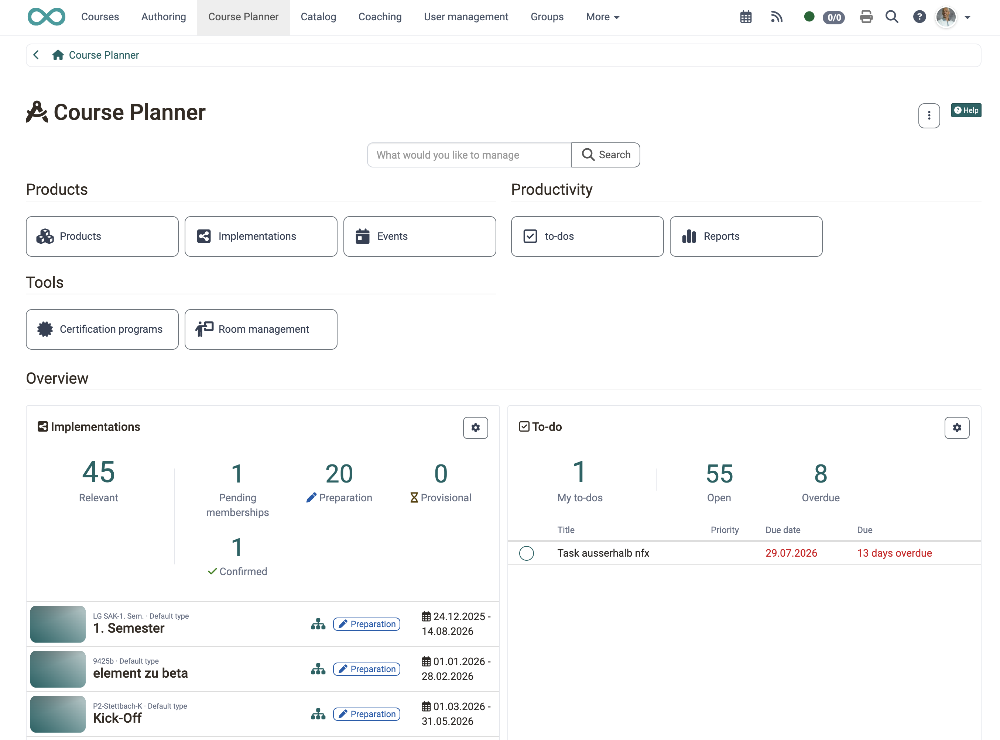

# Course Planner: Overview [:octicons-tag-16:{ title="from Release 20.0 (OO-7834)" }](https://track.frentix.com/issue/OO-7834){:target="_blank"} {: #course_planner}

The section [Start page and areas](#start_page) shows what each button on the start page is for and where it is described.

## Profile

Name | Course Planner
---------|----------
Available since | Release 13.0 (2018)
Redesign | Release 20.0 (OO-7834)

## What's the purpose of the Course Planner? {: #purpose}

The Course Planner is a module for course management. The aim is to create and run courses automatically and efficiently, starting from the offer.

With the Course Planner, the planning work can be separated from the content creation (in the author area).

Of course, you can also create OpenOlat courses without Course Planner. However, the Course Planner provides you with a tool that consolidates the organizational tasks.

| without Course Planner              | with Course Planner                                        |
| -------------------------------- | --------------------------------------------------------- |
| only independent single courses | single or multiple courses with several implementations   |
| everything is administered and managed individually in the courses | central administration |
| x                                | Functional separation between administration and content   |
| x                                | Central planning of several courses                          |
| x                                | Central member administration of several courses              |
| x                                | Central tendering of several courses                    |
| x                                | Central control and management of multiple courses          |

The Course Planner can be used to manage

* single courses
* course bundles
* structured educational programs/products

[To the top of the page ^](#course_planner)

---

## Planning tasks {: #planning}

The planning tasks include:

- Create different offer types (e.g. chargeable / not chargeable)
- Plan several implementations, each with its own time window
- Place offers in the catalog
- Define space quotas in the courses
- Prepare automatic course creation from template
- Set up automated status changes in the course

[To the top of the page ^](#course_planner)

---

## Planning single courses {: #planning_single_courses}

With the Course Planner, several implementations can be created for a course and offered in the catalog.

This administrative planning work can be done by a course planner even if the course has not yet been created or is not yet available in its final version.

{ class="shadow lightbox" title="Planning for single courses" }

Independently of these administrative tasks (carried out by a course planner), a course can be created by authors as a template and then integrated into all implementations.

The courses can also be instantiated automatically on a definable date.

{ class="shadow lightbox" title="Planning for single courses" }

For example, members can be added directly to the individual implementations by booking an offer themselves in the catalog.

!!! info "Please note:"

    Course members in the template course are then only the course owners with the author role.

{ class="shadow lightbox" title="Planning for single courses" }

[To the top of the page ^](#course_planner)

---

## Planning for course bundles  {: #planning_course_bundles}

Just as several implementations can be created for a single course, implementations can also be created for an entire course bundle and offered in the catalog.

If desired, the combination of courses/learning resources can also be modified in the individual implementations and deviate from the standard implementation ("copy template").

{ class="shadow lightbox" title="Planning for course bundles" }

[To the top of the page ^](#course_planner)

---

## Planning for structured educational programs {: #planning_structured_product}

Structured products/educational programs have an additional tree structure compared to course bundles. They contain structural elements. 

Even if participants are to complete an educational product, they are made members of a specific implementation. (Not members of individual courses or members of the educational product template.)

{ class="shadow lightbox" title="Structured product" }

In addition, a billing system can also be set up for the implementation.

{ class="shadow lightbox" title="Structured product" }

[To the top of the page ^](#course_planner)

---

## Who can use the Course Planner? [:octicons-tag-16:{ title="from Release 20.3.0 (OO-8916)" }](https://track.frentix.com/issue/OO-8916){:target="_blank"} {: #users}

After activation of the Course Planner by a system administrator, it is available to all users with the role "Course Planner". (When using organisational units, the role course planner may also be restricted to certain organisational units.) 

Administrators and principals also have access. (These roles may also be restricted to organisational units.)

Principals have exclusively read access to the entire Course Planner: actions such as "Change status", "Remove" or "Instantiate" are not available to them. If a principal opens a course directly from the Course Planner, the same read-only restriction also applies to the course view.

!!! info "Note on the restriction as principal"
    The read restriction is active whenever the principal only holds this role. There can be overlaps if a user has several roles in a product, for example. In that case, this user can become active wherever the role permits, for example in a to-do assigned to "them".

Limited to a specific product, product owners and element owners can access it within their area of responsibility.

!!! info "Other OpenOlat roles"
    Authors and learning resource administrators do not have access to the Course Planner. Their role, rights and responsibilities focus on content creation rather than on the planning, scheduling and administration of courses and implementations.

[To the top of the page ^](#course_planner)

---

## Roles and rights in the Course Planner {: #roles_rights}

Access in the Course Planner is based on three areas of responsibility:

* **subject-related and structural responsibility**: setting up and maintaining products, implementations and elements
* **administrative responsibility**: managing members, for example by a secretariat
* **content-related responsibility**: content, events and tasks of the individual elements

Depending on the role, one, two or all three areas are covered:

* **Course planner** (organisation role): covers all three areas and has unrestricted access to all products and certification programs of their own organisation.
* **Administrator**: has the same rights in the Course Planner as a course planner.
* **Product owner**: takes on the same tasks as a course planner, but limited to the products for which they are registered as product owner (regardless of the organisation).
* **Element owner**: holds the content-related responsibility for their own elements (regardless of the organisation). They have full access to the content and events of their own element, but can only read members and settings and cannot change the structure.
* **Principal**: has exclusively read access to the entire Course Planner (see section above).

In addition, owners of certification programs have access to the Course Planner.

### Rights matrix {: #rights_matrix}

The following overview shows which actions the individual roles can perform on the objects of the Course Planner.

Legend: :material-check: access or action available · :material-cancel: no access · the remaining entries name the actions available in each case.

|  | Administrator | Course planner | Product owner | Principal | Element owner | Course owner | Master coach | Coach | Participant |
| --- | --- | --- | --- | --- | --- | --- | --- | --- | --- |
| Access to the Course Planner | :material-check: | :material-check: | :material-check: | :material-check: | :material-check: | :material-cancel: | :material-cancel: | :material-cancel: | :material-cancel: |
| Product (active) | Create, Read, Edit, Delete | Create, Read, Edit, Delete | Read, Edit | Read | Read | :material-cancel: | :material-cancel: | :material-cancel: | :material-cancel: |
| Product (deleted) | Read | :material-cancel: | :material-cancel: | :material-cancel: | :material-cancel: | :material-cancel: | :material-cancel: | :material-cancel: | :material-cancel: |
| Implementation | Create, Read, Edit, Delete | Create, Read, Edit, Delete | Create, Read, Edit, Delete | Read | :material-cancel: | :material-cancel: | :material-cancel: | :material-cancel: | :material-cancel: |
| Element | Create, Read, Edit, Delete | Create, Read, Edit, Delete | Create, Read, Edit, Delete | Read | Read, Edit | :material-cancel: | :material-cancel: | :material-cancel: | :material-cancel: |
| Event | Create, Read, Edit, Delete | Create, Read, Edit, Delete | Create, Read, Edit, Delete | Read | Create, Read, Edit, Delete | :material-cancel: | :material-cancel: | :material-cancel: | :material-cancel: |
| Template | Add, Read, Instantiate, Remove | Add, Read, Instantiate, Remove | Add, Read, Instantiate, Remove | Read | Add, Read, Instantiate, Remove | :material-cancel: | :material-cancel: | :material-cancel: | :material-cancel: |
| Course | Add, Read, Remove | Add, Read, Remove | Add, Read, Remove | Read | Add, Read, Remove | :material-cancel: | :material-cancel: | :material-cancel: | :material-cancel: |
| To-do | Create, Read, Edit, Delete | Create, Read, Edit, Delete | Create, Read, Edit, Delete | Read | Create, Read, Edit, Delete | :material-cancel: | :material-cancel: | :material-cancel: | :material-cancel: |
| To-do (assigned or delegated) | :material-check: | :material-check: | :material-check: | :material-cancel: | :material-check: | :material-check: | :material-cancel: | :material-cancel: | :material-cancel: |
| Room management [:octicons-tag-16:{ title="from Release 21.0.3 (OO-9721)" }](https://track.frentix.com/issue/OO-9721){:target="_blank"} | Read | Read | :material-cancel: | :material-cancel: | :material-cancel: | :material-cancel: | :material-cancel: | :material-cancel: | :material-cancel: |

!!! info "Course and group roles in the Course Planner"
    Course owner, Master coach, Coach and Participant are course or group roles. They have no management rights in the Course Planner itself; their tasks lie in running the course. One exception are to-dos: course owners can be assigned to a to-do or entered as a delegated person. In the personal to-do list they then change its status; all other details are edited by the roles with editing rights in the Course Planner.

[To the top of the page ^](#course_planner)

---

## Where can I find the Course Planner? {: #access}

If you have the role and rights of a course planner, you will find the Course Planner in the main navigation.

!!! tip "Requirement"

    In order to use the Course Planner, it must be activated by a system administrator. If the option is not available in the main navigation, please contact your system administrator or the support of your OpenOlat instance.

[To the top of the page ^](#course_planner)

---

## Start page and areas [:octicons-tag-16:{ title="from Release 21.0 (OO-9418)" }](https://track.frentix.com/issue/OO-9418){:target="_blank"} {: #start_page}

When you open the Course Planner, you are taken to its start page. At the top are the search and the buttons to the functions, divided into the three areas "Products", "Productivity" and "Tools". Below, the "Overview" section shows widgets on implementations, events and to-dos.

{ class="shadow lightbox" title="Start page of the Course Planner" }

If you are looking for a function, the overview tells you in one sentence what it is for and takes you to its description with the link. The tables follow the start page: each table corresponds to one area, with its title from the user interface and in the same order. Which buttons you see depends on your role and on which modules the system administration has switched on.

**Products**

| Button | What for |
|---|---|
| [Products](../Course_Planner_Products.md) | Create and manage educational products. A product is a learning offer that you offer in one or more implementations. |
| [Implementations](../Course_Planner_Implementations.md) | Create and manage the implementations of all products. Each implementation takes place at its own time and with its own participants. |
| [Events](../Course_Planner_Events.md) | View and plan the events of your implementations, for example the course days of a module. |

**Productivity**

| Button | What for |
|---|---|
| [To-dos](../Course_Planner_Todos.md) | Track the to-dos of all elements in one place, for example those assigned to you and the overdue ones. |
| [Reports](../Course_Planner_Reports/index.md) | Generate Excel reports on the booking orders of your products and implementations from templates. |

**Tools**

| Button | What for |
|---|---|
| [Certification programs](../Course_Planner_Certification_Programs.md) | Award a certificate for attending an implementation or several courses and manage the recertification of the members. |
| [Room management](../Course_Planner_Rooms.md) | Read the room scheduling and the rooms of your organisation, for example which rooms are booked for events and where bookings overlap. System administrators maintain rooms and buildings in the system administration under `Administration > Modules > Rooms`. |

The following two functions are located outside the three areas. Their table therefore has a title that the user interface does not show.

**Further functions of the start page**

| Function | What for |
|---|---|
| [Search and overview](../Course_Planner_Dashboard.md) | Search for implementations, courses and events and adapt the widgets in the "Overview" section to your needs. |
| [Import](../Course_Planner_Import_Export/index.md) | Read in products, implementations and memberships from an Excel file, via the entry "Import" in the more menu (⋮) at the top right. You start the export in the lists "Products", "Implementations" and "Events". |

[To the top of the page ^](#course_planner)

---

## Further information {: #further_information}

[How do I create my first OpenOlat course? >](../../../manual_how-to/my_first_course/my_first_course.md) 
[How do I plan and run a course in several implementations with the Course Planner? >](../../../manual_how-to/course_planner_courses/course_planner_courses.md) 
[How do I plan and run a product with several courses with the Course Planner? >](../../../manual_how-to/course_planner_curriculum/course_planner_curriculum.md) 
[Module Course Planner (Administration manual) >](../../../manual_admin/administration/Modules_Course_Planner.md) 
[What rights do the roles have within a course? >](../../basic_concepts/Authorisation_Concept.md)

[To the top of the page ^](#course_planner)
