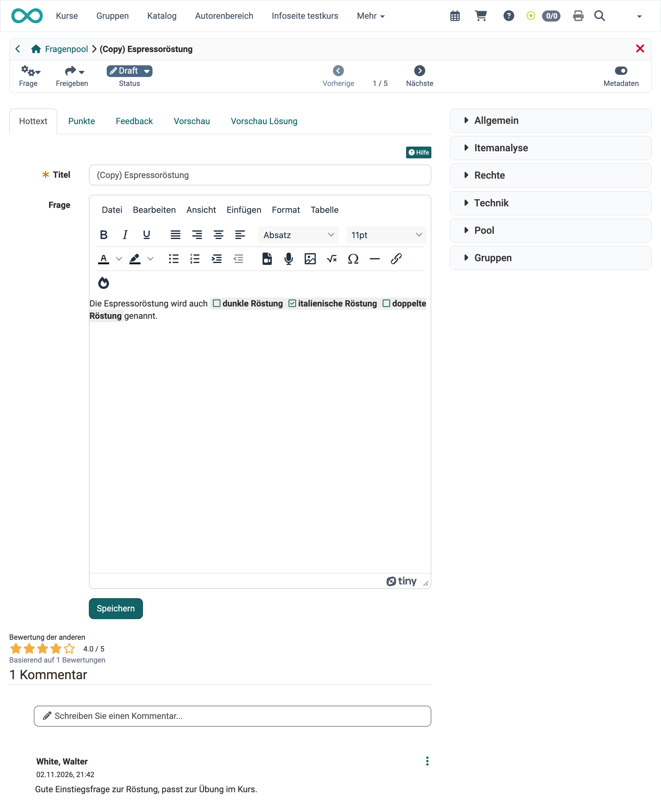
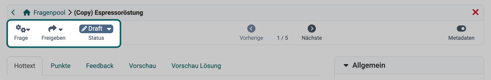
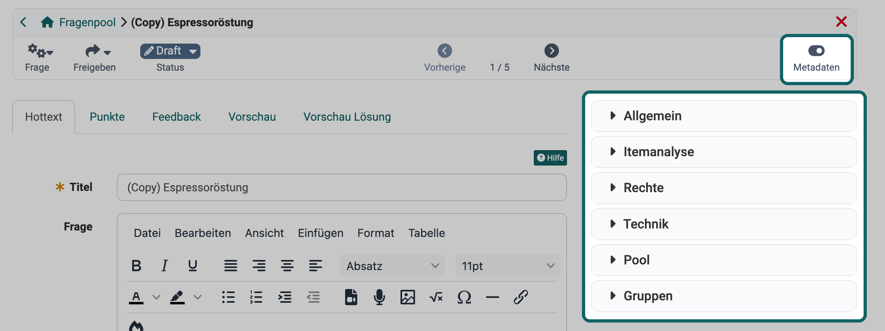
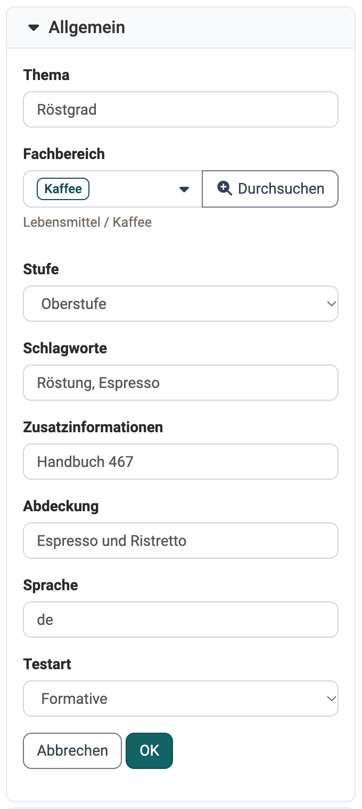
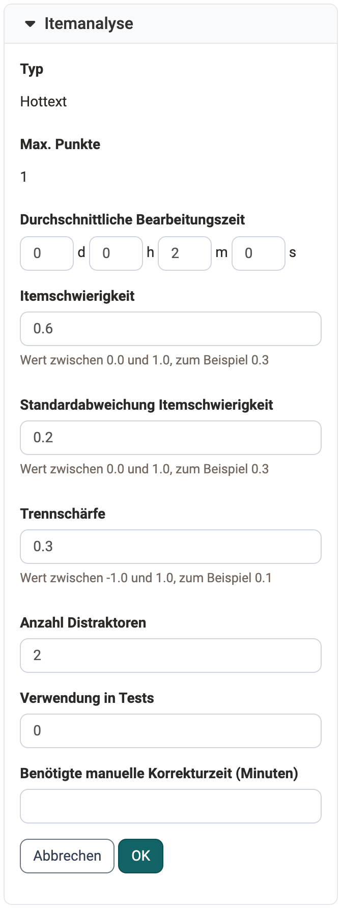
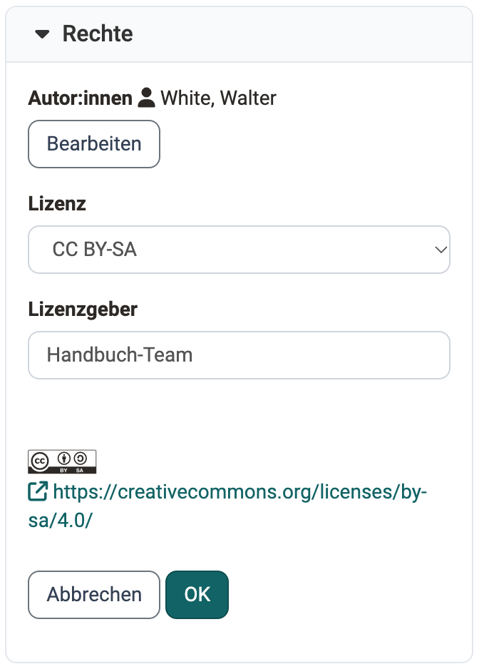
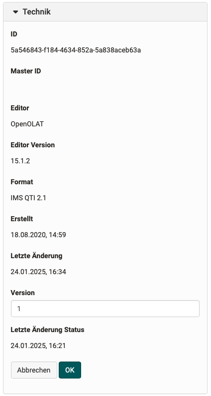
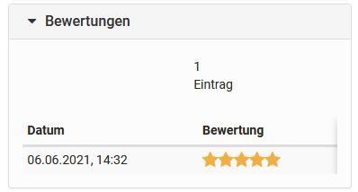
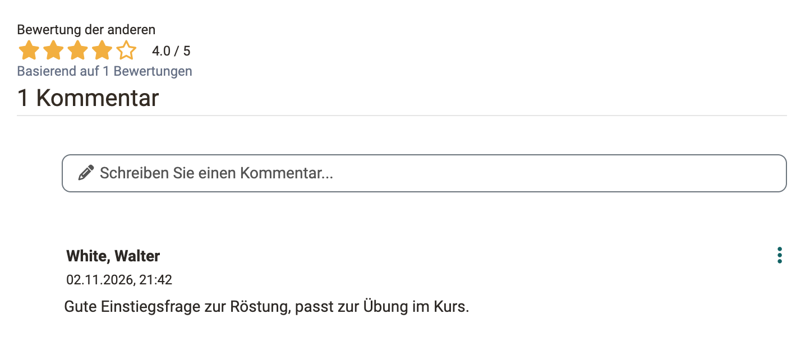

# Fragenpool: Detailansicht einer Frage und Metadaten {: #question_details}

Wenn Sie eine Frage im Fragenpool auswählen, öffnet sich ihre Detailansicht, und Sie arbeiten direkt im Editor der Frage. Dort bearbeiten Sie die Frage und ordnen ihr Metadaten zu: Angaben wie Fachbereich, Stufe oder Schlagworte, mit denen Sie Fragen später gezielt finden und automatisch auswählen lassen.

{ class="shadow lightbox" title="Fragenpool, Detailansicht einer Frage · 2026.11.02" }

## Toolbar {: #toolbar}

{ class="shadow lightbox" title="Fragenpool, Toolbar der Detailansicht einer Frage · 2026.11.02" }

In der Toolbar kopieren oder löschen Sie die Frage über das Menü "Frage".

Über "Freigeben" können Sie

* die Frage exportieren
* oder in einem Pool freigeben
* oder in einer Gruppe freigeben.

Mit "Status" legen Sie fest, in welchem Stand die Frage ist. So sehen alle auf einen Blick, ob die Frage ein Entwurf ist, gerade überarbeitet wird oder fertig ist.

Mit "Vorherige" und "Nächste" wechseln Sie zur vorherigen oder nächsten Frage der Liste, aus der Sie die Frage geöffnet haben. Die Zahl dazwischen zeigt, an welcher Stelle der Liste die Frage steht.

Administrator:innen und Poolverwalter:innen sehen in der Toolbar zusätzlich "Log". Damit laden sie eine Excel-Datei herunter, die jede Änderung an der Frage mit "Datum", "Aktion" und "Geändert durch" auflistet.

[Zum Seitenanfang ^](#question_details)

## Editor

Im Fragenpool erstellen und bearbeiten Sie Fragen mit demselben Editor wie in einer Test-Lernressource.

[Zu den Details des Frage-Editors >](../learningresources/Configure_test_questions.de.md) 
[Zum Seitenanfang ^](#question_details)

## Metadaten {: #metadata}

Eine Frage im Fragenpool besteht nicht nur aus der Frage selbst. Dazu kommen beschreibende Angaben, die Metadaten. Mit ihnen finden Autor:innen Fragen für einen Test und stellen sie zusammen. Den grössten Teil der Metadaten erfassen die Autor:innen selbst.
Insgesamt bietet der Fragenpool mehr als 20 Metadatenfelder nach dem Standard [Learning Objects Metadata](http://de.wikipedia.org/wiki/Learning_Objects_Metadata "Learning Objects Metadata").

Die Suchfilter des Fragenpools und der Kursbaustein "Übung" wählen Fragen anhand ihrer Metadaten aus. Welche Angaben dafür zählen und wie Sie sie pflegen, zeigt die Anleitung [Nutzen von Metadaten](../../manual_how-to/question_metadata/question_metadata.de.md).

Die Metadaten blenden Sie mit dem Schalter "Metadaten" rechts oben in der Toolbar ein und aus.

{ class="shadow lightbox" title="Fragenpool, Detailansicht einer Frage mit eingeblendeten Metadaten · 2026.11.02" }

!!! info "Wichtig"

    Ist der [Beurteilungsprozess](Question_Bank_Review_Process.de.md) eingeschaltet, erscheint zusätzlich der Bereich ["Bewertungen"](#metadata_ratings).

[Zum Seitenanfang ^](#question_details)

### Metadaten bearbeiten {: #metadata_edit}

Ist der Beurteilungsprozess eingeschaltet, hängt das Bearbeiten der Metadaten nicht vom Status der Frage ab. Die Metadaten bearbeiten die Autor:innen der Frage, Personen mit der Kompetenz "Verwalten" im Fachbereich der Frage und Systemadministrator:innen, in jedem Status von "Draft" bis "Final". Poolverwalter:innen bearbeiten sie, wenn ihnen die System-Administration im Abschnitt "Rechte Poolverwalter:in" das Recht "alle Fragen sehen und die Metadaten bearbeiten" erteilt hat: `Administration > e-Assessment > Fragenpool`. Wer eine Frage nur über einen Pool oder eine Freigabe sieht, sieht die Metadaten schreibgeschützt.

Bearbeiten lassen sich die Bereiche "Allgemein", "Itemanalyse", "Rechte" und "Technik". Ändern Sie Werte im Bereich "Itemanalyse" nur, wenn Sie mit der Itemanalyse vertraut sind.
Speichern Sie Ihre Eingaben anschliessend mit "OK".

[Zum Seitenanfang ^](#question_details)

### Allgemein {: #metadata_general}

{ class="aside-right lightbox" title="Fragenpool, Metadaten einer Frage, Bereich Allgemein · 2026.11.02" }

Dieser Bereich ordnet die Frage inhaltlich ein. Die Angaben "Fachbereich", "Stufe", "Schlagworte", "Sprache" und "Testart" dienen zugleich als Suchfilter im Fragenpool und als Kriterien im Kursbaustein "Übung".

"Thema" formulieren Sie frei, passend zum Inhalt der Frage.

"Fachbereich" bezieht sich auf die Taxonomie des Fragenpools. Die Auswahl sollte die Bereiche Ihrer Organisation abdecken. Sie wählen aus den Fachbereichen, die Ihnen zugeordnet sind. Fehlen Fachbereiche, wenden Sie sich an Ihre Poolverwalter:in oder Administrator:in.

Unter "Stufe" wählen Sie zum Beispiel eine Schul- oder Hochschulstufe. Ebenso eignen sich Kompetenzstufen oder Schwierigkeitsgrade. Auch die Stufen legen die Poolverwalter:innen vorher fest.

"Schlagworte" vergeben Sie frei. Anders als der Fachbereich hängen sie an keiner Taxonomie.

Unter "Zusatzinformationen" tragen Sie weitere Angaben zur Frage ein.

"Abdeckung" beschreibt das Themengebiet und grenzt es zusammen mit den Schlagworten ein.

Bei "Sprache" trägt OpenOlat beim Erstellen einer Frage das Kürzel Ihrer OpenOlat-Sprache ein, zum Beispiel "de".

Bei "Testart" wählen Sie, ob die Frage für einen summativen (bewertenden) oder formativen (diagnostischen) Test gedacht ist oder für beide.

[Zum Seitenanfang ^](#question_details)

### Itemanalyse {: #metadata_item_analysis}

{ width="336" class="aside-right lightbox" title="Fragenpool, Metadaten einer Frage, Bereich Itemanalyse · 2026.11.02" }

Dieser Bereich enthält Angaben zur Itemanalyse und zur Verwendung der Frage in Tests. "Typ" zeigt den Fragetyp, zum Beispiel Single Choice. "Max. Punkte" zeigt die höchste Punktzahl, die in der Frage erreichbar ist.

Die Itemanalyse ist ein Satz (statistischer) Verfahren. Sie bewertet einzelne Fragen danach, wie gut sie das Wissen messen, das ein Test abfragen soll. Typische Kennwerte sind die Itemschwierigkeit und die Trennschärfe.

Unter "Durchschnittliche Bearbeitungszeit" geben Sie an, wie lange die Bearbeitung der Frage voraussichtlich dauert. So stellen Sie später leichter Tests für eine bestimmte Bearbeitungsdauer zusammen.

Die "Itemschwierigkeit" drückt mit einem Wert zwischen 0 und 1 aus, wie schwer eine Frage zu beantworten ist. Sie gibt an, wie viele Personen einer Kandidatengruppe die Frage korrekt lösen, im Verhältnis zur maximal erreichbaren Punktzahl. Der Schwierigkeitsindex soll Personen mit hoher Merkmalsausprägung von Personen mit niedriger Merkmalsausprägung unterscheiden. Unbrauchbar sind deshalb Items, die alle Personen oder keine Person lösen konnten (Indexwert nahe 1 bzw. 0). Items mit Werten nahe 1 sind zu einfach und unterscheiden nicht zwischen den Leistungen der Personen, Items mit Werten nahe 0 sind zu schwierig. Beachten Sie, dass bei einer Multiple Choice Frage mit 5 Antwortalternativen (4 Distraktoren) die Ratewahrscheinlichkeit bereits 20% beträgt. Für eine gute Leistungsdifferenzierung eignen sich Items im Bereich 0.4-0.9 oder 40-90%.

Die "Standardabweichung Itemschwierigkeit" gibt mit einem Indexwert zwischen 0 und 1 an, wie stark sich die Antworten auf eine Frage zwischen mehreren Personen unterscheiden, also wie weit die Antworten um den Mittelwert streuen (Schwankungsbreite). Eine Standardabweichung umfasst etwas mehr als 68% aller Werte um den Mittelwert, zwei Standardabweichungen umfassen knapp 95.5% aller Werte der Verteilung. Je kleiner die Standardabweichung ist, desto "stabiler" ist die Itemschwierigkeit über eine oder mehrere Gruppen von Testkandidat:innen, je grösser, desto "instabiler". Wählen Sie Items mit einer hohen Standardabweichung deshalb mit etwas Vorsicht aus.

Die "Trennschärfe" gibt mit einem Wert zwischen -1 und +1 an, wie gut ein Item Kandidat:innen mit guter und schlechter Leistung in der Gesamtprüfung trennt. Sie zeigt, ob eine Frage etwas Ähnliches abfragt wie der übrige Test. Die Trennschärfe ist deshalb der wichtigste Kennwert bei der Auswahl von Items. Sie wird berechnet als Korrelationskoeffizient zwischen der erreichten Punktzahl in diesem Item und der Gesamtpunktzahl der Prüfung ohne dieses Item. Für eine gute Leistungsdifferenzierung braucht es Items mit klar positiver Trennschärfe, wenn möglich grösser oder gleich 0.2, sicher aber grösser als 0.1. Items mit einer Trennschärfe um 0 tragen nichts zur Differenzierung bei. Items mit negativer Trennschärfe laufen dem Differenzierungsziel sogar entgegen und sollten in Folgetests nicht mehr vorkommen.

Unter "Anzahl Distraktoren" geben Sie an, wie viele falsche Antwortalternativen die Frage anbietet.

"Verwendung in Tests" setzt OpenOlat selbst: Das Feld zeigt, in wie vielen Tests die Frage eingebunden ist, und zählt bei jeder neuen Einbindung hoch.

Unter "Benötigte manuelle Korrekturzeit (Minuten)" tragen Sie ein, wie lange die manuelle Bewertung der Frage voraussichtlich dauert.

Die Teststatistik eines Tests führt für jede Frage eine Itemanalyse durch und zeigt das Ergebnis an. Diese Werte übertragen Sie bei Bedarf von Hand aus der Teststatistik in die Metadaten der Frage.

Alle anderen Kennwerte berechnet OpenOlat _nicht_. Liegen Daten dazu vor, etwa aus anderen Systemen oder aus einer eigenen Berechnung, tragen Sie sie _von Hand_ an der Frage ein.

[Zum Seitenanfang ^](#question_details)

### Rechte {: #metadata_rights}

{ width="336" class="aside-right lightbox" title="Fragenpool, Metadaten einer Frage, Bereich Rechte · 2026.11.02" }

Dieser Bereich enthält Angaben zu den Autor:innen und zur Lizenz der Frage. Alle Personen, die die Frage erstellt oder bearbeitet haben, stehen unter "Autor:innen". Mit "Bearbeiten" fügen Sie weitere Autor:innen hinzu oder entfernen sie.

Weiter legen Sie die Lizenz fest. Standardmässig stehen Creative-Commons-Lizenzen zur Auswahl. Informationen zu Creative Commons finden Sie in der [Wikipedia](http://de.wikipedia.org/wiki/Creative_Commons "Wikipedia") und unter [www.creativecommons.org](http://www.creativecommons.org/ "www.creativecommons.org"). Weitere Lizenzen erstellen Systemadministrator:innen in der System-Administration unter `Administration > Core-Konfiguration > Lizenzen`.

"Lizenzgeber" und "Lizenz" tragen Sie von Hand ein, sie haben keine weitere Wirkung. Sind in der System-Administration unter `Administration > Core-Konfiguration > Lizenzen` für den Fragenpool eine "Initiale Lizenz" und ein "Initialer Lizenzgeber" festgelegt, trägt OpenOlat sie beim Anlegen einer neuen Frage automatisch ein. Wer die Frage bearbeiten darf, kann Lizenz und Lizenzgeber danach anpassen.

[Zum Seitenanfang ^](#question_details)

### Technik {: #metadata_technical}

{ class="aside-right lightbox"}

Unter "Technik" sehen Sie den "Editor", in dem die Frage erstellt wurde, und dessen "Editor Version". "Format" gibt an, welches technische Format die Frage hat. "Erstellt" und "Letzte Änderung" zeigen, wann die Frage erstellt oder importiert wurde und wann sie zuletzt geändert wurde.

Ist der Beurteilungsprozess eingeschaltet, setzt OpenOlat die "Version" selbst. Jedes Mal, wenn eine Frage in die Beurteilung und damit in den Status "Review" geht, zählt die Version um eins hoch. Ist der Beurteilungsprozess ausgeschaltet, tragen Sie die Version von Hand ein und passen sie an.

Alle anderen Angaben im Bereich "Technik" lassen sich nicht bearbeiten.

[Zum Seitenanfang ^](#question_details)

### Bewertungen {: #metadata_ratings}

{ class="aside-right lightbox"}

Ist der Beurteilungsprozess eingeschaltet, zeigt dieser Bereich die Bewertungen der Frage aus dem Beurteilungsprozess. Dieselben Bewertungen erscheinen zusätzlich bei den [Kommentaren und Bewertungen](#comments) anderer Personen am unteren Rand der Detailansicht.

Ist der Beurteilungsprozess ausgeschaltet, fehlt der Bereich "Bewertungen" in den Metadaten.

[Details zum Beurteilungsprozess >](Question_Bank_Review_Process.de.md) 
[Aktivierung des Beurteilungsprozesses durch Administrator:innen >](../../manual_admin/administration/eAssessment_Question_bank.de.md) 
[Zum Seitenanfang ^](#question_details)

### Pool {: #metadata_pool}

Der Bereich "Pool" listet die Pools, in denen die Frage freigegeben ist.

[Zum Seitenanfang ^](#question_details)

### Gruppen {: #metadata_groups}

Der Bereich "Gruppen" listet die Gruppen, in denen die Frage freigegeben ist.

[Zum Seitenanfang ^](#question_details)

!!! note "Hinweis"

    Wenn Sie Fragen aus einem Test im Standard QTI 2.1 in den Fragenpool importieren, übernimmt OpenOlat die Metadaten, die der Test zu jeder Frage gespeichert hat. Stammen die Fragen des Tests aus dem Fragenpool, behalten sie so unter anderem Thema, Fachbereich, Stufe, Schlagworte, Testart, die Werte der Itemanalyse und die Lizenz. Die "Sprache" übernimmt OpenOlat nicht: Nach dem Import steht dort das Kürzel der OpenOlat-Sprache der Person, die importiert hat.

## Kommentare {: #comments}

{ class="shadow lightbox" title="Fragenpool, Detailansicht einer Frage, unterer Rand · 2026.11.02" }

Die Kommentare und Bewertungen (Sterne) am unteren Rand der Detailansicht stammen von Autor:innen und von Personen, die die Frage verwalten dürfen. Jede Person mit Zugriff auf die Frage kann hier einen Kommentar abgeben.

Die Bewertungen aus einem Beurteilungsprozess (siehe Metadaten) erscheinen zusätzlich darunter.

[Zum Seitenanfang ^](#question_details)

## Weiterführende Informationen {: #further_information}

**Auf dieser Seite erwähnt** 
[Testfragen konfigurieren >](../learningresources/Configure_test_questions.de.md) 
[Learning Objects Metadata (Wikipedia) >](http://de.wikipedia.org/wiki/Learning_Objects_Metadata) 
[Nutzen von Metadaten >](../../manual_how-to/question_metadata/question_metadata.de.md) 
[Fragenpool: Beurteilungsprozess >](Question_Bank_Review_Process.de.md) 
[Creative Commons (Wikipedia) >](http://de.wikipedia.org/wiki/Creative_Commons) 
[www.creativecommons.org >](http://www.creativecommons.org/) 
[e-Assessment Administration: Fragenpool >](../../manual_admin/administration/eAssessment_Question_bank.de.md)

**Weiterführend** 
[Fragenpool: Fragen erstellen >](Question_Bank_Create_Questions.de.md) 
[Fragenpool: Fragen importieren >](Question_Bank_Import_Questions.de.md) 
[Fragenpool: Freigabemöglichkeiten >](Question_Pool_Sharing_Options.de.md) 
[Wie gehe ich vor, wenn ich einen Test erstelle? >](../../manual_how-to/test_creation_procedure/test_creation_procedure.de.md)

[Zum Seitenanfang ^](#question_details)
