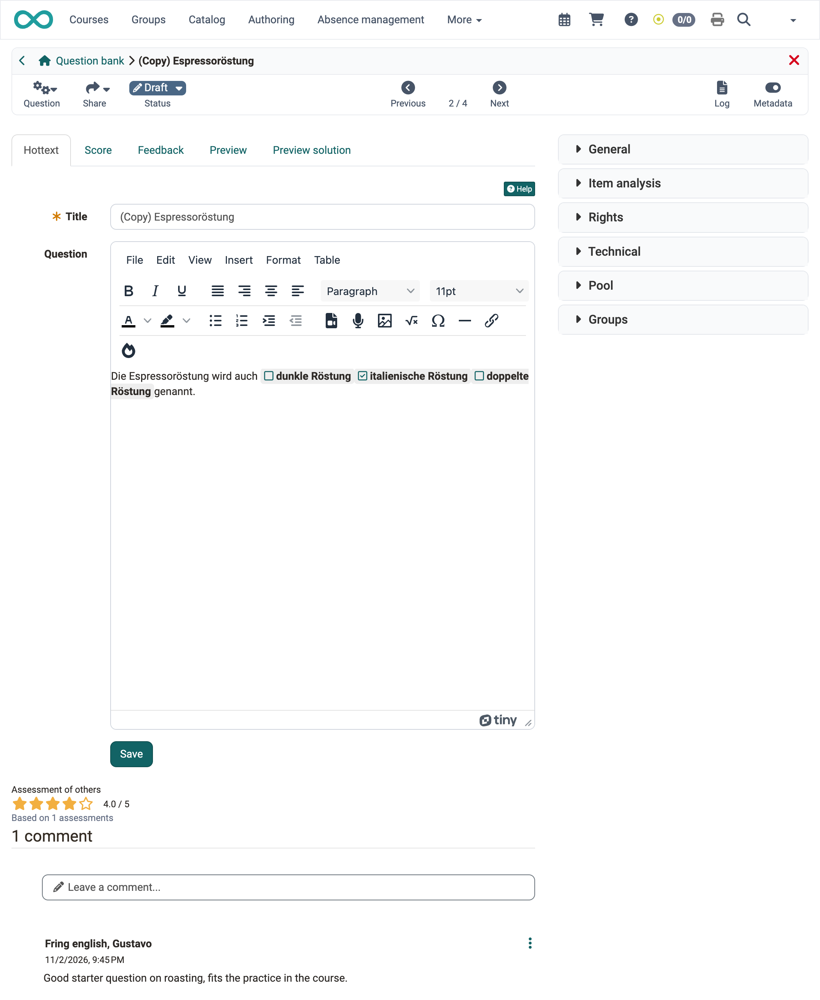
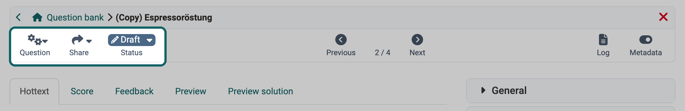
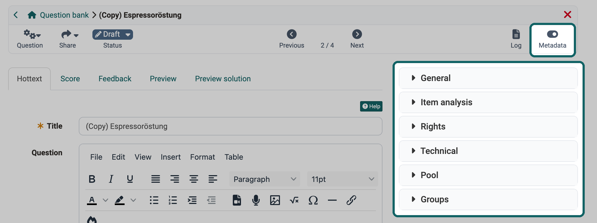
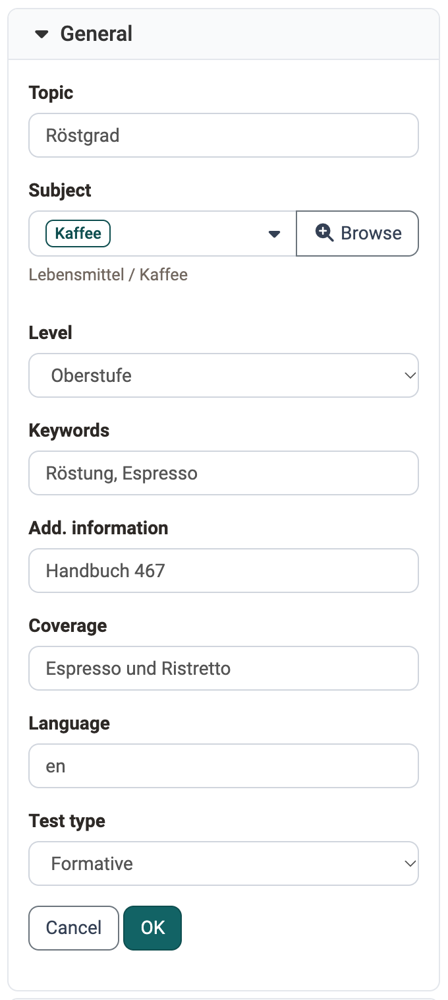
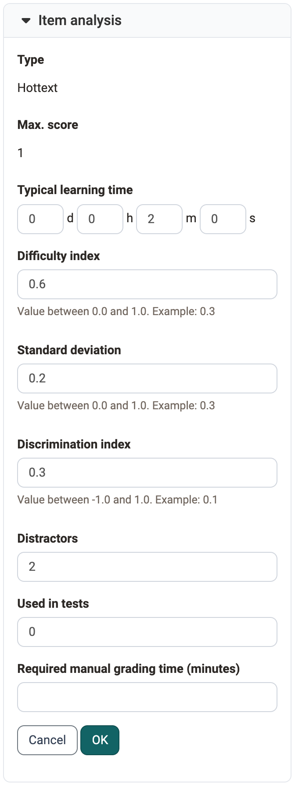
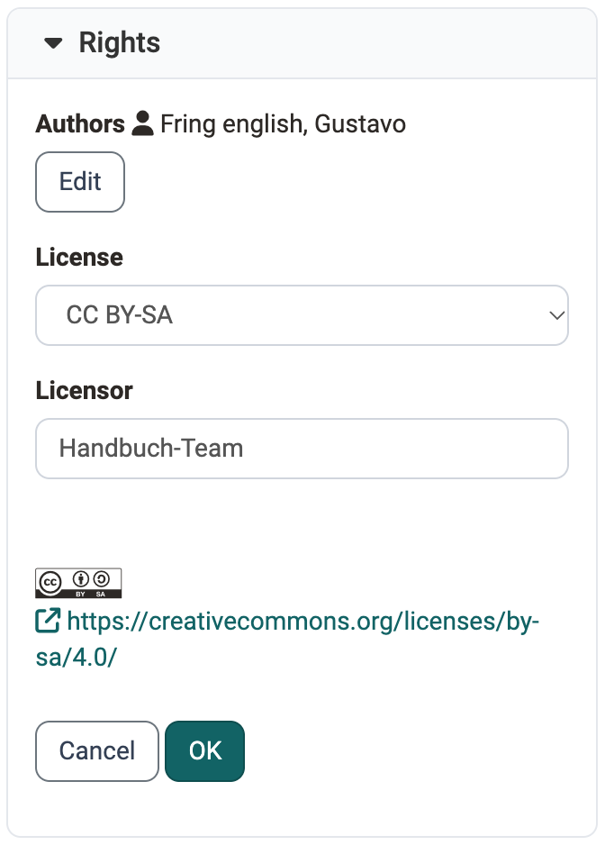
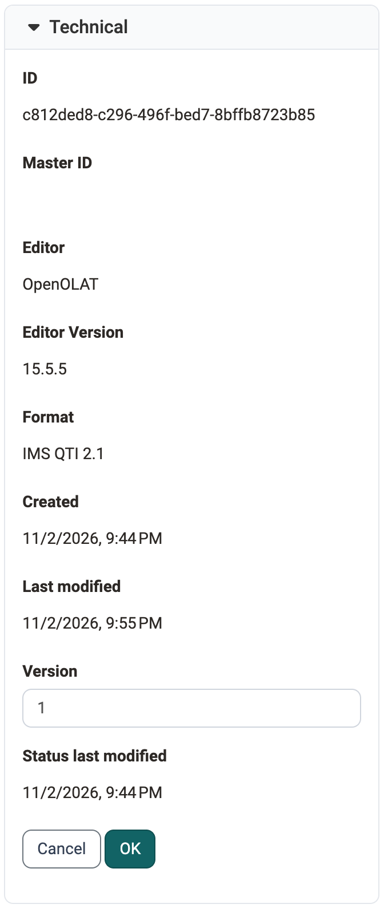
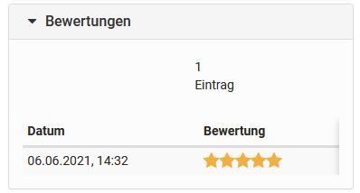
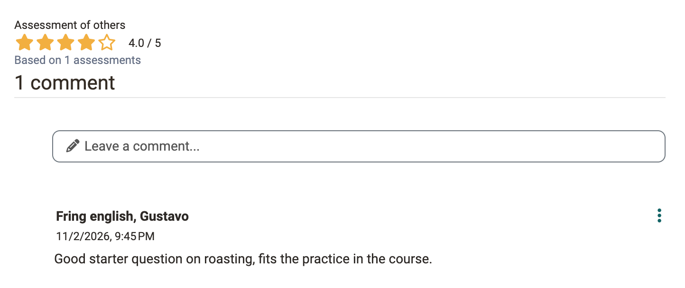

# Question bank: Details of a question and metadata {: #question_details}

When you select a question in the question bank, its detailed view opens and you work directly in the question editor. There you edit the question and assign metadata to it: entries such as subject, level or keywords, with which you later find questions specifically and have them selected automatically.

{ class="shadow lightbox" title="Question bank, detailed view of a question · 2026.11.02" }

## Toolbar {: #toolbar}

{ class="shadow lightbox" title="Question bank, toolbar of the detailed view of a question · 2026.11.02" }

In the toolbar, you copy or delete the question via the "Question" menu.

Via "Share" you can

* export the question
* or share it with a pool
* or share it with a group.

With "Status" you define the stage the question is in. This way everyone sees at a glance whether the question is a draft, is being revised or is finished.

With "Previous" and "Next" you switch to the previous or next question of the list from which you opened the question. The number in between shows the position of the question in the list.

Administrators and question bank managers also see "Log" in the toolbar. With it they download an Excel file that lists every change to the question with "Date", "Action" and "Changed by".

[To the top of the page ^](#question_details)

## Editor

In the question bank, you create and edit questions with the same editor as in a test learning resource.

[To the details about the question editor >](../learningresources/Configure_test_questions.md) 
[To the top of the page ^](#question_details)

## Metadata {: #metadata}

A question in the question bank does not only consist of the question itself. It also carries describing entries, the metadata. With them, authors find questions for a test and put them together. Authors enter most of the metadata themselves.
All in all, the question bank offers more than 20 metadata fields according to the standard [Learning Objects Metadata](http://en.wikipedia.org/wiki/Learning_object_metadata "Learning Objects Metadata").

The search filters of the question bank and the course element "Practice" select questions by their metadata. The instructions [Benefits of metadata](../../manual_how-to/question_metadata/question_metadata.md) show which entries count and how you maintain them.

You show and hide the metadata with the "Metadata" toggle at the top right of the toolbar.

{ class="shadow lightbox" title="Question bank, detailed view of a question with displayed metadata · 2026.11.02" }

!!! info "Important"

    If the [review process](Question_Bank_Review_Process.md) is switched on, the section ["Ratings"](#metadata_ratings) also appears.

[To the top of the page ^](#question_details)

### Edit metadata {: #metadata_edit}

If the review process is switched on, you edit the metadata in the status "Draft" and "Revision". Users with "Manage" rights, question bank managers and system administrators can also edit the metadata in the status "Review" and "Final".

The sections "General", "Item analysis", "Rights" and "Technical" can be edited. Only change values in the "Item analysis" section if you are familiar with item analysis.
Then save your entries with "OK".

[To the top of the page ^](#question_details)

### General {: #metadata_general}

{ class="aside-right lightbox" title="Question bank, metadata of a question, section General · 2026.11.02" }

This section classifies the content of the question. The entries "Subject", "Level", "Keywords", "Language" and "Test type" also serve as search filters in the question bank and as criteria in the course element "Practice".

You formulate the "Topic" freely, matching the content of the question.

"Subject" refers to the taxonomy of the question bank. The selection should cover the areas of your organization. You select from the subjects that have been assigned to you. If subjects are missing, contact your question bank manager or administrator.

Under "Level" you select, for example, a school or university level. Competence levels or difficulty levels are also suitable. The question bank managers also define the levels beforehand.

You assign "Keywords" freely. In contrast to the subject, they are not linked to a taxonomy.

Under "Add. information" you enter further details about the question.

"Coverage" describes the subject area and narrows it down together with the keywords.

For "Language", OpenOlat enters the code of your OpenOlat language when a question is created, for example "en".

For "Test type" you select whether the question is intended for a summative (evaluative) or formative (diagnostic) test or for both.

[To the top of the page ^](#question_details)

### Item analysis {: #metadata_item_analysis}

{ width="336" class="aside-right lightbox" title="Question bank, metadata of a question, section Item analysis · 2026.11.02" }

This section contains information on the item analysis and on the use of the question in tests. "Type" shows the question type, for example Single-Choice. "Max. score" shows the highest score that can be achieved in the question.

The item analysis is a set of (statistical) methods. It evaluates individual questions by how well they measure the knowledge that a test is meant to query. Typical parameters are the difficulty index and the discrimination index.

Under "Typical learning time" you indicate how long answering the question is expected to take. This makes it easier for you to compile tests for a specific processing time later on.

The "Difficulty index" expresses with a value between 0 and 1 how difficult it is to answer a question. It indicates how many individuals of a group of candidates correctly solve the question, in relation to the maximum achievable score. The difficulty index is meant to distinguish individuals with high characteristic values from individuals with low characteristic values. Items that all individuals or no individual could solve are therefore useless (index value close to 1 or 0). Items with values close to 1 are too simple and do not distinguish between the performance of individuals, items with values close to 0 are too difficult. Please note that in a multiple choice question with 5 response options (4 distractors), the probability of guessing is already 20%. Items in the range of 0.4-0.9 or 40-90% are suitable for a good performance differentiation.

The "Standard deviation" (of the difficulty index) indicates with an index value between 0 and 1 how much the answers to a question differ between several individuals, i.e. how widely the answers are scattered around the mean (range of variation). One standard deviation comprises slightly more than 68% of all values around the mean, two standard deviations comprise almost 95.5% of all values of the distribution. The smaller the standard deviation, the more "stable" the difficulty index across one or more groups of test candidates, the larger, the more "unstable". Therefore select items with a high standard deviation with some caution.

The "Discrimination index" indicates with a value between -1 and +1 how well an item separates candidates with good and poor performance in the overall exam. It shows whether a question asks something similar to the rest of the test. The discrimination index is therefore the most important parameter in the selection of items. It is calculated as the correlation coefficient between the score achieved in this item and the total score of the exam without this item. For a good performance differentiation, items with a clearly positive discrimination index are required, if possible greater than or equal to 0.2, but certainly greater than 0.1. Items with a discrimination index around 0 do not contribute to differentiation. Items with a negative discrimination index even run counter to the differentiation goal and should no longer appear in follow-up tests.

Under "Distractors" you indicate how many wrong answer options the question offers.

OpenOlat sets "Used in tests" itself: the field shows in how many tests the question is included and counts up with every new inclusion.

Under "Required manual grading time (minutes)" you enter how long the manual assessment of the question is expected to take.

The test statistics of a test carry out an item analysis for each question and display the result. If required, you transfer these values manually from the test statistics to the metadata of the question.

OpenOlat does _not_ calculate any of the other parameters. If data are available, for example from other systems or from your own calculation, you enter them _manually_ at the question.

[To the top of the page ^](#question_details)

### Rights {: #metadata_rights}

{ width="336" class="aside-right lightbox" title="Question bank, metadata of a question, section Rights · 2026.11.02" }

This section contains information on the authors and the license of the question. All persons who have created or edited the question are listed under "Authors". With "Edit" you add further authors or remove them.

Furthermore, you define the license. By default, Creative Commons licenses are available. Information on Creative Commons can be found in the [Wikipedia](http://en.wikipedia.org/wiki/Creative_Commons "Wikipedia") and on [www.creativecommons.org](http://www.creativecommons.org/ "www.creativecommons.org"). System administrators create further licenses in the system administration under `Administration > Core functions > Licenses`.

You enter "Licensor" and "License" manually, they have no further effect. If an "Initial license" and an "Initial licensor" are defined for the question bank in the system administration under `Administration > Core functions > Licenses`, OpenOlat enters them automatically when a new question is created. Anyone who may edit the question can adjust license and licensor afterwards.

[To the top of the page ^](#question_details)

### Technical {: #metadata_technical}

{ width="336" class="aside-right lightbox" title="Question bank, metadata of a question, section Technical · 2026.11.02" }

Under "Technical" you see the "Editor" in which the question was created, and its "Editor Version". "Format" indicates the technical format of the question. "Created" and "Last modified" show when the question was created or imported and when it was last changed.

If the review process is switched on, OpenOlat sets the "Version" itself. Each time a question goes into review and thus into the status "Review", the version counts up by one. If the review process is switched off, you enter and adjust the version manually.

All other entries in the "Technical" section cannot be edited.

[To the top of the page ^](#question_details)

### Ratings {: #metadata_ratings}

{ class="aside-right lightbox"}

If the review process is switched on, this section shows the ratings of the question from the review process. The same ratings also appear in the [comments and ratings](#comments) of other people at the bottom of the detailed view.

If the review process is switched off, the "Ratings" section is missing from the metadata.

[Details about the review process >](Question_Bank_Review_Process.md) 
[Activation of the review process by administrators >](../../manual_admin/administration/eAssessment_Question_bank.md) 
[To the top of the page ^](#question_details)

### Pool {: #metadata_pool}

The "Pool" section lists the pools in which the question is shared.

[To the top of the page ^](#question_details)

### Groups {: #metadata_groups}

The "Groups" section lists the groups in which the question is shared.

[To the top of the page ^](#question_details)

!!! note "Note"

    If you import questions from a test in the standard QTI 2.1 into the question bank, OpenOlat takes over the metadata that the test has stored for each question. If the questions of the test come from the question bank, they thus keep, among other things, topic, subject, level, keywords, test type, the values of the item analysis and the license. OpenOlat does not take over the "Language": after the import, it contains the code of the OpenOlat language of the person who imported the questions.

## Comments {: #comments}

{ class="shadow lightbox" title="Question bank, detailed view of a question, bottom · 2026.11.02" }

The comments and ratings (stars) at the bottom of the detailed view come from authors and from people who may manage the question. Anyone with access to the question can leave a comment here.

The ratings from a review process (see metadata) also appear below.

[To the top of the page ^](#question_details)

## Further information {: #further_information}

**Mentioned on this page** 
[Configure test questions >](../learningresources/Configure_test_questions.md) 
[Learning Objects Metadata (Wikipedia) >](http://en.wikipedia.org/wiki/Learning_object_metadata) 
[Benefits of metadata >](../../manual_how-to/question_metadata/question_metadata.md) 
[Question Bank Review Process >](Question_Bank_Review_Process.md) 
[Creative Commons (Wikipedia) >](http://en.wikipedia.org/wiki/Creative_Commons) 
[www.creativecommons.org >](http://www.creativecommons.org/) 
[e-Assessment Administration: Question bank >](../../manual_admin/administration/eAssessment_Question_bank.md)

**Further reading** 
[Question Bank: Create Questions >](Question_Bank_Create_Questions.md) 
[Question Bank: Import Questions >](Question_Bank_Import_Questions.md) 
[Question Bank: Sharing Options >](Question_Pool_Sharing_Options.md) 
[How do I proceed when I create a test? >](../../manual_how-to/test_creation_procedure/test_creation_procedure.md)

[To the top of the page ^](#question_details)
