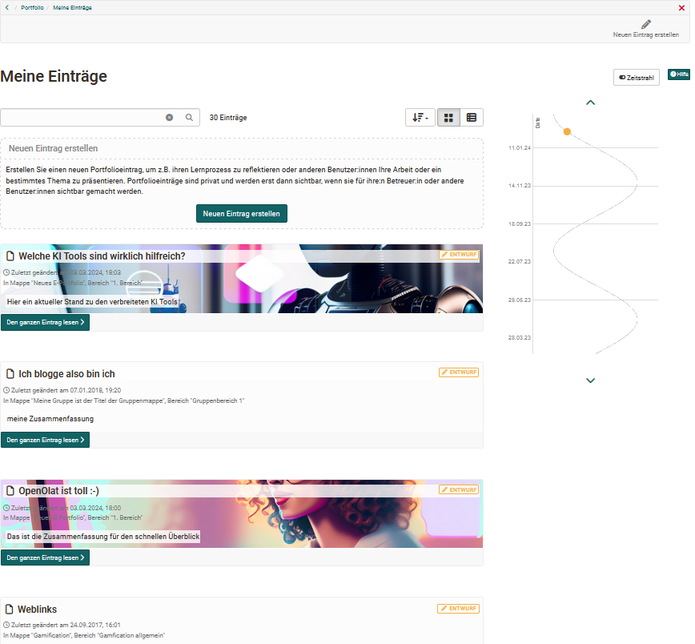

# Meine Einträge {: #my_entries}

Unter "Meine Einträge" haben Sie alle Ihre Portfolioeinträge im Überblick, in der Regel in chronologischer Reihenfolge, und sehen am Status (z.B. Entwurf oder publiziert), wie weit ein Eintrag fortgeschritten ist. Sie öffnen den Bereich im persönlichen Menü: 
`Persönliches Menü > Portfolio 2.0 > Zeige meine Einträge`

{ class="shadow lightbox" title="Bereich Meine Einträge im Portfolio" }

Im Bereich "Meine Einträge" kommt es nicht darauf an, in welcher Mappe sich ein Eintrag befindet oder ob ein Eintrag überhaupt einer Mappe zugeordnet ist. Alle Einträge werden aufgelistet.

!!! tip "Tipp"

    "Meine Einträge" können in zwei unterschiedlichen Darstellungen angezeigt werden. Die Tabellenansicht bietet die Möglichkeit, sich weitere Details der Einträge anzeigen zu lassen, z.B. ob ein Eintrag referenziert wurde oder ob dazu Kommentare vorliegen.

## Neue Einträge erstellen

Neue Einträge erstellen Sie über den Link "Neuen Eintrag erstellen" rechts oben oder über den gleichnamigen Button im Kasten über der Liste. Optional ist es möglich, ein Titelbild für den neuen Eintrag hochzuladen, unter Kategorie ein Stichwort hinzuzufügen und, sofern die Taxonomie aktiviert ist, den Eintrag einem Kompetenzbereich zuzuordnen. Der neue Eintrag kann entweder einer bereits existierenden Mappe und einem dort vorhandenen Bereich zugeordnet oder zunächst unabhängig von Mappen erstellt werden (sogenannter Floating Eintrag). Anschliessend gelangen Sie in den [Portfolio Editor](../area_modules/The_portfolio_editor_17_1.de.md) und können den Eintrag mit Inhalten ausgestalten und auch eine Verbindung zu Elementen des [Media Centers](../personal_menu/Media_Center.de.md) herstellen. Allerdings werden keine kompletten Portfolioeinträge im Media Center abgelegt.

In den Portfolio Editor gelangen Sie auch, wenn Sie einen bestehenden Eintrag anklicken.

!!! info "Wichtig"

    Einträge können sich auch auf Formulare beziehen und aus einer abgeholten Mappe stammen. In diesem Fall steht der Portfolio Editor nicht zur Verfügung.

## Zeitstrahl [:octicons-tag-16:{ title="ab Release 11.0 (OO-2301)" }](https://track.frentix.com/issue/OO-2301)

Führen Sie ein ePortfolio über einen längeren Zeitraum, etwa ein Semester oder ein Jahr, zeigt Ihnen der Zeitstrahl auf einen Blick, wann Ihre Einträge entstanden sind und wie weit sie fortgeschritten sind. Farbig markierte Punkte zeigen an, wann ein Eintrag erstellt wurde. Fahren Sie mit dem Mauszeiger über einen Punkt, erscheinen Titel und Status des Eintrags. Die unterschiedlichen Farben der Punkte kennzeichnen den jeweiligen Status des Eintrags.

Der Zeitstrahl zeigt die letzten zwölf Monate, die jüngsten Einträge oben. Mit den Pfeilen über und unter dem Zeitstrahl verschieben Sie den Ausschnitt um jeweils sechs Monate. Über den Schalter "Zeitstrahl" rechts oben blenden Sie ihn ein und aus, OpenOlat merkt sich Ihre Wahl. Ihre [Administrator:in](../../manual_admin/administration/eAssessment_ePortfolio.de.md#visible_elements) kann den Zeitstrahl ausschalten.

## Weiterführende Informationen {: #further_information}

[Der Portfolio Editor >](The_portfolio_editor_17_1.de.md) 
[Persönliche Werkzeuge: Das Media Center >](../personal_menu/Media_Center.de.md) 
[e-Assessment Administration: ePortfolio >](../../manual_admin/administration/eAssessment_ePortfolio.de.md) 
[Meine Mappen >](My_portfolio_binders.de.md) 
[Mehrfachverwendung von Einträgen >](Multiple_use_of_entries.de.md)

[Zum Seitenanfang ^](#my_entries)
