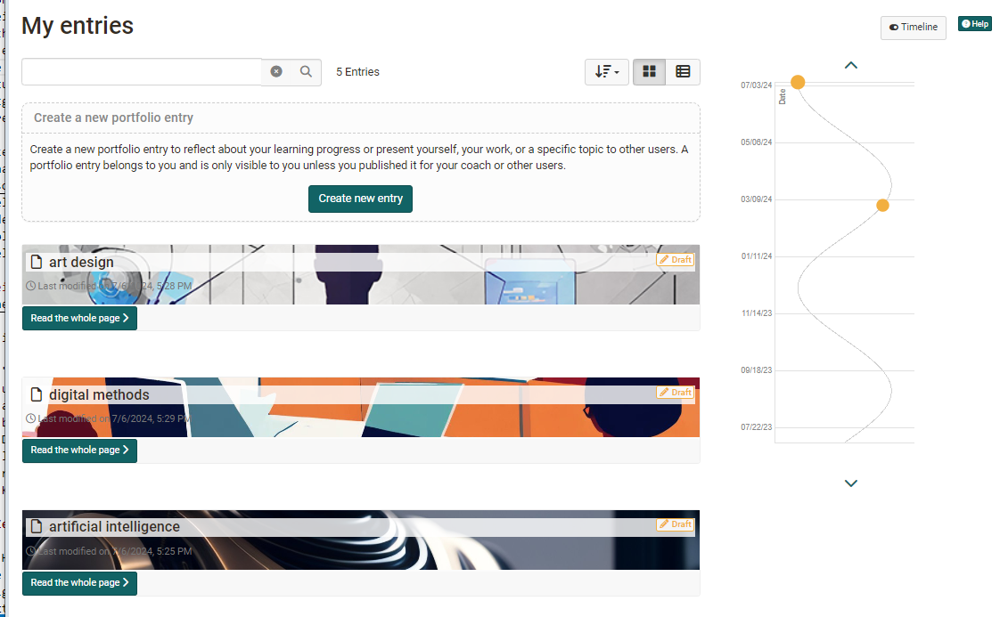

# My entries {: #my_entries}

Under "My entries" you have an overview of all your portfolio entries, usually in chronological order, and you can see from the status (e.g. draft or published) how far an entry has progressed. You open the area in the personal menu: 
`Personal menu > Portfolio 2.0 > Show my entries`

{ class="shadow lightbox" title="My entries in the portfolio" }

In the "My entries" area, it does not matter in which binder an entry is located or whether an entry is assigned to a binder at all. All entries are listed.

!!! tip "Tip"

    "My entries" can be displayed in two different ways. The table view offers the possibility to display further details of the entries, e.g. whether an entry was referenced or whether comments are available.

## Create new entries

You create new entries via the link "Create new entry" at the top right or via the button of the same name in the box "Create a new portfolio entry" above the list. Optionally, it is possible to upload a cover image for the new entry, add a keyword under Category and, if the taxonomy is activated, assign the entry to a competence area. The new entry can either be assigned to an existing binder and an existing section there or initially created independently of binders (so-called floating entry). You then access the [Portfolio Editor](../area_modules/The_portfolio_editor_17_1.md) and can add content to the entry and also create a link to elements of the [Media Center](../personal_menu/Media_Center.md). However, no complete portfolio entries are stored in the Media Center.

You can also access the Portfolio Editor by clicking on an existing entry.

!!! info "Important"

    Entries can also refer to forms and originate from a collected binder. In this case, the Portfolio Editor is not available.

## Timeline [:octicons-tag-16:{ title="from Release 11.0 (OO-2301)" }](https://track.frentix.com/issue/OO-2301)

If you keep an ePortfolio over a longer period of time, such as a semester or a year, the timeline shows you at a glance when your entries were created and how far they have progressed. Colored dots indicate when an entry was created. When you move the mouse pointer over a dot, the title and status of the entry appear. The different colors of the dots indicate the respective status of the entry.

The timeline shows the last twelve months, with the most recent entries at the top. With the arrows above and below the timeline you move the visible period by six months at a time. With the toggle "Timeline" at the top right you show and hide it, and OpenOlat remembers your choice. Your [administrator](../../manual_admin/administration/eAssessment_ePortfolio.md#visible_elements) can switch off the timeline.

## Further information {: #further_information}

[The Portfolio Editor >](The_portfolio_editor_17_1.md) 
[User tools: Media Center >](../personal_menu/Media_Center.md) 
[e-Assessment Administration: ePortfolio >](../../manual_admin/administration/eAssessment_ePortfolio.md) 
[My binders >](My_portfolio_binders.md) 
[Multiple use of entries >](Multiple_use_of_entries.md)

[To the top of the page ^](#my_entries)
