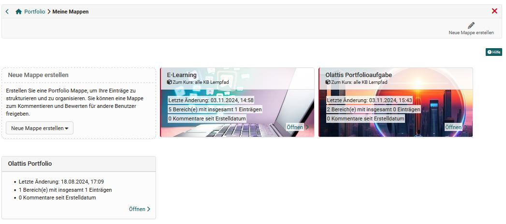
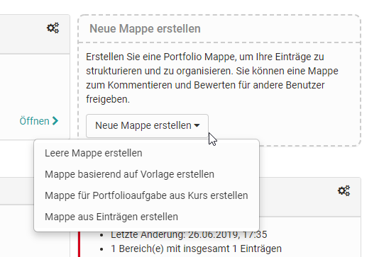
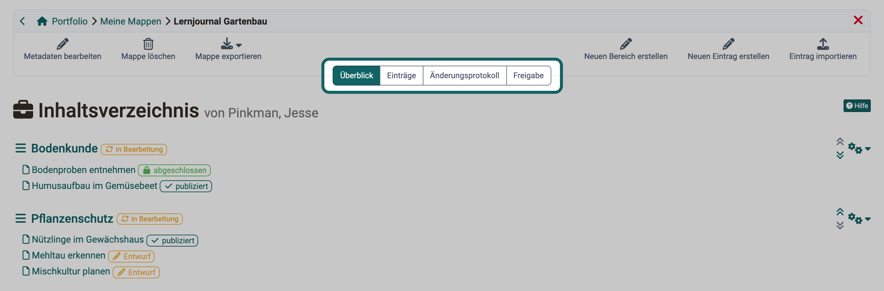
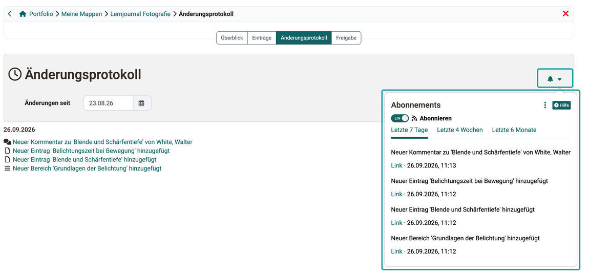
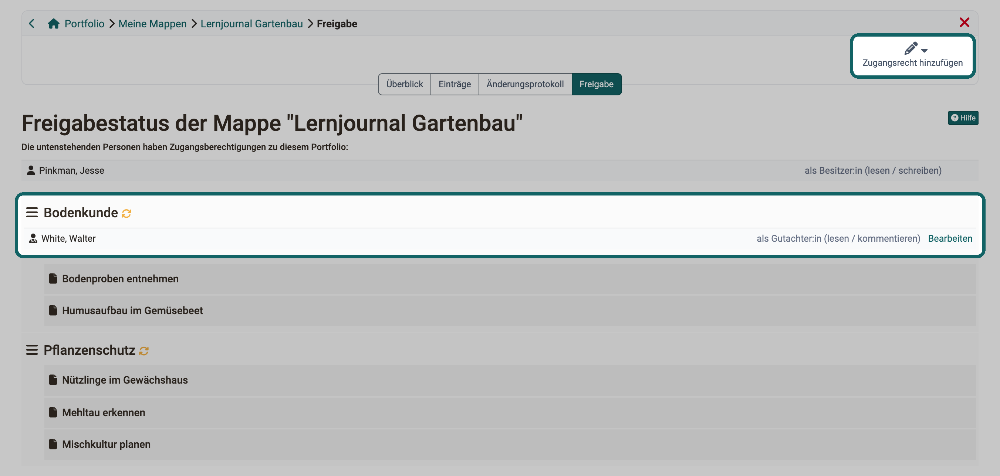

# Meine Portfolio Mappen {: #my_portfolio_binders}

Unter "Meine Mappen" finden Sie alle Ihre Mappen an einer Stelle, die in einem Kurs abgeholten wie die selbst erstellten, und legen hier auch neue Mappen an. Jede Benutzer:in erreicht das eigene Portfolio über das persönliche Menü: 
`Persönliches Menü > Portfolio 2.0 > Zu meinen Mappen`

{ class="shadow lightbox" title="Bereich Meine Mappen im Portfolio" }

## Die zwei Mappenvarianten

Es werden grundsätzlich zwei Arten von Portfoliomappen unterschieden:

* In einem Kurs abgeholte Mappen
* Selbst erstellte, kursunabhängige Mappen

### Abgeholte, vorbereitete Mappen [:octicons-tag-16:{ title="ab Release 11.0 (OO-2305)" }](https://track.frentix.com/issue/OO-2305)

In einem Kurs bei einer Portfolioaufgabe abgeholte Mappen erkennen Sie am roten Randstreifen und dem Hinweis auf den zugehörigen Kurs. Diese Mappen basieren auf einer ["Portfolio 2.0 Vorlage"](../learningresources/Portfolio_template_Creation.de.md) und werden in der Regel von einer anderen Person, meist den Lehrenden, erstellt. Abgeholt wird die Mappe im Kurs über den Kursbaustein "[Portfolioaufgabe](../learningresources/Course_Element_Portfolio_Task.de.md)". Alternativ ist es auch möglich, Portfoliovorlagen kursunabhängig zu buchen und abzuholen.

Sobald Lernende eine Portfoliomappe abholen, wird eine Kopie der Vorlage erstellt und die abgeholte Mappe erscheint im persönlichen Portfoliobereich unter "Meine Mappen". Wer diese Mappe öffnet, kann die dort hinterlegten Aufgaben (Typ Freitext oder Formular) wählen bzw. abholen und die bereitgestellten Portfolioaktivitäten bearbeiten, indem diverse Artefakte (Texte, Dateien, Bilder usw.) hinterlegt oder ein vorbereitetes Formular ausgefüllt wird.

Im [Portfolio Editor](../area_modules/The_portfolio_editor_17_1.de.md) muss immer zuerst ein Layout ausgewählt werden, bevor es mit Inhalten und Artefakten, wahlweise auch aus dem [Media Center](../basic_concepts/Media_Center_Concept.de.md), gefüllt werden kann. Es können auch mehrere Layouts für eine bereitgestellte Aufgabe verwendet werden.

Alternativ können auch schon erstellte Portfolioeinträge über den Button ["Inhalt referenzieren"](Multiple_use_of_entries.de.md) verknüpft werden. Änderungen an den Einträgen sind dann an allen referenzierten Stellen möglich.

!!! info "Wichtig"

    Benutzer:innen können allerdings keine neuen "Bereiche" in einer abgeholten Portfoliomappe anlegen. Auch das Erstellen von eigenen "Einträgen" ist standardmässig deaktiviert.

### Individuelle Portfoliomappen [:octicons-tag-16:{ title="ab Release 11.0 (OO-2297)" }](https://track.frentix.com/issue/OO-2297)

Alle OpenOlat Benutzer:innen können individuelle, unabhängige, persönliche Portfoliomappen mit Bereichen, Einträgen und diversen Inhalten erstellen und so z.B. den eigenen Lernprozess dokumentieren und begleiten, ohne dass ein Kursbezug oder ein formaler Lehrrahmen besteht.

Es gibt im Bereich "Meine Mappen" zwei Stellen, an denen neue Mappen erstellt werden können.

#### a) Über den Link "Neue Mappe erstellen" rechts oben

Auf diesem Weg erhalten Sie rasch eine neue, leere Mappe. Dabei stehen grundsätzlich alle Möglichkeiten des Portfolios inklusive Gestaltung der Bereiche, Bearbeitung der Metadaten, Mappenexport, Mappe löschen und Vergabe des Zugangsrechts zur Verfügung.

#### b) Über das Ausklappmenü im Kasten "Neue Mappe erstellen"

Im Kasten "Neue Mappe erstellen" öffnet der gleichnamige Button ein Ausklappmenü mit allen Wegen zu einer neuen Mappe.

{ class="shadow lightbox" title="Kasten Neue Mappe erstellen in Meine Mappen" }

Neben der Möglichkeit, eine leere Mappe wie unter a) zu erstellen, gibt es noch folgende weitere Optionen:

* **"Mappe basierend auf Vorlage erstellen"**: Hier kann als Basis eine Portfolio 2.0 Vorlage verwendet werden, für die die Benutzer:in die Berechtigung hat.
* **"Mappe für Portfolioaufgabe aus Kurs erstellen"**: Hier werden Portfolioaufgaben aus den eigenen Kursen angezeigt und es kann eine ausgewählt werden. Dieses Vorgehen führt zum selben Ergebnis wie das Abholen der Portfolioaufgabe im Kurs.
* **"Mappe aus Einträgen erstellen"**: Hier können zuvor erstellte Einträge in einer neuen Portfoliomappe gebündelt werden. Ein Wizard führt dabei Schritt für Schritt durch die Auswahl.

!!! info "Wichtig"

    Die Möglichkeit, selbst Mappen zu erstellen, kann von Ihrer [Administrator:in](../../manual_admin/administration/eAssessment_ePortfolio.de.md) eingeschränkt werden.

## Die Tabs einer Portfoliomappe

Eine geöffnete Mappe führt die Tabs "Überblick", "Einträge", "Änderungsprotokoll" und "Freigabe". Mit ihnen wechseln Sie zwischen dem Inhalt der Mappe, ihrem Verlauf und den Zugangsrechten.

{ class="shadow lightbox" title="Tab Überblick einer Portfoliomappe · 2026.10.26" }

* **Überblick**: Das Inhaltsverzeichnis der Mappe zeigt die Bereiche mit ihren Einträgen, jeweils mit Status.
* **Einträge**: Hier stehen die Einträge der Mappe nach Bereichen geordnet, mit dem Zeitstrahl wie unter [Meine Einträge](My_entries.de.md).
* **Änderungsprotokoll**: Hier sind alle Änderungen in chronologischer Reihenfolge aufgelistet, die neueste zuoberst. Im Feld "Änderungen seit" legen Sie fest, ab welchem Datum die Liste beginnt. Über das Glockensymbol rechts oben neben der Überschrift lassen Sie sich über diese Änderungen informieren, statt den Tab selbst zu prüfen: Klicken Sie darauf und schalten Sie im Popup-Fenster "Abonnieren" ein. Gemeldet werden neue Kommentare zu Einträgen mit dem Namen der schreibenden Person sowie neue und geänderte Einträge, Bereiche und Einschätzungen, jeweils nur zu Inhalten, die Sie in der Mappe sehen dürfen. Die Meldungen sammeln sich unter [Abonnements](../personal_menu/Subscriptions.de.md) im persönlichen Menü und gehen je nach Ihrer Einstellung zusätzlich per E-Mail.
* **Freigabe**: Hier sehen Sie, wer mit welchem Recht auf die Mappe, ihre Bereiche und Einträge zugreift. Über "Zugangsrecht hinzufügen" geben Sie Bereiche und Einträge frei. Mehr dazu unter [Sammeln und Bearbeiten](../learningresources/Portfolio_task_and_assignment_Collecting_and_editing.de.md).

{ class="shadow lightbox" title="Tab Änderungsprotokoll einer Portfoliomappe" }

{ class="shadow lightbox" title="Tab Freigabe einer Portfoliomappe · 2026.10.26" }

Zwei weitere Tabs erscheinen abhängig von der Mappe und Ihren Rechten:

* **Vorlagen**, wenn Sie in dieser Mappe eine Aufgabe aus einer Vorlage abholen können.
* **Bewertung**, wenn die Mappe bewertbar ist und Sie die Bewertung einsehen dürfen.

!!! info "Wichtig"

    Die Tabs "Überblick", "Einträge" und "Änderungsprotokoll" kann Ihre [Administrator:in](../../manual_admin/administration/eAssessment_ePortfolio.de.md) ausschalten.

## Weiterführende Informationen {: #further_information}

**Auf dieser Seite erwähnt** 
[Portfoliovorlage: Erstellung >](../learningresources/Portfolio_template_Creation.de.md) 
[Kursbaustein "Portfolioaufgabe" >](../learningresources/Course_Element_Portfolio_Task.de.md) 
[Der Portfolio Editor >](The_portfolio_editor_17_1.de.md) 
[Media Center: Konzept >](../basic_concepts/Media_Center_Concept.de.md) 
[Mehrfachverwendung von Einträgen >](Multiple_use_of_entries.de.md) 
[e-Assessment Administration: ePortfolio >](../../manual_admin/administration/eAssessment_ePortfolio.de.md) 
[Meine Einträge >](My_entries.de.md) 
[Persönliche Werkzeuge: Abonnements >](../personal_menu/Subscriptions.de.md) 
[Portfolioaufgabe: abholen und bearbeiten >](../learningresources/Portfolio_task_and_assignment_Collecting_and_editing.de.md)

**Weiterführend** 
[Persönliche Werkzeuge: Portfolio >](../personal_menu/Portfolio.de.md) 
[An mich freigegeben >](Shared_with_me.de.md) 
[Von mir freigegeben >](Shared_by_me.de.md)

[Zum Seitenanfang ^](#my_portfolio_binders)
