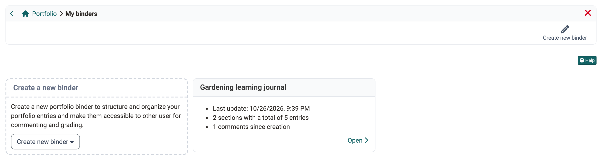
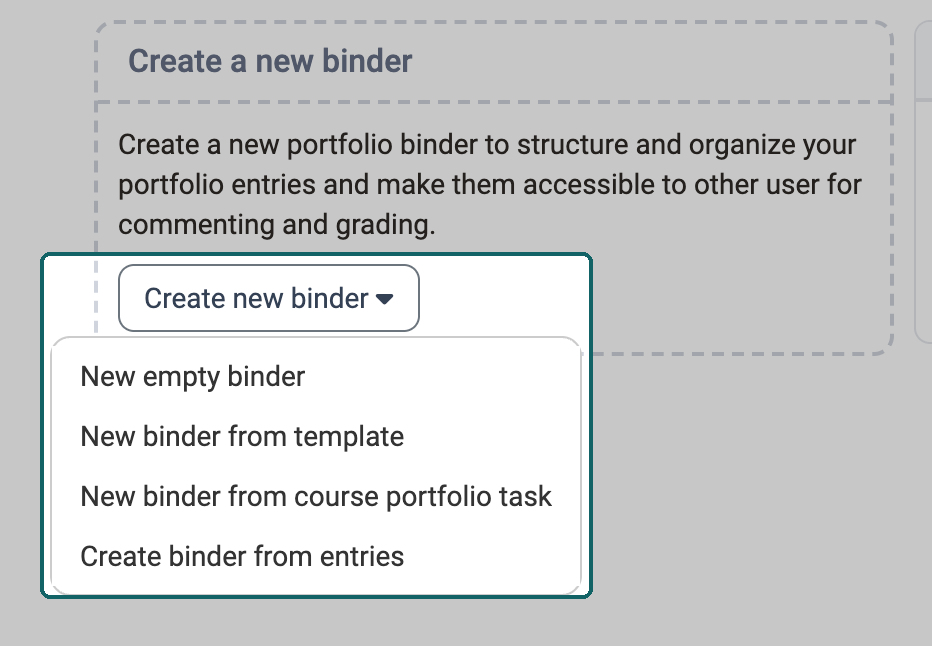
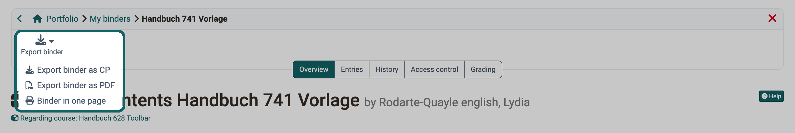
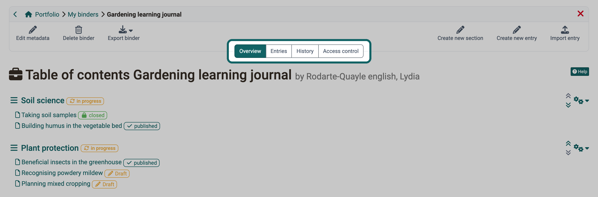
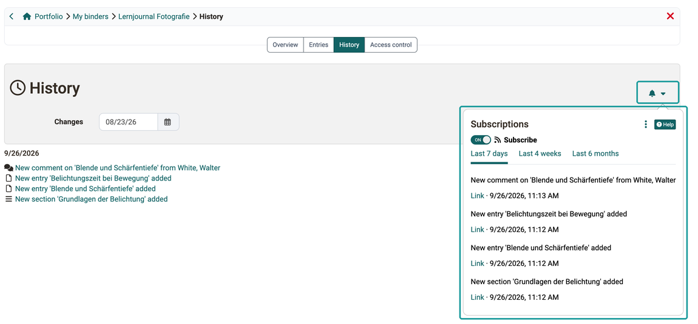
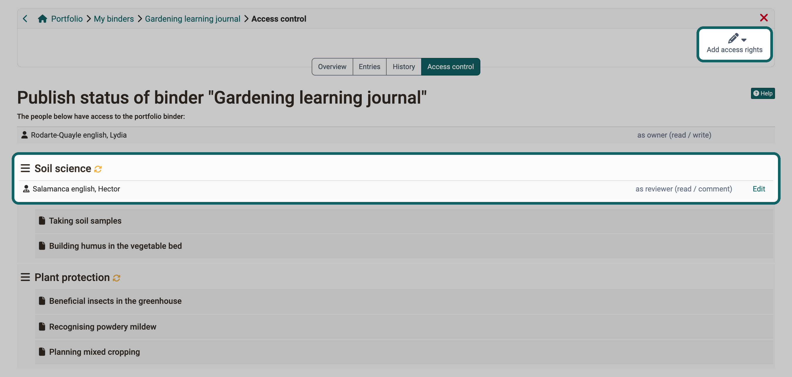

# My binders {: #my_portfolio_binders}

Under "My binders" you find all your binders in one place, those collected in a course as well as those you created yourself, and you also create new binders here. Every user reaches their own portfolio via the personal menu: 
`Personal menu > Portfolio 2.0 > Go to my binders`

{ class="shadow lightbox" title="My binders in the portfolio · 2026.10.26" }

## The two types of binders

There are basically two types of binders:

* Binders collected in a course
* Self-created, course-independent binders

### Collected, prepared binders [:octicons-tag-16:{ title="from Release 11.0 (OO-2305)" }](https://track.frentix.com/issue/OO-2305)

You can recognize binders collected from a portfolio task in a course by the red border and the reference to the corresponding course. These binders are based on a ["Portfolio 2.0 template"](../learningresources/Portfolio_template_Creation.md) and are usually created by another person, mostly the teacher. The binder is collected in the course via the course element "[Portfolio Task](../learningresources/Course_Element_Portfolio_Task.md)". Alternatively, it is also possible to book and collect portfolio templates independently of a course.

As soon as learners collect a binder, a copy of the template is created and the collected binder appears in the personal portfolio area under "My binders". Whoever opens this binder can select or collect the tasks stored there (free text or form type) and edit the portfolio activities provided by storing various artifacts (texts, files, images, etc.) or filling out a prepared form.

In the [Portfolio Editor](../area_modules/The_portfolio_editor_17_1.md), a layout must always be selected first before it can be filled with content and artifacts, optionally also from the [Media Center](../basic_concepts/Media_Center_Concept.md). Several layouts can also be used for a provided task.

Alternatively, already created portfolio entries can also be linked via the ["Link content"](Multiple_use_of_entries.md) button. Changes to the entries are then possible in all referenced locations.

!!! info "Important"

    However, users cannot create new "sections" in a collected binder. Creating their own "entries" is also disabled by default. Which actions you have in a collected binder is described under [The toolbar of a binder](#binder_toolbar).

### Individual binders [:octicons-tag-16:{ title="from Release 11.0 (OO-2297)" }](https://track.frentix.com/issue/OO-2297) {: #individual-portfolio-binders}

All OpenOlat users can create individual, independent, personal binders with sections, entries and various types of content, for example to document and support their own learning process without a course context or a formal instructional framework.

In the "My binders" area, there are two places where new binders can be created.

#### a) Via the link "Create new binder" at the top right

This way, you quickly get a new, empty binder. In a binder you created yourself, all actions of the [toolbar](#binder_toolbar) are available to you, from structuring it into sections and editing the metadata to exporting and deleting it. You assign access rights in the tab "Access control".

#### b) Via the dropdown menu in the box "Create a new binder"

In the box "Create a new binder", the button "Create new binder" opens a dropdown menu with all ways to a new binder.

{ class="shadow lightbox" title="Box Create a new binder in My binders · 2026.10.26" }

In addition to creating an empty binder as described under a), there are the following options:

* **"New binder from template"**: A Portfolio 2.0 template for which the user has permission can be used as the basis.
* **"New binder from course portfolio task"**: Portfolio tasks from the user's own courses are displayed here and one can be selected. This approach leads to the same result as collecting the portfolio task in the course.
* **"Create binder from entries"**: Previously created entries can be bundled into a new binder. A wizard guides you step by step through the selection.

!!! info "Important"

    The ability to create binders yourself can be restricted by your [administrator](../../manual_admin/administration/eAssessment_ePortfolio.md).

## The toolbar of a binder {: #binder_toolbar}

When you open a binder, you manage it via the toolbar above the tabs: on the left the binder as a whole, on the right its content. Which actions you see depends on whether you created the binder yourself or collected it from a template. The toolbar shows these actions only to the person who owns the binder. Whoever reads a binder via an access right, for example as a coach, sees none of them. The image under [The tabs of a binder](#binder_tabs) shows the toolbar of a binder you created yourself.

* **Edit metadata**: Here you change "Title", "Summary", "Teaser Image (jpg, png, gif)" and "Categories" of the binder. In a binder from a template, the template sets these details and the action is missing.
* **Delete binder**: OpenOlat moves the binder to the trash. There you get it back with "Restore" or delete it permanently with "Delete binder": `Personal menu > Portfolio 2.0 > Go to trash > Binders`. You may delete a binder from a template only if the template has switched on "Users are allowed to delete binders".
* **Export binder**: With this you back up the binder or pass it on outside OpenOlat. The dropdown menu offers three forms:
    * "Export binder as CP" downloads the binder as a CP (Content Package).
    * "Export binder as PDF" downloads the binder as a PDF file. The option only appears if your administrator has set up the [PDF Generator](../../manual_admin/administration/External_Tools_-_Administration.md#pdf_generator).
    * "Binder in one page" opens the whole binder as one page in a new browser window, for reading and printing.

    { class="shadow lightbox" title="Dropdown menu Export binder in a binder from a template · 2026.10.28" }

* **Create new section**: A section structures the binder like a chapter and holds the entries. The action exists only in binders you created yourself. In a binder from a template, the template defines the sections.
* **Create new entry**: Here you write a new entry in a section of the binder. The action only appears once the binder has at least one section. In a binder from a template, it only appears if the template has switched on "Users are allowed to create new entries" or if the binder shows the tab "Templates". This tab exists if the template has switched on "Add template folder" and contains templates.
* **Import entry**: With this you take over entries you have already written, for example under [My entries](My_entries.md), into a section of this binder. The wizard "Import entries" guides you through the selection. The action only appears once the binder has at least one section. In a binder from a template, it only appears if the template has switched on "Users are allowed to create new entries".

In the tab "Entries", the toolbar only shows the export and the actions for the content. "Edit metadata" and "Delete binder" are missing there, and "Import entry" only appears there in binders you created yourself.

The same toolbar appears when you open the binder in the course element "Portfolio Task" or under [Shared by me](Shared_by_me.md).

Which options a template switches on is set by its authors in the settings of the portfolio template, in the form "Portfolio template's options": `Portfolio template > Administration > Settings > Tab "Options"`. For more information, see [Portfolio template: Administration and editing](../learningresources/Portfolio_template_Administration_and_editing.md).

## The tabs of a binder {: #binder_tabs}

An opened binder shows the tabs "Overview", "Entries", "History" and "Access control". With them you switch between the content of the binder, its history of changes and the access rights.

{ class="shadow lightbox" title="Overview tab and toolbar of a binder · 2026.10.26" }

* **Overview**: The table of contents of the binder shows the sections with their entries, each with its status.
* **Entries**: Here the entries of the binder are listed by section, with the timeline as under [My entries](My_entries.md).
* **History**: Here all changes are listed in chronological order, with the most recent at the top. In the field "Changes" you set the date from which the list starts. The bell icon at the top right next to the heading lets you be informed about these changes instead of checking the tab yourself: click it and switch on "Subscribe" in the pop-up window. You are notified of new comments on entries with the name of the person who wrote them, as well as new and changed entries, sections and evaluations, in each case only for content you are allowed to see in the binder. The notifications are collected under [Subscriptions](../personal_menu/Subscriptions.md) in the personal menu and, depending on your settings, are also sent by e-mail.
* **Access control**: Here you see who has which right on the binder, its sections and entries. With "Add access rights" you share sections and entries. For more information, see [Collecting and editing](../learningresources/Portfolio_task_and_assignment_Collecting_and_editing.md).

{ class="shadow lightbox" title="History tab of a binder" }

{ class="shadow lightbox" title="Access control tab of a binder · 2026.10.26" }

Two further tabs appear depending on the binder and your rights:

* **Templates**, if you can pick up a task from a template in this binder.
* **Grading**, if the binder is assessable and you are allowed to view the assessment.

!!! info "Important"

    Your [administrator](../../manual_admin/administration/eAssessment_ePortfolio.md) can switch off the tabs "Overview", "Entries" and "History".

## Further information {: #further_information}

**Mentioned on this page** 
[Portfolio template: Creation >](../learningresources/Portfolio_template_Creation.md) 
[Course Element "Portfolio Task" >](../learningresources/Course_Element_Portfolio_Task.md) 
[The Portfolio Editor >](The_portfolio_editor_17_1.md) 
[Media Center Concept >](../basic_concepts/Media_Center_Concept.md) 
[Multiple use of entries >](Multiple_use_of_entries.md) 
[e-Assessment Administration: ePortfolio >](../../manual_admin/administration/eAssessment_ePortfolio.md) 
[External Tools: Overview >](../../manual_admin/administration/External_Tools_-_Administration.md) 
[My entries >](My_entries.md) 
[Shared by me >](Shared_by_me.md) 
[Portfolio template: Administration and editing >](../learningresources/Portfolio_template_Administration_and_editing.md) 
[User tools: Subscriptions >](../personal_menu/Subscriptions.md) 
[Portfolio task and assignment: Collecting and editing >](../learningresources/Portfolio_task_and_assignment_Collecting_and_editing.md)

**Further reading** 
[User tools: Portfolio >](../personal_menu/Portfolio.md) 
[Shared with me >](Shared_with_me.md)

[To the top of the page ^](#my_portfolio_binders)
