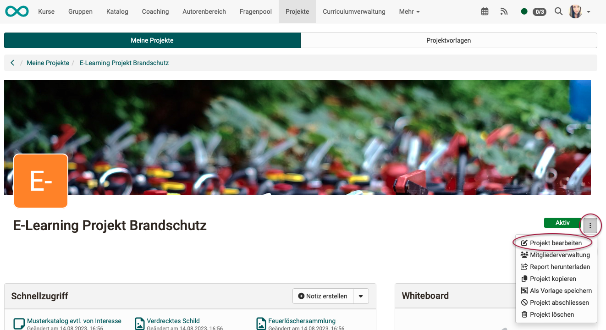
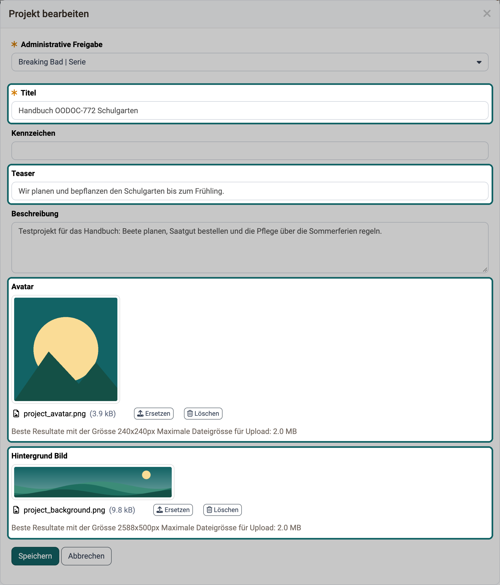
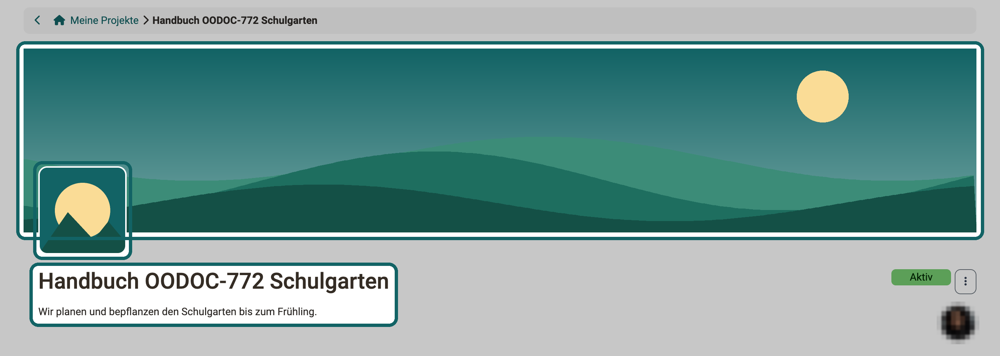
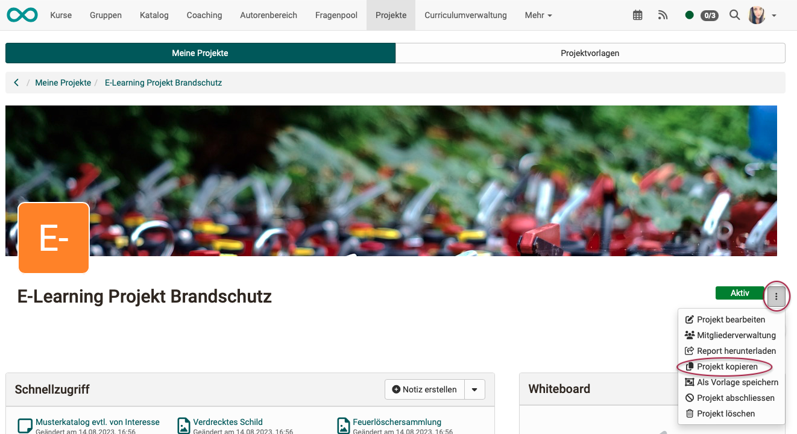
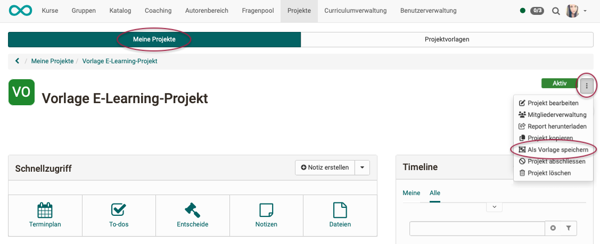
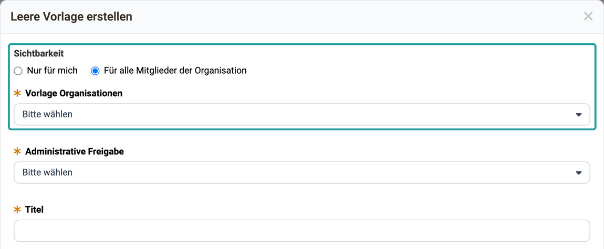
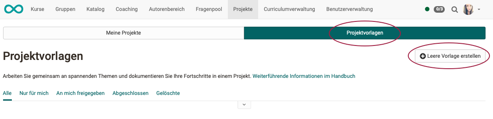
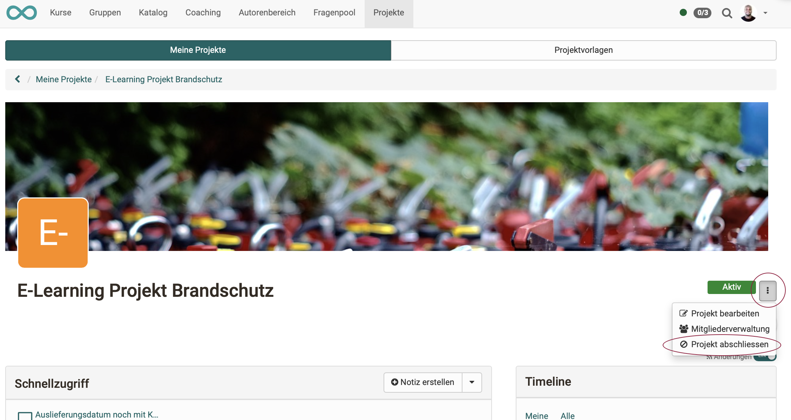
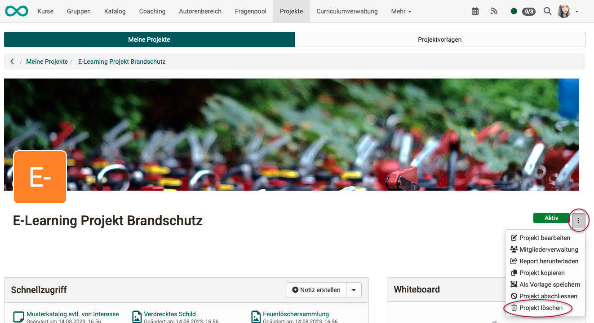
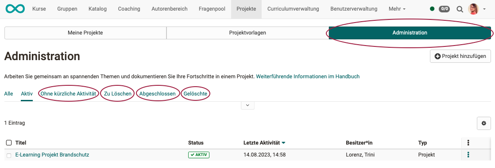

# Projekte - Administration {: #administration}

Wenn Sie ein Projekt einrichten, weiterverwenden oder beenden, finden Sie die Befehle dazu an einer Stelle: im 3-Punkte-Menü rechts oben im geöffneten Projekt. Das Menü enthält:

* **Projekt bearbeiten**: Titel, Teaser und Bilder der Startseite festlegen
* **Mitgliederverwaltung**: die [Mitglieder des Projekts verwalten](../area_modules/Project_Member_Management.de.md)
* **Report herunterladen**: einen [Report](../area_modules/Project_Report.de.md) über das Projekt herunterladen
* **Projekt kopieren**
* **Als Vorlage speichern**
* **Projekt abschliessen** und **Projekt reaktivieren**
* **Projekt löschen**

!!! info "Wichtig"

    Welche Einträge das Menü zeigt, hängt von Ihrer Projektrolle ab.

## Projekt bearbeiten

Mit "Projekt bearbeiten" gestalten Sie die Startseite des Projekts: Titel, Teaser und Bilder, die alle Mitglieder beim Öffnen des Projekts sehen. Die Inhalte (Termine eintragen, To-dos erstellen usw.) bearbeiten Sie dagegen direkt im Projekt.

Ändern können diese Angaben Projektbesitzer:innen, Projektleiter:innen, Projektbüro-Mitarbeiter:innen, Administrator:innen und Projektverwalter:innen. Die übrigen Mitglieder finden an derselben Stelle "Projekt anzeigen" und sehen die Angaben nur.

Öffnen Sie im Cockpit des Projekts rechts oben das 3-Punkte-Menü und wählen Sie "Projekt bearbeiten".

{ class="shadow lightbox" title="Cockpit eines Projekts" }

Es öffnet sich der Dialog "Projekt bearbeiten". Vier Angaben aus dem Dialog erscheinen auf der Startseite des Projekts.

{ class="shadow lightbox" title="Dialog Projekt bearbeiten · 2026.11.10" }

* **Titel**: Pflichtfeld. Der Titel steht als Überschrift auf der Startseite und bezeichnet das Projekt in der Projektliste.
* **Teaser**: Kurztext, der auf der Startseite direkt unter dem Titel erscheint.
* **Avatar**: Quadratisches Bild links oben auf der Startseite. Beste Resultate mit der Grösse 240x240px, maximale Dateigrösse 2 MB.
* **Hintergrund Bild**: Bild über die ganze Breite der Startseite. Beste Resultate mit der Grösse 2588x500px, maximale Dateigrösse 2 MB.

Ein hochgeladenes Bild tauschen Sie mit "Ersetzen" aus oder entfernen es mit "Löschen". Mit "Speichern" übernehmen Sie die Änderungen.

So erscheinen die vier Angaben auf der Startseite des Projekts:

{ class="shadow lightbox" title="Startseite eines Projekts · 2026.11.10" }

Drei weitere Felder erscheinen nicht oder nur klein auf der Startseite:

* **Administrative Freigabe**: Pflichtfeld. Die Organisationen, denen das Projekt zugeordnet ist. Projektverwalter:innen und Administrator:innen dieser Organisationen sehen das Projekt im Tab "Administration". Ohne eine dieser Rollen ist Ihre eigene Organisation vorbelegt und nicht änderbar.
* **Kennzeichen**: Frei wählbare Referenz, zum Beispiel eine Projektnummer. Sie erscheint klein unter dem Titel und als einblendbare Spalte in der Projektliste.
* **Beschreibung**: Ausführlicher Text zum Projekt. Die Startseite zeigt ihn nicht an.

## Projekt kopieren [:octicons-tag-16:{ title="ab Release 18.0 (OO-6840)" }](https://track.frentix.com/issue/OO-6840)

Soll ein neues Projekt mit denselben Inhalten starten, kopieren Sie ein bestehendes Projekt mit "Projekt kopieren" im 3-Punkte-Menü.

{ class="shadow lightbox" title="Cockpit eines Projekts" }

Kopiert werden:

* alle To-dos
* alle Entscheide
* alle Notizen
* alle Dateien

**Nicht** kopiert werden:

* Projektmitglieder

**Teilweise** kopiert werden:

* Termine und Meilensteine (werden ohne Datum kopiert)

## Projektvorlagen

Wenn Sie ähnliche Projekte wiederholt anlegen, sparen Sie mit einer Vorlage die Einrichtung jedes einzelnen Projekts.

Ein bestehendes Projekt speichern Sie im 3-Punkte-Menü mit "Als Vorlage speichern" als Vorlage.

{ class="shadow lightbox" title="Cockpit eines Projekts" }

Es öffnet sich der Dialog "Als Vorlage speichern". Eine private Vorlage steht nur Ihnen zur Verfügung. Eine organisationsweite Vorlage steht allen Mitgliedern der gewählten Organisationen zur Verfügung. Die Auswahl "Sichtbarkeit" mit den Optionen "Nur für mich" und "Für alle Mitglieder der Organisation" sehen nur Personen mit der Organisationsrolle Administrator:in oder Projektverwalter:in. Erlaubt die System-Administration unter `Administration > Module > Projekte` auch Autor:innen, Projekte und Vorlagen hinzuzufügen, sehen auch Autor:innen diese Auswahl. Alle übrigen Personen erstellen immer eine private Vorlage. Bei der Option "Für alle Mitglieder der Organisation" wählen Sie im Feld "Vorlage Organisationen" die Organisationen aus, in denen Sie eine dieser Rollen haben. :octicons-tag-16:{ title="ab Release 21.0.3 (OO-9719)" }

{ class="shadow lightbox" title="Dialog Leere Vorlage erstellen" }

Eine Vorlage, die nicht auf einem bestehenden Projekt aufbaut, legen Sie im Tab "Projektvorlagen" an: `Projekte > Tab "Projektvorlagen" > Button "Leere Vorlage erstellen"`. Für die Sichtbarkeit gilt dort dieselbe Regel wie beim Speichern eines Projekts als Vorlage.

{ class="shadow lightbox" title="Tab Projektvorlagen im Bereich Projekte" }

## Projekte abschliessen

Ist die Arbeit an einem Projekt erledigt, schliessen Sie es im 3-Punkte-Menü mit "Projekt abschliessen" ab.

{ class="shadow lightbox" title="Cockpit eines Projekts" }

Abschliessen können ein Projekt nur:

* Projektbesitzer:innen
* Projektleiter:innen
* Projektbüro-Mitarbeiter:innen
* Administrator:innen
* Projektverwalter:innen

!!! info "Wichtig"

    Dieselben Personen können ein abgeschlossenes Projekt mit "Projekt reaktivieren" wieder aktivieren.

## Projekt löschen

Ein Projekt, das nicht mehr gebraucht wird, löschen Sie im 3-Punkte-Menü mit "Projekt löschen".

{ class="shadow lightbox" title="Cockpit eines Projekts" }

Löschen können ein Projekt nur:

* Projektbesitzer:innen
* Administrator:innen
* Projektverwalter:innen

!!! info "Wichtig"

    Ein gelöschtes Projekt erscheint in der Liste "Gelöschte". Dort lässt es sich nur noch ansehen, nicht mehr bearbeiten. Projektbesitzer:innen, Administrator:innen und Projektverwalter:innen können es mit "Projekt reaktivieren" wieder aktivieren.

## Tab Administration [:octicons-tag-16:{ title="ab Release 18.0 (OO-6845)" }](https://track.frentix.com/issue/OO-6845)

Administrator:innen und Projektverwalter:innen behalten im Bereich "Projekte" die Projekte ihrer Organisationen im Blick und räumen ruhende Projekte auf. Dafür haben sie einen weiteren Tab: `Projekte > Tab "Administration"`.

{ class="shadow lightbox" title="Tab Administration im Bereich Projekte" }

Oberhalb der Projektliste grenzen diese Filter die Liste ein:

* **Ohne kürzliche Aktivität** 
Die Liste zeigt Projekte, in denen seit mehr als 28 Tagen keine Aktivität stattgefunden hat. Ihr Status ist "Aktiv" oder "Abgeschlossen". Prüfen Sie, ob sich diese Projekte abschliessen oder löschen lassen. Im Zweifel fragen Sie bei den Projektbesitzer:innen nach.

* **Zu Löschen** 
Die Liste "Zu Löschen" erscheint nur im Tab "Administration". Sie zeigt Projekte mit dem Status "Abgeschlossen", in denen seit mehr als 28 Tagen keine Aktivität stattgefunden hat.

* **Abgeschlossen** 
Anhand dieser Liste fragen Projektverwalter:innen nach, ob sich Projekte, die seit längerem abgeschlossen sind, löschen lassen. 
Abgeschlossene Projekte lassen sich noch reaktivieren.

* **Gelöschte** 
Gelöschte Projekte lassen sich nur noch ansehen, nicht mehr bearbeiten. Projektbesitzer:innen, Administrator:innen und Projektverwalter:innen können sie mit "Projekt reaktivieren" wieder aktivieren.

## Weiterführende Informationen {: #further_information}

**Auf dieser Seite erwähnt** 
[Projekte: Mitgliederverwaltung >](../area_modules/Project_Member_Management.de.md) 
[Projekte - Projektreport >](../area_modules/Project_Report.de.md)

**Weiterführend** 
[Projekte: Überblick >](../area_modules/Project_Overview/index.de.md) 
[Rollen und Rechte: Welche Rollen gibt es? >](../basic_concepts/Roles/index.de.md) 
[Modul Projekte >](../../manual_admin/administration/Modules_Projects.de.md)

[Zum Seitenanfang ^](#administration)
