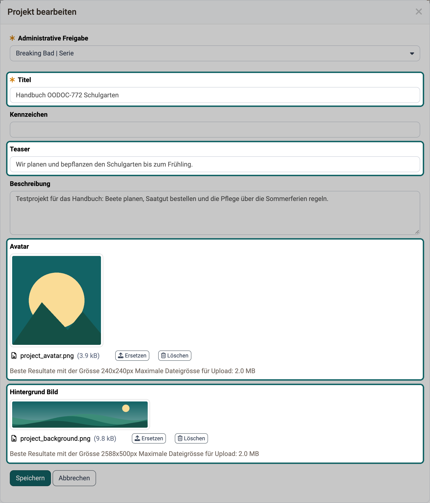
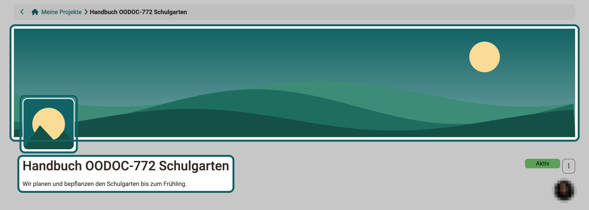
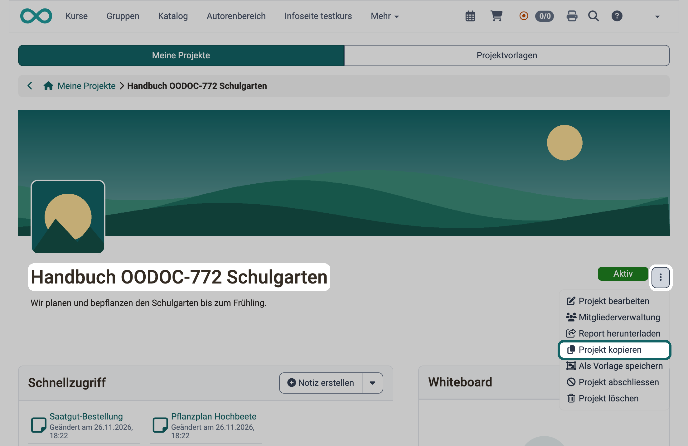
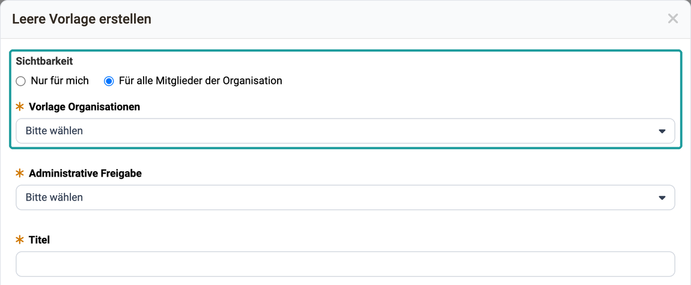
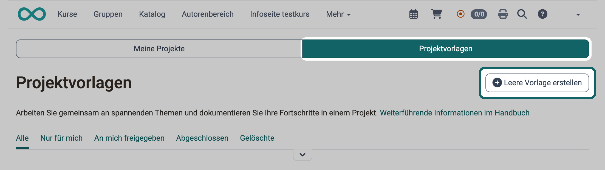
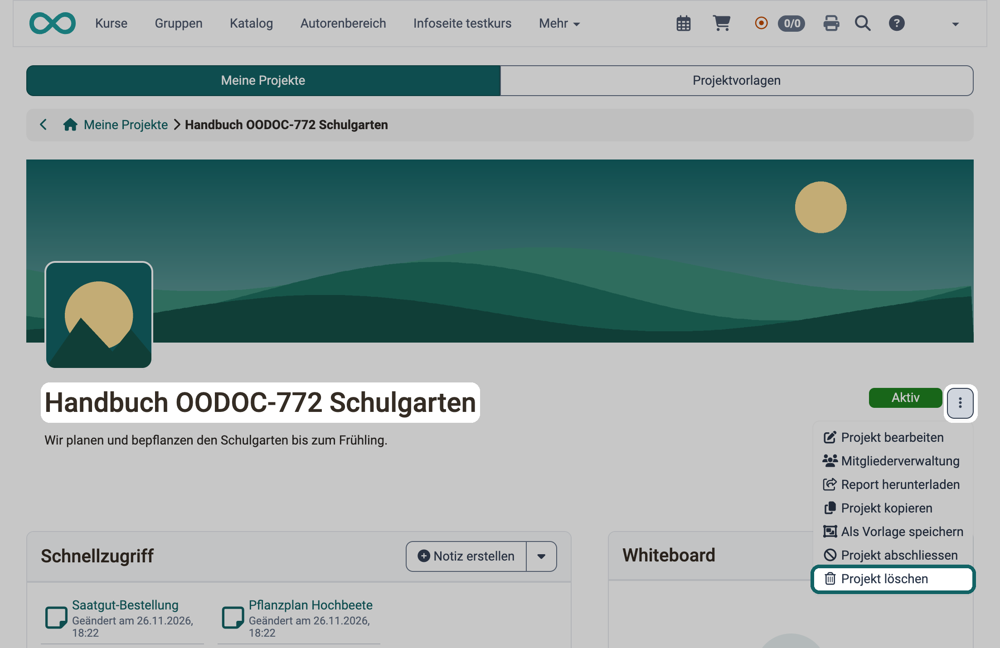
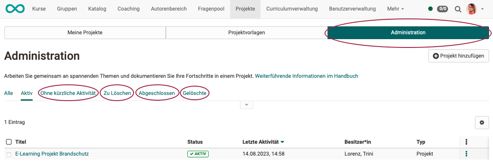

# Projekte - Administration {: #administration}

Wenn Sie ein Projekt einrichten, weiterverwenden oder beenden, finden Sie die Befehle dazu an einer Stelle: im 3-Punkte-Menü rechts oben im geöffneten Projekt. 
`Projekte > Tab "Meine Projekte" > "Projekttitel" > 3-Punkte-Menü`

Menüpunkt | Wozu
---|---
[Projekt bearbeiten](#edit_project) | Titel, Teaser und Bilder festlegen, die alle Mitglieder beim Öffnen des Projekts sehen.
[Mitgliederverwaltung](../area_modules/Project_Member_Management.de.md) | Die Mitglieder des Projekts und ihre Projektrollen verwalten.
[Report herunterladen](../area_modules/Project_Report.de.md) | Die Daten des Projekts in einem Report zusammenfassen und herunterladen.
[Projekt kopieren](#copy_project) | Ein neues Projekt mit denselben Inhalten starten.
[Als Vorlage speichern](#project_templates) | Das Projekt als Vorlage für ähnliche Projekte ablegen.
[Projekt abschliessen](#close_project) | Ein erledigtes Projekt abschliessen.
[Projekt reaktivieren](#close_project) | Ein abgeschlossenes Projekt wieder aktivieren. Für ein gelöschtes Projekt siehe [Projekt löschen](#delete_project).
[Projekt löschen](#delete_project) | Ein Projekt löschen, das nicht mehr gebraucht wird.

!!! info "Wichtig"

    Welche Einträge das Menü zeigt, hängt von Ihrer Projektrolle ab, zum Beispiel "Besitzer:in", "Leiter:in" oder "Teilnehmer:in". Was jede Rolle darf, zeigt die [Tabelle der Rollen in der Mitgliederverwaltung](../area_modules/Project_Member_Management.de.md#roles).

## Projekt bearbeiten {: #edit_project}

Mit "Projekt bearbeiten" gestalten Sie die Startseite des Projekts, das [Cockpit](../area_modules/Project_Cockpit.de.md), das alle Mitglieder beim Öffnen des Projekts sehen: Sie legen Titel, Teaser und Bilder fest. Die Inhalte (Termine eintragen, To-dos erstellen usw.) bearbeiten Sie dagegen direkt im Projekt.

Ändern können diese Angaben Personen mit der Projektrolle "Besitzer:in", "Leiter:in" oder "Projektbüro". Ausserdem können es Personen mit der Organisationsrolle "Administrator:in" oder "Projektverwalter:in": Sie verwalten die Projekte ihrer Organisation, auch ohne Mitglied zu sein. Die übrigen Mitglieder finden an derselben Stelle "Projekt anzeigen" und sehen die Angaben nur.

Öffnen Sie im Cockpit des Projekts rechts oben das 3-Punkte-Menü und wählen Sie "Projekt bearbeiten".

{ class="shadow lightbox" title="Cockpit eines Projekts · 2026.11.26" }

Es öffnet sich der Dialog "Projekt bearbeiten". Vier Angaben aus dem Dialog erscheinen auf der Startseite des Projekts.

{ class="shadow lightbox" title="Dialog Projekt bearbeiten · 2026.11.10" }

* **Titel**: Pflichtfeld. Der Titel steht als Überschrift auf der Startseite und bezeichnet das Projekt in der Projektliste.
* **Teaser**: Kurztext, der auf der Startseite direkt unter dem Titel erscheint.
* **Avatar**: Quadratisches Bild links oben auf der Startseite. Beste Resultate mit der Grösse 240x240px, maximale Dateigrösse 2 MB.
* **Hintergrundbild**: Bild über die ganze Breite der Startseite. Beste Resultate mit der Grösse 2588x500px, maximale Dateigrösse 2 MB.

Ein Bild laden Sie mit "Datei auswählen" hoch oder ziehen es in das Feld. Ein hochgeladenes Bild tauschen Sie mit "Ersetzen" aus oder entfernen es mit "Löschen". Mit "Speichern" übernehmen Sie die Änderungen.

So erscheinen die vier Angaben auf der Startseite des Projekts:

{ class="shadow lightbox" title="Startseite eines Projekts · 2026.11.10" }

Drei weitere Felder erscheinen nicht oder nur klein auf der Startseite:

* **Administrative Freigabe**: Pflichtfeld. Die Organisationen, denen das Projekt zugeordnet ist. Projektverwalter:innen und Administrator:innen dieser Organisationen sehen das Projekt im Tab "Administration". Ohne eine dieser Rollen sehen Sie die Organisationen des Projekts, ändern können Sie sie nicht. Bei einem neuen Projekt sind das die Organisationen, denen Sie angehören.
* **Kennzeichen**: Frei wählbare Referenz, zum Beispiel eine Projektnummer. Sie erscheint klein unter dem Titel und als einblendbare Spalte in der Projektliste.
* **Beschreibung**: Ausführlicher Text zum Projekt. Die Startseite zeigt ihn nicht an.

## Projekt kopieren [:octicons-tag-16:{ title="ab Release 18.0 (OO-6840)" }](https://track.frentix.com/issue/OO-6840) {: #copy_project}

Soll ein neues Projekt mit denselben Inhalten starten, kopieren Sie ein bestehendes Projekt mit "Projekt kopieren" im 3-Punkte-Menü.

{ class="shadow lightbox" title="Cockpit eines Projekts · 2026.11.26" }

Kopieren können Personen mit der Projektrolle "Besitzer:in" und Personen mit der Organisationsrolle "Administrator:in" oder "Projektverwalter:in", sofern sie Projekte erstellen dürfen. Wer Projekte erstellen darf, legt die System-Administration fest: `Administration > Module > Projekte`.

Es öffnet sich der Dialog "Projekt kopieren" mit denselben Feldern wie "Projekt bearbeiten". Teaser, Beschreibung und Bilder sind aus dem Projekt übernommen, der Titel trägt den Zusatz "(Kopie)". Sie passen die Angaben an und speichern.

Was die Kopie aus dem Projekt übernimmt:

* **To-dos, Entscheide, Notizen und Dateien**: alle
* **Termine und Meilensteine**: alle, ohne Datum. Das Datum tragen Sie im neuen Projekt ein.
* **Projektmitglieder**: keine

## Projektvorlagen {: #project_templates}

Wenn Sie ähnliche Projekte wiederholt anlegen, sparen Sie mit einer Vorlage die Einrichtung jedes einzelnen Projekts.

Ein bestehendes Projekt speichern Sie im 3-Punkte-Menü mit "Als Vorlage speichern" als Vorlage.

{ class="shadow lightbox" title="Cockpit eines Projekts · 2026.11.26" }

Es öffnet sich der Dialog "Als Vorlage speichern". Eine private Vorlage steht nur Ihnen zur Verfügung. Eine organisationsweite Vorlage steht allen Mitgliedern der gewählten Organisationen zur Verfügung. Die Auswahl "Sichtbarkeit" mit den Optionen "Nur für mich" und "Für alle Mitglieder der Organisation" sehen nur Personen mit der Organisationsrolle Administrator:in oder Projektverwalter:in. Erlaubt die System-Administration unter `Administration > Module > Projekte` auch Autor:innen, Projekte und Vorlagen hinzuzufügen, sehen auch Autor:innen diese Auswahl. Alle übrigen Personen erstellen immer eine private Vorlage. Bei der Option "Für alle Mitglieder der Organisation" wählen Sie im Feld "Vorlage Organisationen" die Organisationen aus, in denen Sie eine dieser Rollen haben. :octicons-tag-16:{ title="ab Release 21.0.3 (OO-9719)" }

{ class="shadow lightbox" title="Dialog Leere Vorlage erstellen" }

Eine Vorlage, die nicht auf einem bestehenden Projekt aufbaut, legen Sie im Tab "Projektvorlagen" an: `Projekte > Tab "Projektvorlagen" > Button "Leere Vorlage erstellen"`. Für die Sichtbarkeit gilt dort dieselbe Regel wie beim Speichern eines Projekts als Vorlage.

{ class="shadow lightbox" title="Tab Projektvorlagen im Bereich Projekte · 2026.11.26" }

## Projekt abschliessen {: #close_project}

Ist die Arbeit an einem Projekt erledigt, schliessen Sie es im 3-Punkte-Menü mit "Projekt abschliessen" ab.

{ class="shadow lightbox" title="Cockpit eines Projekts · 2026.11.26" }

Das Projekt erhält den Status "Abgeschlossen" und erscheint in der Liste "Abgeschlossen". Die Mitglieder arbeiten im Projekt weiter wie bisher; der Status zeigt allen, dass die Arbeit erledigt ist.

Abschliessen können ein Projekt nur Personen mit einer dieser Rollen:

* Projektrolle "Besitzer:in", "Leiter:in" oder "Projektbüro"
* Organisationsrolle "Administrator:in" oder "Projektverwalter:in"

!!! info "Wichtig"

    Dieselben Personen können ein abgeschlossenes Projekt mit "Projekt reaktivieren" wieder aktivieren.

## Projekt löschen {: #delete_project}

Ein Projekt, das nicht mehr gebraucht wird, löschen Sie im 3-Punkte-Menü mit "Projekt löschen".

{ class="shadow lightbox" title="Cockpit eines Projekts · 2026.11.26" }

Löschen können ein Projekt nur Personen mit einer dieser Rollen:

* Projektrolle "Besitzer:in"
* Organisationsrolle "Administrator:in" oder "Projektverwalter:in"

!!! info "Wichtig"

    Ein gelöschtes Projekt erscheint im Tab "Meine Projekte" und im Tab "Administration" in der Liste "Gelöschte". Dort lässt es sich nur noch ansehen, nicht mehr bearbeiten. Dieselben Personen, die es löschen dürfen, können es mit "Projekt reaktivieren" wieder aktivieren.

## Tab Administration [:octicons-tag-16:{ title="ab Release 18.0 (OO-6845)" }](https://track.frentix.com/issue/OO-6845) {: #tab_administration}

Administrator:innen und Projektverwalter:innen behalten im Bereich "Projekte" die Projekte ihrer Organisationen im Blick und räumen ruhende Projekte auf. Dafür haben sie einen weiteren Tab: `Projekte > Tab "Administration"`.

{ class="shadow lightbox" title="Tab Administration im Bereich Projekte" }

Über der Projektliste grenzen neben "Alle" und "Aktiv" vier Filter die Liste ein. "Ohne kürzliche Aktivität" und "Zu löschen" gibt es nur in diesem Tab. Als Aktivität zählt jede Aktion im Projekt, auch das Öffnen des Projekts oder einer Datei. Das Datum zeigt die Spalte "Letzte Aktivität".

* **Ohne kürzliche Aktivität** 
Die Liste zeigt Projekte, in denen seit mehr als 28 Tagen keine Aktivität stattgefunden hat. Ihr Status ist "Aktiv" oder "Abgeschlossen". Prüfen Sie, ob sich diese Projekte abschliessen oder löschen lassen. Im Zweifel fragen Sie bei den Besitzer:innen nach.

* **Zu löschen** 
Die Liste zeigt Projekte mit dem Status "Abgeschlossen", in denen seit mehr als 28 Tagen keine Aktivität stattgefunden hat. Sie ist ein Vorschlag: Gelöscht wird ein Projekt erst mit "Projekt löschen".

* **Abgeschlossen** 
Die Liste zeigt alle abgeschlossenen Projekte. Sie lassen sich noch reaktivieren. Ist ein Projekt seit längerem abgeschlossen, klären Sie mit den Besitzer:innen, ob es sich löschen lässt.

* **Gelöschte** 
Die Liste zeigt die gelöschten Projekte. Sie lassen sich nur noch ansehen, nicht mehr bearbeiten. Besitzer:innen, Administrator:innen und Projektverwalter:innen können sie mit "Projekt reaktivieren" wieder aktivieren.

## Weiterführende Informationen {: #further_information}

**Auf dieser Seite erwähnt** 
[Projekte: Mitgliederverwaltung >](../area_modules/Project_Member_Management.de.md) 
[Projekte - Projektreport >](../area_modules/Project_Report.de.md) 
[Projekte - Cockpit >](../area_modules/Project_Cockpit.de.md)

**Weiterführend** 
[Projekte: Überblick >](../area_modules/Project_Overview/index.de.md) 
[Rollen und Rechte: Welche Rollen gibt es? >](../basic_concepts/Roles/index.de.md) 
[Modul Projekte >](../../manual_admin/administration/Modules_Projects.de.md)

[Zum Seitenanfang ^](#administration)
