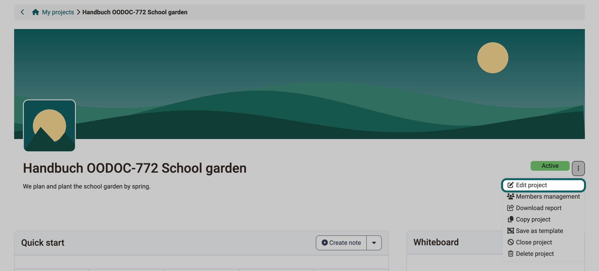
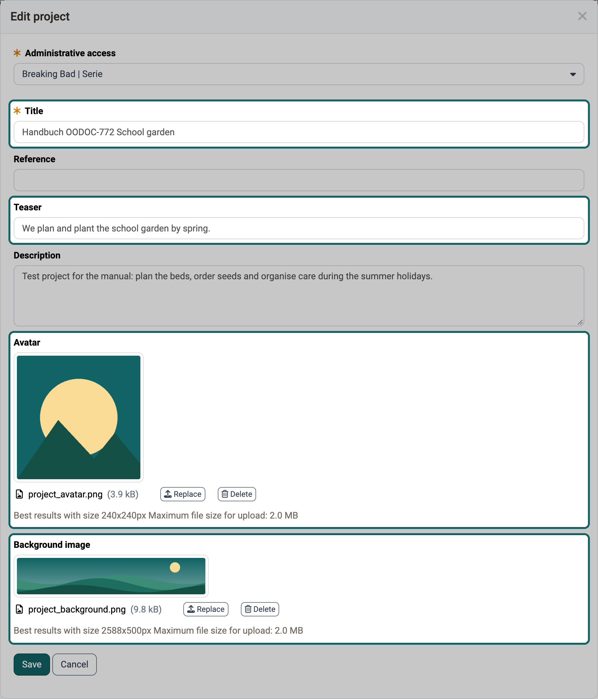
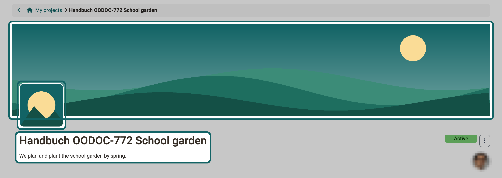
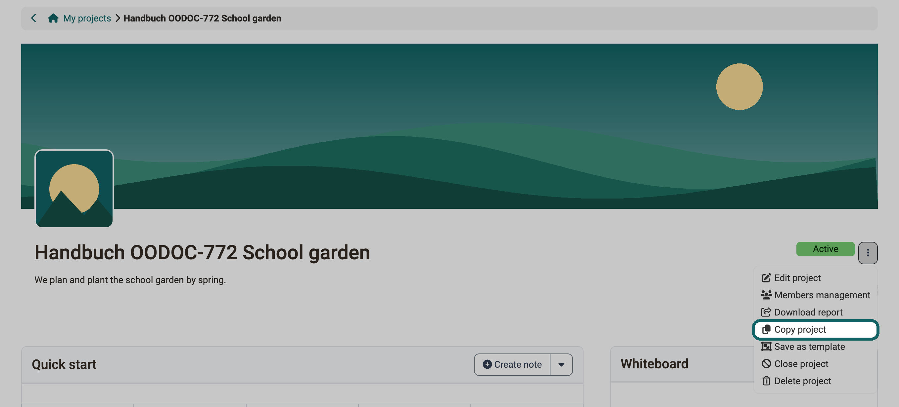
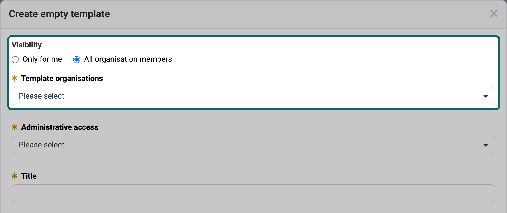
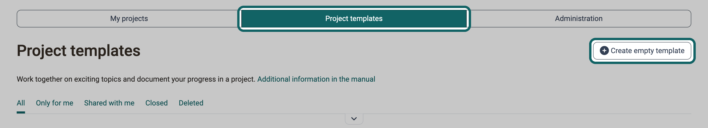
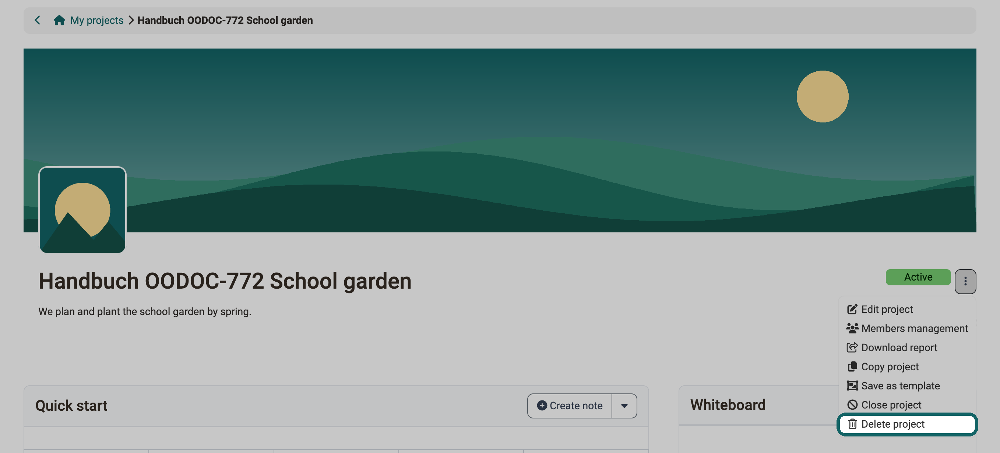
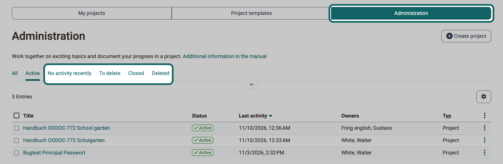

# Projects - Administration {: #administration}

When you set up, reuse or end a project, you find the commands for this in one place: in the 3-dot menu at the top right of the opened project. 
`Projects > Tab "My projects" > "Project title" > 3-dot menu`

Menu item | What for
---|---
[Edit project](#edit_project) | Set the title, teaser and images that all members see when they open the project.
[Members management](../area_modules/Project_Member_Management.md) | Manage the members of the project and their project roles.
[Download report](../area_modules/Project_Report.md) | Summarise the data of the project in a report and download it.
[Copy project](#copy_project) | Start a new project with the same content.
[Save as template](#project_templates) | Keep the project as a template for similar projects.
[Close project](#close_project) | Close a project whose work is done.
[Reopen project](#close_project) | Reactivate a closed project. For a deleted project see [Delete project](#delete_project).
[Delete project](#delete_project) | Delete a project that is no longer needed.

!!! info "Important"

    Which entries the menu shows depends on your project role, for example "Owner", "Leader" or "Participant". What each role may do is shown in the [table of roles in the members management](../area_modules/Project_Member_Management.md#roles).

## Edit project {: #edit_project}

With "Edit project" you design the start page of the project, the [cockpit](../area_modules/Project_Cockpit.md) that all members see when they open the project: you set the title, teaser and images. You edit the content (entering appointments, creating to-dos, etc.) directly in the project instead.

People with the project role "Owner", "Leader" or "Project office" can change these entries. People with the organisation role "Administrator" or "Project manager" can do so as well: they manage the projects of their organisation, even without being a member. All other members find "View project" in the same place and can only view the entries.

Open the 3-dot menu at the top right of the project cockpit and select "Edit project".

{ class="shadow lightbox" title="Cockpit of a project · 2026.11.10" }

The dialog "Edit project" opens. Four entries from the dialog appear on the start page of the project.

{ class="shadow lightbox" title="Dialog Edit project · 2026.11.10" }

* **Title**: Mandatory field. The title is the heading of the start page and names the project in the project list.
* **Teaser**: Short text that appears on the start page directly below the title.
* **Avatar**: Square image at the top left of the start page. Best results with size 240x240px, maximum file size 2 MB.
* **Background image**: Image across the full width of the start page. Best results with size 2588x500px, maximum file size 2 MB.

You upload an image with "Choose file" or drag it into the field. You exchange an uploaded image with "Replace" or remove it with "Delete". With "Save" you apply the changes.

This is where the four entries appear on the start page of the project:

{ class="shadow lightbox" title="Start page of a project · 2026.11.10" }

Three further fields do not appear on the start page, or only in small print:

* **Administrative access**: Mandatory field. The organisations the project is assigned to. Project managers and administrators of these organisations see the project in the tab "Administration". Without one of these roles, you see the organisations of the project but cannot change them. For a new project, these are the organisations you belong to.
* **Reference**: Freely selectable reference, for example a project number. It appears in small print below the title and as an optional column in the project list.
* **Description**: Detailed text about the project. The start page does not show it.

## Copy project [:octicons-tag-16:{ title="from Release 18.0 (OO-6840)" }](https://track.frentix.com/issue/OO-6840) {: #copy_project}

If a new project is to start with the same content, copy an existing project with "Copy project" in the 3-dot menu.

{ class="shadow lightbox" title="Cockpit of a project · 2026.11.10" }

People with the project role "Owner" and people with the organisation role "Administrator" or "Project manager" can copy a project, provided they are allowed to create projects. Who may create projects is set by the system administration: `Administration > Modules > Projects`.

The dialog "Copy project" opens with the same fields as "Edit project". Teaser, description and images are taken over from the project, the title carries the addition "(copy)". You adjust the entries and save.

What the copy takes over from the project:

* **To-dos, decisions, notes and files**: all
* **Appointments and milestones**: all, without date. You enter the date in the new project.
* **Project members**: none

## Project templates {: #project_templates}

If you repeatedly create similar projects, a template saves you the setup of each individual project.

You save an existing project as a template with "Save as template" in the 3-dot menu.

{ class="shadow lightbox" title="Cockpit of a project · 2026.11.10" }

The dialog "Save as template" opens. A private template is available only to you. An organisation-wide template is available to all members of the selected organisations. The selection "Visibility" with the options "Only for me" and "All organisation members" is shown only to people with the organisation role administrator or project manager. If the system administration under `Administration > Modules > Projects` also allows authors to create projects and templates, authors see this selection as well. All other people always create a private template. With the option "All organisation members", select in the field "Template organisations" the organisations in which you hold one of these roles. :octicons-tag-16:{ title="from Release 21.0.3 (OO-9719)" }

{ class="shadow lightbox" title="Dialog Create empty template · 2026.11.10" }

You create a template that does not build on an existing project in the tab "Project templates": `Projects > Tab "Project templates" > Button "Create empty template"`. The same rule for visibility applies there as when saving a project as a template.

{ class="shadow lightbox" title="Tab Project templates in the Projects area · 2026.11.10" }

## Close project {: #close_project}

When the work on a project is done, close it with "Close project" in the 3-dot menu.

{ class="shadow lightbox" title="Cockpit of a project · 2026.11.10" }

The project gets the status "Closed" and appears in the list "Closed". The members continue to work in the project as before; the status shows everyone that the work is done.

Only people with one of these roles can close a project:

* project role "Owner", "Leader" or "Project office"
* organisation role "Administrator" or "Project manager"

!!! info "Important"

    The same people can reactivate a closed project with "Reopen project".

## Delete project {: #delete_project}

You delete a project that is no longer needed with "Delete project" in the 3-dot menu.

{ class="shadow lightbox" title="Cockpit of a project · 2026.11.10" }

Only people with one of these roles can delete a project:

* project role "Owner"
* organisation role "Administrator" or "Project manager"

!!! info "Important"

    A deleted project appears in the tab "My projects" and in the tab "Administration" in the list "Deleted". There it can only be viewed, no longer edited. The same people who may delete it can reactivate it with "Reopen project".

## Tab Administration [:octicons-tag-16:{ title="from Release 18.0 (OO-6845)" }](https://track.frentix.com/issue/OO-6845) {: #tab_administration}

Administrators and project managers keep track of the projects of their organisations in the area "Projects" and clear up dormant projects. For this they have another tab: `Projects > Tab "Administration"`.

{ class="shadow lightbox" title="Tab Administration in the Projects area · 2026.11.10" }

Above the project list, besides "All" and "Active", four filters narrow down the list. "No activity recently" and "To delete" exist only in this tab. Every action in the project counts as activity, including opening the project or a file. The column "Last activity" shows the date.

* **No activity recently** 
The list shows projects in which there has been no activity for more than 28 days. Their status is "Active" or "Closed". Check whether these projects can be closed or deleted. If in doubt, ask the owners.

* **To delete** 
The list shows projects with the status "Closed" in which there has been no activity for more than 28 days. It is a suggestion: a project is only deleted with "Delete project".

* **Closed** 
The list shows all closed projects. They can still be reopened. If a project has been closed for a long time, clarify with the owners whether it can be deleted.

* **Deleted** 
The list shows the deleted projects. They can only be viewed, no longer edited. Owners, administrators and project managers can reactivate them with "Reopen project".

## Further information {: #further_information}

**Mentioned on this page** 
[Projects: Member Management >](../area_modules/Project_Member_Management.md) 
[Projects - Project report >](../area_modules/Project_Report.md) 
[Projects - Cockpit >](../area_modules/Project_Cockpit.md)

**Further reading** 
[Projects: Overview >](../area_modules/Project_Overview/index.md) 
[Roles and Rights: Which roles are available? >](../basic_concepts/Roles/index.md) 
[Module Projects >](../../manual_admin/administration/Modules_Projects.md)

[To the top of the page ^](#administration)
