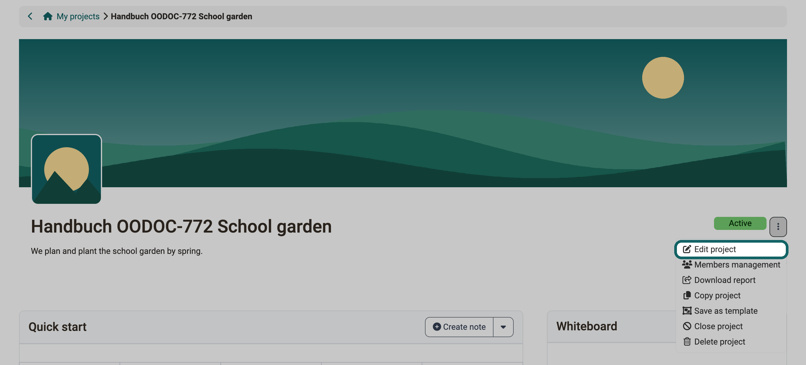
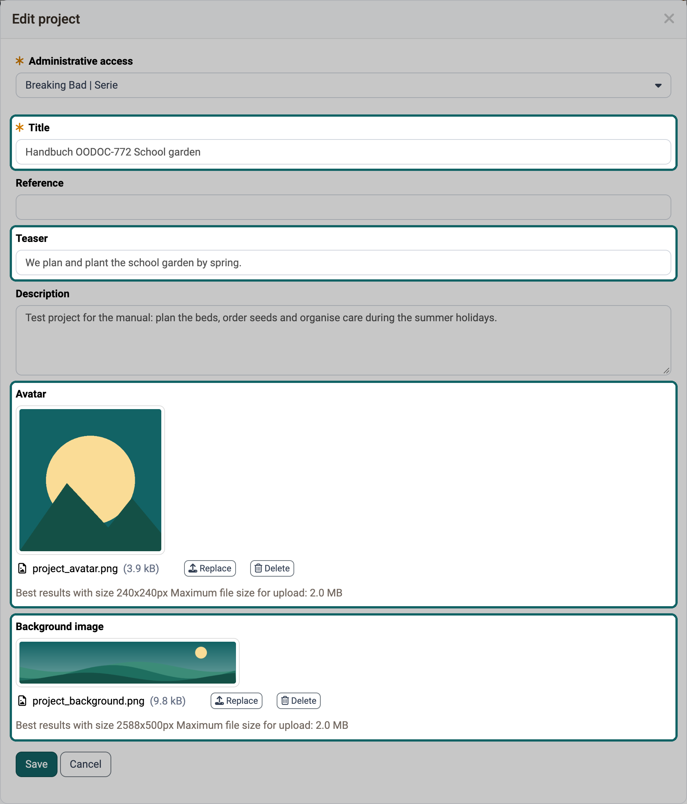
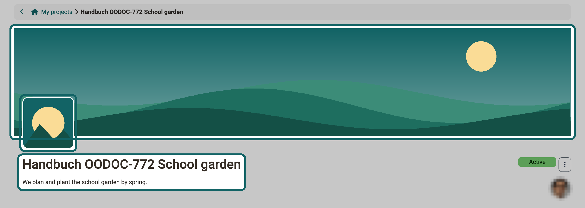
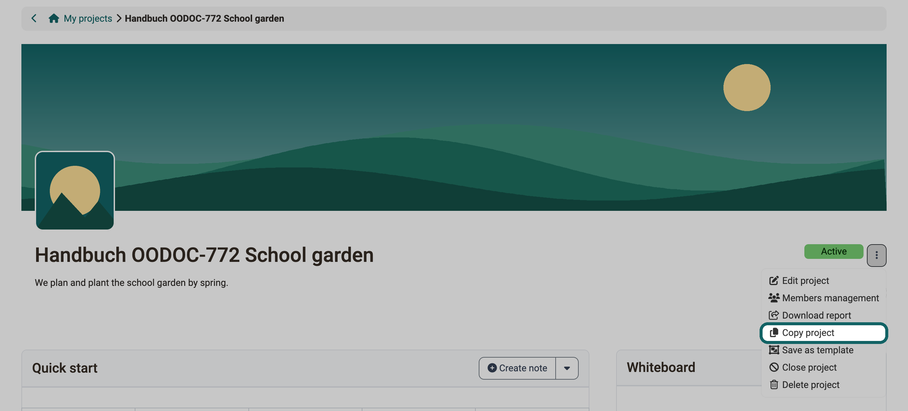
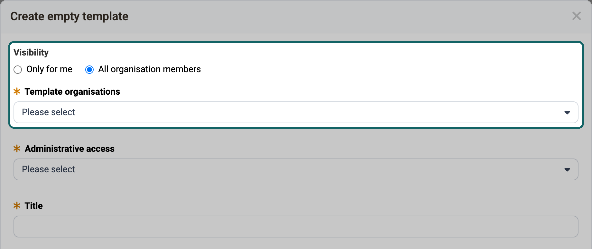
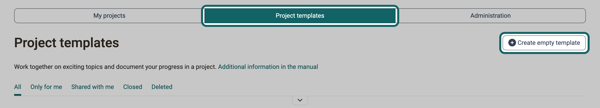
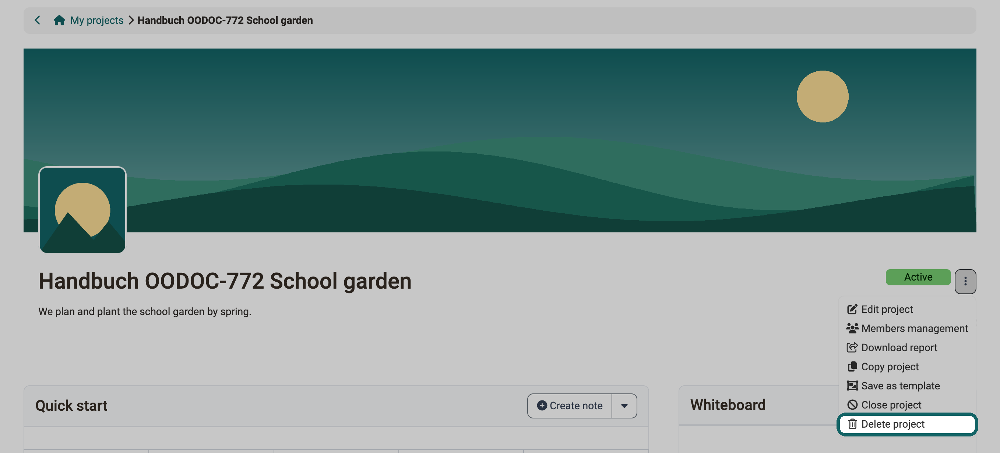
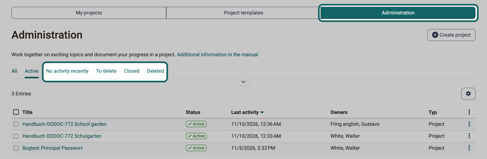

# Projects - Administration {: #administration}

When you set up, reuse or end a project, you find the commands for this in one place: in the 3-dot menu at the top right of the opened project. The menu contains:

* **Edit project**: set the title, teaser and images of the start page
* **Members management**: [manage the members of the project](../area_modules/Project_Member_Management.md)
* **Download report**: download a [report](../area_modules/Project_Report.md) on the project
* **Copy project**
* **Save as template**
* **Close project** and **Reopen project**
* **Delete project**

!!! info "Important"

    Which entries the menu shows depends on your project role.

## Edit project

With "Edit project" you design the start page of the project: the title, teaser and images that all members see when they open the project. You edit the content (entering appointments, creating to-dos, etc.) directly in the project instead.

Project owners, project leaders, project office staff, administrators and project managers can change these entries. All other members find "View project" in the same place and can only view the entries.

Open the 3-dot menu at the top right of the project cockpit and select "Edit project".

{ class="shadow lightbox" title="Cockpit of a project · 2026.11.10" }

The dialog "Edit project" opens. Four entries from the dialog appear on the start page of the project.

{ class="shadow lightbox" title="Dialog Edit project · 2026.11.10" }

* **Title**: Mandatory field. The title is the heading of the start page and names the project in the project list.
* **Teaser**: Short text that appears on the start page directly below the title.
* **Avatar**: Square image at the top left of the start page. Best results with size 240x240px, maximum file size 2 MB.
* **Background image**: Image across the full width of the start page. Best results with size 2588x500px, maximum file size 2 MB.

You exchange an uploaded image with "Replace" or remove it with "Delete". With "Save" you apply the changes.

This is where the four entries appear on the start page of the project:

{ class="shadow lightbox" title="Start page of a project · 2026.11.10" }

Three further fields do not appear on the start page, or only in small print:

* **Administrative access**: Mandatory field. The organisations the project is assigned to. Project managers and administrators of these organisations see the project in the tab "Administration". Without one of these roles, your own organisation is preset and cannot be changed.
* **Reference**: Freely selectable reference, for example a project number. It appears in small print below the title and as an optional column in the project list.
* **Description**: Detailed text about the project. The start page does not show it.

## Copy project [:octicons-tag-16:{ title="from Release 18.0 (OO-6840)" }](https://track.frentix.com/issue/OO-6840)

If a new project is to start with the same content, copy an existing project with "Copy project" in the 3-dot menu.

{ class="shadow lightbox" title="Cockpit of a project · 2026.11.10" }

The following are copied:

* all to-dos
* all decisions
* all notes
* all files

The following are **not** copied:

* project members

The following are **partially** copied:

* appointments and milestones (are copied without date)

## Project templates

If you repeatedly create similar projects, a template saves you the setup of each individual project.

You save an existing project as a template with "Save as template" in the 3-dot menu.

{ class="shadow lightbox" title="Cockpit of a project · 2026.11.10" }

The dialog "Save as template" opens. A private template is available only to you. An organisation-wide template is available to all members of the selected organisations. The selection "Visibility" with the options "Only for me" and "All organisation members" is shown only to people with the organisation role administrator or project manager. If the system administration under `Administration > Modules > Projects` also allows authors to create projects and templates, authors see this selection as well. All other people always create a private template. With the option "All organisation members", select in the field "Template organisations" the organisations in which you hold one of these roles. :octicons-tag-16:{ title="from Release 21.0.3 (OO-9719)" }

{ class="shadow lightbox" title="Dialog Create empty template · 2026.11.10" }

You create a template that does not build on an existing project in the tab "Project templates": `Projects > Tab "Project templates" > Button "Create empty template"`. The same rule for visibility applies there as when saving a project as a template.

{ class="shadow lightbox" title="Tab Project templates in the Projects area · 2026.11.10" }

## Close projects

When the work on a project is done, close it with "Close project" in the 3-dot menu.

{ class="shadow lightbox" title="Cockpit of a project · 2026.11.10" }

Only these people can close a project:

* project owners
* project leaders
* project office staff
* administrators
* project managers

!!! info "Important"

    The same people can reactivate a closed project with "Reopen project".

## Delete project

You delete a project that is no longer needed with "Delete project" in the 3-dot menu.

{ class="shadow lightbox" title="Cockpit of a project · 2026.11.10" }

Only these people can delete a project:

* project owners
* administrators
* project managers

!!! info "Important"

    A deleted project appears in the list "Deleted". There it can only be viewed, no longer edited. Project owners, administrators and project managers can reactivate it with "Reopen project".

## Tab Administration [:octicons-tag-16:{ title="from Release 18.0 (OO-6845)" }](https://track.frentix.com/issue/OO-6845)

Administrators and project managers keep track of the projects of their organisations in the area "Projects" and clear up dormant projects. For this they have another tab: `Projects > Tab "Administration"`.

{ class="shadow lightbox" title="Tab Administration in the Projects area · 2026.11.10" }

Above the project list, these filters narrow down the list:

* **No activity recently** 
The list shows projects in which there has been no activity for more than 28 days. Their status is "Active" or "Closed". Check whether these projects can be closed or deleted. If in doubt, ask the project owners.

* **To delete** 
The list "To delete" only appears in the tab "Administration". It shows projects with the status "Closed" in which there has been no activity for more than 28 days.

* **Closed** 
With this list, project managers ask whether projects that have been closed for a long time can be deleted. 
Closed projects can still be reopened.

* **Deleted** 
Deleted projects can only be viewed, no longer edited. Project owners, administrators and project managers can reactivate them with "Reopen project".

## Further information {: #further_information}

**Mentioned on this page** 
[Projects: Member Management >](../area_modules/Project_Member_Management.md) 
[Projects - Project report >](../area_modules/Project_Report.md)

**Further reading** 
[Projects: Overview >](../area_modules/Project_Overview/index.md) 
[Roles and Rights: Which roles are available? >](../basic_concepts/Roles/index.md) 
[Module Projects >](../../manual_admin/administration/Modules_Projects.md)

[To the top of the page ^](#administration)
