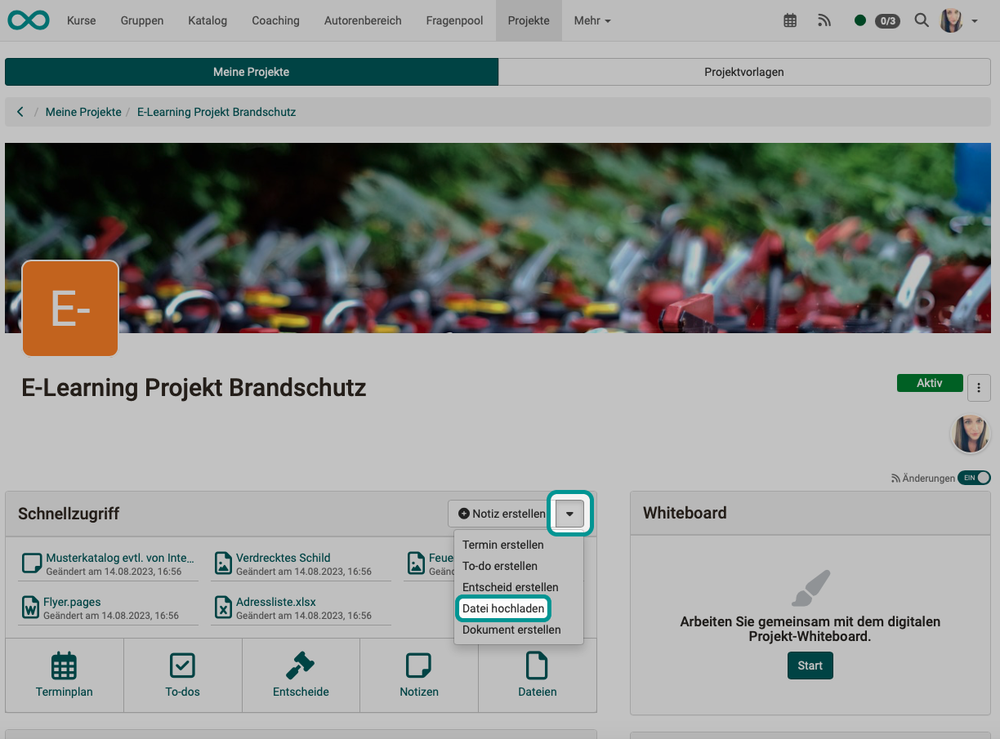
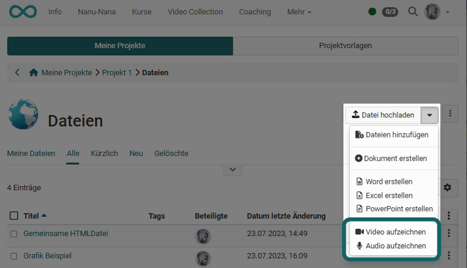
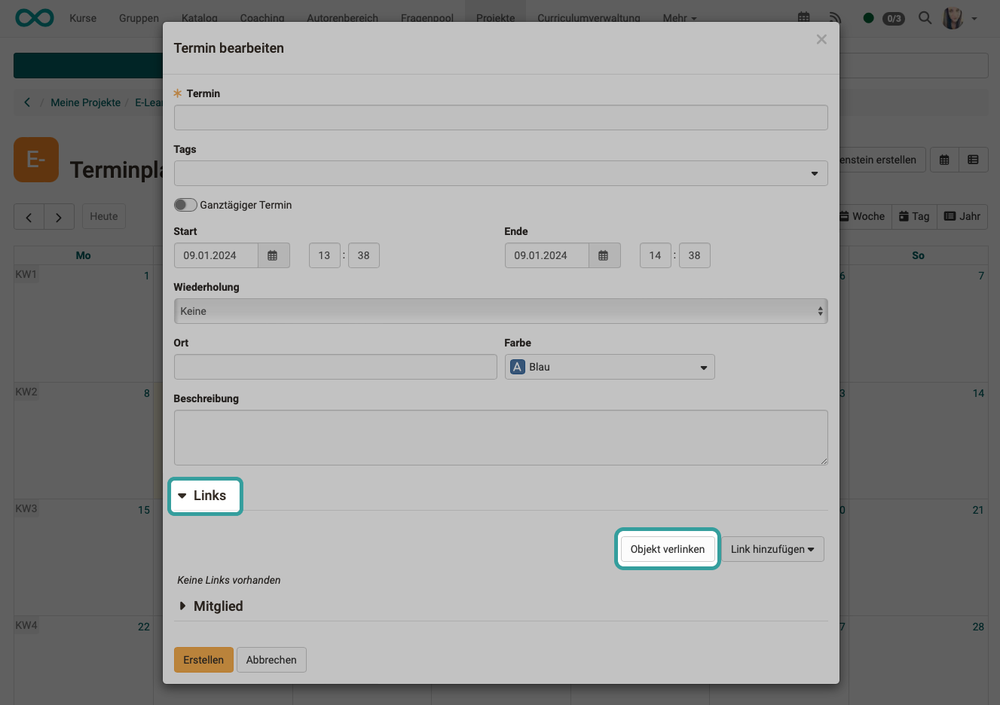
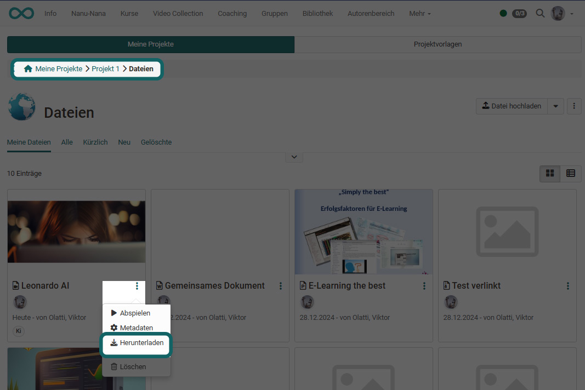
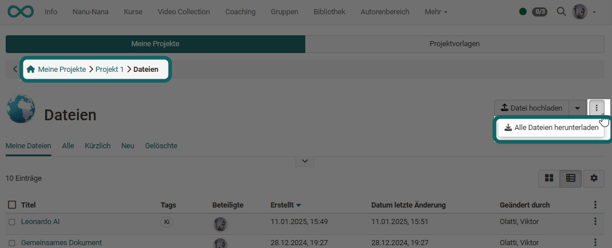
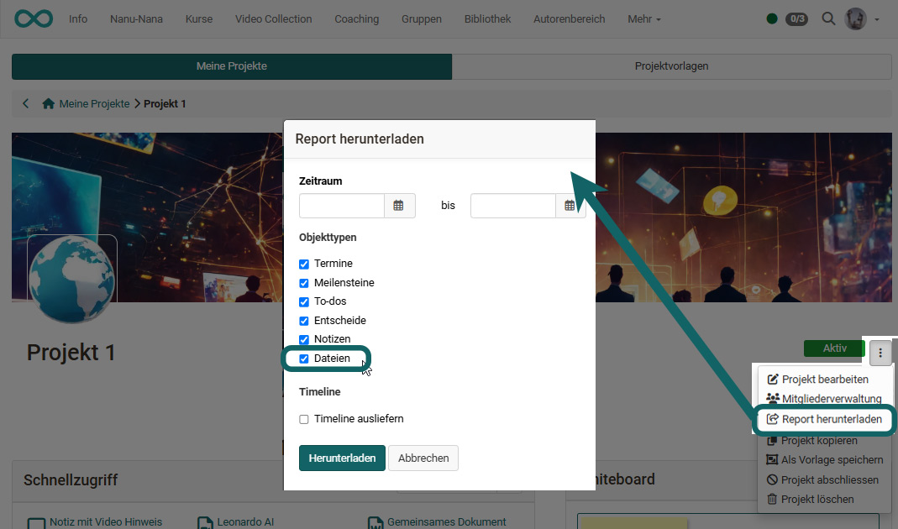

# Projekte - Video und Audio {: #video_audio}

## Wo und wie können in Projekten Video und Audio integriert werden?

In einem Projekt laden Sie Video- und Audiodateien hoch oder nehmen sie direkt in OpenOlat auf. Jede dieser Dateien lässt sich danach in allen Bereichen des Projekts verlinken, zum Beispiel in einem Termin oder einer Notiz.

## Upload

Video- und Audiodateien laden Sie im Bereich "[Dateien](../area_modules/Project_Files.de.md)" des Projekts hoch und verlinken sie von dort in allen weiteren Bereichen. Im Cockpit steht der Eintrag "Datei hochladen" zusätzlich im Schnellzugriff zur Verfügung.

{ class="shadow lightbox" title="Schnellzugriff im Cockpit eines Projekts" }

## Recording [:octicons-tag-16:{ title="ab Release 18.1.2 (OO-7382)" }](https://track.frentix.com/issue/OO-7382)

Ein Video oder eine Audioaufnahme nehmen Sie direkt im Projekt auf, ohne vorher eine Datei vorzubereiten. Im Bereich "Dateien" öffnen Sie dazu das Menü neben dem Button "Datei hochladen" und wählen "Video aufzeichnen" oder "Audio aufzeichnen".

Die beiden Einträge sehen alle Projektmitglieder, deren Rolle Objekte im Projekt anlegen darf (siehe [Rollen](../area_modules/Project_Member_Management.de.md#roles)). Voraussetzung ist, dass die System-Administration die Video- oder die Audioaufzeichnung im [Modul Audio-/Video-Recording](../../manual_admin/administration/Modules_Audio_Video_Recording.de.md) aktiviert hat.

OpenOlat speichert neu aufgenommene Videos als mp4-Dateien, Audios als m4a-Dateien.

{ class="shadow lightbox" title="Bereich Dateien eines Projekts" }

## Verlinkung

In allen Objekten innerhalb eines Projektes (Termine, To-dos, Entscheide, Notizen, Dateien) können Sie projektinterne Links hinzufügen. Auf diesem Weg können Sie auch Verbindungen zu Videos herstellen.

### Objekt verlinken

Wählen Sie diese Option, wenn sich Ihr Video bereits im Bereich Dateien des Projektes befindet. Sie können aus der Liste direkt die gewünschte Datei markieren.

{ class="shadow lightbox" title="Dialog Termin bearbeiten im Terminplan eines Projekts" }

### Link hinzufügen

Liegt das Video noch nicht im Projekt, laden Sie es über das Menü "Link hinzufügen" und den Eintrag "Datei hochladen" hoch. OpenOlat legt die Datei im Bereich "Dateien" des Projekts ab und verlinkt sie mit dem Objekt.

!!! info "Wichtig"

    Mit Verlinkung ist hier nicht ein Link zu einer extern im Internet vorliegenden Videodatei, z.B. in YouTube, gemeint. Derartige Links können z.B. über eine HTML-Seite mit entsprechenden Links hergestellt werden.

## Download

Alle Video- und Audiodateien des Projekts liegen im Bereich "Dateien", ob hochgeladen oder in OpenOlat aufgenommen. Dort laden Sie eine Datei über ihr 3-Punkte-Menü und den Eintrag "Herunterladen" herunter oder löschen sie.

{ class="shadow lightbox" title="Bereich Dateien eines Projekts in der Kachelansicht" }

Mehrere Dateien auf einmal laden Sie in der Tabellenansicht herunter oder löschen sie dort gemeinsam.

Um alle Dateien des Projekts auf einmal herunterzuladen, öffnen Sie rechts oben das 3-Punkte-Menü und wählen "Alle Dateien herunterladen". Die ZIP-Datei enthält auch die Video- und Audiodateien.

{ class="shadow lightbox" title="Bereich Dateien eines Projekts in der Tabellenansicht" }

## Video/Audio in Reports [:octicons-tag-16:{ title="ab Release 18.1.0 (OO-6874)" }](https://track.frentix.com/issue/OO-6874)

Ein Report fasst ein Projekt zusammen, zum Beispiel für die Archivierung. Im Cockpit öffnet das 3-Punkte-Menü mit dem Eintrag "Report herunterladen" den gleichnamigen Dialog. Ist dort unter "Objekttypen" der Eintrag "Dateien" angekreuzt, enthält der Report alle Dateien des Projekts, auch die Video- und Audiodateien.

{ class="shadow lightbox" title="Cockpit eines Projekts" }

## Weiterführende Informationen {: #further_information}

[Projekte: Dateien >](../area_modules/Project_Files.de.md) 
[Projekte: Mitgliederverwaltung >](../area_modules/Project_Member_Management.de.md) 
[Modul Audio-/Video-Recording >](../../manual_admin/administration/Modules_Audio_Video_Recording.de.md) 
[Projekte - Cockpit >](../area_modules/Project_Cockpit.de.md) 
[Projekte - Projektreport >](../area_modules/Project_Report.de.md)

[Zum Seitenanfang ^](#video_audio)
