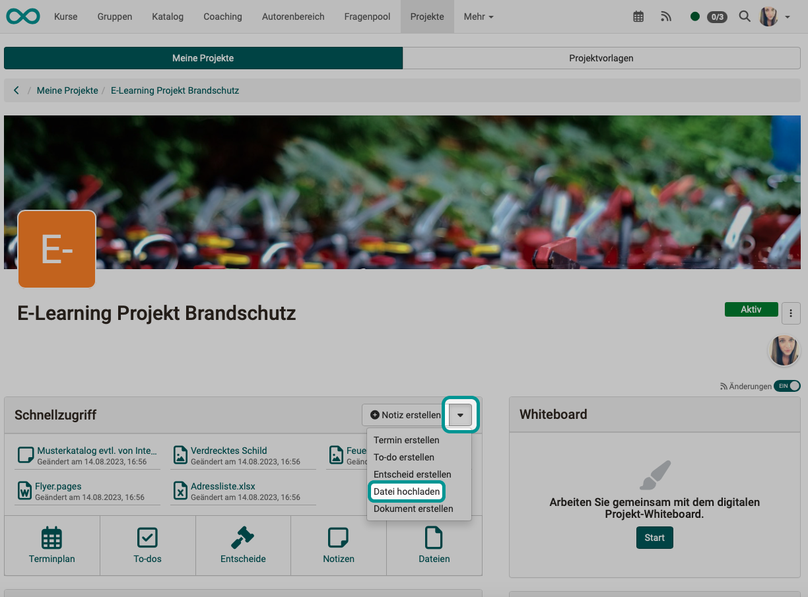
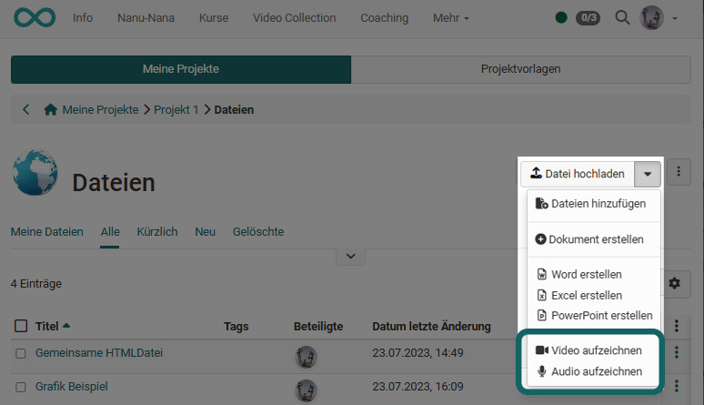
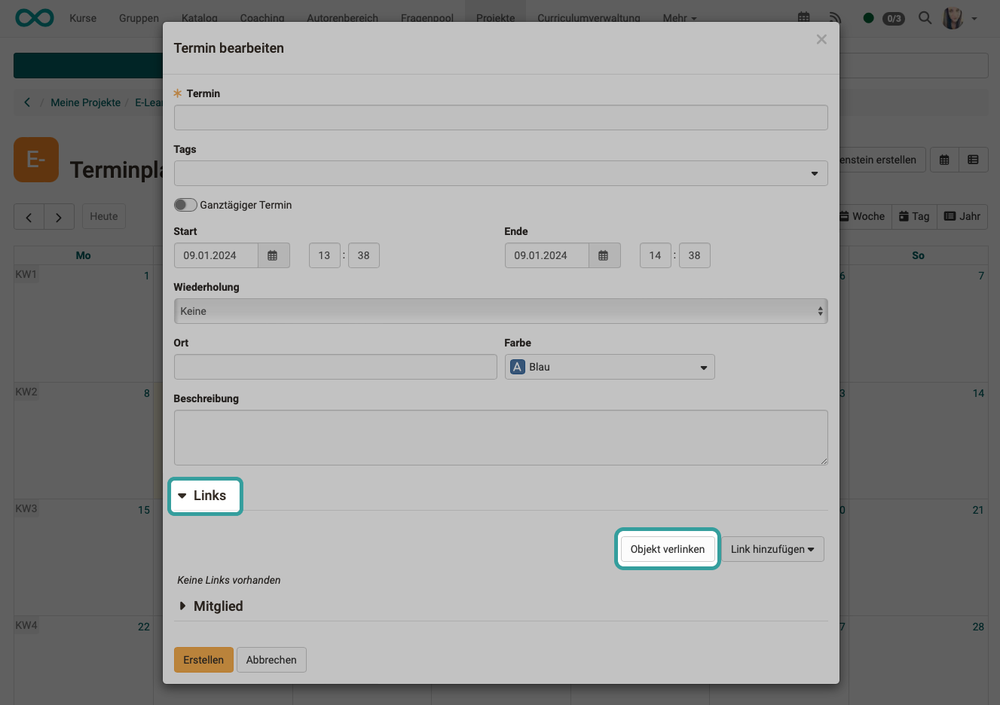
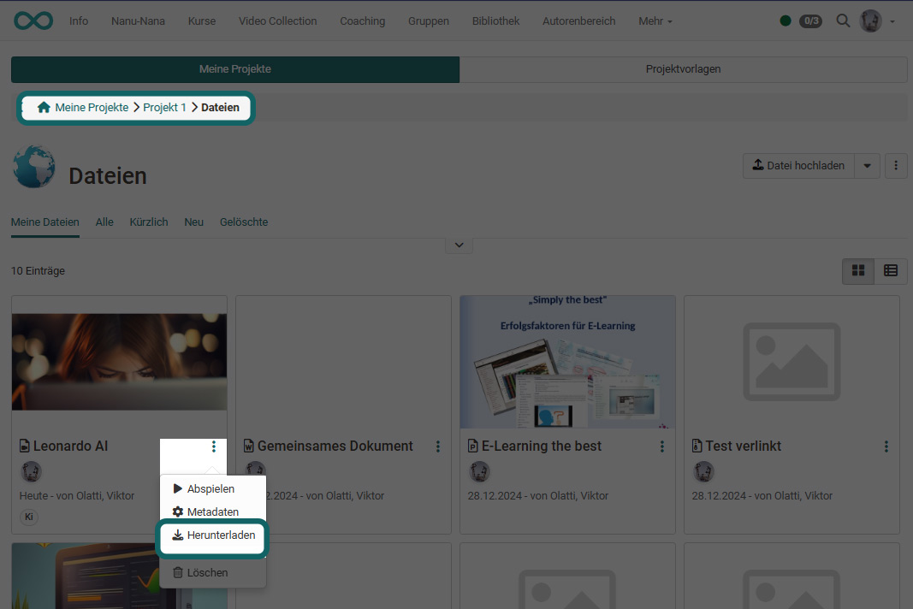
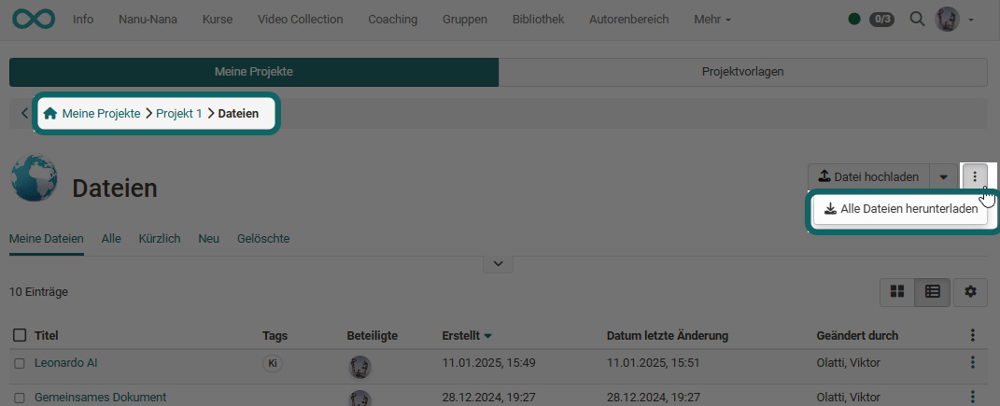
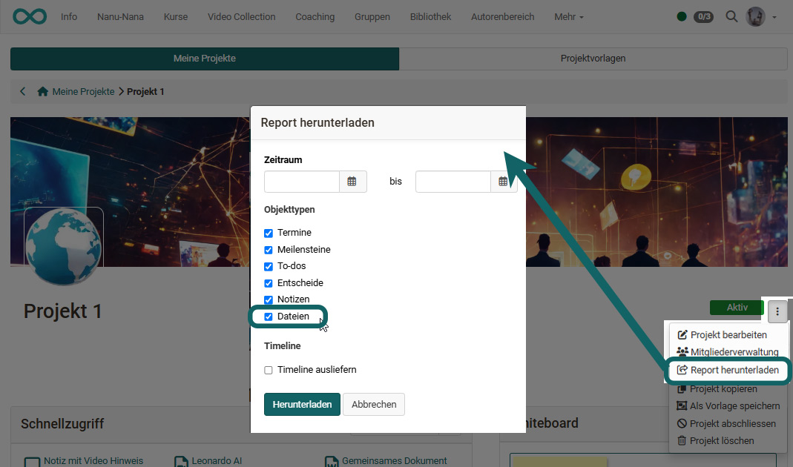

# Projects - Video and Audio {: #video_audio}

## Where and how can video and audio be integrated into projects?

In a project, you upload video and audio files or record them directly in OpenOlat. Each of these files can then be linked in all areas of the project, for example in an appointment or a note.

## Upload

You upload video and audio files in the "[Files](../area_modules/Project_Files.md)" area of the project and link them from there in all other areas. In the cockpit, the entry "Upload file" is also available in the Quick start.

{ class="shadow lightbox" title="Quick start in the cockpit of a project" }

## Recording [:octicons-tag-16:{ title="from Release 18.1.2 (OO-7382)" }](https://track.frentix.com/issue/OO-7382)

You record a video or an audio recording directly in the project, without preparing a file first. To do so, open the menu next to the button "Upload file" in the "Files" area and select "Record video" or "Record audio".

All project members whose role may create objects in the project see these two entries (see [Roles](../area_modules/Project_Member_Management.md#roles)). The prerequisite is that the system administration has activated video or audio recording in the [Audio/Video Recording module](../../manual_admin/administration/Modules_Audio_Video_Recording.md).

OpenOlat saves newly recorded videos as mp4 files, audio as m4a files.

{ class="shadow lightbox" title="Files area of a project" }

## Linking

You can add project-internal links to all objects within a project (appointments, to-dos, decisions, notes, files). You can also create links to videos in this way.

### Link object

Select this option if your video is already in the Files area of the project. You can select the desired file directly from the list.

{ class="shadow lightbox" title="Dialog Edit appointment in the schedule of a project" }

### Add link

If the video is not in the project yet, upload it via the menu "Add link" and the entry "Upload file". OpenOlat stores the file in the "Files" area of the project and links it to the object.

!!! info "Important"

    Linking here does not mean a link to an external video file available on the Internet, e.g. on YouTube. Such links can be created, for example, via an HTML page with corresponding links.

## Download

All video and audio files of the project are in the "Files" area, whether uploaded or recorded in OpenOlat. There you download a file via its 3-dot menu and the entry "Download", or delete it.

{ class="shadow lightbox" title="Files area of a project in the tile view" }

You download several files at once in the table view, or delete them there together.

To download all files of the project at once, open the 3-dot menu at the top right and select "Download all files". The ZIP file also contains the video and audio files.

{ class="shadow lightbox" title="Files area of a project in the table view" }

## Video/Audio in reports [:octicons-tag-16:{ title="from Release 18.1.0 (OO-6874)" }](https://track.frentix.com/issue/OO-6874)

A report summarises a project, for example for archiving. In the cockpit, the 3-dot menu with the entry "Download report" opens the dialog of the same name. If the entry "Files" is checked under "Object types" there, the report contains all files of the project, including the video and audio files.

{ class="shadow lightbox" title="Cockpit of a project" }

## Further information {: #further_information}

[Projects: Files >](../area_modules/Project_Files.md) 
[Projects: Member Management >](../area_modules/Project_Member_Management.md) 
[Module Audio/Video Recording >](../../manual_admin/administration/Modules_Audio_Video_Recording.md) 
[Projects - Cockpit >](../area_modules/Project_Cockpit.md) 
[Projects - Project report >](../area_modules/Project_Report.md)

[To the top of the page ^](#video_audio)
