# Qualitätsmanagement: Datenerhebungsgeneratoren {: #Quality_Management_Data_Collection_Generators}

!!! tip "Empfehlung"

    Ein Datenerhebungsgenerator erstellt [Datenerhebungen](Quality_Management_Data_Collections.de.md). Kennen Sie die Datenerhebung, verstehen Sie die Einstellungen des Generators leichter.

## Was macht ein Datenerhebungsgenerator? {: #QMgenerator_function}

Wer dieselbe Befragung in vielen Kursen durchführt, etwa ein Feedback am Ende jedes Kurses, muss die Datenerhebungen nicht einzeln anlegen. Ein Datenerhebungsgenerator erstellt sie im Modul Qualitätsmanagement automatisch, nach Regeln, die Sie einmal festlegen.

{ class="lightbox" title="Schema eines Datenerhebungsgenerators" }

## Wie wird ein Datenerhebungsgenerator erstellt? {: #create_QMgenerator}

Datenerhebungsgeneratoren erstellen und bearbeiten Personen mit der Rolle Qualitätsverwalter:in oder Administrator:in. Ihnen zeigt die Hauptnavigation den Eintrag "Qualitätsmanagement". Auf dessen Startseite klicken Sie im Abschnitt "Datenerhebungsgeneratoren" auf "Datenerhebungsgeneratoren öffnen".

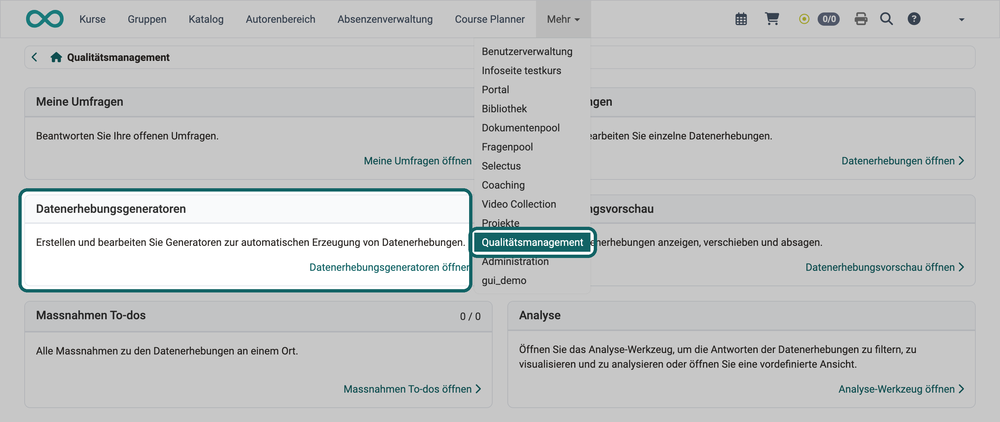{ class="shadow lightbox" title="Startseite des Qualitätsmanagements · 2026.10.22" }

Klicken Sie dort auf "Generator erstellen".

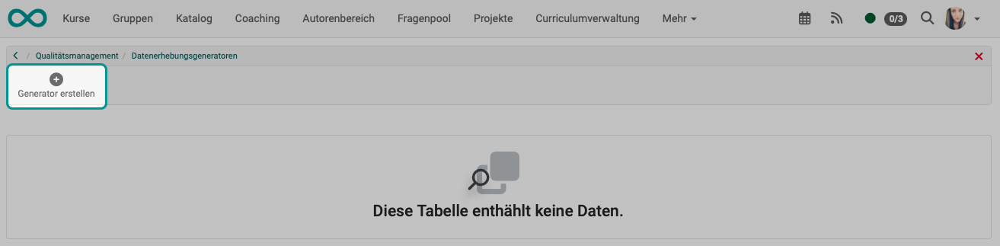{ class="shadow lightbox" title="Liste der Datenerhebungsgeneratoren" }

Im Dialog "Generator erstellen" wählen Sie den Typ und geben den Titel des Generators ein. Der Typ bestimmt, wofür der Generator Datenerhebungen erstellt: für Kurse, für die Termine von Betreuer:innen in einem Kurs oder für Elemente im Course Planner. Nach dem Erstellen lässt sich der Typ nicht mehr ändern.

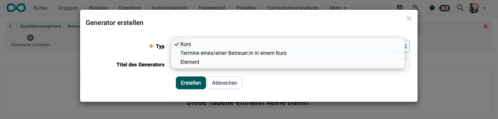{ class="shadow lightbox" title="Dialog Generator erstellen" }

[Zum Seitenanfang ^](#Quality_Management_Data_Collection_Generators)

---

## Generator Typ "Kurs" {: #QMgenerator_type_course}

Der Typ "Kurs" erstellt Datenerhebungen für Kurse. Ihr Start richtet sich nach dem Kursbeginn, nach dem Kursende oder nach festen Wochentagen.

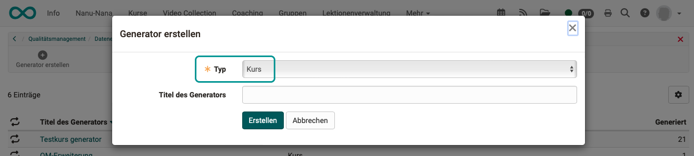{ class="shadow lightbox" title="Dialog Generator erstellen" }

### Tab "Konfiguration" {: #Quality_Management_Data_Collection_Generators_Type_Course_Config}

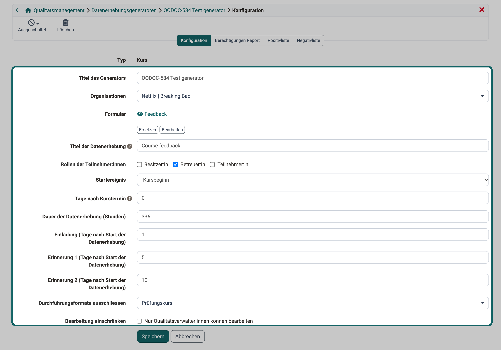{ class="shadow lightbox" title="Tab Konfiguration, Typ Kurs · 2026.10.22" }

#### Titel des Generators {: #course_generator_title }
Wählen Sie einen Titel, der Inhalt und Zweck nennt. So unterscheiden Sie den Generator in der Liste von den anderen Generatoren.

#### Organisationen {: #course_organisations }
Der Generator berücksichtigt nur Kurse der hier gewählten Organisationen und ihrer Unterorganisationen. Das Feld erscheint, wenn das Modul "Organisationen" eingeschaltet ist.

#### Formular {: #course_form }
Ein Generator arbeitet mit genau einem Formular. So lassen sich alle seine Datenerhebungen vergleichen und gemeinsam auswerten. Für ein weiteres Formular erstellen Sie einen weiteren Generator. Hat der Generator bereits Datenerhebungen erstellt, lässt sich das Formular nicht mehr ersetzen.

#### Titel der Datenerhebung {: #course_data_collection_title }
Geben Sie hier den Titel der vom Datenerhebungsgenerator erzeugten Datenerhebungen an.
Im Titel können auch Variablen verwendet werden.

#### Rollen der Teilnehmer:innen {: #course_roles }
Die Kursmitglieder mit den hier ausgewählten Rollen können an der Datenerhebung teilnehmen. So befragen Sie zum Beispiel nur die Betreuer:innen eines Kurses.

#### Startereignis {: #course_start_trigger }
Das Startereignis legt fest, wann die Datenerhebung startet:

* Kursbeginn
* Kursende
* Täglich

#### Tage nach Kurstermin {: #course_days_after_course_date }
Diese Option wird nur angezeigt, wenn "Kursbeginn" oder "Kursende" als Startereignis gewählt wurde.
Der Start der Datenerhebung wird aus dem Startereignis und der hier eingetragenen Anzahl Tage berechnet.
Die Anzahl Tage kann auch negativ sein.

#### Wochentage {: #course_days_of_week }
Diese Option wird nur angezeigt, wenn "Täglich" als Startereignis gewählt wurde.
Der Generator erstellt an jedem gewählten Wochentag für jeden Kurs eine Datenerhebung.

#### Startzeit {: #course_start_time }
Diese Option wird nur angezeigt, wenn "Täglich" als Startereignis gewählt wurde.
Tragen Sie Stunde und Minute ein, zu der die Datenerhebungen an den angegebenen Wochentagen starten.

!!! note "Hinweis"

    Hat ein Kurs ein Beginn- oder Enddatum, erstellt der Generator vor dem Beginn und nach dem Ende keine täglichen Datenerhebungen für diesen Kurs.

#### Dauer der Datenerhebung (Stunden) {: #course_duration }
Nach Start der Datenerhebung können alle Teilnehmenden im angegebenen Zeitraum das Formular ausfüllen und abgeben. Nach Ablauf dieser Frist ist eine Abgabe nicht mehr möglich.

#### Einladung (Tage nach Start der Datenerhebung) {: #course_invitation }
Die Einladung geht so viele Tage nach dem Start der Datenerhebung hinaus, wie Sie hier eintragen. Der Generator berechnet das Versanddatum für jede Datenerhebung aus deren eigenem Startdatum. Ohne Eintrag verschickt OpenOlat keine Einladung.

#### Erinnerung 1 (Tage nach Start der Datenerhebung) {: #course_reminder_1 }
Das Versanddatum der Erinnerung berechnet der Generator wie bei der Einladung aus dem Startdatum der Datenerhebung und dem hier eingetragenen Wert.

#### Erinnerung 2 (Tage nach Start der Datenerhebung) {: #course_reminder_2 }
Das Versanddatum der zweiten Erinnerung wird gleich berechnet wie bei der Erinnerung 1.

#### Durchführungsformate ausschliessen {: #course_exclude_implementation_formats }
Zu Kursen kann in den Metadaten ein Durchführungsformat angegeben werden. Es besteht die Möglichkeit, bei erzeugten Datenerhebungen bestimmte [Durchführungsformate](../../manual_admin/administration/Modules.de.md#course) auszuschliessen, z.B. wenn Prüfungskurse nicht berücksichtigt werden sollen.

#### Bearbeitung einschränken {: #course_limit_edit_rights }
Setzen Sie das Häkchen bei "Nur Qualitätsverwalter:innen können bearbeiten", lassen sich die geplanten Datenerhebungen dieses Generators nur noch im Modul Qualitätsmanagement bearbeiten. In der [Datenerhebungsvorschau](Quality_Management_Data_Collection_Preview.de.md) eines Kurses und im Course Planner sind sie dann nur noch zu sehen.

### Tab "Berechtigungen Report"

Die Berechtigungen, die Sie hier festlegen, übernimmt der Generator in jede Datenerhebung, die er erstellt. Die einzelnen Einstellungen beschreibt die Seite [Datenerhebung](Quality_Management_Data_Collections.de.md).

### Tab "Positivliste" {: #Quality_Management_Data_Collection_Generators_Type_Course_PositivList}

Mit der Positivliste beschränken Sie den Generator auf ausgewählte Kurse. Er berücksichtigt dann nur Kurse, die seine Konfiguration erfüllen und zugleich in der Positivliste stehen.

### Tab "Negativliste" {: #Quality_Management_Data_Collection_Generators_Type_Course_NegativList}

Mit der Negativliste nehmen Sie einzelne Kurse aus, die der Generator nach seiner Konfiguration sonst berücksichtigen würde.

!!! tip "Tipp"

    Erstellen Sie entweder eine Positivliste oder eine Negativliste. 
    Sollen nur wenige Kurse Datenerhebungen erhalten, eignet sich die Positivliste.  Sollen die meisten Kurse Datenerhebungen erhalten, eignet sich die Negativliste.

[Zum Seitenanfang ^](#Quality_Management_Data_Collection_Generators)

---

## Generator Typ "Termine eines/einer Betreuer:in in einem Kurs" {: #QMgenerator_type_events}

Dieser Typ erstellt Datenerhebungen zu den Terminen, die Betreuer:innen in einem Kurs unterrichten. Die Datenerhebung startet im letzten Termin der Betreuer:in oder im Termin mit einer bestimmten Einheit.

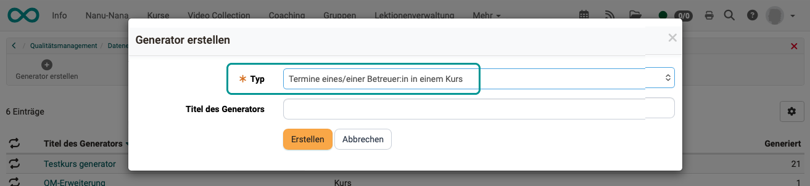{ class="shadow lightbox" title="Dialog Generator erstellen" }

### Tab "Konfiguration"

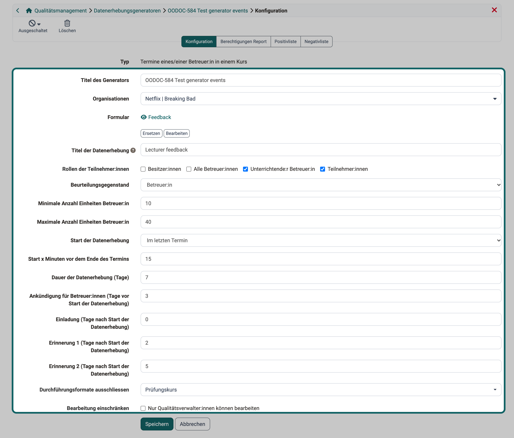{ class="shadow lightbox" title="Tab Konfiguration, Typ Termine eines/einer Betreuer:in in einem Kurs · 2026.10.22" }

Siehe auch [Konfiguration im Typ Kurs](#Quality_Management_Data_Collection_Generators_Type_Course_Config).

#### Rollen der Teilnehmer:innen {: #events_roles }
Die Kursmitglieder mit den hier ausgewählten Rollen können an der Datenerhebung teilnehmen.

* Besitzer:innen
* Alle Betreuer:innen (= alle Betreuer:innen des Kurses)
* Unterrichtende:r Betreuer:in (= unterrichtende Person am Termin, der zur Datenerhebung führt)
* Teilnehmer:innen

#### Beurteilungsgegenstand {: #events_topic }
Der Beurteilungsgegenstand legt fest, was die [Datenerhebung](Quality_Management_Data_Collections.de.md) beurteilt:

* Betreuer:in
* Kurs

!!! note "Hinweis"

    Gibt es in einem Kurs mehrere Betreuer:innen, welche die übrigen Kriterien erfüllen, wird pro Betreuer:in eine [Datenerhebung](Quality_Management_Data_Collections.de.md) initiiert.

#### Minimale Anzahl Einheiten Betreuer:in {: #events_teacher_minimum_units }
Die Datenerhebung findet nur statt, wenn der/die Betreuer:in die hier angegebene minimale Anzahl Einheiten in einem Kurs insgesamt hat. (Nicht nur die bereits durchgeführten Lektionen.)

#### Maximale Anzahl Einheiten Betreuer:in {: #events_teacher_maximum_units }
Die Datenerhebung findet nur statt, wenn der/die Betreuer:in die hier angegebene maximale Anzahl Einheiten in einem Kurs insgesamt nicht überschreitet.

!!! note "Beispiel"

    Im Regelfall sollen nur Betreuer:innen beurteilt werden, die mindestens 10 Einheiten unterrichten. Dafür tragen Sie bei der minimalen Anzahl Einheiten 10 ein.

    Betreuer:innen, die nur selten unterrichten, beurteilen Sie mit einem weiteren Generator. Dort legen Sie eine maximale Anzahl Einheiten fest.

#### Start der Datenerhebung {: #events_data_collection_start }
Hier wählen Sie den Termin, in dem die Datenerhebung startet:

* Im letzten Termin (welchen der/die Betreuer:in in einem Kurs unterrichtet)
* Im Termin mit der Einheit x (Termine, die der/die Betreuer:in unterrichtet)

#### Termin mit der Einheit x {: #events_event_with_unit }
Diese Option wird nur angezeigt, wenn "Im Termin mit der Einheit x" gewählt wurde.
Tragen Sie die Nummer der Einheit ein. Die Datenerhebung startet im Termin, der diese Einheit enthält.

#### Start x Minuten vor dem Ende des Termins {: #events_minutes_before_end }
Die Datenerhebung startet so viele Minuten vor dem Ende des Termins, wie Sie hier eintragen. Startet die Befragung noch während des Termins, beteiligen sich in der Regel mehr Teilnehmende.

#### Dauer der Datenerhebung (Tage) {: #events_duration }
Nach Start der Datenerhebung können alle Teilnehmenden im angegebenen Zeitraum das Formular ausfüllen und abgeben. Nach Ablauf dieser Frist ist eine Abgabe nicht mehr möglich.

#### Ankündigung für Betreuer:innen (Tage vor Start der Datenerhebung) {: #events_announcement }
Mit einer Ankündigung erfahren Betreuer:innen vorab von der Datenerhebung und können bei Bedarf reagieren. Sie geht so viele Tage vor dem Start der Datenerhebung hinaus, wie Sie hier eintragen. Ohne Eintrag verschickt OpenOlat keine Ankündigung.

#### Einladung (Tage nach Start der Datenerhebung) {: #events_invitation }
Die Einladung ist eine E-Mail an die Teilnehmer:innen mit dem Link zum Formular. Ohne Eintrag verschickt OpenOlat keine E-Mail. Die Teilnehmenden erfahren dann auf anderem Weg von der Datenerhebung, zum Beispiel von der Betreuer:in im Unterricht.

#### Erinnerung 1 (Tage nach Start der Datenerhebung) {: #events_reminder_1 }
Das Versanddatum der Erinnerung wird wie beim [Typ Kurs](#course_reminder_1) aus dem Startdatum der Datenerhebung und dem hier eingetragenen Wert berechnet.

#### Erinnerung 2 (Tage nach Start der Datenerhebung) {: #events_reminder_2 }
Das Versanddatum der zweiten Erinnerung wird gleich berechnet wie bei der Erinnerung 1.

### Tab "Berechtigungen Report"

Die hier eingegebene Konfiguration wird 1:1 in die erstellten Datenerhebungen übertragen.
Siehe [Datenerhebung](Quality_Management_Data_Collections.de.md).

### Tab "Positivliste"

Siehe [Typ Kurs Positivliste](#Quality_Management_Data_Collection_Generators_Type_Course_PositivList).

### Tab "Negativliste"

Siehe [Typ Kurs Negativliste](#Quality_Management_Data_Collection_Generators_Type_Course_NegativList).

[Zum Seitenanfang ^](#Quality_Management_Data_Collection_Generators)

---

## Generator Typ "Element" {: #QMgenerator_type_element}

Der Typ "Element" erstellt Datenerhebungen für Elemente im Course Planner. Den Start berechnet der Generator vom Beginn oder vom Ende des Elements aus.

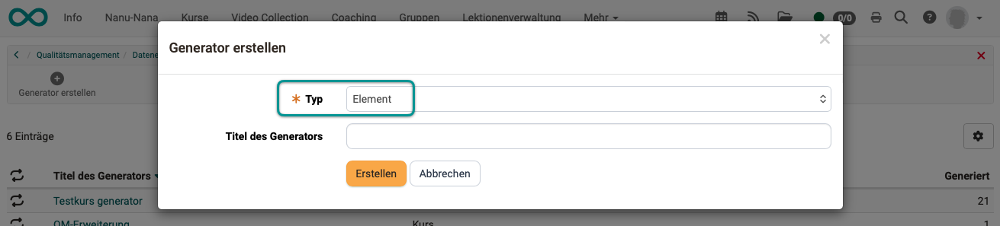{ class="shadow lightbox" title="Dialog Generator erstellen" }

### Tab "Konfiguration"

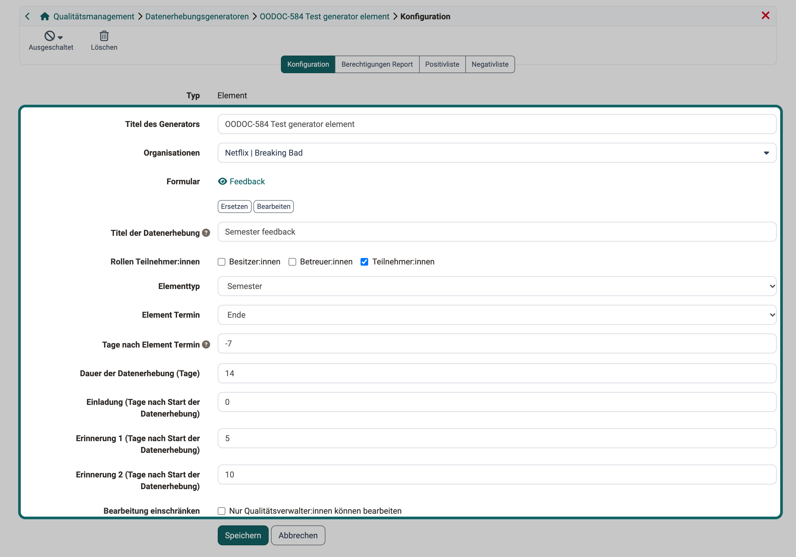{ class="shadow lightbox" title="Tab Konfiguration, Typ Element · 2026.10.22" }

Siehe auch [Konfiguration im Typ Kurs](#Quality_Management_Data_Collection_Generators_Type_Course_Config).

#### Elementtyp {: #element_type }
Der Generator erstellt für jedes Element dieses Elementtyps eine Datenerhebung. Welche Elementtypen zur Wahl stehen, hängt von der Einrichtung des Course Planner ab, zum Beispiel:

* Semester
* Lehrgang
* Modul

#### Element Termin {: #element_date }
Der Element Termin legt fest, von welchem Datum des Elements aus der Start der Datenerhebung berechnet wird:

* Beginn
* Ende

#### Tage nach Element Termin {: #element_days_after_element_date }
Der Start der Datenerhebung wird aus dem Element Termin und der hier eingetragenen Anzahl Tage berechnet.
Die Anzahl Tage kann auch negativ sein.

#### Dauer der Datenerhebung (Tage) {: #element_duration }
Beim Typ "Element" geben Sie die Dauer in Tagen an, nicht in Stunden wie beim Typ "Kurs". Nach Ablauf dieser Frist ist eine Abgabe nicht mehr möglich.

### Tab "Berechtigungen Report"

Wie beim Typ "Kurs" übernimmt der Generator die Berechtigungen, die Sie hier festlegen, in jede Datenerhebung, die er erstellt. Die einzelnen Einstellungen beschreibt die Seite [Datenerhebung](Quality_Management_Data_Collections.de.md).

### Tab "Positivliste"

Mit der Positivliste beschränken Sie den Generator auf ausgewählte Elemente. Er berücksichtigt dann nur Elemente, die seine Konfiguration erfüllen und zugleich in der Positivliste stehen.

### Tab "Negativliste"

Mit der Negativliste nehmen Sie einzelne Elemente aus, die der Generator nach seiner Konfiguration sonst berücksichtigen würde.

!!! tip "Tipp"

    Erstellen Sie entweder eine Positivliste oder eine Negativliste. Sollen nur wenige Elemente Datenerhebungen erhalten, eignet sich die Positivliste.  Sollen die meisten Elemente Datenerhebungen erhalten, eignet sich die Negativliste.

[Zum Seitenanfang ^](#Quality_Management_Data_Collection_Generators)

---

## Generator einschalten {: #activate_QMgenerator}

Ein neuer Generator ist ausgeschaltet. So konfigurieren Sie ihn in Ruhe, bevor er Datenerhebungen erstellt. Zum Einschalten klicken Sie links oben auf "Ausgeschaltet" und wählen "Einschalten".

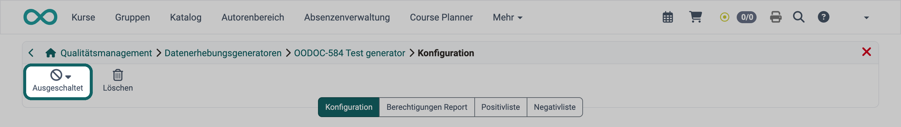{ class="shadow lightbox" title="Generator im Qualitätsmanagement · 2026.10.22" }

!!! info "Wichtig"

    Bearbeiten lässt sich ein Generator nur, solange er ausgeschaltet ist.

Beim Einschalten öffnet sich der Dialog "Datenerhebungsgenerator einschalten" mit dem Feld "Stichtag". Der Stichtag legt fest, ab wann der Generator Datenerhebungen berücksichtigt. Bei einem neuen Generator steht im Feld der aktuelle Zeitpunkt. Schalten Sie einen Generator wieder ein, der schon gelaufen ist, steht im Feld der Zeitpunkt seines letzten Laufs vor dem Ausschalten. Unter dem Feld zeigt der Dialog, wie viele neue Datenerhebungen mit diesem Stichtag generiert werden. Ändern Sie den Stichtag, passt sich die Anzahl an.

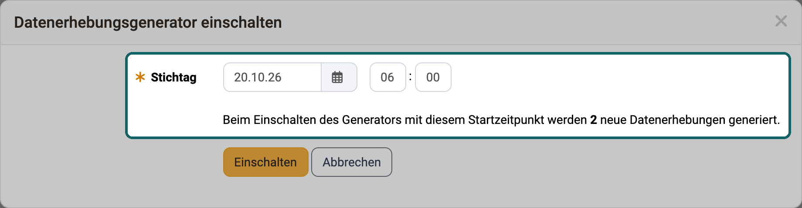{ class="shadow lightbox" title="Dialog Datenerhebungsgenerator einschalten · 2026.10.22" }

Mit "Einschalten" schalten Sie den Generator ein. Mit "Abbrechen" bleibt er ausgeschaltet.

!!! warning "Nachholen nach dem Wiedereinschalten"

    War ein Generator einige Zeit ausgeschaltet, holt er beim Wiedereinschalten Datenerhebungen nach. Massgebend ist der Stichtag.

    * **Stichtag unverändert:** Der Generator holt die Datenerhebungen nach, die während der ausgeschalteten Zeit fällig wurden.
    * **Stichtag auf den aktuellen Zeitpunkt gesetzt:** Der Generator holt keine verpassten Datenerhebungen nach. Beim Typ "Kurs" kann er aber Datenerhebungen erzeugen, die in diesem Moment bereits laufen.
    * **Zeitraum:** Nachgeholte Datenerhebungen behalten Start und Ende, die sich aus der Konfiguration ergeben. Sie laufen also nur noch die verbleibende Zeit.
    * **Abgelaufene Datenerhebungen:** Beim Startereignis "Täglich" und beim Typ "Termine eines/einer Betreuer:in in einem Kurs" holt der Generator nur Datenerhebungen nach, die beim Einschalten noch laufen. Bei den Startereignissen "Kursbeginn" und "Kursende" und beim Typ "Element" erzeugt er auch Datenerhebungen, deren Ende beim Einschalten schon vorbei ist.

    Prüfen Sie deshalb die Anzahl im Dialog, bevor Sie auf "Einschalten" klicken.

[Zum Seitenanfang ^](#Quality_Management_Data_Collection_Generators)

---

## Weiterführende Informationen {: #further_information}

**Auf dieser Seite erwähnt** 
[Qualitätsmanagement: Datenerhebung >](Quality_Management_Data_Collections.de.md) 
[Module: Übersicht >](../../manual_admin/administration/Modules.de.md) 
[Qualitätsmanagement: Datenerhebungsvorschau >](Quality_Management_Data_Collection_Preview.de.md)

**Weiterführend** 
[Qualitätsmanagement: Übersicht >](Quality_Management.de.md) 
[Qualitätsmanagement: Analyse >](Quality_Management_Analysis.de.md)

[Zum Seitenanfang ^](#Quality_Management_Data_Collection_Generators)
