# Quality Management: Data Collection Generators {: #Quality_Management_Data_Collection_Generators}

!!! tip "Recommendation"

    A data collection generator creates [data collections](Quality_Management_Data_Collections.md). If you know the data collection, the settings of the generator are easier to understand.

## What does a data collection generator do? {: #QMgenerator_function}

If you run the same survey in many courses, for example a feedback at the end of every course, you do not have to create the data collections one by one. A data collection generator creates them automatically in the Quality management module, according to rules you define once.

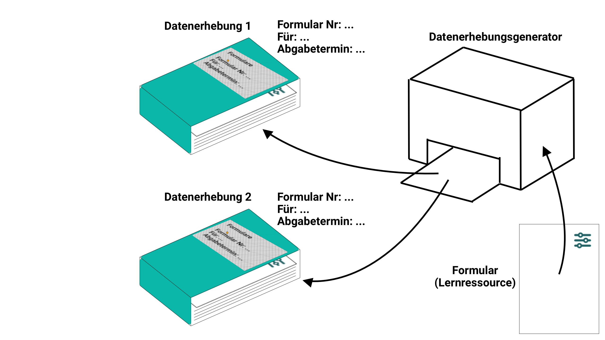{ class="lightbox" title="Scheme of a data collection generator" }

## How is a data collection generator created? {: #create_QMgenerator}

Persons with the role Quality manager or Administrator create and edit data collection generators. For them, the main navigation shows the entry "Quality management". On its start page, click "Go to data collection generators" in the section "Data collection generators".

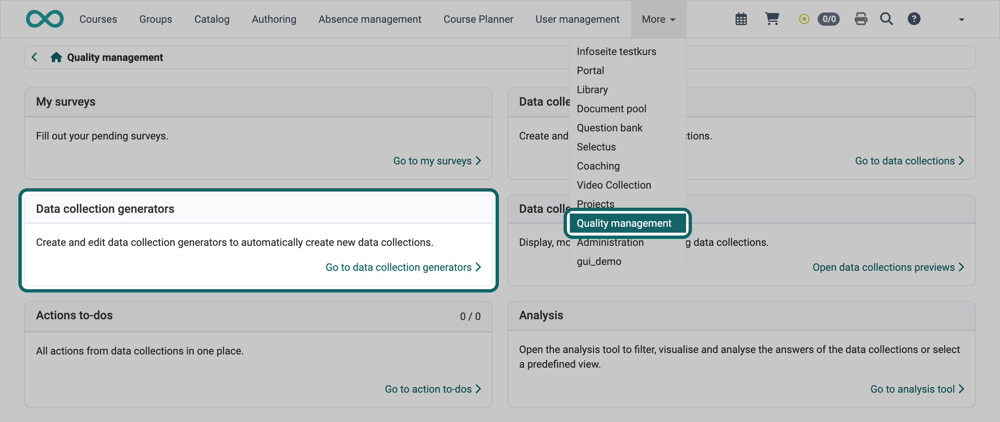{ class="shadow lightbox" title="Start page of the quality management · 2026.10.22" }

Click "Create generator" there.

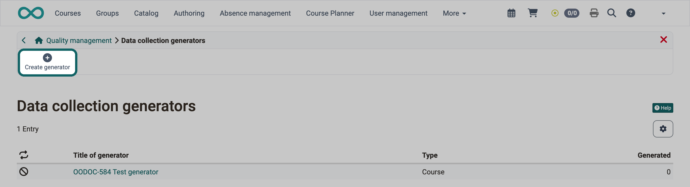{ class="shadow lightbox" title="List of data collection generators · 2026.10.22" }

In the dialog "Create generator", select the type and enter the title of the generator. The type determines what the generator creates data collections for: for courses, for the events of coaches in a course or for elements in the Course Planner. After the generator has been created, the type can no longer be changed.

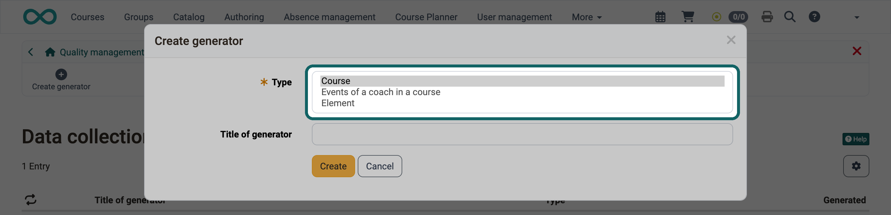{ class="shadow lightbox" title="Dialog Create generator · 2026.10.22" }

[To the top of the page ^](#Quality_Management_Data_Collection_Generators)

---

## Generator type "Course" {: #QMgenerator_type_course}

The type "Course" creates data collections for courses. Their start depends on the start of course, on the end of course or on fixed days of the week.

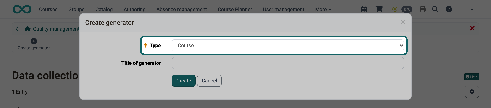{ class="shadow lightbox" title="Dialog Create generator · 2026.10.22" }

### Tab "Configuration" {: #Quality_Management_Data_Collection_Generators_Type_Course_Config}

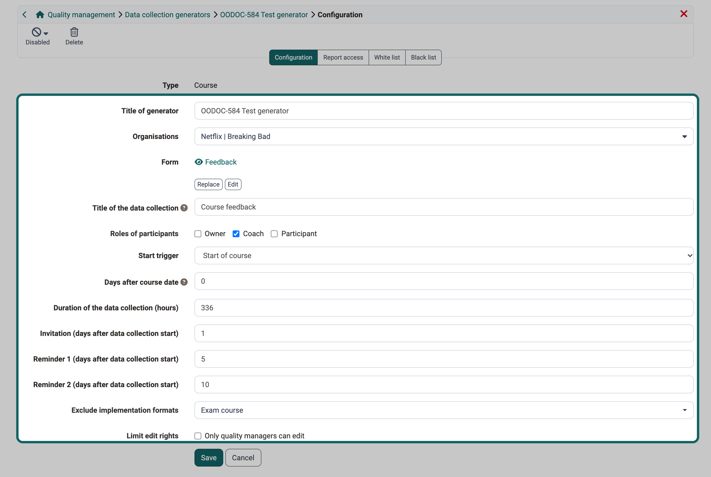{ class="shadow lightbox" title="Tab Configuration, type Course · 2026.10.22" }

#### Title of generator {: #course_generator_title }
Choose a title that states content and purpose. This lets you tell the generator apart from the other generators in the list.

#### Organisations {: #course_organisations }
The generator only takes into account courses of the organisations selected here and of their sub-organisations. The field appears if the module "Organisations" is enabled.

#### Form {: #course_form }
A generator works with exactly one form. This way, all its data collections can be compared and evaluated together. For another form, create another generator. Once the generator has created data collections, the form can no longer be replaced.

#### Title of the data collection {: #course_data_collection_title }
Enter the title of the data collections generated by the data collection generator here.
Variables can also be used in the title.

#### Roles of participants {: #course_roles }
The course members with the roles selected here can participate in the data collection. This way, you can for example survey only the coaches of a course.

#### Start trigger {: #course_start_trigger }
The start trigger determines when the data collection starts:

* Start of course
* End of course
* Daily

#### Days after course date {: #course_days_after_course_date }
This option is only displayed if "Start of course" or "End of course" has been selected as the start trigger.
The start of the data collection is calculated from the start trigger and the number of days entered here.
The number of days can also be negative.

#### Days of week {: #course_days_of_week }
This option is only displayed if "Daily" has been selected as the start trigger.
The generator creates one data collection for each course on every selected day of the week.

#### Start time {: #course_start_time }
This option is only displayed if "Daily" has been selected as the start trigger.
Enter the hour and minute at which the data collections start on the specified days of the week.

!!! note "Note"

    If a course has a start or end date, the generator creates no daily data collections for this course before the start and after the end.

#### Duration of the data collection (hours) {: #course_duration }
After the start of the data collection, all participants can complete and submit the form within the specified period. After this deadline, it is no longer possible to submit the form.

#### Invitation (days after data collection start) {: #course_invitation }
The invitation is sent as many days after the start of the data collection as you enter here. The generator calculates the dispatch date for each data collection from its own start date. Without an entry, OpenOlat sends no invitation.

#### Reminder 1 (days after data collection start) {: #course_reminder_1 }
As for the invitation, the generator calculates the dispatch date of the reminder from the start date of the data collection and the value entered here.

#### Reminder 2 (days after data collection start) {: #course_reminder_2 }
The dispatch date of the second reminder is calculated in the same way as for reminder 1.

#### Exclude implementation formats {: #course_exclude_implementation_formats }
An implementation format can be specified for courses in the metadata. It is possible to exclude certain [implementation formats](../../manual_admin/administration/Modules.md#course) from generated data collections, e.g. if examination courses are not to be included.

#### Limit edit rights {: #course_limit_edit_rights }
If you tick "Only quality managers can edit", the planned data collections of this generator can only be edited in the Quality management module. In the [data collection preview](Quality_Management_Data_Collection_Preview.md) of a course and in the Course Planner, they can then only be viewed.

### Tab "Report access"

The generator transfers the access rights you define here to every data collection it creates. The individual settings are described on the page [Data collections](Quality_Management_Data_Collections.md).

### Tab "White list" {: #Quality_Management_Data_Collection_Generators_Type_Course_PositivList}

With the white list, you limit the generator to selected courses. It then only takes into account courses that meet its configuration and are also on the white list.

### Tab "Black list" {: #Quality_Management_Data_Collection_Generators_Type_Course_NegativList}

With the black list, you exclude individual courses that the generator would otherwise take into account according to its configuration.

!!! tip "Tip"

    Create either a white list or a black list. 
    If only a few courses are to receive data collections, the white list is suitable.  If most courses are to receive data collections, the black list is suitable.

[To the top of the page ^](#Quality_Management_Data_Collection_Generators)

---

## Generator type "Events of a coach in a course" {: #QMgenerator_type_events}

This type creates data collections for the events that coaches teach in a course. The data collection starts in the last event of the coach or in the event with a specific unit.

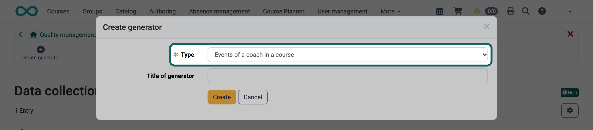{ class="shadow lightbox" title="Dialog Create generator · 2026.10.22" }

### Tab "Configuration"

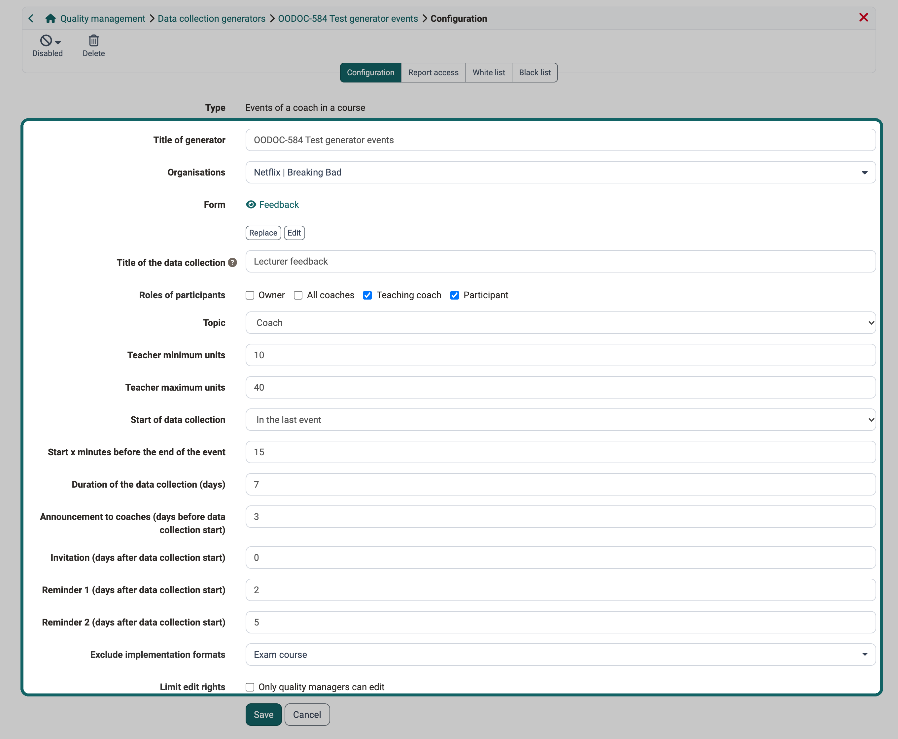{ class="shadow lightbox" title="Tab Configuration, type Events of a coach in a course · 2026.10.22" }

See also [Configuration in the type Course](#Quality_Management_Data_Collection_Generators_Type_Course_Config).

#### Roles of participants {: #events_roles }
The course members with the roles selected here can participate in the data collection.

* Owner
* All coaches (= all coaches of the course)
* Teaching coach (= the person teaching at the event that leads to the data collection)
* Participant

#### Topic {: #events_topic }
The topic determines what the [data collection](Quality_Management_Data_Collections.md) assesses:

* Coach
* Course

!!! note "Note"

    If there are several coaches in a course who fulfill the other criteria, one [data collection](Quality_Management_Data_Collections.md) is initiated per coach.

#### Teacher minimum units {: #events_teacher_minimum_units }
The data collection only takes place if the coach has the minimum number of units in a course in total specified here. (Not only the lessons already held.)

#### Teacher maximum units {: #events_teacher_maximum_units }
The data collection only takes place if the coach does not exceed the maximum number of units in a course in total specified here.

!!! note "Example"

    In the standard case, only coaches who teach at least 10 units are to be assessed. For this, enter 10 as the minimum number of units.

    Coaches who teach only rarely are assessed with another generator. There, you define a maximum number of units.

#### Start of data collection {: #events_data_collection_start }
Here you select the event in which the data collection starts:

* In the last event (which the coach teaches in a course)
* In the event with unit x (events taught by the coach)

#### Event with unit x {: #events_event_with_unit }
This option is only displayed if "In the event with unit x" has been selected.
Enter the number of the unit. The data collection starts in the event that contains this unit.

#### Start x minutes before the end of the event {: #events_minutes_before_end }
The data collection starts as many minutes before the end of the event as you enter here. If the survey starts while the event is still running, more participants usually take part.

#### Duration of the data collection (days) {: #events_duration }
After the start of the data collection, all participants can complete and submit the form within the specified period. After this deadline, it is no longer possible to submit the form.

#### Announcement to coaches (days before data collection start) {: #events_announcement }
With an announcement, coaches learn about the data collection in advance and can react if necessary. It is sent as many days before the start of the data collection as you enter here. Without an entry, OpenOlat sends no announcement.

#### Invitation (days after data collection start) {: #events_invitation }
The invitation is an email to the participants with the link to the form. Without an entry, OpenOlat sends no email. The participants then learn about the data collection by other means, for example from the coach in class.

#### Reminder 1 (days after data collection start) {: #events_reminder_1 }
As for the [type Course](#course_reminder_1), the dispatch date of the reminder is calculated from the start date of the data collection and the value entered here.

#### Reminder 2 (days after data collection start) {: #events_reminder_2 }
The dispatch date of the second reminder is calculated in the same way as for reminder 1.

### Tab "Report access"

The configuration entered here is transferred 1:1 to the created data collections.
See [Data collections](Quality_Management_Data_Collections.md).

### Tab "White list"

See [Type Course White list](#Quality_Management_Data_Collection_Generators_Type_Course_PositivList).

### Tab "Black list"

See [Type Course Black list](#Quality_Management_Data_Collection_Generators_Type_Course_NegativList).

[To the top of the page ^](#Quality_Management_Data_Collection_Generators)

---

## Generator type "Element" {: #QMgenerator_type_element}

The type "Element" creates data collections for elements in the Course Planner. The generator calculates the start from the begin or from the end of the element.

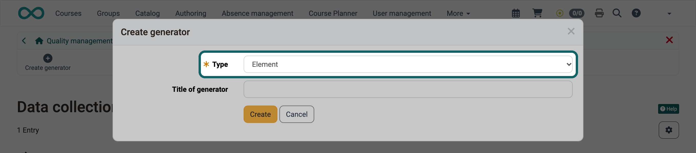{ class="shadow lightbox" title="Dialog Create generator · 2026.10.22" }

### Tab "Configuration"

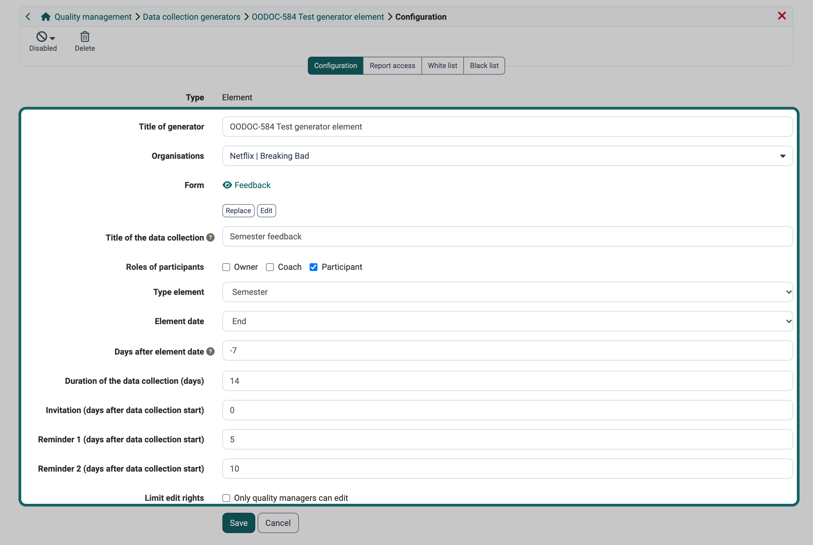{ class="shadow lightbox" title="Tab Configuration, type Element · 2026.10.22" }

See also [Configuration in the type Course](#Quality_Management_Data_Collection_Generators_Type_Course_Config).

#### Type element {: #element_type }
The generator creates one data collection for each element of this element type. Which element types are available depends on how the Course Planner is set up, for example:

* Semester
* Program
* Module

#### Element date {: #element_date }
The element date determines from which date of the element the start of the data collection is calculated:

* Begin
* End

#### Days after element date {: #element_days_after_element_date }
The start of the data collection is calculated from the element date and the number of days entered here.
The number of days can also be negative.

#### Duration of the data collection (days) {: #element_duration }
For the type "Element", you enter the duration in days, not in hours as for the type "Course". After this deadline, it is no longer possible to submit the form.

### Tab "Report access"

As for the type "Course", the generator transfers the access rights you define here to every data collection it creates. The individual settings are described on the page [Data collections](Quality_Management_Data_Collections.md).

### Tab "White list"

With the white list, you limit the generator to selected elements. It then only takes into account elements that meet its configuration and are also on the white list.

### Tab "Black list"

With the black list, you exclude individual elements that the generator would otherwise take into account according to its configuration.

!!! tip "Tip"

    Create either a white list or a black list. If only a few elements are to receive data collections, the white list is suitable.  If most elements are to receive data collections, the black list is suitable.

[To the top of the page ^](#Quality_Management_Data_Collection_Generators)

---

## Enable generator {: #activate_QMgenerator}

A new generator is disabled. This way, you can configure it at leisure before it creates data collections. To enable it, click "Disabled" at the top left and select "Enable".

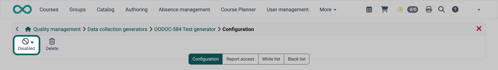{ class="shadow lightbox" title="Generator in the quality management · 2026.10.22" }

!!! info "Important"

    A generator can only be edited while it is disabled.

When you enable a generator, the dialog "Enable data collection generator" opens with the field "Due date". The due date determines from when on the generator takes data collections into account. For a new generator, the field contains the current point in time. If you enable a generator again that has already run, the field contains the time of its last run before it was disabled. Below the field, the dialog shows how many new data collections are generated with this due date. If you change the due date, the number is updated.

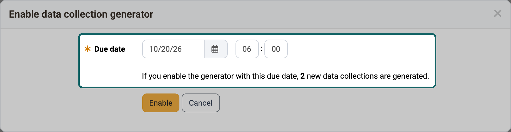{ class="shadow lightbox" title="Dialog Enable data collection generator · 2026.10.22" }

Click "Enable" to enable the generator. With "Cancel", it remains disabled.

!!! warning "Catching up after enabling again"

    If a generator was disabled for some time, it catches up on data collections when it is enabled again. The due date is decisive.

    * **Due date unchanged:** The generator catches up on the data collections that became due while it was disabled.
    * **Due date set to the current point in time:** The generator does not catch up on missed data collections. For the type "Course", however, it can create data collections that are already running at this moment.
    * **Period:** Data collections that are caught up keep the start and end that result from the configuration. They therefore only run for the remaining time.
    * **Expired data collections:** For the start trigger "Daily" and for the type "Events of a coach in a course", the generator only catches up on data collections that are still running when it is enabled. For the start triggers "Start of course" and "End of course" and for the type "Element", it also creates data collections whose end has already passed when it is enabled.

    Therefore, check the number in the dialog before you click "Enable".

[To the top of the page ^](#Quality_Management_Data_Collection_Generators)

---

## Further information {: #further_information}

**Mentioned on this page** 
[Quality Management: Data collections >](Quality_Management_Data_Collections.md) 
[Modules: Overview >](../../manual_admin/administration/Modules.md) 
[Quality Management: Data Collection Preview >](Quality_Management_Data_Collection_Preview.md)

**Further reading** 
[Quality Management: Overview >](Quality_Management.md) 
[Quality Management: Analysis >](Quality_Management_Analysis.md)

[To the top of the page ^](#Quality_Management_Data_Collection_Generators)
