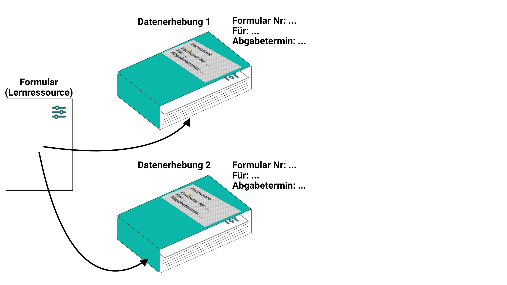
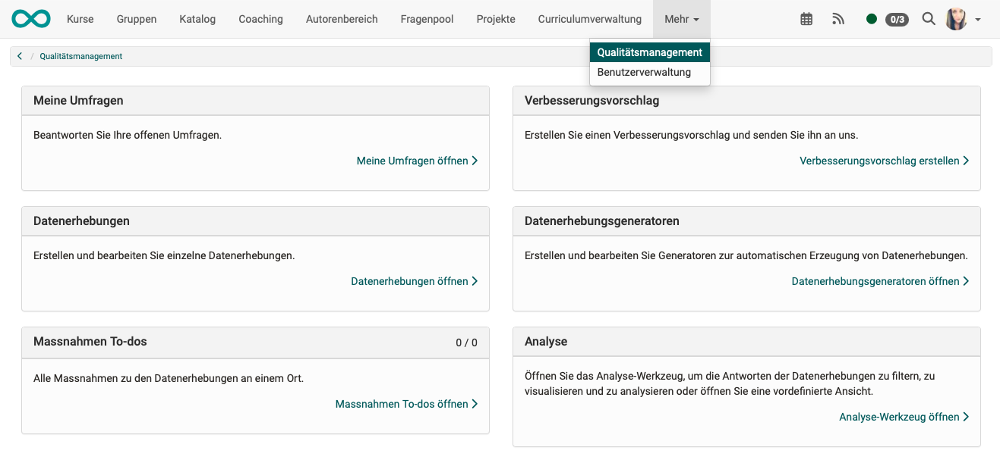
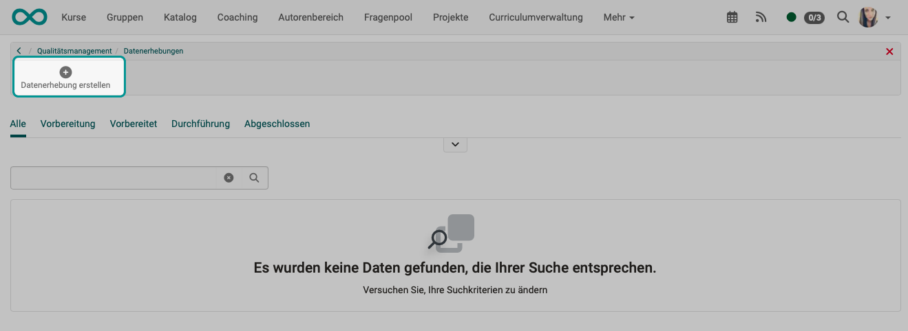
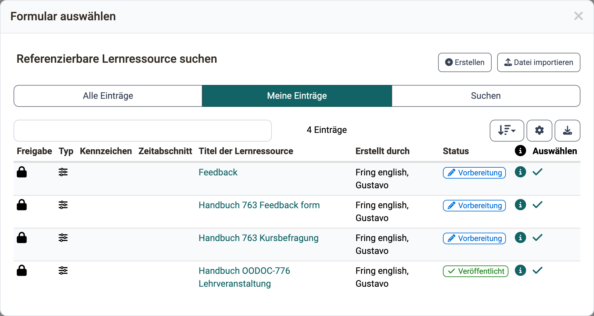
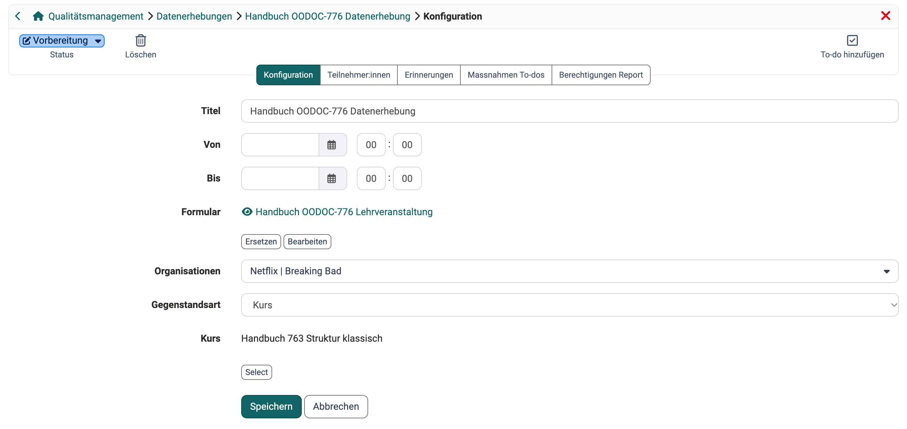
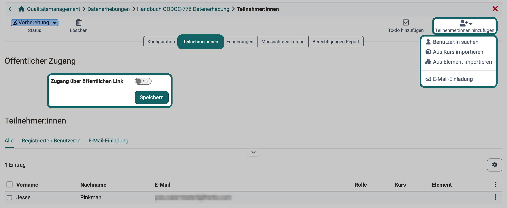
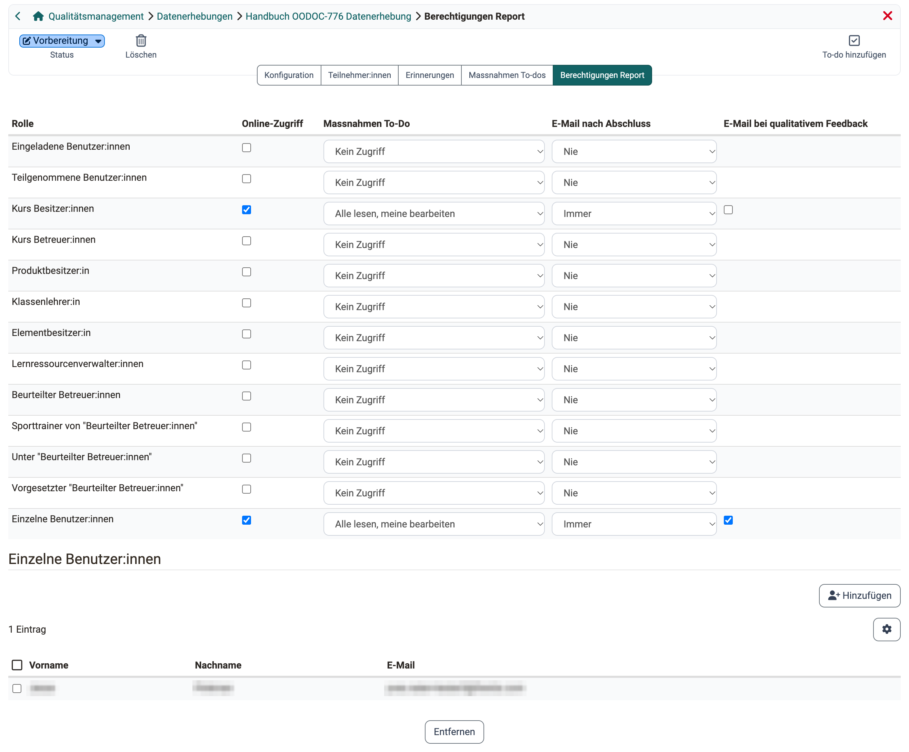
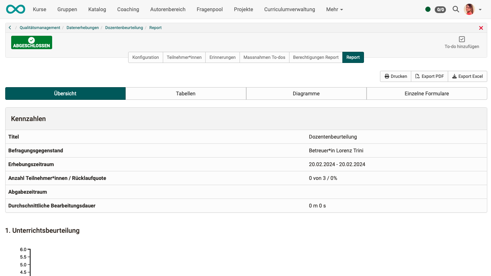
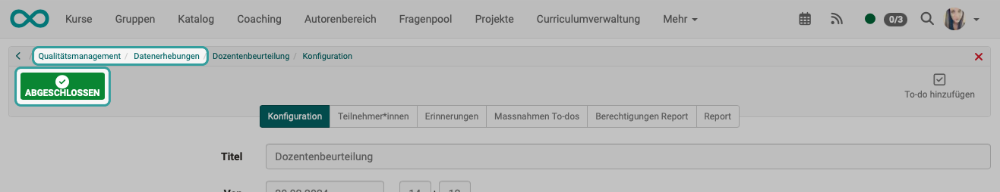
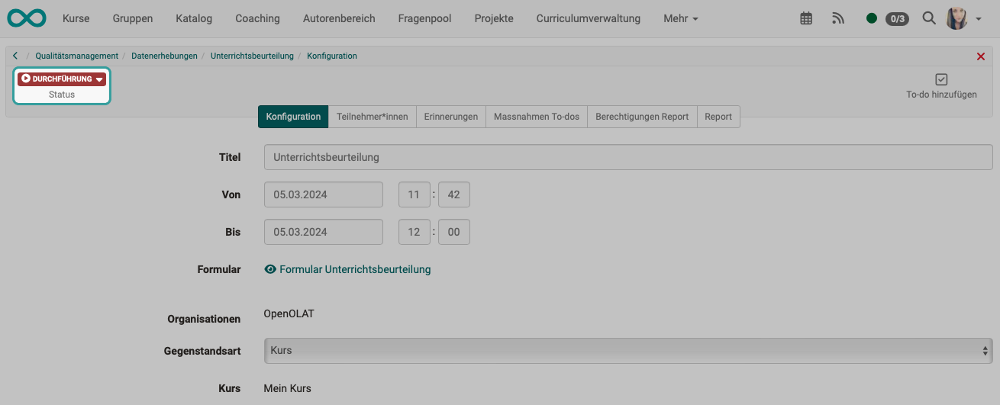

# Qualitätsmanagement: Datenerhebung {: #Quality_Management_Data_Collections}

## Was ist eine Datenerhebung? {: #definition}

!!! info "Zusammenfassung"

    Eine Datenerhebung befragt

    * einen bestimmten Personenkreis
    * in einem bestimmten Zeitfenster
    * zu einem bestimmten Thema
    * mit einem bestimmten Formular.

* Wer Rückmeldung zur Qualität von Unterricht, Kursen, Dozierenden u.a. erhalten will, legt einem bestimmten Personenkreis einen Fragebogen (Formular-Lernressource) zum Ausfüllen vor.
* Zum festgelegten Zeitpunkt verschickt OpenOlat E-Mails mit einem Link auf die Formular-Lernressource.
* Das Qualitätsmanagement wertet die Eingaben der Teilnehmer:innen aus, z.B. auch über verschiedene Kurse hinweg.
* Am Ende erzeugt OpenOlat einen Report, auf den ein bestimmbarer Personenkreis Zugriff erhält.
* Datenerhebungen legen Qualitätsmanager:innen und Administrator:innen im Qualitätsmanagement an.

{ class="lightbox" title="Schema einer Datenerhebung" }

[Zum Seitenanfang ^](#Quality_Management_Data_Collections)

---

## Neue Datenerhebung erstellen {: #create_data_collections}

Wer eine Befragung plant, legt dafür eine Datenerhebung an. Qualitätsmanager:innen und Administrator:innen sehen in der Hauptnavigation das Qualitätsmanagement und öffnen dort im Abschnitt "Datenerhebungen" die Liste der Datenerhebungen: 
`Qualitätsmanagement > Datenerhebungen > Button "Datenerhebung erstellen"`

{ class="shadow lightbox" title="Startseite des Qualitätsmanagements" }

{ class="shadow lightbox" title="Liste der Datenerhebungen" }

Als Erstes wählen Sie eine vorhandene Formular-Lernressource oder erstellen eine neue.

{ class="shadow lightbox" title="Dialog Formular auswählen · 2026.11.10" }

Die Datenerhebung richten Sie anschliessend in fünf Tabs ein. Zum festgelegten Zeitpunkt verschickt OpenOlat E-Mails mit einem Link zum Formular an die Teilnehmer:innen. Am Ende erzeugt OpenOlat einen Report, auf den die im Tab "Berechtigungen Report" genannten Personen zugreifen. Sobald ein Report vorhanden ist, erscheint zusätzlich der Tab "Report".

{ class="shadow lightbox" title="Tab Konfiguration einer Datenerhebung · 2026.11.10" }

### Tab "Konfiguration" {: #tab_config}

Hier legen Sie fest, welches Formular die Teilnehmenden in welchem Zeitraum ausfüllen. Läuft die Datenerhebung, füllen alle Teilnehmenden im angegebenen Zeitraum das hier ausgewählte Formular aus und geben es ab. Nach Ablauf dieser Frist ist keine Abgabe mehr möglich.

Nach Ende der Abgabefrist steht der Report allen Personen zur Verfügung, die im Tab "Berechtigungen Report" aufgelistet sind.

### Tab "Teilnehmer:innen" {: #tab_participants}

In diesem Tab legen Sie fest, wen Sie befragen, also wer die Aufforderung zur Teilnahme mit dem Link zum Formular per E-Mail erhält.

Mit dem Button "Teilnehmer:innen hinzufügen" suchen Sie Benutzer:innen oder übernehmen die Mitglieder eines Kurses oder eines Curriculumelements. Mit "E-Mail-Einladung" laden Sie Personen über ihre E-Mail-Adresse ein. [:octicons-tag-16:{ title="ab Release 20.1 (OO-8329)" }](https://track.frentix.com/issue/OO-8329)

{ class="shadow lightbox" title="Tab Teilnehmer:innen einer Datenerhebung · 2026.11.10" }

#### Öffentlicher Zugang [:octicons-tag-16:{ title="ab Release 20.1 (OO-8330)" }](https://track.frentix.com/issue/OO-8330) {: #public_access}

Möchten Sie auch Personen ohne OpenOlat-Konto befragen, etwa die Gäste einer Veranstaltung, schalten Sie im Abschnitt "Öffentlicher Zugang" den Schalter "Zugang über öffentlichen Link" ein. OpenOlat trägt im Feld "Link" einen zufälligen Wert ein, der den Schluss des Links bildet. Sie können ihn ändern. Das Feld "Vorschau" zeigt den vollständigen Link, mit "Speichern" übernehmen Sie die Einstellung. Jede Person, die den Link öffnet, nimmt an der Datenerhebung teil, ohne in OpenOlat registriert zu sein. Den Schalter ändern Sie, solange die Datenerhebung den Status "Vorbereitung" oder "Vorbereitet" hat.

Neben dem Link kopieren Sie ihn mit "In Zwischenablage kopieren" oder zeigen ihn mit "QR-Code anzeigen" als QR-Code. Mit "PNG herunterladen" speichern Sie den QR-Code als Bild. Zeigen Sie ihn zum Beispiel am Ende einer Veranstaltung auf einer Folie, nehmen die Anwesenden direkt am Telefon an der Umfrage teil. Mehr dazu unter [Links kopieren und als QR-Code weitergeben](../basic_concepts/Navigation.de.md#url_field). [:octicons-tag-16:{ title="ab Release 21.1.2 (OO-9982)" }](https://track.frentix.com/issue/OO-9982)

### Tab "Erinnerungen" {: #tab_reminders}

Damit die Befragten die Datenerhebung nicht verpassen, bereiten Sie hier die Einladung und Erinnerungsmails vor. OpenOlat verschickt sie automatisch, sobald die gewählte Versandbedingung eintritt.

Die Einladung ist eine E-Mail an die Teilnehmer:innen mit dem Link zum Formular. Ist keine Einladung eingerichtet, verschickt OpenOlat keine E-Mail, und Sie informieren die Teilnehmenden auf anderem Weg, z.B. im Unterricht.

### Tab "Massnahmen To-dos" [:octicons-tag-16:{ title="ab Release 18.0 (OO-6781)" }](https://track.frentix.com/issue/OO-6781) {: #tab_action_to_dos}

Zeigen die Ergebnisse einer Datenerhebung oder eines einzelnen Formulars Handlungsbedarf, reagieren Sie direkt mit Massnahmen. Sie legen To-dos im Zusammenhang der Datenerhebung an und weisen sie den zuständigen Personen zu. Diese erhalten eine E-Mail über das neue To-do. Alle To-dos stehen im Bereich ["Massnahmen (To-dos)"](Quality_Management_To-dos.de.md) zur Verfügung.

### Tab "Berechtigungen Report" {: #tab_permission_report}

Hier legen Sie fest, wer nach dem Abschluss einer Datenerhebung auf die Reports zugreift und wer davon erfährt. Im Tab "Berechtigungen Report" bestimmen Sie, 
a) wer welche Reports sehen darf 
b) und ob und wie OpenOlat darüber informiert.

{ class="shadow lightbox" title="Tab Berechtigungen Report einer Datenerhebung · 2026.11.09" }

* Spalte **Online-Zugriff:** Die in der 1. Spalte genannten Empfänger:innen greifen online auf die Reports zu.
* Spalte **Massnahmen To-Do:** Legt fest, was die in der 1. Spalte genannten Empfänger:innen mit den Massnahmen To-dos der Datenerhebung tun dürfen: "Kein Zugriff", "Alle lesen, meine bearbeiten", "Meine bearbeiten und neue erstellen", "Alle bearbeiten und neue erstellen" oder "Vollzugriff".
* Spalte **E-Mail nach Abschluss:** Legt fest, ob die in der 1. Spalte genannten Empfänger:innen eine E-Mail erhalten, sobald OpenOlat den Report erzeugt hat: "Immer", "Nie", "Ungenügend" oder "Ungenügend oder neutral". Wann die beiden letzten Einstellungen eine E-Mail auslösen, steht unter "Bedingungen einer E-Mail-Benachrichtigung".
* Spalte **E-Mail bei qualitativem Feedback:** Die in der 1. Spalte genannten Empfänger:innen erhalten eine E-Mail, sobald OpenOlat den Report erzeugt hat und die Befragten im Formular Textfelder ausgefüllt oder eine Datei hochgeladen haben.
* Abschnitt **Einzelne Benutzer:innen:** Hier geben Sie frei gewählten Benutzer:innen Zugriff, die ihn nicht über eine Rolle haben.

Qualitätsmanager:innen sehen den aktuellen Status der Datenerhebung schon vor dem Abschluss.

**Bedingungen einer E-Mail-Benachrichtigung** 
Ob OpenOlat bei den Einstellungen "Ungenügend" und "Ungenügend oder neutral" eine E-Mail auslöst, berechnet es aus den Rubrik-Elementen des Formulars. 
Je Rubrik berechnet OpenOlat aus den Antworten aller Fragen den Durchschnitt. Diesen ordnet es anhand der Wertebereiche (Skala) in der Konfiguration der Rubrik einer Klassierung zu: "ungenügend", "neutral" oder "genügend". Liegt der Durchschnitt in keinem Wertebereich, etwa weil keine definiert sind, lautet die Klassierung "nicht bewertet".

**Beispiel:**

- Das Formular enthält 6 Rubriken.
- Bei den ersten beiden Rubriken sind keine Wertebereiche definiert, ihre Klassierung lautet also immer "nicht bewertet".
- Für die anderen 4 ermittelt OpenOlat Durchschnitt und Klassierung.
- Bei der Einstellung "Ungenügend" verschickt OpenOlat die E-Mail, wenn mindestens eine Rubrik die Klassierung "ungenügend" erhält.
- Bei der Einstellung "Ungenügend oder neutral" verschickt OpenOlat die E-Mail, wenn mindestens eine Rubrik die Klassierung "ungenügend" oder "neutral" erhält.
- Ist in diesem Beispiel "Ungenügend" eingestellt, genügt also eine der Rubriken 3 bis 6 mit der Klassierung "ungenügend", um die E-Mail auszulösen.

### Tab "Report" {: #tab_report}

Sobald ein Report vorhanden ist, zeigt OpenOlat den Tab "Report". Er fasst die Ergebnisse der Datenerhebung mit ihren Kennzahlen zusammen. Mit "Drucken", "Export PDF" und "Export Excel" geben Sie den Report aus, etwa für eine Besprechung.

{ class="shadow lightbox" title="Tab Report einer abgeschlossenen Datenerhebung" }

[Zum Seitenanfang ^](#Quality_Management_Data_Collections)

---

### Empfohlene Formulare {: #recommended_forms}

Für Umfragen im Qualitätsmanagement verwenden Sie Formular-Lernressourcen, die Sie in OpenOlat mit dem Content Editor erstellen. Am besten auswerten lassen sich Rubrik-Elemente. Freitext-Felder sind ebenfalls möglich, OpenOlat wertet sie aber nicht automatisch aus. Bewährt hat sich deshalb ein Formular mit mehreren Rubrik-Elementen und ergänzend ein oder zwei Freitext-Feldern, in denen die Befragten eigene Kommentare formulieren.

Mehr Informationen über die Erstellung geeigneter Formulare für das Qualitätsmanagement finden Sie hier:

[Qualitätsmanagement: Umfragen >](Quality_Management_Surveys.de.md) 
[Was sollte ein Qualitätsmanagements-Formular enthalten? >](Quality_Management_Surveys.de.md#was-sollte-ein-qualitatsmanagements-formular-enthalten) 
[Formular als Rubrik Bewertung in einem Kurs >](../learningresources/Forms_in_Rubric_Scoring.de.md)

[Zum Seitenanfang ^](#Quality_Management_Data_Collections)

---

## Datenerhebung ausführen {: #execute_data_collection}

OpenOlat startet eine Datenerhebung mit dem Status "Vorbereitet" automatisch, sobald ihr Zeitfenster aus dem Tab "Konfiguration" beginnt. Den Status setzen Sie über den Status-Button der Datenerhebung von "Vorbereitung" auf "Vorbereitet", wenn alles eingerichtet ist. Mit "Durchführung" im selben Menü starten Sie die Datenerhebung sofort. Während der "Durchführung" füllen die befragten Personen das Formular aus und geben es ab. Nach Ablauf der Frist ist keine Abgabe mehr möglich.

[Zum Seitenanfang ^](#Quality_Management_Data_Collections)

---

## Datenerhebung abschliessen {: #complete_data_collection}

OpenOlat schliesst eine Datenerhebung automatisch ab, sobald ihr Zeitfenster abgelaufen ist.

{ class="shadow lightbox" title="Konfiguration einer abgeschlossenen Datenerhebung" }

Den Status "Abgeschlossen" behält eine Datenerhebung dauerhaft.

Eine abgeschlossene Datenerhebung bearbeiten Sie nur noch in den Tabs

* Massnahmen To-dos und
* Berechtigungen Report

Eine laufende Datenerhebung schliessen Sie auch von Hand ab, ohne das Ende des Zeitfensters abzuwarten. Öffnen Sie dazu das Menü des Status-Buttons "Durchführung" und wählen Sie "Abgeschlossen".

{ class="shadow lightbox" title="Konfiguration einer laufenden Datenerhebung" }

[Zum Seitenanfang ^](#Quality_Management_Data_Collections)

---

## Weiterführende Informationen {: #further_information}

[Navigation >](../basic_concepts/Navigation.de.md) 
[Qualitätsmanagement: Massnahmen (To-dos) >](Quality_Management_To-dos.de.md) 
[Qualitätsmanagement: Umfragen >](Quality_Management_Surveys.de.md) 
[Formular als Rubrik-Bewertung >](../learningresources/Forms_in_Rubric_Scoring.de.md) 
[Qualitätsmanagement: Übersicht >](Quality_Management/index.de.md) 
[Qualitätsmanagement: Datenerhebungsgeneratoren >](Quality_Management_Data_Collection_Generators.de.md) 
[Qualitätsmanagement: Analyse >](Quality_Management_Analysis.de.md)

[Zum Seitenanfang ^](#Quality_Management_Data_Collections)
