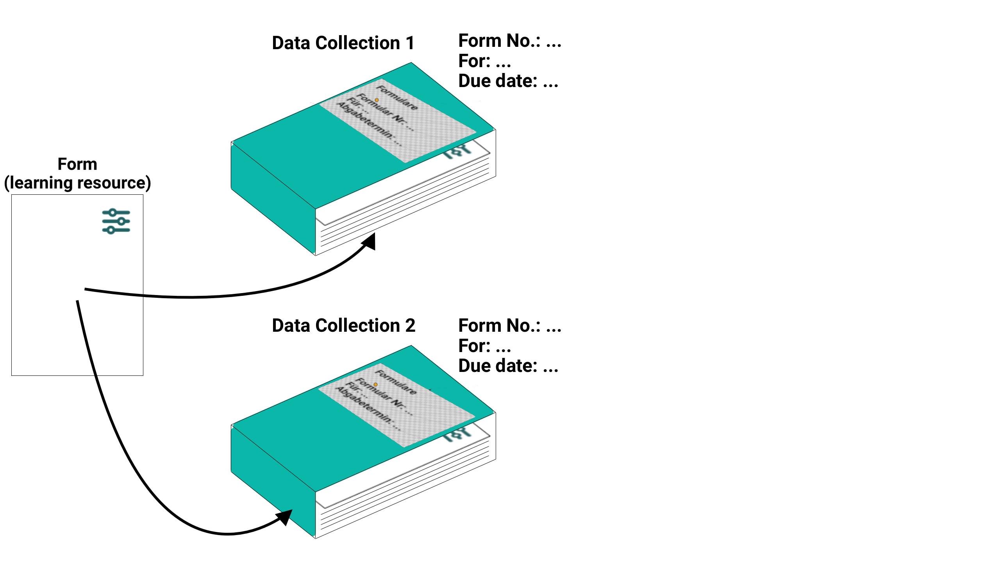
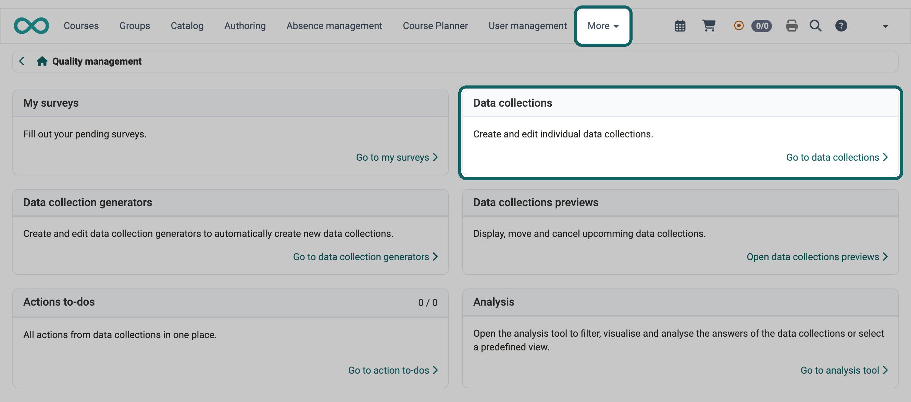
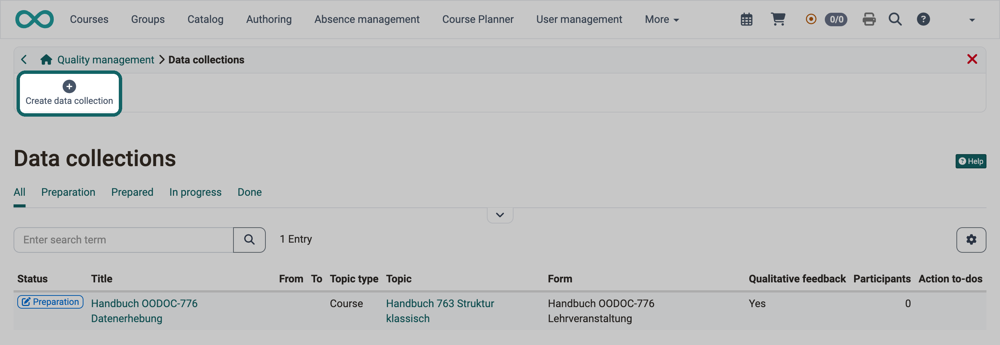
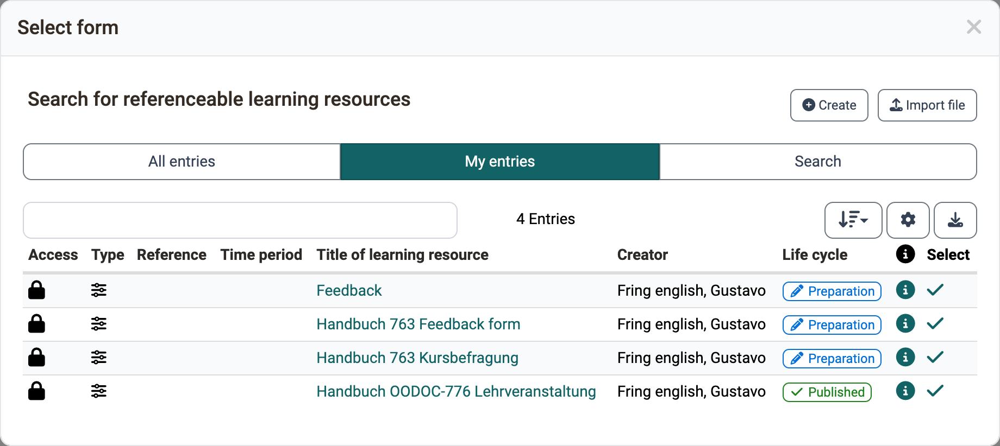
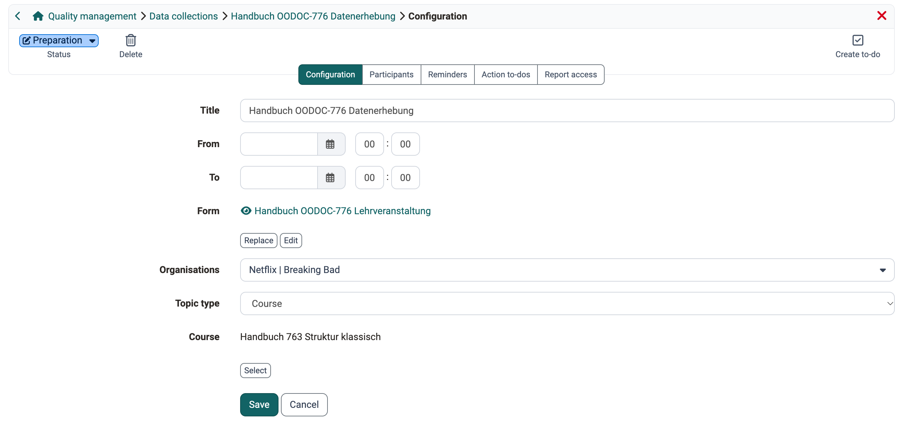
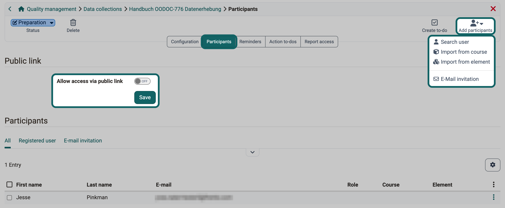
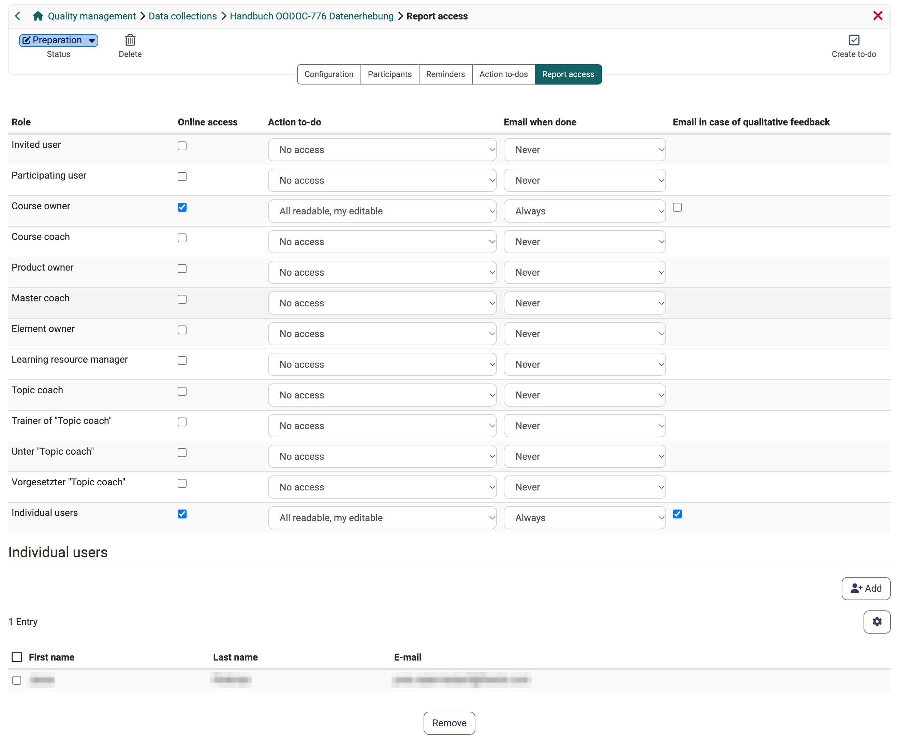
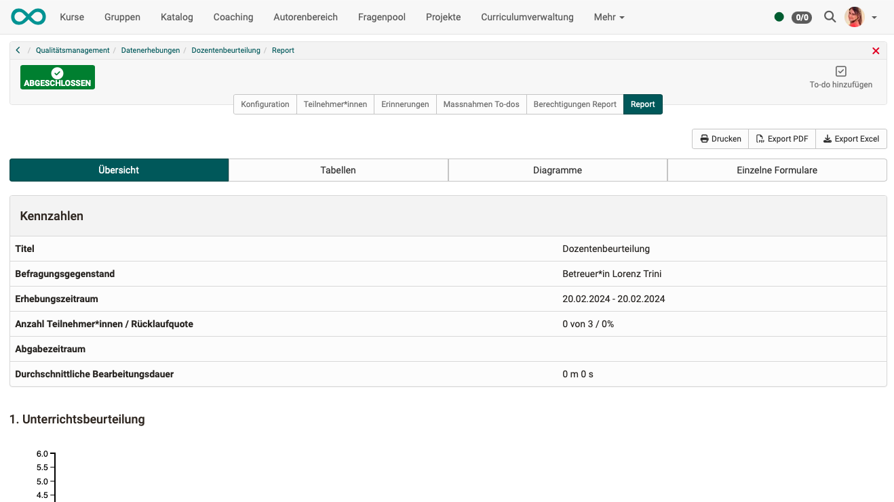
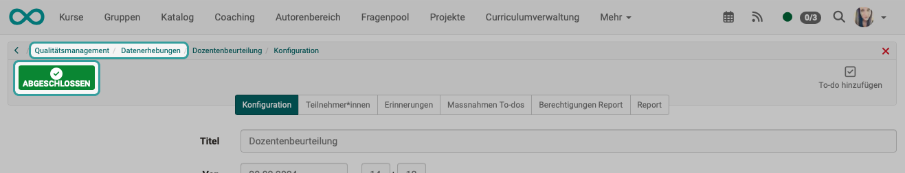
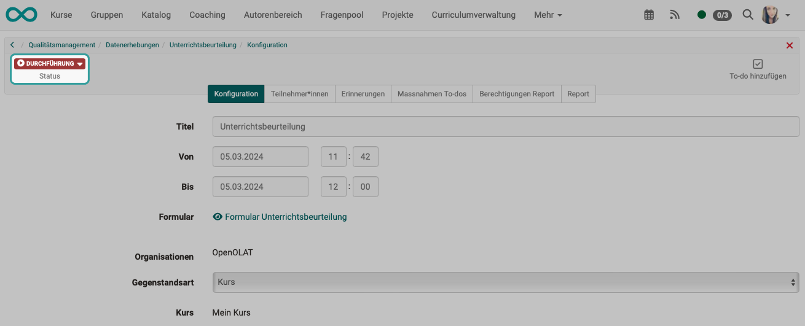

# Quality Management: Data collections {: #Quality_Management_Data_Collections}

## What is a data collection? {: #definition}

!!! info "Summary"

    A data collection surveys

    * a certain group of people
    * in a certain time window
    * on a certain topic
    * with a certain form.

* If you want feedback on the quality of teaching, courses, lecturers, etc., you give a questionnaire (form learning resource) to a specific group of people to complete.
* At the specified time, OpenOlat sends emails with a link to the form learning resource.
* The quality management evaluates the participants' entries, e.g. also across different courses.
* At the end, OpenOlat generates a report which a definable group of people can access.
* Quality managers and administrators create data collections in the quality management.

{ class="lightbox" title="Scheme of a data collection · 2026.11.10" }

[To the top of the page ^](#Quality_Management_Data_Collections)

---

## Create new data collection {: #create_data_collections}

If you plan a survey, you create a data collection for it. Quality managers and administrators see the quality management in the main navigation and open the list of data collections there in the section "Data collections": 
`Quality management > Data collections > Button "Create data collection"`

{ class="shadow lightbox" title="Start page of the quality management · 2026.11.10" }

{ class="shadow lightbox" title="List of data collections · 2026.11.10" }

First, you select an existing form learning resource or create a new one.

{ class="shadow lightbox" title="Dialog Select form · 2026.11.09" }

You then set up the data collection in five tabs. At the specified time, OpenOlat sends emails with a link to the form to the participants. At the end, OpenOlat generates a report which the persons named in the tab "Report access" can access. As soon as a report is available, the tab "Report" appears as well.

{ class="shadow lightbox" title="Tab Configuration of a data collection · 2026.11.09" }

### Tab "Configuration" {: #tab_config}

Here you define which form the participants complete in which period. While the data collection is running, all participants complete and submit the form selected here during the specified period. After this deadline, it is no longer possible to submit the form.

At the end of the submission period, the report is available to all persons listed in the tab "Report access".

### Tab "Participants" {: #tab_participants}

In this tab, you define whom you survey, i.e. who receives the invitation to participate with the link to the form by email.

With the button "Add participants" you search for users or take over the members of a course or a curriculum element. With "E-Mail invitation" you invite persons via their email address. [:octicons-tag-16:{ title="from Release 20.1 (OO-8329)" }](https://track.frentix.com/issue/OO-8329)

{ class="shadow lightbox" title="Tab Participants of a data collection · 2026.11.10" }

#### Public access [:octicons-tag-16:{ title="from Release 20.1 (OO-8330)" }](https://track.frentix.com/issue/OO-8330) {: #public_access}

If you also want to survey persons without an OpenOlat account, for example the guests of an event, switch on "Allow access via public link" in the section "Public access". OpenOlat enters a random value in the field "Link" that forms the end of the link. You can change it. The field "Preview" shows the complete link, and "Save" applies the setting. Any person who opens the link takes part in the data collection without being registered in OpenOlat. You change the switch as long as the data collection has the status "Preparation" or "Prepared".

Next to the link, you copy it with "Copy to clipboard" or show it as a QR code with "Show QR code". With "Download PNG" you save the QR code as an image. If you show it on a slide at the end of an event, for example, the people present take part in the survey directly on their phone. More on this under [Copy links and pass them on as a QR code](../basic_concepts/Navigation.md#url_field). [:octicons-tag-16:{ title="from Release 21.1.2 (OO-9982)" }](https://track.frentix.com/issue/OO-9982)

### Tab "Reminders" {: #tab_reminders}

So that the respondents do not miss the data collection, you prepare the invitation and reminder emails here. OpenOlat sends them automatically as soon as the selected dispatch condition is met.

The invitation is an email to the participants with the link to the form. If no invitation is set up, OpenOlat sends no email, and you inform the participants by other means, e.g. in class.

### Tab "Action to-dos" [:octicons-tag-16:{ title="from Release 18.0 (OO-6781)" }](https://track.frentix.com/issue/OO-6781) {: #tab_action_to_dos}

If the results of a data collection or of a single form show a need for action, you respond directly with actions. You create to-dos in the context of the data collection and assign them to the persons responsible. They receive an email about the new to-do. All to-dos are available in the section ["Actions (To-dos)"](Quality_Management_To-dos.md).

### Tab "Report access" {: #tab_permission_report}

Here you define who accesses the reports after a data collection has finished and who is informed about it. In the tab "Report access" you determine 
a) who is allowed to see which reports 
b) and whether and how OpenOlat informs them.

{ class="shadow lightbox" title="Tab Report access of a data collection · 2026.11.09" }

* Column **Online access:** The recipients named in the 1st column access the reports online.
* Column **Action to-do:** Defines what the recipients named in the 1st column may do with the action to-dos of the data collection: "No access", "All readable, my editable", "My editable and create new ones", "All editable and create new ones" or "Full access".
* Column **Email when done:** Defines whether the recipients named in the 1st column receive an email as soon as OpenOlat has generated the report: "Always", "Never", "Insufficient" or "Insufficient or neutral". When the last two settings trigger an email is described under "Conditions for an email notification".
* Column **Email in case of qualitative feedback:** The recipients named in the 1st column receive an email as soon as OpenOlat has generated the report and the respondents have filled in text fields in the form or uploaded a file.
* Section **Individual users:** Here you grant access to freely chosen users who do not have it through a role.

Quality managers see the current status of the data collection even before it is finished.

**Conditions for an email notification** 
Whether OpenOlat triggers an email with the settings "Insufficient" and "Insufficient or neutral" is calculated from the rubric elements of the form. 
For each rubric, OpenOlat calculates the average from the answers to all questions. It assigns this average to a rating using the value ranges (scale) in the configuration of the rubric: "insufficient", "neutral" or "sufficient". If the average does not fall within any value range, for example because none are defined, the rating is "not rated".

**Example:**

- The form contains 6 rubrics.
- No value ranges are defined for the first two rubrics, so their rating is always "not rated".
- For the other 4, OpenOlat determines the average and the rating.
- With the setting "Insufficient", OpenOlat sends the email if at least one rubric receives the rating "insufficient".
- With the setting "Insufficient or neutral", OpenOlat sends the email if at least one rubric receives the rating "insufficient" or "neutral".
- If "Insufficient" is set in this example, one of the rubrics 3 to 6 with the rating "insufficient" is therefore enough to trigger the email.

### Tab "Report" {: #tab_report}

As soon as a report is available, OpenOlat shows the tab "Report". It summarises the results of the data collection with their key figures. With "Print", "Export PDF" and "Export Excel" you output the report, for example for a meeting.

{ class="shadow lightbox" title="Tab Report of a finished data collection" }

[To the top of the page ^](#Quality_Management_Data_Collections)

---

### Recommended forms {: #recommended_forms}

For surveys in quality management, you use form learning resources that you create in OpenOlat with the Content Editor. Rubric elements can be evaluated best. Free text fields are also possible, but OpenOlat does not evaluate them automatically. A form with several rubric elements, supplemented by one or two free text fields in which the respondents formulate their own comments, has therefore proven itself.

For more information on creating suitable forms for quality management, see:

[Quality Management: Surveys >](Quality_Management_Surveys.md) 
[What should a quality management form incorporate? >](Quality_Management_Surveys.md#what-should-a-quality-management-form-incorporate) 
[Forms in Rubric Scoring in a course >](../learningresources/Forms_in_Rubric_Scoring.md)

[To the top of the page ^](#Quality_Management_Data_Collections)

---

## Execute data collection {: #execute_data_collection}

OpenOlat starts a data collection with the status "Prepared" automatically as soon as its time window from the tab "Configuration" begins. You set the status via the status button of the data collection from "Preparation" to "Prepared" when everything is set up. With "In progress" in the same menu you start the data collection immediately. While it is "In progress", the surveyed persons complete and submit the form. After the deadline, it is no longer possible to submit the form.

[To the top of the page ^](#Quality_Management_Data_Collections)

---

## Finish data collection {: #complete_data_collection}

OpenOlat finishes a data collection automatically as soon as its time window has expired.

{ class="shadow lightbox" title="Configuration of a finished data collection" }

A data collection keeps the status "Done" permanently.

You edit a finished data collection only in the tabs

* Action to-dos and
* Report access

You can also finish a running data collection manually, without waiting for the end of the time window. To do this, open the menu of the status button "In progress" and select "Done".

{ class="shadow lightbox" title="Configuration of a running data collection" }

[To the top of the page ^](#Quality_Management_Data_Collections)

---

## Further information {: #further_information}

[Navigation >](../basic_concepts/Navigation.md) 
[Quality Management: Actions (To-dos) >](Quality_Management_To-dos.md) 
[Quality Management: Surveys >](Quality_Management_Surveys.md) 
[Forms in Rubric Scoring >](../learningresources/Forms_in_Rubric_Scoring.md) 
[Quality Management: Overview >](Quality_Management/index.md) 
[Quality Management: Data Collection Generators >](Quality_Management_Data_Collection_Generators.md) 
[Quality Management: Analysis >](Quality_Management_Analysis.md)

[To the top of the page ^](#Quality_Management_Data_Collections)
