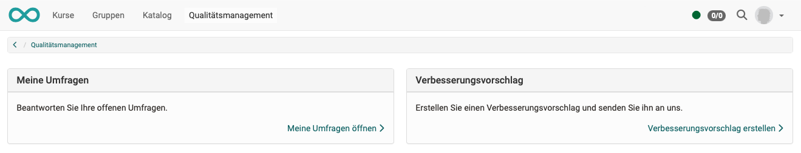
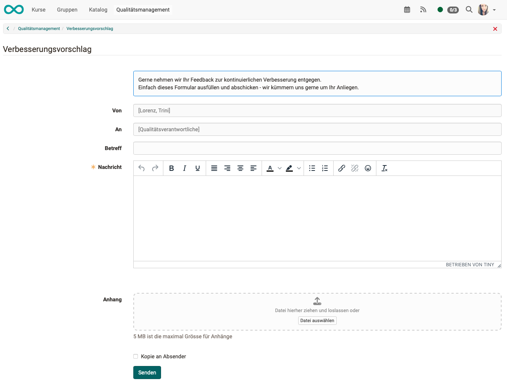

# Quality Management: Suggestion for improvement {: #Quality_Management_Improvement}

If the quality management is switched on, OpenOlat users normally see the entry "Quality management" at the top of the main navigation. Participants find **"My surveys"** and **"Suggestions for improvement"** there, quality managers find further options.

{ class="lightbox" title="Start page of the quality management for participants" }

!!! note "Note"

    System administrators can also deactivate the option for suggestions for improvement in the system administration. Participants then go directly to "My surveys" when they click on "Quality management" in the main navigation (without an intermediate step).

Calling up "Suggestion for improvement" opens a mail window in which text can be entered freely. System administrators set the recipient address (quality officers) in the system administration: 
`Administration > Modules > Quality management`

{ class="lightbox" title="Mail form Suggestion for improvement" }
