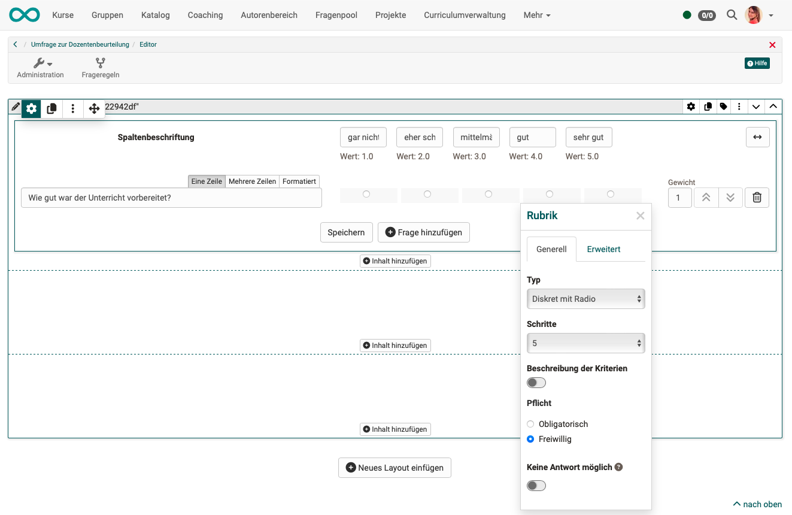

# Qualitätsmanagement: Umfragen {: #Quality_Management_Surveys}

## Womit werden Umfragen erstellt?

Eine Umfrage im Qualitätsmanagement beruht auf einer Formular-Lernressource. Sie binden das Formular nicht in einen Kursbaustein ein (Kursbaustein "Formular", "Umfrage" oder "Bewertung"), sondern direkt im Modul Qualitätsmanagement. Zum konfigurierten Zeitpunkt verschickt OpenOlat von dort einen Link an die Zielgruppe, die Sie ebenfalls im Modul festlegen. Über diesen Link finden die Empfänger:innen die Fragen.

!!! note "Hinweis"

    Bitte unterscheiden Sie:

    * **Lernressource "Formular"** (entspricht einem Blatt Papier mit Fragen)
    * **[Kursbaustein "Formular"](../learningresources/Course_Element_Form.de.md)** 
    In diesen Kursbaustein wird eine Formular-Lernressource eingebunden.
    * **[Kursbaustein "Umfrage"](../learningresources/Course_Element_Survey.de.md)** 
    Auch in diesen Kursbaustein wird eine Formular-Lernressource eingebunden. Im Unterschied zum Kursbaustein "Formular" können die Eintragungen der Teilnehmer:innen in die Formular-Lernressource jedoch anonym gemacht werden. Ausserdem wird ein Report mit Statistiken erzeugt.

## Wo werden die Formulare erstellt?

Die Formular-Lernressourcen für das Qualitätsmanagement erstellen Sie [im Autorenbereich](../area_modules/Authoring.de.md), wie alle anderen Lernressourcen auch.

Auch bei der Erstellung einer Datenerhebung oder eines Datenerhebungsgenerators besteht die Möglichkeit, in den Autorenbereich zu wechseln und dort eine Formular-Lernressource zu erstellen.

## Wer erstellt die Formulare für das Qualitätsmanagement?

Formular-Lernressourcen für das Qualitätsmanagement erstellen alle Autor:innen, nicht nur Personen mit der Rolle Qualitätsmanager:in. Jedes Formular, das eine Autor:in erstellt, lässt sich im Qualitätsmanagement verwenden.

Die Qualitätsmanager:innen werden zwar oft ihre Fragen zur Qualitätskontrolle selbst formulieren (d.h. die Lernressource selbst erstellen), aber sie können auch bereits vorhandene Formular-Lernressourcen anderer Autor:innen in ihre Datenerhebungen einbinden. 
Umgekehrt sind die selbst zur Qualitätskontrolle erstellten Lernressourcen für alle anderen Autor:innen sichtbar. Rechte zur Bearbeitung müssen aber von Besitzer:innen einer Lernressource explizit gewährt werden: 
`Lernressource > Administration > Einstellungen > Tab "Freigabe" > Optionen unter "Autor:innen können ..."`

## Was sollte ein Qualitätsmanagements-Formular enthalten?

Lernressourcen vom Typ "Formular" erstellen Sie im Autorenbereich und bauen sie im [Formulareditor](../learningresources/Form_Editor.de.md) auf. Jedes Element, das der Formulareditor anbietet, lässt sich in das Formular einfügen.

Häufig wird ein Rubrik-Element mit einer Likertskala verwendet. Mit Feldern für Freitext-Eingaben können persönliche Kommentare ermöglicht werden. Wenn keine Felder zur Angabe des Namens angelegt werden, bleibt die Umfrage anonym.

{ class="shadow lightbox" title="Formulareditor einer Formular-Lernressource" }

Wenn ein Formular für Befragungen im Rahmen des Qualitätsmanagements verwendet wird, ist ein einheitliches Formular für alle Teilnehmer:innen und Kurse erforderlich. Die enthaltenen Fragen sollten dem entsprechend allgemein formuliert sein und dem jeweiligen Verwendungszweck angepasst sein, z.B.

* Startbefragung
* Dozierendenbeurteilung
* Zwischenbefragung
* Abschlussbefragung
* Ad-hoc-Befragungen

Es kommen also relativ wenige Standardfragebogen zum Einsatz, und ein Fragebogen entspricht einer Analyse.

## Änderung von Formularen für das Qualitätsmanagement

Einmal verwendete Formular-Lernressourcen können nur noch minimal bearbeitet werden. Abänderungen würden das Ergebnis verfälschen, weil dadurch die neu Befragten andere Fragen beantworten würden als vor der Änderung Befragte.

Soll mit neuen Formular-Lernressourcen gearbeitet werden, kann die bisherige Lernressource im Autorenbereich kopiert und die Kopie abgeändert werden. Anschliessend sollte die Formular-Lernressource für die weiteren Datenerhebungen zu einem günstigen Stichtag ausgetauscht werden.

## Weiterführende Informationen {: #further_information}

[Kursbaustein "Formular" >](../learningresources/Course_Element_Form.de.md) 
[Kursbaustein "Umfrage" >](../learningresources/Course_Element_Survey.de.md) 
[Autorenbereich - Übersicht >](../area_modules/Authoring.de.md) 
[Der Formulareditor >](../learningresources/Form_Editor.de.md) 
[Qualitätsmanagement: Übersicht >](../area_modules/Quality_Management.de.md) 
[Qualitätsmanagement: Datenerhebung >](../area_modules/Quality_Management_Data_Collections.de.md) 
[Qualitätsmanagement: Datenerhebungsgeneratoren >](../area_modules/Quality_Management_Data_Collection_Generators.de.md)

[Zum Seitenanfang ^](#Quality_Management_Surveys)
