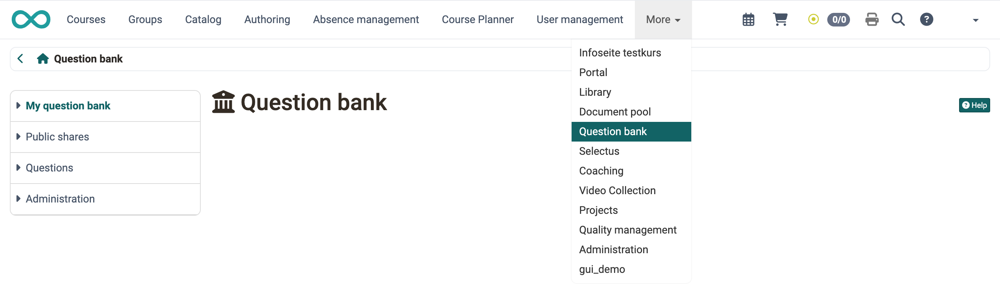
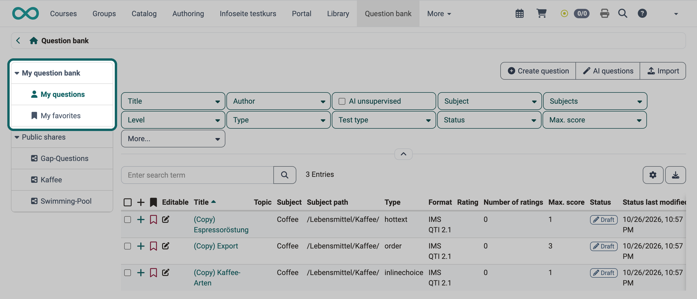
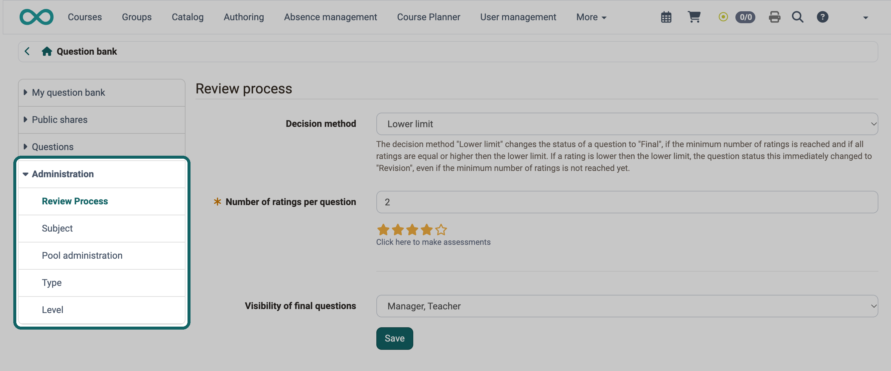

# :o_icon_o_icon_qpool: Question Bank: Overview {: #question_bank}

The collaborative question bank in OpenOlat allows authors to create, save, edit and reuse test questions as independent items in a catalog-like structure.

It is a collection (database) of many individual test questions, called items, usually in QTI format. Each item contains not only the question and the corresponding answers, but also information such as author, creation date and keywords. Characteristic values for item analysis can be added. This chapter explains how you create, edit and manage items in the question bank.

The questions can be shared with other people who also have access to the pool.

The goal is the reuse of questions that have already been created: in tests, as a quiz question in an interactive video or in a course element of the "Page" type, by yourself or, after sharing, by other authors.

You open the question bank in the main navigation. Which roles see it there is set by the system administration on the page [Sites](../../manual_admin/administration/Customizing.md#sites) in the column "Access". With the default setting "Authors only", these are authors, administrators and principals. With the setting "Authors, question bank admins and members", question bank managers who are not also authors see it too. If the main navigation does not fit the width of the screen, the question bank appears in the "More" menu.

{ class="shadow lightbox" title="Start page of the question bank · 2026.10.29" }

## Profile

Name | Question bank
---------|----------
Available since | Release 9.0 (OO-533)

!!! note "Quick Links"

    * [Create questions](Question_Bank_Create_Questions.md)
    * [Import questions](Question_Bank_Import_Questions.md)
    * [Item Detailed View](Item_Detailed_View.md)
    * [Use questions](Question_bank_possible_operations.md)
    * [Search in the question bank](Question_Pool_Search.md)
    * [Sharing options in the question bank](Question_Pool_Sharing_Options.md)
    * [Question Bank Review Process](Question_Bank_Review_Process.md)
    * [Question Bank Administration](Question_Bank_Administration.md)

The menu of the question bank is divided into the areas that the following sections describe. Which of them you see depends on your role and on the configuration.

## My question bank {: #my_question_bank}

Under "My questions" you will find your own questions. You can mark the questions as favorites and group them in lists. Favorites and lists are two ways of sorting and organizing items. Each list you create appears as its own entry under "My question bank" in the menu.

Items that you mark as favorites under "My questions" appear a second time under "My favorites". These are one and the same item: changes under "My favorites" also apply under "My questions".

Questions can also be [created with the help of AI](Question_Bank_Create_Questions.md#create_with_AI), as multiple-choice questions and as essay questions with AI correction.

Individual questions, entire sections or tests can also be exported directly from the [test editor](../learningresources/Test_editor_QTI_2.1.md) to the question bank. To do this, select in the toolbar of the test editor: `Export > Export to pool`. Depending on which level you are on in the menu tree on the left, OpenOlat exports individual questions, individual sections or the entire test to the question bank.

If the [review process](Question_Bank_Review_Process.md) is activated (authors review each other's questions), "My question bank" also shows your subjects. Depending on authorization, the menu also shows the areas "Review" and "Final".

Depending on the configuration, the buttons "Create question", "AI questions" and "Import" are located above the table of your questions. With the search filters and the search field, you narrow down the table, see [Search function in the question bank](Question_Pool_Search.md).

{ class="shadow lightbox" title="My question bank area · 2026.10.26" }

[To the top of the page ^](#question_bank)

## Public shares {: #sharing_options}

Pools and groups for exchanging questions are available in the "Public shares" area. While favorites and lists are used for personal organization, the pools are the collection point for all shared items. Before an item appears in a pool, the owner must share it or import it directly into the corresponding pool.

The icon in front of each entry shows the type of share: :o_icon_o_icon_pool_pool: stands for a pool, :o_icon_o_icon_pool_share: for a group that questions are shared with.

You can share the questions with other people who have access to the pool according to the configuration in the [system administration](../../manual_admin/administration/eAssessment_Question_bank.md).

Administrators can deactivate lists, pools and groups in the system administration, so they may not be visible: `Administration > e-Assessment > Question bank`

[To the top of the page ^](#question_bank)

## Questions {: #questions}

The area "Questions" is shown to administrators and to question bank managers who have been given the right "see all questions and edit the metadata" in the system administration. In contrast to "My questions", the entry "All questions" lists every question of the question bank, including questions of other authors. The entries "Without subject" and "Without author" show questions that lack this information.

[To the top of the page ^](#question_bank)

## Administration {: #administration}

In the "Administration" area, administrators and [question bank managers](Question_Bank_Administration.md#pool_manager) set up the question bank, for example the pools, the subjects and the question types. Question bank managers only see the settings for which the system administration has granted them the right.

{ class="shadow lightbox" title="Administration area of the question bank · 2026.10.29" }

[See the details >](Question_Bank_Administration.md) 
[To the top of the page ^](#question_bank)

## Further information {: #further_information}

[Creating Tests >](../learningresources/Test.md) 
[Test question types >](../learningresources/Test_question_types.md)

[To the top of the page ^](#question_bank)
