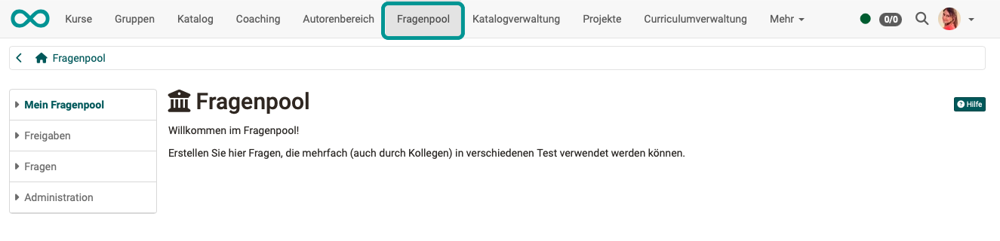
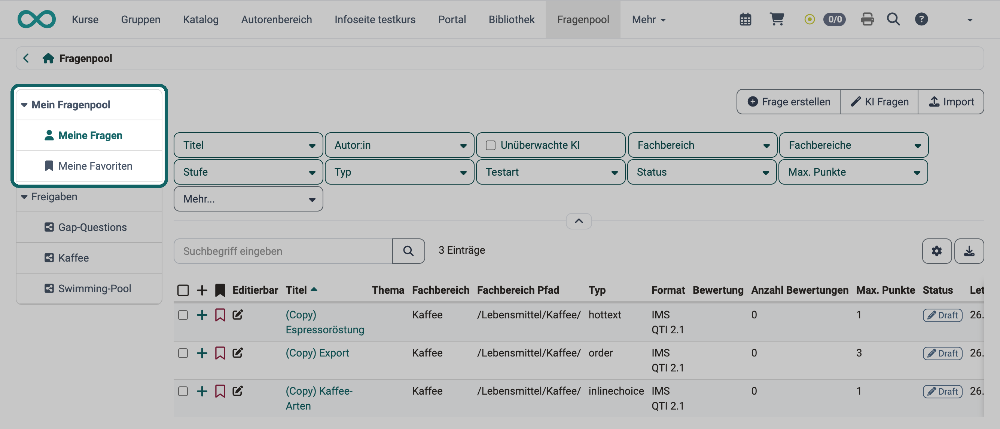
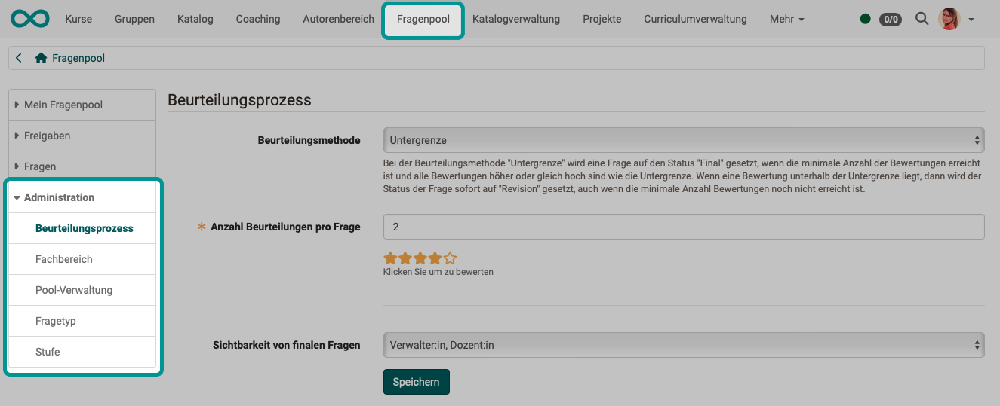

# :o_icon_o_icon_qpool: Fragenpool: Übersicht {: #question_bank}

Der kollaborative Fragenpool in OpenOlat erlaubt Autor:innen, Testfragen als eigenständige Items in einer katalogähnlichen Struktur zu erstellen, zu speichern, zu bearbeiten und weiter zu verwenden.

Er ist eine Sammlung (Datenbank) vieler einzelner Testfragen, sogenannter Items, in der Regel im QTI-Format. Jedes Item enthält nicht nur die Frage samt den dazugehörigen Antworten, sondern auch Angaben wie Autor:in, Erstelldatum und Schlagworte. Kennwerte zur Itemanalyse lassen sich ergänzen. Dieses Kapitel erklärt, wie Sie Items im Fragenpool erstellen, bearbeiten und verwalten.

Die Fragen können mit anderen Personen, die auch Zugriff auf den Pool haben, geteilt werden.

Ziel ist die Wiederverwendung einmal erstellter Fragen: in Tests, als Quizfrage in einem interaktiven Video oder in einem Kursbaustein vom Typ "Seite", durch Sie selbst oder, nach einer Freigabe, durch andere Autor:innen.

Den Fragenpool öffnen Sie in der Hauptnavigation. Welche Rollen ihn dort sehen, legt die System-Administration auf der Seite [Bereiche](../../../manual_admin/administration/Customizing.de.md#sites) in der Spalte "Zugang" fest. In der Standardeinstellung "Autor:innen" sind das Autor:innen, Administrator:innen und Principals. Mit der Einstellung "Autor:innen, Poolmitglieder und Poolverwalter:innen" sehen ihn auch Poolverwalter:innen, die nicht zugleich Autor:innen sind. Passt die Hauptnavigation nicht in die Breite des Bildschirms, steht der Fragenpool im Menü "Mehr".

{ class="shadow lightbox" title="Startseite des Fragenpools" }

## Steckbrief

Name | Fragenpool
---------|----------
Verfügbar seit | Release 9.0 (OO-533)

!!! note "Quick Links"

    * [Fragen erstellen](../Question_Bank_Create_Questions.de.md)
    * [Fragen importieren](../Question_Bank_Import_Questions.de.md)
    * [Detailansicht einer Frage](../Item_Detailed_View.de.md)
    * [Mögliche Aktionen im Fragenpool](../Question_bank_possible_operations.de.md)
    * [Suche im Fragenpool](../Question_Pool_Search.de.md)
    * [Freigabemöglichkeiten im Fragenpool](../Question_Pool_Sharing_Options.de.md)
    * [Beurteilungsprozess für Fragen im Pool](../Question_Bank_Review_Process.de.md)
    * [Fragenpool-Administration](../Question_Bank_Administration.de.md)

Das Menü des Fragenpools gliedert sich in die Bereiche, die die folgenden Abschnitte beschreiben. Welche davon Sie sehen, hängt von Ihrer Rolle und von der Konfiguration ab.

## Mein Fragenpool {: #my_question_bank}

Unter "Meine Fragen" finden Sie Ihre eigenen Fragen. Sie können die Fragen als Favoriten markieren und sie in Listen zusammenfassen. Favoriten und Listen sind zwei Möglichkeiten, Items zu sortieren und zu organisieren. Jede Liste, die Sie anlegen, erscheint unter "Mein Fragenpool" als eigener Eintrag im Menü.

Items, die Sie unter "Meine Fragen" als Favorit markieren, erscheinen unter "Meine Favoriten" ein zweites Mal. Es handelt sich dabei um ein und dasselbe Item: Änderungen unter "Meine Favoriten" gelten auch unter "Meine Fragen".

Fragen können auch [mit Hilfe von KI erstellt](../Question_Bank_Create_Questions.de.md#create_with_AI) werden, als Multiple-Choice-Fragen und als Freitextfragen mit KI-Korrektur.

Einzelne Fragen, ganze Sektionen oder Tests lassen sich auch direkt aus dem [Testeditor](../../learningresources/Test_editor_QTI_2.1.de.md) in den Fragenpool exportieren. Wählen Sie dazu im Testeditor in der Toolbar: `Export > Zum Pool exportieren`. Je nachdem, auf welcher Stufe Sie sich im Menübaum links befinden, exportiert OpenOlat einzelne Fragen, einzelne Sektionen oder den ganzen Test in den Fragenpool.

Ist der [Beurteilungsprozess](../Question_Bank_Review_Process.de.md) aktiviert (Autor:innen beurteilen die erstellten Fragen gegenseitig), zeigt "Mein Fragenpool" zusätzlich Ihre Fachbereiche. Je nach Berechtigung erscheinen im Menü ausserdem die Bereiche "Beurteilung" und "Final".

Je nach Konfiguration stehen über der Tabelle Ihrer Fragen die Buttons "Frage erstellen", "KI Fragen" und "Import". Mit den Suchfiltern und dem Suchfeld grenzen Sie die Tabelle ein, mehr dazu unter [Suchfunktion im Fragenpool](../Question_Pool_Search.de.md).

{ class="shadow lightbox" title="Bereich Mein Fragenpool · 2026.10.26" }

[Zum Seitenanfang ^](#question_bank)

## Freigaben {: #sharing_options}

Im Bereich "Freigaben" stehen Pools und Gruppen zum Austausch von Fragen zur Verfügung. Während Favoriten und Listen der persönlichen Ordnung dienen, sind die Pools die Sammelstelle für alle freigegebenen Items. Bevor ein Item in einem Pool erscheint, muss die Besitzer:in es freigeben oder direkt in den entsprechenden Pool importieren.

Das Symbol vor jedem Eintrag zeigt die Art der Freigabe: :o_icon_o_icon_pool_pool: steht für einen Pool, :o_icon_o_icon_pool_share: für eine Gruppe, für die Fragen freigegeben sind.

Die Fragen können Sie mit anderen Personen teilen, die entsprechend der Konfiguration in der [System-Administration](../../../manual_admin/administration/eAssessment_Question_bank.de.md) Zugriff auf den Pool haben.

Listen, Pools und Gruppen können Administrator:innen in der System-Administration deaktivieren, sie sind deshalb eventuell nicht sichtbar: `Administration > e-Assessment > Fragenpool`

[Zum Seitenanfang ^](#question_bank)

## Fragen {: #questions}

Den Bereich "Fragen" sehen Administrator:innen sowie Poolverwalter:innen, wenn ihnen in der System-Administration das Recht "alle Fragen sehen und die Metadaten bearbeiten" erteilt ist. Im Unterschied zu "Meine Fragen" listet der Eintrag "Alle Fragen" sämtliche Fragen des Fragenpools auf, auch Fragen anderer Autor:innen. Die Einträge "Ohne Fachbereich" und "Ohne Autor:in" zeigen Fragen, denen diese Angaben fehlen.

[Zum Seitenanfang ^](#question_bank)

## Administration {: #administration}

Im Bereich "Administration" richten Administrator:innen und [Poolverwalter:innen](../Question_Bank_Administration.de.md#pool_manager) den Fragenpool ein, etwa die Pools, die Fachbereiche und die Fragetypen. Poolverwalter:innen sehen dort nur die Einstellungen, für die ihnen die System-Administration das Recht erteilt hat.

{ class="shadow lightbox" title="Bereich Administration im Fragenpool" }

[Zu den Details >](../Question_Bank_Administration.de.md) 
[Zum Seitenanfang ^](#question_bank)

## Weiterführende Informationen {: #further_information}

[Tests erstellen >](../../learningresources/Test.de.md) 
[Test Fragetypen >](../../learningresources/Test_question_types.de.md)

[Zum Seitenanfang ^](#question_bank)