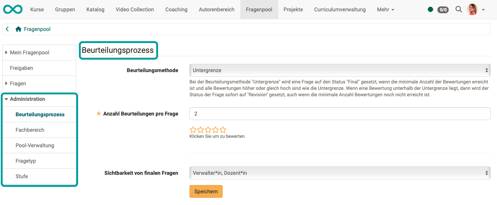
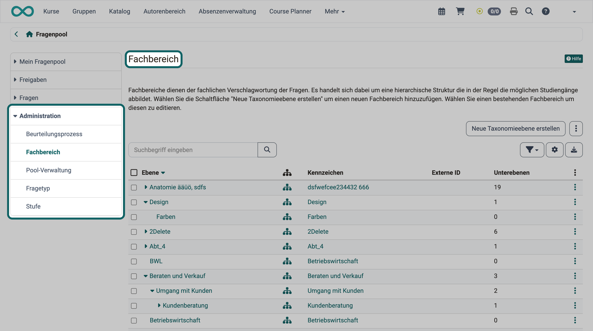
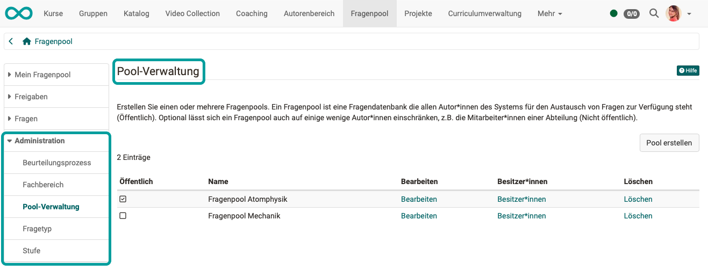
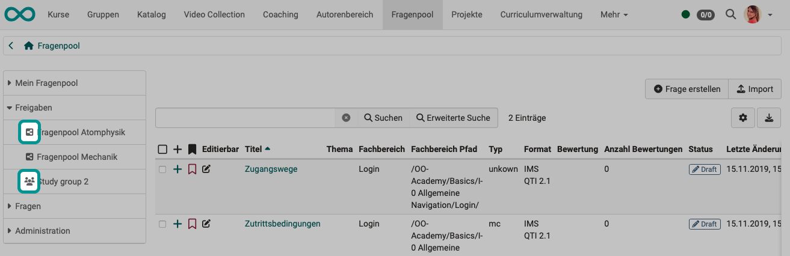
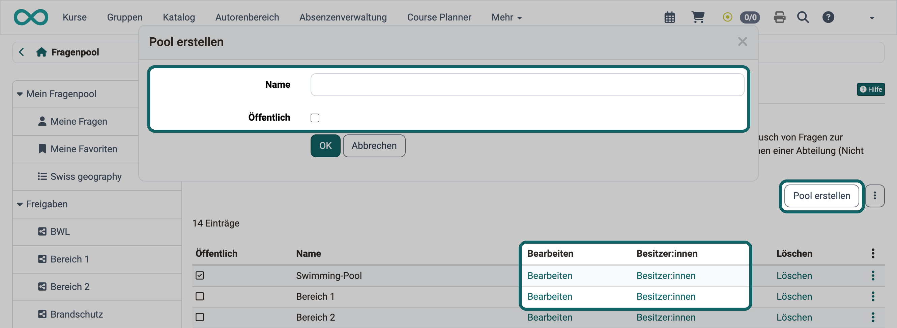
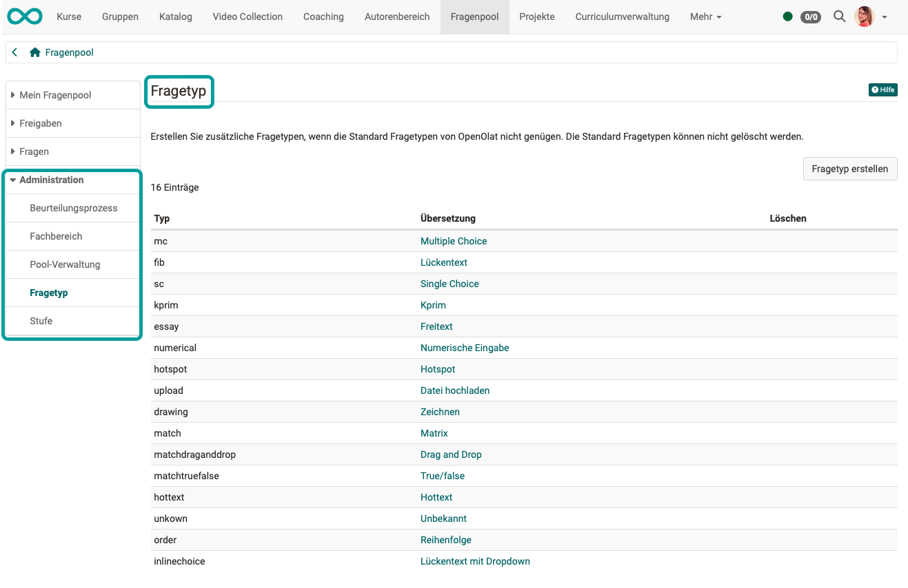
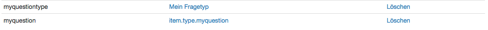
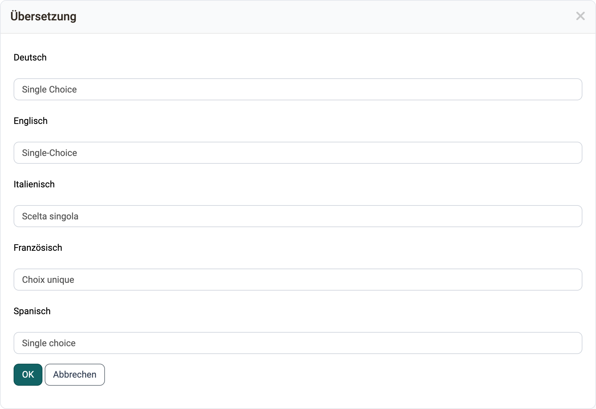
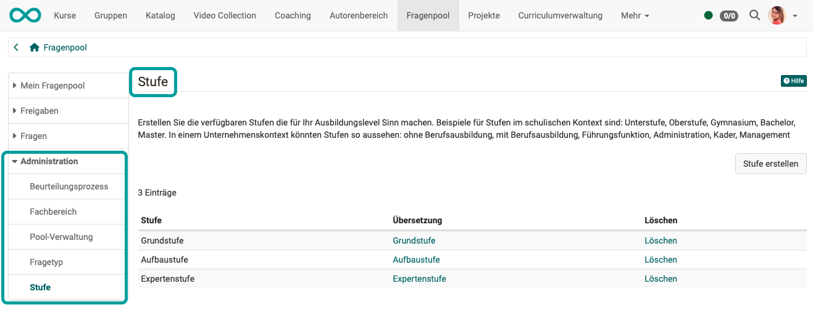

# Fragenpool: Administration {: #question_bank_administration}

## Konfiguration durch Poolverwalter:innen {: #pool_manager}

Poolverwalter:in ist eine [Rolle](../basic_concepts/Roles_Rights.de.md), die Administrator:innen oder Rollenverwalter:innen OpenOlat-Benutzer:innen zuweisen.

Poolverwalter:innen haben das Recht, organisatorische Aspekte des Fragenpools zu ändern. Sie haben jedoch keinen Einfluss auf den Inhalt des Fragenpools und der einzelnen Pools.

Die Administration des Fragenpools umfasst fünf Bereiche zur Organisation des Fragenpools. Administrator:innen sehen alle fünf. Poolverwalter:innen sehen die Bereiche, für die ihnen die System-Administration das Recht erteilt hat, im Abschnitt "Rechte Poolverwalter:in" unter: `Administration > e-Assessment > Fragenpool`. Mehr dazu unter [e-Assessment Administration: Fragenpool](../../manual_admin/administration/eAssessment_Question_bank.de.md).

  * Beurteilungsprozess
  * Fachbereich
  * Pool-Verwaltung
  * Fragetyp
  * Stufe

---

### Beurteilungsprozess [:octicons-tag-16:{ title="ab Release 12.3 (OO-3111)" }](https://track.frentix.com/issue/OO-3111){:target="_blank"} {: #assessment_process}

{ class="shadow lightbox" title="Seite Beurteilungsprozess im Bereich Administration" }

Hier legen Sie fest, wann eine Frage den Status "Final" erhält, falls für sie ein Beurteilungsprozess gestartet wurde. Liegt bei der Beurteilungsmethode "Untergrenze" eine Bewertung unterhalb der hier angegebenen Untergrenze, setzt OpenOlat die Frage auf "Revision".

[Zum Seitenanfang ^](#question_bank_administration)

---

### Fachbereich {: #subject}

{ class="shadow lightbox" title="Seite Fachbereich im Bereich Administration · 2026.11.02" }

Mit Fachbereichen verschlagworten Sie Fragen (Items) nach ihrem Fach. OpenOlat zeigt die Fachbereiche in einer hierarchischen Struktur. Diese bildet z.B. in Ausbildungsorganisationen mögliche Studiengänge ab, in der Privatwirtschaft eventuell Organisationseinheiten.

Hinter den Fachbereichen steht eine [Taxonomie](../../manual_admin/administration/Modules_Taxonomy.de.md). Neue Fachbereiche fügen Sie mit der Schaltfläche "Neue Taxonomieebene erstellen" oder mit "Taxonomieebenen importieren" hinzu. Bestehende Fachbereiche bearbeiten Sie ebenfalls hier.

Damit eine Frage in den Beurteilungsprozess gegeben werden kann, muss ein Fachbereich angegeben werden. Die Beurteilung übernehmen Fachexpert:innen, die in diesem Bereich Kompetenz besitzen. Weil auch die Expert:innen einem Fachbereich zugeordnet sind, lassen sich Frage und Expert:in so einander zuordnen.

[Zum Seitenanfang ^](#question_bank_administration)

---

### Pool-Verwaltung {: #pool}

{ class="shadow lightbox" title="Seite Pool-Verwaltung im Bereich Administration" }

Ein Pool ist eine Sammlung von Fragen im Fragenpool, über die Autor:innen Testfragen untereinander austauschen.

Neue Pools fügen Sie mit der Schaltfläche "Pool erstellen" hinzu. Bestehende Pools bearbeiten oder löschen Sie in der Tabelle der Pools.

Pools können entweder öffentlich sein (und stehen damit automatisch allen Autor:innen zur Verfügung) oder nicht öffentlich. Bei einem nicht öffentlichen Pool beschränken Sie den Zugriff auf ausgesuchte Personen, zum Beispiel auf die Mitarbeiter:innen einer Abteilung.

{ class="aside-right lightbox" }

Diese Personen fügen Sie dem Pool über den Link "Besitzer:innen" hinzu. Pools erscheinen im Bereich "Freigaben" mit dem nebenstehenden Icon.

{ class="aside-right lightbox" }

Pools erstellen nur Administrator:innen und Poolverwalter:innen mit dem Recht für die Pool-Verwaltung. Für einen selbst gewählten Personenkreis geben Autor:innen ihre Fragen stattdessen für eine OpenOlat-Gruppe frei. Solche Gruppenfreigaben erscheinen mit dem nebenstehenden Icon.

{ class="shadow lightbox" title="Bereich Freigaben im Fragenpool" }

[Zum Seitenanfang ^](#question_bank_administration)

**Pool erstellen**

{ class="shadow lightbox" title="Dialog Pool erstellen in der Pool-Verwaltung · 2026.11.02" }

* **"Pool erstellen"**: Die Schaltfläche öffnet den Dialog "Pool erstellen".
* **"Name"**: Geben Sie den Namen des neuen Pools ein.
* **"Öffentlich"**: Legen Sie fest, ob der Pool öffentlich (für alle Autor:innen sichtbar) oder privat sein soll. Bei einem privaten Pool legen Sie unter "Besitzer:innen" fest, welche Benutzer:innen Zugriff auf den Pool erhalten.
* **"Bearbeiten"**: Für bestehende Pools ändern Sie hier den Namen und die Sichtbarkeit.
* **"Besitzer:innen"**: Fügen Sie Besitzer:innen hinzu oder entfernen Sie diese.

[Zum Seitenanfang ^](#question_bank_administration)

---

### Fragetyp {: #type}

{ class="shadow lightbox" title="Seite Fragetyp im Bereich Administration" }

OpenOlat bietet für Tests verschiedene [Fragetypen](../learningresources/Test_question_types.de.md). Fragen dieser Typen erstellen Sie im Testeditor der Lernressource Test oder im Fragenpool. Genügen Ihnen die Standard-Fragetypen nicht, erstellen Sie hier zusätzliche Fragetypen. Die Standard-Fragetypen lassen sich nicht löschen.

Im Testeditor und im Fragenpool erstellen Sie nur Fragen der Standard-Fragetypen. In der Detailansicht einer Frage zeigt das Metadatum "Typ" in der Kategorie "Itemanalyse" den Fragetyp an. Ändern lässt er sich dort nicht.

Übersetzen Sie einen neu erstellten Fragetyp in jede Sprache, die in Ihrer OpenOlat-Instanz eingeschaltet ist. So sehen zum Beispiel deutsch- und englischsprachige Benutzer:innen den Typennamen in ihrer Sprache und nicht den Übersetzungsschlüssel.

**Fragetyp erstellen**

Einen neuen Fragetyp erstellen Sie mit der Schaltfläche "Fragetyp erstellen". Er erscheint zuunterst in der Tabelle der Typen, in der Spalte "Übersetzung" nach diesem Muster:

    item.type.[Typenname]

Das ist der Übersetzungsschlüssel. Über ihn übersetzt OpenOlat den Typennamen in die Sprachen Ihrer OpenOlat-Instanz.

{ class="shadow lightbox" title="Tabelle der Fragetypen" }

Klicken Sie in der Tabellenspalte "Übersetzung" auf die entsprechende Zeile. Es öffnet sich der Dialog "Übersetzung":

{ class="shadow lightbox" title="Dialog Übersetzung eines Fragetyps · 2026.11.02" }

Der Dialog zeigt ein Feld für jede Sprache, die in Ihrer OpenOlat-Instanz eingeschaltet ist. Tragen Sie in jedem Feld den Typennamen in dieser Sprache ein und klicken Sie auf "OK". OpenOlat zeigt den Namen ab nun in der Tabelle der Typen, im Filter "Typ" der Fragenlisten und in der Detailansicht einer Frage unter "Typ" an.

[Zum Seitenanfang ^](#question_bank_administration)

---

### Stufe {: #level}

{ class="shadow lightbox" title="Seite Stufe im Bereich Administration" }

Mit Stufen ordnen Sie Fragen zusätzlich ein, vergleichbar mit einer Schwierigkeitsstufe. Hier erstellen Sie die Stufen, die den Ausbildungsleveln in Ihrem Kontext entsprechen.

Die Stufe einer Frage weisen Sie in der [Detailansicht](Item_Detailed_View.de.md#metadata_general) im Metadatum "Stufe" unter "Allgemein" zu. So ordnen Sie zum Beispiel die Schwierigkeit einer Frage einer Stufe zu.

Beispiele für Stufen im schulischen Kontext sind:

* Unterstufe
* Oberstufe
* Gymnasium
* Bachelor
* Master 

In einem Unternehmenskontext könnten Stufen so aussehen:

* ohne Berufsausbildung
* mit Berufsausbildung
* Führungsfunktion
* Administration
* Kader
* Management

Neue Stufen erstellen Sie mit dem Button "Stufe erstellen" rechts oben.

Wie Fragetypen übersetzen Sie auch Stufen in jede Sprache, die in Ihrer OpenOlat-Instanz eingeschaltet ist. Klicken Sie dazu in der Spalte "Übersetzung" auf die Zeile der Stufe und gehen Sie vor wie unter "Fragetyp erstellen" beschrieben.

[Zum Seitenanfang ^](#question_bank_administration)

## Weiterführende Informationen {: #further_information}

**Auf dieser Seite erwähnt** 
[Rollen und Rechte: Übersicht >](../basic_concepts/Roles_Rights.de.md) 
[e-Assessment Administration: Fragenpool >](../../manual_admin/administration/eAssessment_Question_bank.de.md) 
[Modul Taxonomie >](../../manual_admin/administration/Modules_Taxonomy.de.md) 
[Test Fragetypen >](../learningresources/Test_question_types.de.md) 
[Fragenpool: Detailansicht einer Frage und Metadaten >](Item_Detailed_View.de.md)

**Weiterführend** 
[Fragenpool: Beurteilungsprozess >](Question_Bank_Review_Process.de.md) 
[Fragenpool: Freigabemöglichkeiten >](Question_Pool_Sharing_Options.de.md)

[Zum Seitenanfang ^](#question_bank_administration)
