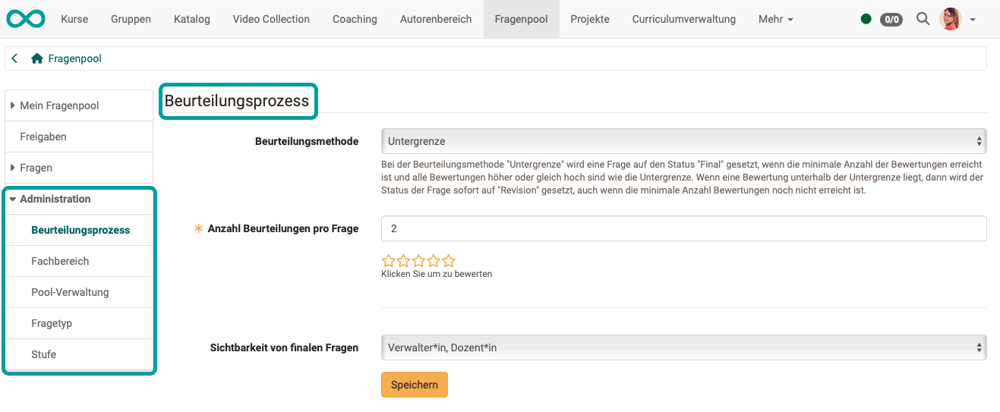
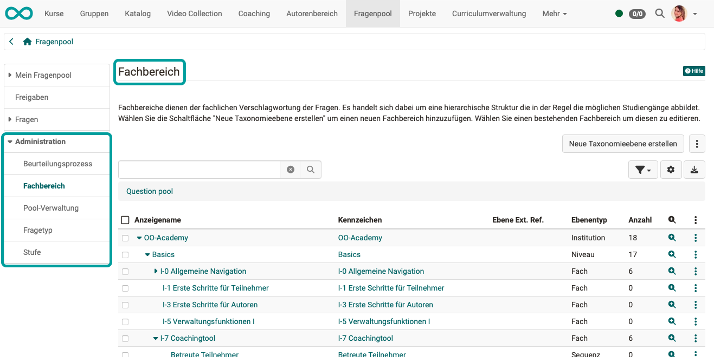
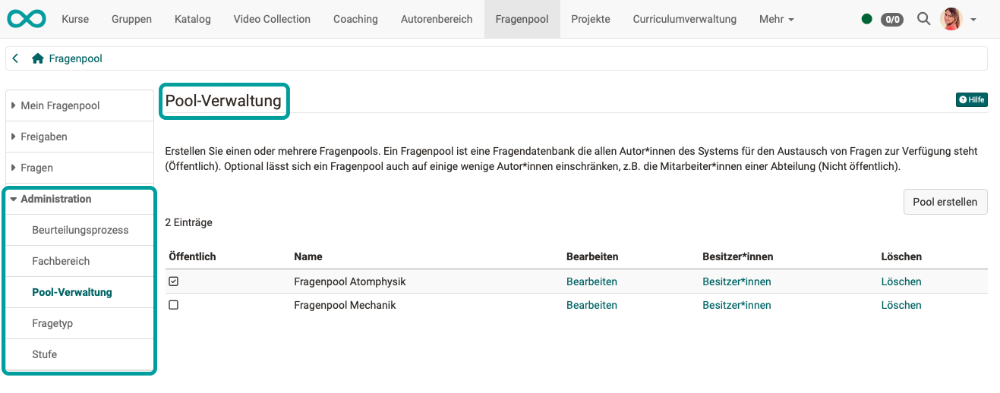
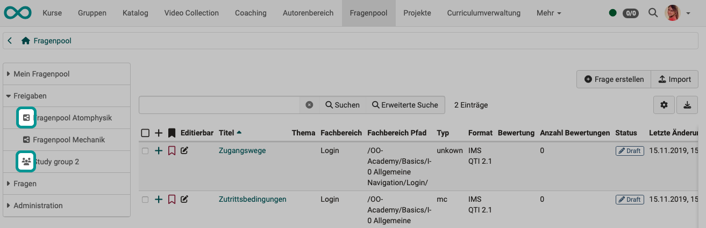
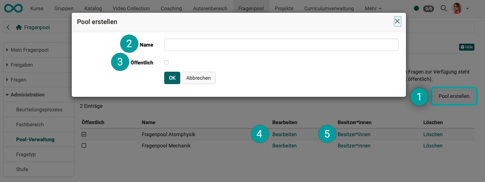
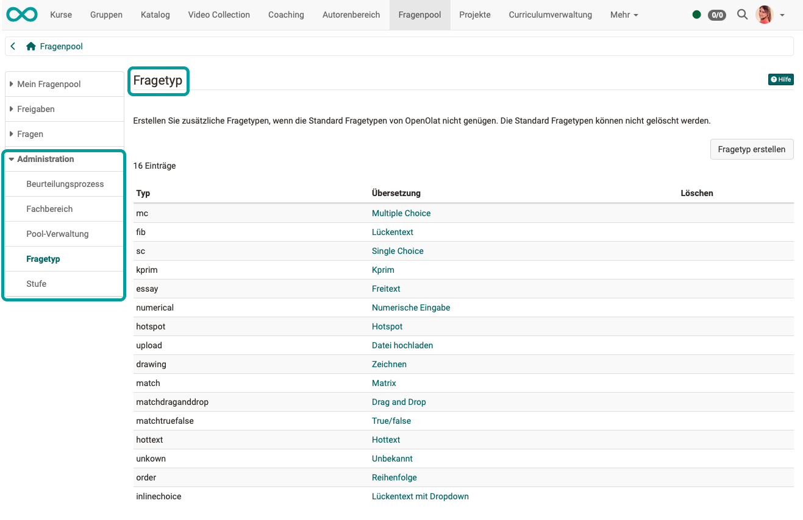
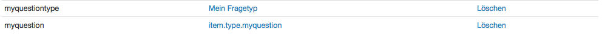
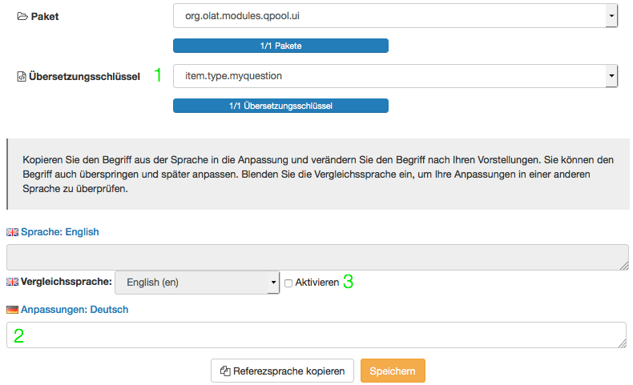
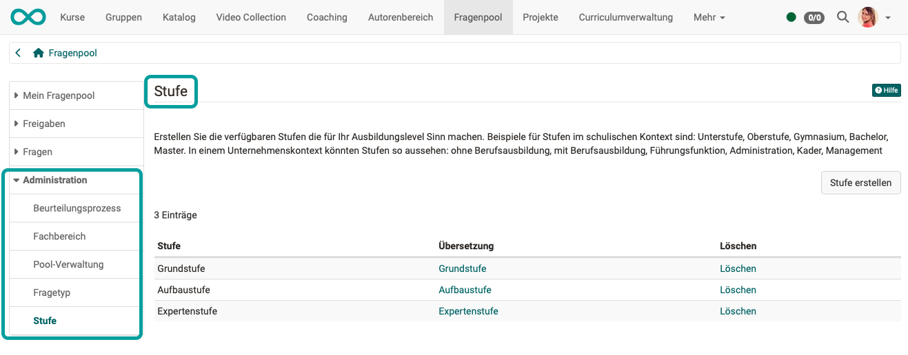

# Fragenpool: Administration {: #question_bank_administration}

## Konfiguration durch Poolverwalter:innen {: #pool_manager}

Poolverwalter:in ist eine [Rolle](../basic_concepts/Roles_Rights.de.md), die Administrator:innen oder Rollenverwalter:innen OpenOlat-Benutzer:innen zuweisen.

Poolverwalter:innen haben das Recht, organisatorische Aspekte des Fragenpools zu ändern. Sie haben jedoch keinen Einfluss auf den Inhalt des Fragenpools und der einzelnen Pools.

Die Administration des Fragenpools umfasst fünf Bereiche zur Organisation des Fragenpools. Administrator:innen sehen alle fünf. Poolverwalter:innen sehen die Bereiche, für die ihnen die System-Administration das Recht erteilt hat, im Abschnitt "Rechte Poolverwalter:in" unter: `Administration > e-Assessment > Fragenpool`. Mehr dazu unter [e-Assessment Administration: Fragenpool](../../manual_admin/administration/eAssessment_Question_bank.de.md).

  * Beurteilungsprozess
  * Fachbereich
  * Pool-Verwaltung
  * Fragetyp
  * Stufe

---

### Beurteilungsprozess [:octicons-tag-16:{ title="ab Release 12.3 (OO-3111)" }](https://track.frentix.com/issue/OO-3111){:target="_blank"} {: #assessment_process}

{ class="shadow lightbox" title="Seite Beurteilungsprozess im Bereich Administration" }

Hier legen Sie fest, wann eine Frage den Status "Final" erhält, falls für sie ein Beurteilungsprozess gestartet wurde. Liegt bei der Beurteilungsmethode "Untergrenze" eine Bewertung unterhalb der hier angegebenen Untergrenze, setzt OpenOlat die Frage auf "Revision".

[Zum Seitenanfang ^](#question_bank_administration)

---

### Fachbereich {: #subject}

{ class="shadow lightbox" title="Seite Fachbereich im Bereich Administration" }

Fachbereiche dienen der fachlichen Verschlagwortung der Fragen (Items) und werden in einer hierarchischen Struktur dargestellt. Diese bildet z.B. in Ausbildungsorganisationen mögliche Studiengänge ab, in der Privatwirtschaft eventuell Organisationseinheiten.

Hinter den Fachbereichen steht eine [Taxonomie](../../manual_admin/administration/Modules_Taxonomy.de.md). Neue Fachbereiche werden über die Schaltfläche "Neue Taxonomieebene erstellen" oder über "Taxonomieebenen importieren" hinzugefügt. Bereits bestehende Fachbereiche können auch bearbeitet werden.

Damit eine Frage in den Beurteilungsprozess gegeben werden kann, muss ein Fachbereich angegeben werden. Die Beurteilung übernehmen Fachexpert:innen, die in diesem Bereich Kompetenz besitzen. Weil auch die Expert:innen einem Fachbereich zugeordnet sind, lassen sich Frage und Expert:in so einander zuordnen.

[Zum Seitenanfang ^](#question_bank_administration)

---

### Pool-Verwaltung {: #pool}

{ class="shadow lightbox" title="Seite Pool-Verwaltung im Bereich Administration" }

Ein Pool (engl. Sammelbecken, Reservoir etc.) ist eine Fragendatenbank, die Autor:innen für den Austausch von Testfragen zur Verfügung steht.

Neue Pools werden über die Schaltfläche "Pool erstellen" hinzugefügt. Bereits bestehende Pools können bearbeitet oder gelöscht werden.

Fragenpools können entweder öffentlich sein (und stehen damit automatisch allen Autor:innen zur Verfügung) oder nicht öffentlich. Bei einem nicht öffentlichen Pool beschränken Sie den Zugriff auf ausgesuchte Personen, zum Beispiel auf die Mitarbeiter:innen einer Abteilung.

{ class="aside-right lightbox" }

Diese Personen fügen Sie dem Pool über den Link "Besitzer:innen" hinzu. Pools erscheinen im Bereich "Freigaben" mit dem nebenstehenden Icon.

{ class="aside-right lightbox" }

Pools erstellen nur Administrator:innen und Poolverwalter:innen mit dem Recht für die Pool-Verwaltung. Für einen selbst gewählten Personenkreis geben Autor:innen ihre Fragen stattdessen für eine OpenOlat-Gruppe frei. Solche Gruppenfreigaben erscheinen mit dem nebenstehenden Icon.

{ class="shadow lightbox" title="Bereich Freigaben im Fragenpool" }

[Zum Seitenanfang ^](#question_bank_administration)

**Pool erstellen**

{ class="shadow lightbox" title="Dialog Pool erstellen in der Pool-Verwaltung" }

  1. **"Pool erstellen"**: Die Schaltfläche öffnet das Formular "Pool erstellen".
  2. **"Name"**: Geben Sie den Namen des neuen Pools ein.
  3. **"Öffentlich"**: Legen Sie fest, ob der Pool öffentlich (für alle Autor:innen sichtbar) oder privat sein soll. Bei einem privaten Pool legen Sie unter "Besitzer:innen" fest, welche Benutzer:innen Zugriff auf den Pool erhalten.
  4. **"Bearbeiten"**: Für bestehende Pools ändern Sie hier den Namen und die Sichtbarkeit.
  5. **"Besitzer:innen"**: Fügen Sie Besitzer:innen hinzu oder entfernen Sie diese.

[Zum Seitenanfang ^](#question_bank_administration)

---

### Fragetyp {: #type}

{ class="shadow lightbox" title="Seite Fragetyp im Bereich Administration" }

OpenOlat verfügt über diverse Test [Fragetypen](../learningresources/Test_question_types.de.md), die entweder im Testeditor der Lernressource Test oder im Itemeditor des Fragenpools erstellt werden können. Erstellen Sie zusätzliche Fragetypen, wenn die Standard-Fragetypen von OpenOlat nicht genügen. Die Standard-Fragetypen können nicht gelöscht werden.

Ein vom Standard abweichender Fragetyp kann nicht über den Editor erstellt werden, sondern muss einer bestehenden Frage eines Standard-Typs in der Detailansicht mit Hilfe des Metadatums "Typ" in der Kategorie "Itemanalyse" zugewiesen werden. Eine in diesem Stil geänderte Frage wird nach wie vor dem ursprünglichen Fragetyp entsprechen, allerdings wird nun im Fragenpool in der Spalte "Typ" der neue Typ angezeigt.

Neu erstellte Fragetypen müssen pro verfügbarer Sprache übersetzt werden, damit sowohl z.B. deutsch- als auch englischsprachige Benutzer:innen die korrekten Begriffe angezeigt bekommen (und nicht den hier sichtbaren Übersetzungsschlüssel).

**Fragetyp erstellen**

Nachdem Sie mit Hilfe der Schaltfläche "Fragetyp erstellen" einen neuen Fragetyp erstellt haben, erscheint dieser zuunterst in der Tabelle der Typen, in der Spalte "Übersetzung". Dazu wird stets folgende Namenskonvention angewandt:

    item.type.[Typenname]

Dies ist der sogenannte Übersetzungsschlüssel, mit dem der Typenname in die verschiedenen, auf Ihrer OpenOlat-Instanz verfügbaren Sprachen übersetzt wird.

{ class="shadow lightbox" title="Tabelle der Fragetypen" }

Klicken Sie in der Tabellenspalte "Übersetzung" auf die entsprechende Zeile. Es öffnet sich das folgende Formular:

{ class="shadow lightbox" title="Formular zum Übersetzen eines Fragetyps" }

  1. **"Übersetzungsschlüssel"**: Im Dropdown-Menü sehen Sie den Typennamen, wie er noch in der Tabelle erscheint. Hier und im darüber liegenden Menü "Paket" können Sie nichts ändern.
  2. **"Anpassungen: Deutsch"**: Tragen Sie hier den gewünschten Typennamen ein. OpenOlat zeigt ihn ab nun in der Tabelle der Typen, in der Typenauswahl der Detailansicht und bei bereits bestehenden Fragen unter "Typ" an.
  3. **"Vergleichssprache"**: Aktivieren Sie die Vergleichssprache und wählen Sie die Sprache im Dropdown-Menü aus, um die Begriffe zu vergleichen und zu überprüfen.

Wiederholen Sie diese Schritte für jede in Ihrer Instanz verfügbare Sprache.

[Zum Seitenanfang ^](#question_bank_administration)

---

### Stufe {: #level}

{ class="shadow lightbox" title="Seite Stufe im Bereich Administration" }

Stufen stellen eine weitere Kategorisierungsmöglichkeit dar und können z.B. mit einer Schwierigkeitsstufe verglichen werden. Hier erstellen Sie Stufen, die in Ihrem Kontext Ihren verfügbaren Ausbildungsleveln entsprechen.

Die Stufe eines Frageitems kann in der [Detailansicht](Item_Detailed_View.de.md#metadata_general) als Metadatum "Stufe" unter "Allgemein" zugewiesen werden. So kann z.B. die Schwierigkeit einer Frage einer Stufe zugeordnet werden.

Beispiele für Stufen im schulischen Kontext sind:

* Unterstufe
* Oberstufe
* Gymnasium
* Bachelor
* Master 

In einem Unternehmenskontext könnten Stufen so aussehen:

* ohne Berufsausbildung
* mit Berufsausbildung
* Führungsfunktion
* Administration
* Kader
* Management

Neue Stufen erstellen Sie mit dem Button "Stufe erstellen" rechts oben.

Wie Fragetypen müssen auch Stufen pro verfügbarer Sprache übersetzt werden, damit sowohl z.B. deutsch- als auch englischsprachige Benutzer:innen die korrekten Begriffe angezeigt bekommen. Gehen Sie dazu vor, wie unter "Fragetyp erstellen" beschrieben.

[Zum Seitenanfang ^](#question_bank_administration)

## Weiterführende Informationen {: #further_information}

**Auf dieser Seite erwähnt** 
[Rollen und Rechte: Übersicht >](../basic_concepts/Roles_Rights.de.md) 
[e-Assessment Administration: Fragenpool >](../../manual_admin/administration/eAssessment_Question_bank.de.md) 
[Modul Taxonomie >](../../manual_admin/administration/Modules_Taxonomy.de.md) 
[Test Fragetypen >](../learningresources/Test_question_types.de.md) 
[Fragenpool: Detailansicht einer Frage >](Item_Detailed_View.de.md)

**Weiterführend** 
[Fragenpool: Beurteilungsprozess >](Question_Bank_Review_Process.de.md) 
[Fragenpool: Freigabemöglichkeiten >](Question_Pool_Sharing_Options.de.md)

[Zum Seitenanfang ^](#question_bank_administration)
