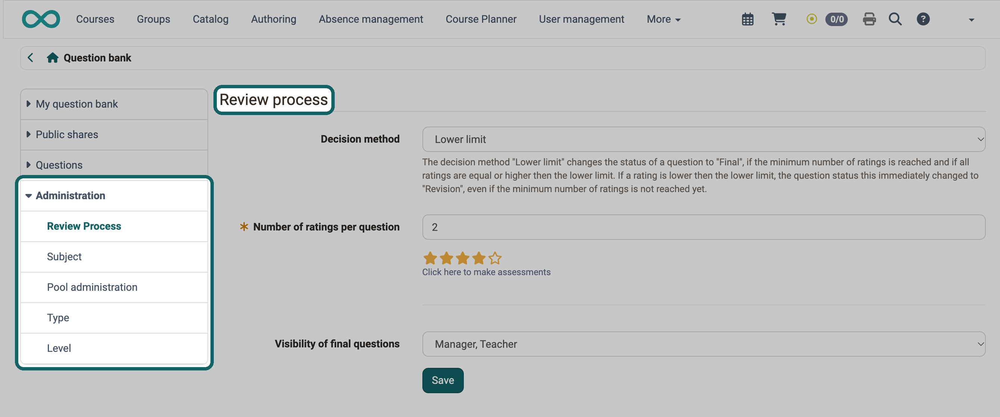
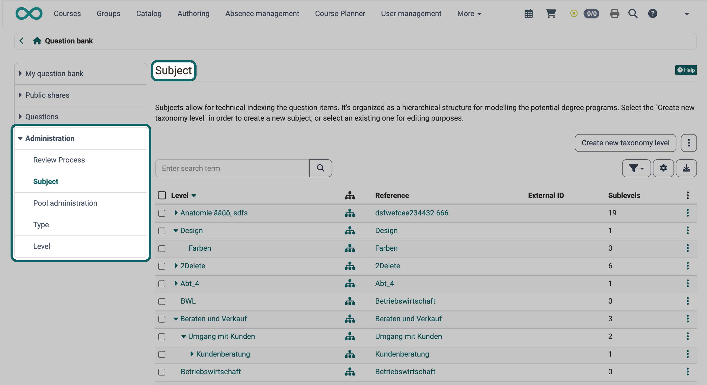
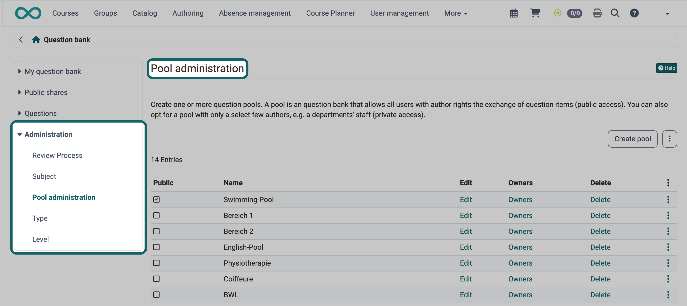
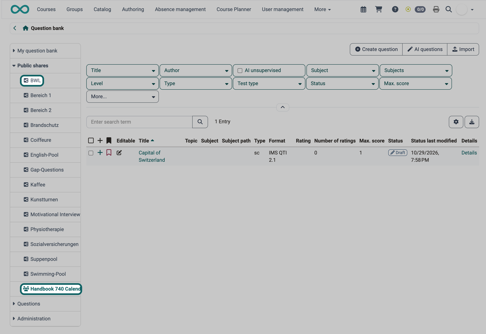
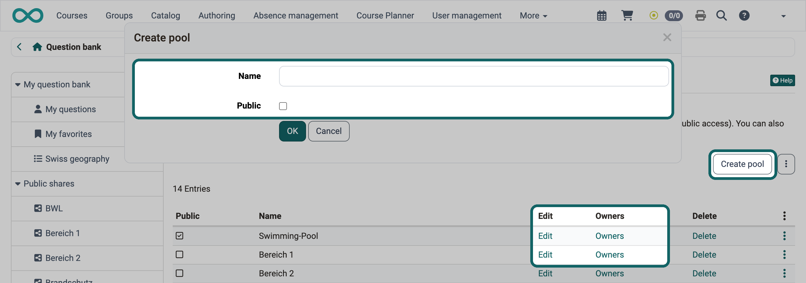
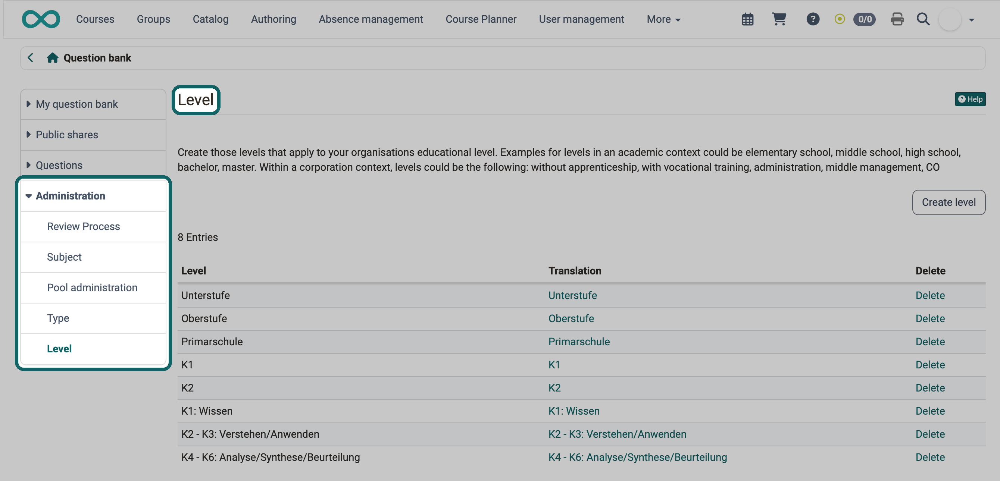

# Question Bank: Administration {: #question_bank_administration}

## Configuration by question bank managers {: #pool_manager}

Question bank manager is a [role](../basic_concepts/Roles_Rights/index.md) that administrators or roles managers assign to OpenOlat users.

Question bank managers have the right to change organizational aspects of the question bank. However, they have no influence on the content of the question bank or of the individual pools.

The administration of the question bank comprises five areas for organizing the question bank. Administrators see all five. Question bank managers see the areas for which the system administration has granted them the right, in the section "Rights question bank manager" under: `Administration > e-Assessment > Question bank`. More on this under [e-Assessment Administration: Question bank](../../manual_admin/administration/eAssessment_Question_bank.md).

  * Review Process
  * Subject
  * Pool administration
  * Type
  * Level

---

### Review Process [:octicons-tag-16:{ title="from Release 12.3 (OO-3111)" }](https://track.frentix.com/issue/OO-3111){:target="_blank"} {: #assessment_process}

{ class="shadow lightbox" title="Review Process page in the Administration area · 2026.10.29" }

Here you define when a question receives the status "Final" if a review process has been started for it. If, with the decision method "Lower limit", a rating is below the lower limit specified here, OpenOlat sets the question to "Revision".

[To the top of the page ^](#question_bank_administration)

---

### Subject {: #subject}

{ class="shadow lightbox" title="Subject page in the Administration area · 2026.10.29" }

With subjects you tag questions (items) by their subject. OpenOlat shows the subjects in a hierarchical structure. In educational organizations, for example, this represents possible courses of study, in the private sector possibly organizational units.

A [taxonomy](../../manual_admin/administration/Modules_Taxonomy.md) is behind the subjects. You add new subjects with the button "Create new taxonomy level" or with "Import taxonomy levels". You also edit existing subjects here.

In order for a question to be submitted to the review process, a subject must be specified. Subject experts who have expertise in this area take on the review. Because the experts are also assigned to a subject, question and expert can be matched in this way.

[To the top of the page ^](#question_bank_administration)

---

### Pool administration {: #pool}

{ class="shadow lightbox" title="Pool administration page in the Administration area · 2026.10.29" }

A pool is a collection of questions in the question bank through which authors exchange test questions with each other.

You add new pools with the button "Create pool". You edit or delete existing pools in the table of pools.

Pools can either be public (and are therefore automatically available to all authors) or non-public. With a non-public pool you restrict access to selected persons, for example to the employees of a department.

{ class="aside-right lightbox" }

You add these persons to the pool via the "Owners" link. Pools appear in the "Public shares" area with the adjacent icon.

{ class="aside-right lightbox" }

Only administrators and question bank managers with the right for the pool administration create pools. For a group of people they choose themselves, authors instead share their questions with an OpenOlat group. Such group shares appear with the adjacent icon.

{ class="shadow lightbox" title="Public shares area in the question bank · 2026.10.29" }

[To the top of the page ^](#question_bank_administration)

**Create pool**

{ class="shadow lightbox" title="Dialog Create pool in the pool administration · 2026.11.02" }

* **"Create pool"**: The button opens the dialog "Create pool".
* **"Name"**: Enter the name of the new pool.
* **"Public"**: Define whether the pool should be public (visible to all authors) or private. With a private pool you define under "Owners" which users get access to the pool.
* **"Edit"**: For existing pools you change the name and the visibility here.
* **"Owners"**: Add or remove owners.

[To the top of the page ^](#question_bank_administration)

---

### Type {: #type}

The question type indicates how a question is built and how participants answer it, for example Single Choice, Gap text or Hotspot. The page [Test question types](../learningresources/Test_question_types.md) describes which question types OpenOlat offers.

When you create a question, you choose its question type. When you edit or import the question, OpenOlat determines the question type itself from the way the question is built. You cannot change it. The [detailed view](Item_Detailed_View.md#metadata_item_analysis) of a question shows it in the metadata "Type" in the section "Item analysis". In the question lists, you find the questions of a type with the filter "Type".

**Question type in the import**

When you import a ZIP file or a test from Authoring, OpenOlat recognizes the question type of each question from its content. You do not have to specify anything.

In the [Excel import](Question_Bank_Import_Questions.md#excelimport), the row "Type" sets the question type. Without this row and one of the ten values from the template, OpenOlat does not import the question as a separate question. Therefore check before the import that each question starts with the row "Type". The step "Overview" of the import shows which questions OpenOlat recognized with which question type.

[To the top of the page ^](#question_bank_administration)

---

### Level {: #level}

{ class="shadow lightbox" title="Level page in the Administration area · 2026.10.29" }

With levels you categorize questions further, comparable to a difficulty level. Here you create the levels that correspond to the training levels in your context.

You assign the level of a question in the [detailed view](Item_Detailed_View.md#metadata_general) with the metadata "Level" under "General". For example, you assign the difficulty of a question to a level.

Examples of levels in a school context are:

* Lower secondary school
* Upper secondary school
* Grammar school
* Bachelor
* Master 

In a corporate context, levels could look like this:

* without vocational training
* with vocational training
* leadership function
* administration
* executive staff
* management

You create new levels with the button "Create level" at the top right.

Translate each level into each language that is enabled in your OpenOlat instance. To do this, click on the row of the level in the column "Translation". The dialog "Translation" shows one field for each enabled language. Enter the name of the level in each language and click "OK".

[To the top of the page ^](#question_bank_administration)

## Further information {: #further_information}

**Mentioned on this page** 
[Roles and Rights: Overview >](../basic_concepts/Roles_Rights/index.md) 
[e-Assessment Administration: Question bank >](../../manual_admin/administration/eAssessment_Question_bank.md) 
[Module Taxonomy >](../../manual_admin/administration/Modules_Taxonomy.md) 
[Test question types >](../learningresources/Test_question_types.md) 
[Question bank: Details of a question and metadata >](Item_Detailed_View.md) 
[Question Bank: Import Questions >](Question_Bank_Import_Questions.md)

**Further reading** 
[Question Bank Review Process >](Question_Bank_Review_Process.md) 
[Question Bank: Sharing Options >](Question_Pool_Sharing_Options.md)

[To the top of the page ^](#question_bank_administration)
