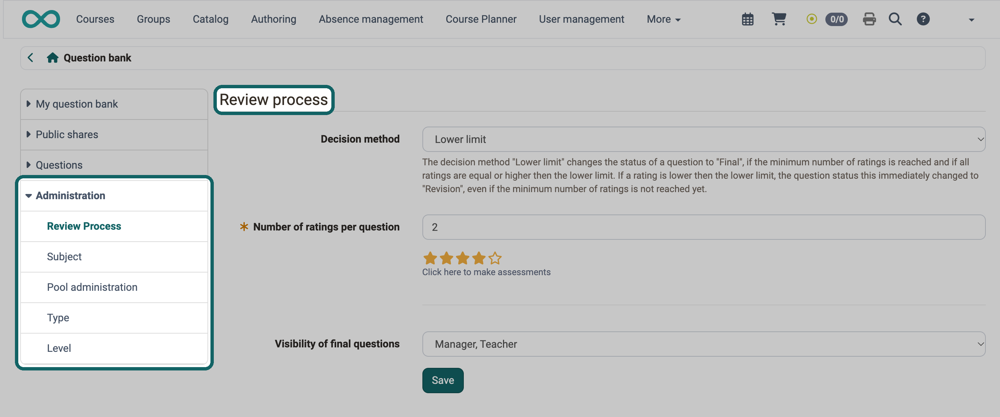
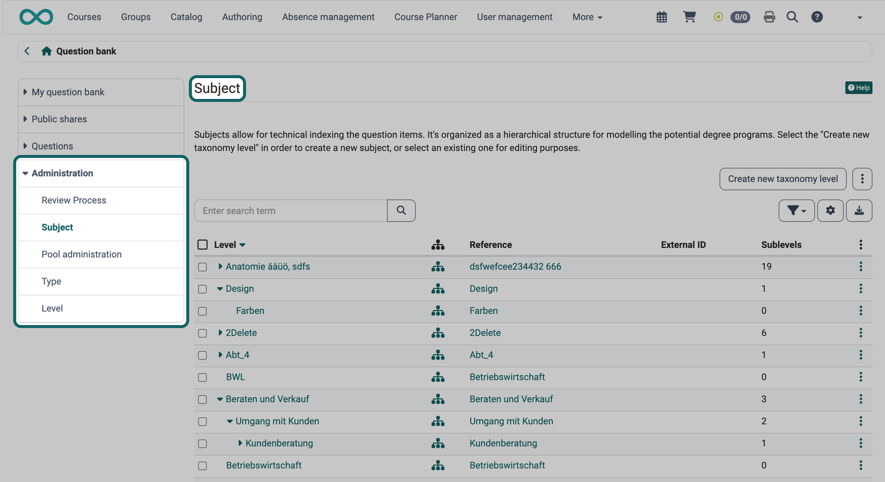
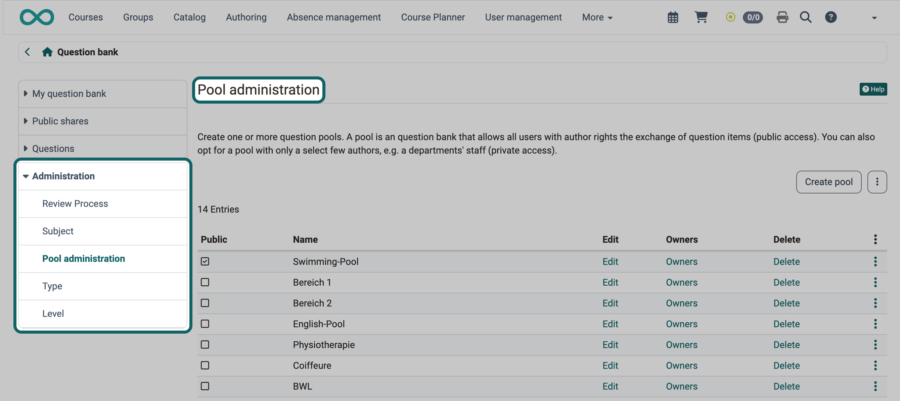
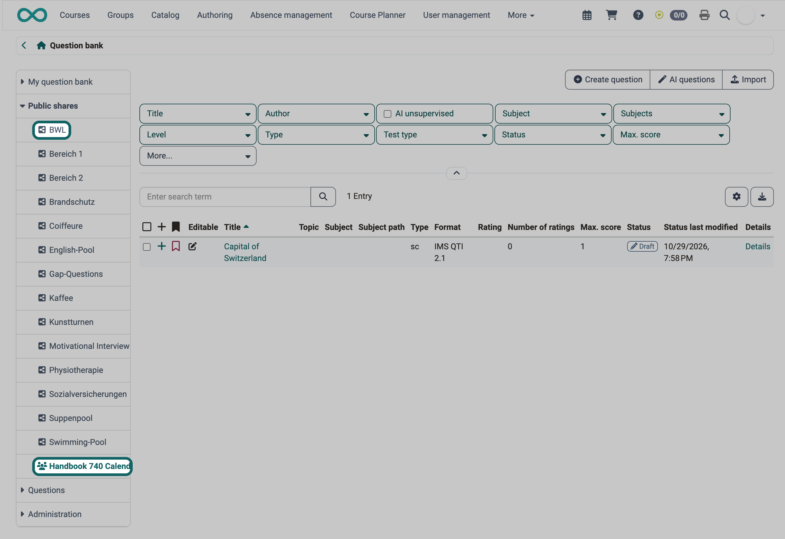
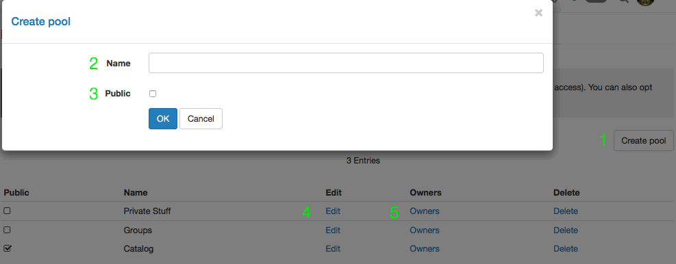
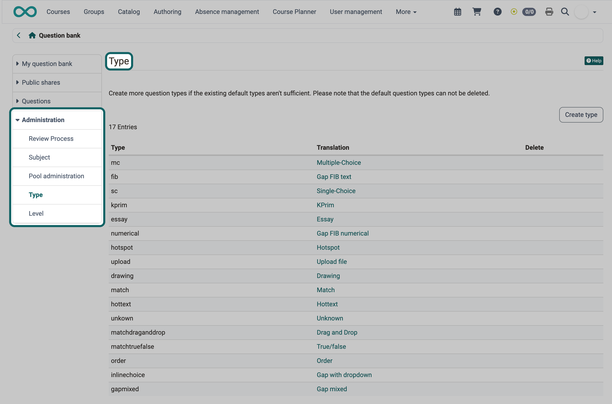
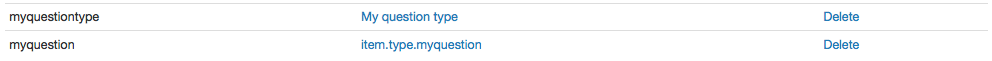
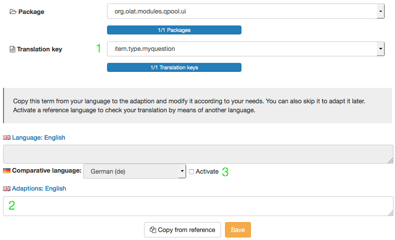
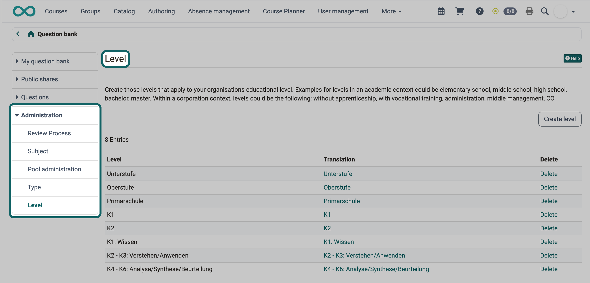

# Question Bank: Administration {: #question_bank_administration}

## Configuration by question bank managers {: #pool_manager}

Question bank manager is a [role](../basic_concepts/Roles_Rights.md) that administrators or roles managers assign to OpenOlat users.

Question bank managers have the right to change organizational aspects of the question bank. However, they have no influence on the content of the question bank or of the individual pools.

The administration of the question bank comprises five areas for organizing the question bank. Administrators see all five. Question bank managers see the areas for which the system administration has granted them the right, in the section "Rights question bank manager" under: `Administration > e-Assessment > Question bank`. More on this under [e-Assessment Administration: Question bank](../../manual_admin/administration/eAssessment_Question_bank.md).

  * Review Process
  * Subject
  * Pool administration
  * Type
  * Level

---

### Review Process [:octicons-tag-16:{ title="from Release 12.3 (OO-3111)" }](https://track.frentix.com/issue/OO-3111){:target="_blank"} {: #assessment_process}

{ class="shadow lightbox" title="Review Process page in the Administration area · 2026.10.29" }

Here you define when a question receives the status "Final" if a review process has been started for it. If, with the decision method "Lower limit", a rating is below the lower limit specified here, OpenOlat sets the question to "Revision".

[To the top of the page ^](#question_bank_administration)

---

### Subject {: #subject}

{ class="shadow lightbox" title="Subject page in the Administration area · 2026.10.29" }

Subjects are used for the subject-related tagging of the questions (items) and are presented in a hierarchical structure. In educational organizations, for example, this represents possible courses of study, in the private sector possibly organizational units.

A [taxonomy](../../manual_admin/administration/Modules_Taxonomy.md) is behind the subjects. New subjects are added via the button "Create new taxonomy level" or via "Import taxonomy levels". Existing subjects can also be edited.

In order for a question to be submitted to the review process, a subject must be specified. Subject experts who have expertise in this area take on the review. Because the experts are also assigned to a subject, question and expert can be matched in this way.

[To the top of the page ^](#question_bank_administration)

---

### Pool administration {: #pool}

{ class="shadow lightbox" title="Pool administration page in the Administration area · 2026.10.29" }

A pool is a question database that is available to authors for the exchange of test questions.

New pools are added via the button "Create pool". Existing pools can be edited or deleted.

Pools can either be public (and are therefore automatically available to all authors) or non-public. With a non-public pool you restrict access to selected persons, for example to the employees of a department.

{ class="aside-right lightbox" }

You add these persons to the pool via the "Owners" link. Pools appear in the "Public shares" area with the adjacent icon.

{ class="aside-right lightbox" }

Only administrators and question bank managers with the right for the pool administration create pools. For a group of people they choose themselves, authors instead share their questions with an OpenOlat group. Such group shares appear with the adjacent icon.

{ class="shadow lightbox" title="Public shares area in the question bank · 2026.10.29" }

[To the top of the page ^](#question_bank_administration)

**Create pool**

{ class="shadow lightbox" title="Dialog Create pool in the pool administration" }

  1. **"Create pool"**: The button opens the form "Create pool".
  2. **"Name"**: Enter the name of the new pool.
  3. **"Public"**: Define whether the pool should be public (visible to all authors) or private. With a private pool you define under "Owners" which users get access to the pool.
  4. **"Edit"**: For existing pools you change the name and the visibility here.
  5. **"Owners"**: Add or remove owners.

[To the top of the page ^](#question_bank_administration)

---

### Type {: #type}

{ class="shadow lightbox" title="Type page in the Administration area · 2026.10.29" }

OpenOlat has various test [question types](../learningresources/Test_question_types.md) that can be created either in the test editor of the learning resource Test or in the item editor of the question bank. Create additional question types if the default question types of OpenOlat are not sufficient. The default question types cannot be deleted.

A question type deviating from the default cannot be created via the editor, but must be assigned to an existing question of a default type in the detailed view using the metadata "Type" in the category "Item analysis". A question changed in this way will still correspond to the original question type, but the new type will now be displayed in the "Type" column in the question bank.

Newly created types must be translated per available language so that, for example, both German- and English-speaking users see the correct terms (and not the translation key visible here).

**Create type**

After you have created a new question type using the button "Create type", it appears at the bottom of the table of types, in the column "Translation". The following naming convention is always applied:

    item.type.[type name]

This is the so-called translation key with which the type name is translated into the various languages available on your OpenOlat instance.

{ class="shadow lightbox" title="Table of question types" }

Click on the corresponding row in the table column "Translation". The following form opens:

{ class="shadow lightbox" title="Form for translating a question type" }

  1. **"Translation key"**: In the dropdown menu you see the type name as it still appears in the table. You cannot change anything here or in the "Package" menu above.
  2. **"Adaptations: English"**: Enter the desired type name here. From now on, OpenOlat shows it in the table of types, in the type selection of the detailed view and for existing questions under "Type".
  3. **"Comparative language"**: Activate the comparative language and select the language in the dropdown menu to compare and check the terms.

Repeat these steps for each language available in your instance.

[To the top of the page ^](#question_bank_administration)

---

### Level {: #level}

{ class="shadow lightbox" title="Level page in the Administration area · 2026.10.29" }

Levels are a further categorization option and can be compared, for example, with a difficulty level. Here you create levels that correspond to the training levels available in your context.

The level of a question item can be assigned in the [detailed view](Item_Detailed_View.md#metadata_general) as the metadata "Level" under "General". For example, the difficulty of a question can be assigned to a level.

Examples of levels in a school context are:

* Lower secondary school
* Upper secondary school
* Grammar school
* Bachelor
* Master 

In a corporate context, levels could look like this:

* without vocational training
* with vocational training
* leadership function
* administration
* executive staff
* management

You create new levels with the button "Create level" at the top right.

Like question types, levels must also be translated per available language so that, for example, both German- and English-speaking users see the correct terms. To do this, proceed as described under "Create type".

[To the top of the page ^](#question_bank_administration)

## Further information {: #further_information}

**Mentioned on this page** 
[Roles and Rights: Overview >](../basic_concepts/Roles_Rights.md) 
[e-Assessment Administration: Question bank >](../../manual_admin/administration/eAssessment_Question_bank.md) 
[Module Taxonomy >](../../manual_admin/administration/Modules_Taxonomy.md) 
[Test question types >](../learningresources/Test_question_types.md) 
[Item Detailed View >](Item_Detailed_View.md)

**Further reading** 
[Question Bank Review Process >](Question_Bank_Review_Process.md) 
[Question Bank: Sharing Options >](Question_Pool_Sharing_Options.md)

[To the top of the page ^](#question_bank_administration)
