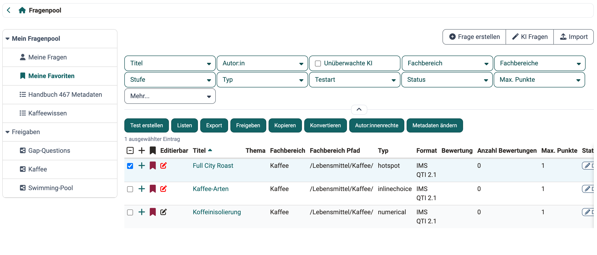
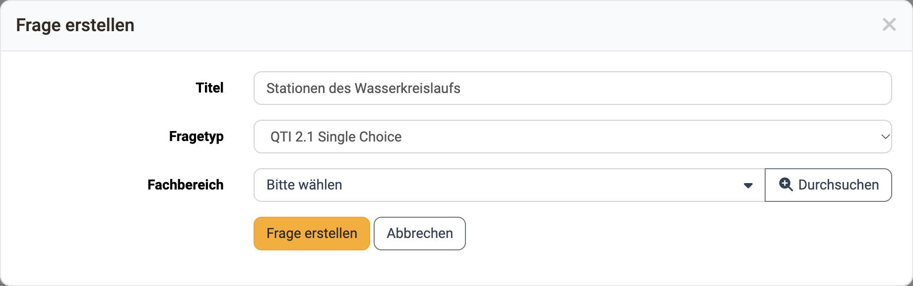
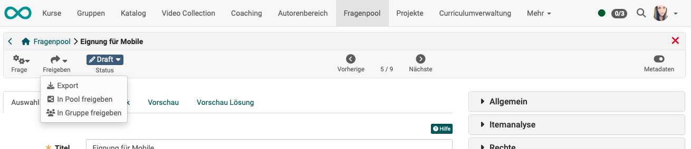

# Fragenpool: Fragen erstellen {: #create_questions}

{ class="shadow lightbox" title="Bereich Meine Favoriten im Fragenpool · 2026.11.04" }

## Übersicht über vorhandene Fragen [:octicons-tag-16:{ title="ab Release 9.0.0 (OO-533)" }](https://track.frentix.com/issue/OO-533){:target="_blank"} {: #question_list}

Die Tabellenansicht der Fragen, die im Fragenpool abgelegt sind, bietet vielfältige Möglichkeiten. Achten Sie darauf, dass alle für Sie relevanten Spalten über das Zahnrad-Symbol ausgewählt sind.

Besonders relevante Fragen können Sie als Favorit markieren und so schnell wiederfinden. Eine weitere Möglichkeit ist, mehrere Fragen in Listen zu organisieren und so eine individuelle Ordnung für Ihre Fragen aufzubauen.

Sie können Fragen im Bereich "Meine Fragen", in einer Liste oder in einer Gruppenfreigabe erstellen oder importieren. Dabei legt OpenOlat die Frageitems aber grundsätzlich unter "Meine Fragen" ab und referenziert sie am jeweiligen Ort.

Eine Übersicht der Fragetypen, die erstellt und importiert werden können, finden Sie im Kapitel ["Test Fragetypen"](../learningresources/Test_question_types.de.md).

[Zum Seitenanfang ^](#create_questions)

## Fragen im Fragenpool erstellen [:octicons-tag-16:{ title="ab Release 9.0.0 (OO-533)" }](https://track.frentix.com/issue/OO-533){:target="_blank"} {: #create}

Frageitems können im Fragenpool über den Button "Frage erstellen" im QTI 2.1 Format erstellt und direkt zur weiteren Nutzung gespeichert werden.

{ class="shadow lightbox" title="Dialog Frage erstellen im Fragenpool · 2026.11.04" }

Im Dialog "Frage erstellen" geben Sie einen Titel ein und wählen anschliessend den Fragetyp und, falls vorhanden, den Fachbereich. Im Feld "Fragetyp" stehen 16 Fragetypen im Format QTI 2.1 zur Wahl, in dieser Reihenfolge: "Single Choice", "Multiple Choice", "Kprim", "Matrix", "Drag and Drop", "True/false", "Lückentext", "Lückentext numerisch", "Lückentext mit Dropdown", "Lückentext gemischt", "Hotspot", "Freitext", "Datei hochladen", "Zeichnen", "Hottext" und "Reihenfolge". Die so erstellten Fragen können dann in die OpenOlat Lernressource Test importiert und verwendet werden.

[Zum Seitenanfang ^](#create_questions)

## Fragen mit Hilfe von KI (Künstlicher Intelligenz) erstellen [:octicons-tag-16:{ title="ab Release 19.0.0 (OO-7787)" }](https://track.frentix.com/issue/OO-7787){:target="_blank"} {: #create_with_AI}

Im Fragenpool können Fragen auch mit Hilfe von künstlicher Intelligenz erstellt werden. Über den Button "KI Fragen" öffnen Sie den Generierungsdialog.

!!! info "Wichtig"

    Diese Funktion steht nur zur Verfügung, wenn in der System-Administration das [KI-Modul](../../manual_admin/administration/External_Tools_AI.de.md) aktiviert und mindestens eine passende KI-Funktion mit einem KI-Anbieter und Modell konfiguriert ist: "MC Fragen Generator" für Multiple-Choice-Fragen sowie "Essay Fragen Generator" und "Essay Bewertung" für Freitextfragen mit KI-Korrektur.

Die KI erzeugt die Fragen aus einem Lerntext (in OpenOlat "Quelltext"): dem Text, den Ihre Lernenden durcharbeiten, etwa ein Skript, ein Kapitel oder ein Merkblatt. Was nicht darin steht, kann die KI nicht abfragen.

Den Lerntext geben Sie in einem von zwei Modi vor:

* **"Datei hochladen"**: Sie laden den Lerntext als Markdown-, Text- oder Word-Datei (.docx) hoch, etwa Ihr Skript.
* **"Text einfügen"**: Sie fügen den Lerntext in das Feld "Quelltext" ein.

Wie lang der Lerntext sein darf, gibt die System-Administration im [KI-Modul](../../manual_admin/administration/External_Tools_AI.de.md#ai_function_limits) vor, standardmässig 60000 Zeichen [:octicons-tag-16:{ title="ab Release 21.0.2 (OO-9677)" }](https://track.frentix.com/issue/OO-9677){:target="_blank"}. Sind "MC Fragen Generator" und "Essay Fragen Generator" beide aktiv, gilt der kleinere der beiden Werte. Der Dialog nennt die geltende Grenze und weist zu lange Texte zurück.

Anschliessend legen Sie fest, wie viele Fragen erzeugt werden: "Multiple-Choice-Fragen" und, sofern die KI-Korrektur konfiguriert ist, "Essay-Fragen mit KI-Korrektur" [:octicons-tag-16:{ title="ab Release 21.0 (OO-9498)" }](https://track.frentix.com/issue/OO-9498){:target="_blank"}. Die KI schlägt anhand der Länge des Lerntexts sinnvolle Werte vor, die Sie anpassen können. Mit den Feldern "Bloom-Stufen", "Zielschwierigkeit" und "Lernziele (optional)" steuern Sie, welche Fragen entstehen, wie beim [Import im Content Editor](../basic_concepts/Content_Editor.de.md#import_ai_quiz); vorausgewählt sind die Bloom-Stufen "Verstehen" und "Anwenden". Mit "Fragen generieren" starten Sie den Vorgang.

Die Generierung läuft im Hintergrund. Sie können den Dialog offen lassen oder schliessen; die neuen Fragen erscheinen im Fragenpool, sobald sie fertig sind. Sie werden in der Sprache des Lerntexts erstellt [:octicons-tag-16:{ title="ab Release 20.3.0 (OO-9355)" }](https://track.frentix.com/issue/OO-9355){:target="_blank"}. KI-generierte Fragen erhalten den Status "Review", damit sie vor der Weiterverwendung fachlich geprüft werden.

Bitte beachten Sie, dass die Fragen in jedem Einzelfall auf inhaltliche Korrektheit überprüft werden müssen.

[Zum Seitenanfang ^](#create_questions)

## KI-Feedback einer Freitextfrage bearbeiten [:octicons-tag-16:{ title="ab Release 21.0 (OO-9498)" }](https://track.frentix.com/issue/OO-9498){:target="_blank"} {: #ai_grading}

Bei Freitextfragen mit KI-Korrektur legt ein Bewertungskit fest, wie die KI die Antworten einschätzt. Die KI füllt dieses Kit bei der Generierung vor; Sie können es im Tab "KI-Feedback" der Frage von Hand anpassen. Der Tab erscheint auch bei einer selbst erstellten Freitextfrage. So bauen Sie das Bewertungskit von Anfang an selbst auf. OpenOlat zeigt den Tab, sobald in der System-Administration im [KI-Modul](../../manual_admin/administration/External_Tools_AI.de.md) die KI-Funktion "Essay Bewertung" aktiviert und mit einem KI-Anbieter und Modell konfiguriert ist.

Die Oberfläche nennt diese Funktion je nach Ort anders: "Essay Bewertung" in der System-Administration, "KI-Korrektur" im Feld "Essay-Fragen mit KI-Korrektur" beim Erzeugen und im Dialog, in dem Lernende einwilligen, und "KI-Feedback" in der Frage. Wer was wo einstellt, zeigt die Grafik [KI-Feedback zu Freitextantworten](../../manual_how-to/ai_essay/ai_essay.de.md#concept) in der Anleitung zur Freitextfrage.

Fünf Angaben sind Pflicht und tragen einen Stern: "Lernziel", "Quelltext-Auszug", "Musterantwort", "Bloom-Stufe" und "Sprache (BCP-47)". Alle übrigen Angaben sind optional, auch die Schlüsselpunkte und die Bewertungskriterien.

* **"Lernziel"**: das Lernziel, das die Frage prüft.
* **"Quelltext-Auszug"**: der Abschnitt aus dem Lerntext, auf dem die Frage beruht, etwa ein Absatz aus dem Skript. Die KI nutzt ihn als Referenz, wenn sie eine Antwort beurteilt.
* **"Musterantwort"**: die erwartete Referenzantwort.
* **"Korrekturhinweise"**: zusätzliche Vorgaben an die KI.
* **"Bloom-Stufe"**: die kognitive Stufe der Frage.
* **"Sprache (BCP-47)"**: die Sprache, in der Lernende antworten sollen, als Sprach-Tag wie `de`, `en` oder `fr`. Tragen Sie den Sprach-Tag ohne Region ein, etwa `en`. OpenOlat belegt das leere Feld mit der Sprache Ihrer Benutzeroberfläche vor. Antworten Lernende in einer anderen Sprache, weist das KI-Feedback darauf hin. Das Feedback selbst schreibt die KI in der Sprache, die die lernende Person in ihren [persönlichen Einstellungen](../personal_menu/Settings.de.md#language) gewählt hat.
* **"Schwierigkeitsgrad"**: ein Wert von 1 bis 5 zur weiteren Steuerung.
* **"Schlüsselpunkte"**: was eine gute Antwort enthalten muss, je mit einer Beschreibung, einem Gewicht von 0.0 bis 1.0 und der Markierung "erforderlich".
* **"Bewertungskriterien"**: nach welchen Gesichtspunkten die KI die Antwort beurteilt, je mit "Name", "Beschreibung", einem "Bereich" ("Inhalt" oder "Sprache") und einem Gewicht.
* **"Häufige Missverständnisse"**: typische Fehlannahmen, die im Feedback berücksichtigt werden.

Eine Zeile gilt als ausgefüllt, sobald ihre Beschreibung, bei Bewertungskriterien ihr Name, eingetragen ist. Sind bei den Schlüsselpunkten oder den Bewertungskriterien Zeilen ausgefüllt, muss die Summe aller Gewichte 1.0 ergeben. Den Hinweis dazu zeigt OpenOlat unter beiden Tabellen.

Lässt sich das Bewertungskit nicht speichern, zeigt OpenOlat den Fehler direkt am Feld oder an der Zeile der Tabelle. Ergeben die Gewichte nicht 1.0, steht die Meldung "Summe der Gewichte muss 1.0 ergeben (±0.01)." beim Gewicht der ersten Zeile.

Mit dem Button "Feedback testen" geben Sie eine Beispielantwort ein und sehen in der Vorschau, welches KI-Feedback Lernende erhalten würden. So lässt sich das Bewertungskit vor dem Einsatz feinjustieren.

!!! info "Wo Lernende das KI-Feedback erhalten"

    Das Bewertungskit wirkt ausschliesslich im [Quiz-Element einer Seite](../basic_concepts/Content_Editor.de.md#ai_feedback). Fügen Sie die Freitextfrage dort über das 3-Punkte-Menü des Quiz-Elements mit "Fragen aus Pool importieren" ein. In den Kursbausteinen "Test" und "Selbsttest" wird das Bewertungskit nicht ausgeführt. Dort bleibt die Freitextantwort der manuellen Korrektur im Bewertungswerkzeug vorbehalten.

[Zum Seitenanfang ^](#create_questions)

## Beurteilung durch Fachkolleg:innen [:octicons-tag-16:{ title="ab Release 12.3 (OO-3111)" }](https://track.frentix.com/issue/OO-3111){:target="_blank"} {: #review}

Nachdem eine Frage in erster Version erstellt wurde, kann sie zur Prüfung durch Fachkolleg:innen in einen Beurteilungsprozess gegeben werden.

[Details zum Beurteilungsprozess >](Question_Bank_Review_Process.de.md) 
[Zum Seitenanfang ^](#create_questions)

## Frage in den Pool freigeben [:octicons-tag-16:{ title="ab Release 9.0.0 (OO-533)" }](https://track.frentix.com/issue/OO-533){:target="_blank"} {: #share_in_pool}

{ class="shadow lightbox" title="Menü Freigeben in der Detailansicht einer Frage" }

Poolverwalter:innen können mehrere Pools anlegen. Als Autor:in einer Frage entscheiden Sie, in welchen Pool Sie Ihre Frage freigeben: `Freigeben > In Pool freigeben`.

[Details zur Freigabe >](Question_Pool_Sharing_Options.de.md) 
[Zum Seitenanfang ^](#create_questions)

## Frage in Gruppe freigeben [:octicons-tag-16:{ title="ab Release 9.0.0 (OO-533)" }](https://track.frentix.com/issue/OO-533){:target="_blank"} {: #share_with_group}

Wenn Sie z.B. Fragen gemeinsam entwickeln, können Sie vorab eine Arbeitsgruppe erstellen. Soll eine neu erstellte Frage zunächst ausschliesslich für die Gruppenmitglieder sichtbar sein, geben Sie die Frage in der Toolbar nur für diese Gruppe frei: `Freigeben > In Gruppe freigeben`.

[Details zur Freigabe >](Question_Pool_Sharing_Options.de.md) 
[Zum Seitenanfang ^](#create_questions)

## Weiterführende Informationen {: #further_information}

**Auf dieser Seite erwähnt** 
[Test Fragetypen >](../learningresources/Test_question_types.de.md) 
[Externe Werkzeuge: KI-Modul >](../../manual_admin/administration/External_Tools_AI.de.md) 
[Content Editor >](../basic_concepts/Content_Editor.de.md) 
[Wie gebe ich Lernenden KI-Feedback auf Freitextantworten im Quiz? >](../../manual_how-to/ai_essay/ai_essay.de.md) 
[Persönliche Konfiguration: Einstellungen >](../personal_menu/Settings.de.md) 
[Fragenpool: Beurteilungsprozess >](Question_Bank_Review_Process.de.md) 
[Fragenpool: Freigabemöglichkeiten >](Question_Pool_Sharing_Options.de.md)

**Weiterführend** 
[Fragenpool: Fragen importieren >](Question_Bank_Import_Questions.de.md) 
[Fragenpool: Detailansicht einer Frage und Metadaten >](Item_Detailed_View.de.md) 
[Wie gehe ich vor, wenn ich einen Test erstelle? >](../../manual_how-to/test_creation_procedure/test_creation_procedure.de.md)

[Zum Seitenanfang ^](#create_questions)