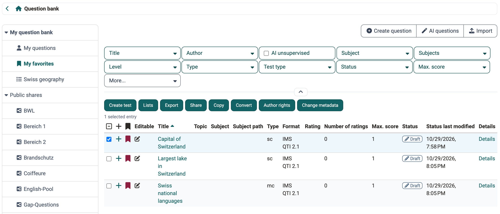
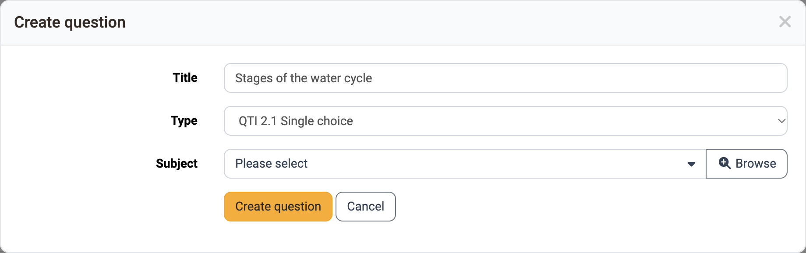
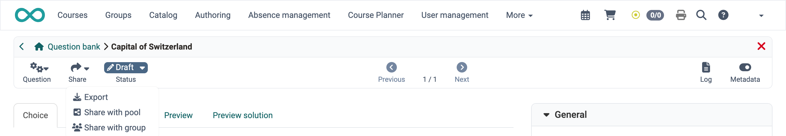

# Question Bank: Create Questions {: #create_questions}

{ class="shadow lightbox" title="My favorites area in the question bank · 2026.11.04" }

## Overview of available questions {: #question_list}

The table shows the questions stored in the question bank. You choose which columns it shows using the cogwheel symbol.

You can mark particularly relevant questions as favorites and find them again quickly. Another option is to organize several questions in lists and thus create an individual order for your questions.

You can create or import questions in the "My questions" area, in a list or in a group share. OpenOlat stores each question item under "My questions" and references it at the respective location.

An overview of the question types that can be created and imported can be found in the chapter ["Test question types"](../learningresources/Test_question_types.md).

[To the top of the page ^](#create_questions)

## Create questions in the question bank [:octicons-tag-16:{ title="from Release 9.0.0 (OO-533)" }](https://track.frentix.com/issue/OO-533){:target="_blank"} {: #create}

With the "Create question" button you create a new question in QTI 2.1 format in the question bank. OpenOlat saves it directly for further use.

{ class="shadow lightbox" title="Create question dialog in the question bank · 2026.11.04" }

In the dialog "Create question" you enter a title and then select the question type and, if available, the subject. The "Type" field offers 16 question types in QTI 2.1 format, in this order: "Single choice", "Multiple choice", "Kprim", "Match", "Drag and Drop", "True/false", "Gap FIB text", "Gap FIB numerical", "Gap with dropdown", "Gap mixed", "Hotspot", "Essay", "Upload file", "Drawing", "Hottext" and "Order". You then take the questions created in this way into the learning resource "Test".

[To the top of the page ^](#create_questions)

## Create questions with AI [:octicons-tag-16:{ title="from Release 19.0.0 (OO-7787)" }](https://track.frentix.com/issue/OO-7787){:target="_blank"} {: #create_with_AI}

Instead of writing every question yourself, you have questions generated in the question bank with AI (artificial intelligence). You open the dialog for this with the "AI questions" button.

!!! info "Important"

    OpenOlat shows the "AI questions" button if the AI feature "MC Question Generator" is configured with an AI provider and a language model in the [AI module](../../manual_admin/administration/External_Tools_AI.md) of the system administration: `Administration > External tools > AI module > Tab "AI features"`. The dialog additionally generates essay questions with AI correction if the AI features "Essay Question Generator" and "Essay Grading" are also configured there.

The AI generates the questions from a source text: the text your learners work through, for example a script, a chapter or a fact sheet. The AI cannot ask about anything that is not in it.

You provide the source text in one of two modes:

* **"Upload file"**: you upload the source text as a Markdown, plain text or Word file (.docx), for example your script.
* **"Paste text"**: you paste the source text into the "Source text" field.

How long the source text may be is set by the system administration in the [AI module](../../manual_admin/administration/External_Tools_AI.md#ai_function_limits), 60000 characters by default [:octicons-tag-16:{ title="from Release 21.0.2 (OO-9677)" }](https://track.frentix.com/issue/OO-9677){:target="_blank"}. If "MC Question Generator" and "Essay Question Generator" are both active, the smaller of the two values applies. The dialog states the applicable limit and rejects texts that are too long.

You then define how many questions are generated: "Multiple-choice questions" and, if the AI feature "Essay Grading" is configured, "Essay questions with AI correction". The AI suggests sensible values based on the length of the source text, which you can adjust. With the fields "Bloom levels", "Target difficulty" and "Learning objectives (optional)" you steer which questions are created, as with the [import in the Content Editor](../basic_concepts/Content_Editor.md#import_ai_quiz); the Bloom levels "Understand" and "Apply" are preselected. Start the process with "Generate questions".

Generation runs in the background. You can leave the dialog open or close it; the new questions appear in the question bank once they are ready. They are created in the language of the source text [:octicons-tag-16:{ title="from Release 20.3.0 (OO-9355)" }](https://track.frentix.com/issue/OO-9355){:target="_blank"}. AI-generated questions receive the "Review" status so they are checked before reuse.

Check each generated question for correctness of content before you use it.

[To the top of the page ^](#create_questions)

## Edit the AI feedback of an essay question [:octicons-tag-16:{ title="from Release 21.0 (OO-9498)" }](https://track.frentix.com/issue/OO-9498){:target="_blank"} {: #ai_grading}

For essay questions with AI correction, a grading kit defines how the AI assesses the answers. The AI prefills this grading kit during generation; you can adjust it by hand in the question's "AI feedback" tab. The tab also appears on an essay question you created yourself. This lets you build the grading kit from the start. OpenOlat shows the tab as soon as the AI feature "Essay Grading" is enabled and configured with an AI provider and a language model in the [AI module](../../manual_admin/administration/External_Tools_AI.md) of the system administration: `Administration > External tools > AI module > Tab "AI features"`.

OpenOlat names this feature for each role with the word that fits its task: "Essay Grading" for the system administration, "AI feedback" in the tab of the question for authors, "AI correction" in the dialog in which learners allow the check of their answer. When generating, you set in the "Essay questions with AI correction" field how many essay questions are created. Which goal who reaches where under which word is shown in the table in the section [What AI feedback does](../../manual_how-to/ai_essay/ai_essay.md#concept) of the instructions on AI feedback.

Five entries are mandatory and carry an asterisk: "Learning objective", "Reference excerpt", "Model answer", "Bloom level" and "Language (BCP-47)". All other entries are optional, including the key points and the rubric criteria.

* **"Learning objective"**: the learning objective the question tests.
* **"Reference excerpt"**: the passage from the source text the question is based on, for example a paragraph from the script. The AI uses it as a reference when it assesses an answer.
* **"Model answer"**: the expected reference answer.
* **"Grading hints"**: additional instructions for the AI.
* **"Bloom level"**: the cognitive level of the question.
* **"Language (BCP-47)"**: the language in which learners are to answer, as a language tag such as `de`, `en` or `fr`. Enter the language tag without region, for example `en`. OpenOlat prefills the empty field with the language of your user interface. If learners answer in a different language, the AI feedback points this out. The AI writes the feedback itself in the language the learner has selected in their [personal settings](../personal_menu/Settings.md#language).
* **"Difficulty (1–5)"**: the standard the AI applies when assessing, from 1 (very easy) to 5 (very hard).
* **"Key points"**: what a good answer must contain, each with a description, a weight from 0.0 to 1.0 and the "required" marker.
* **"Rubric criteria"**: the aspects by which the AI assesses the answer, each with "Name", "Descriptor", a "Scope" ("Content" or "Language") and a weight.
* **"Common misconceptions"**: typical false assumptions about the question, as a reference list in the grading kit. If the AI feedback should address a false assumption, also name it in the grading hints.

A row counts as filled in as soon as its description, or for rubric criteria its name, is entered. If rows are filled in under the key points or the rubric criteria, the sum of all weights must be 1.0. OpenOlat shows the note on this below both tables.

If the grading kit cannot be saved, OpenOlat shows the error directly at the field or at the row of the table. If the weights do not add up to 1.0, the message "Weights must sum to 1.0 (±0.01)." appears at the weight of the first row.

With the "Test feedback" button you enter a sample answer and see in the preview which AI feedback learners would receive. This lets you fine-tune the grading kit before use.

!!! info "Where learners receive the AI feedback"

    The grading kit only takes effect in the [quiz element of a page](../basic_concepts/Content_Editor.md#ai_feedback). Add the essay question there with "Import questions from pool" in the 3-dot menu of the quiz element. In the course elements "Test" and "Self-test" the grading kit is not executed. There the essay answer remains subject to manual correction in the assessment tool.

[To the top of the page ^](#create_questions)

## Assessment by expert colleagues [:octicons-tag-16:{ title="from Release 12.3 (OO-3111)" }](https://track.frentix.com/issue/OO-3111){:target="_blank"} {: #review}

Once a first version of a question is ready, you submit it to a review process in which expert colleagues check it.

[Details about the review process >](Question_Bank_Review_Process.md) 
[To the top of the page ^](#create_questions)

## Share question in the pool {: #share_in_pool}

{ class="shadow lightbox" title="Share menu in the detail view of a question · 2026.10.29" }

Question bank managers can create several pools. As the author of a question, you decide in which pool you share your question: `Share > Share with pool`.

[Details about sharing >](Question_Pool_Sharing_Options.md) 
[To the top of the page ^](#create_questions)

## Share question in group {: #share_with_group}

If you are developing questions together, for example, you can create a workgroup in advance. If a newly created question should initially only be visible to the group members, share the question in the toolbar with this group only: `Share > Share with group`.

[Details about sharing >](Question_Pool_Sharing_Options.md) 
[To the top of the page ^](#create_questions)

## Further information {: #further_information}

**Mentioned on this page** 
[Test question types >](../learningresources/Test_question_types.md) 
[External tools: AI module >](../../manual_admin/administration/External_Tools_AI.md) 
[Content Editor >](../basic_concepts/Content_Editor.md) 
[How do I give learners AI feedback on free-text answers in a quiz? >](../../manual_how-to/ai_essay/ai_essay.md) 
[Personal Configuration: Settings >](../personal_menu/Settings.md) 
[Question Bank Review Process >](Question_Bank_Review_Process.md) 
[Question Bank: Sharing Options >](Question_Pool_Sharing_Options.md)

**Further reading** 
[Question Bank: Import Questions >](Question_Bank_Import_Questions.md) 
[Question bank: Details of a question and metadata >](Item_Detailed_View.md) 
[How do I proceed when I create a test? >](../../manual_how-to/test_creation_procedure/test_creation_procedure.md)

[To the top of the page ^](#create_questions)

