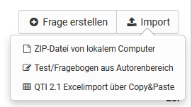
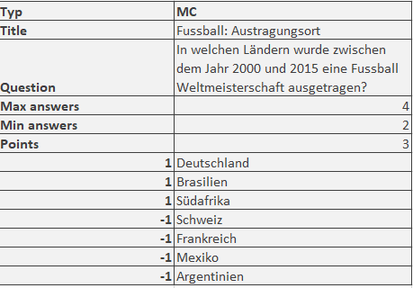
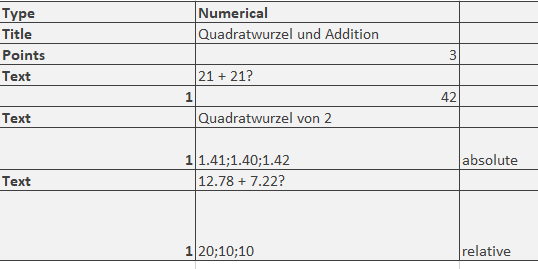
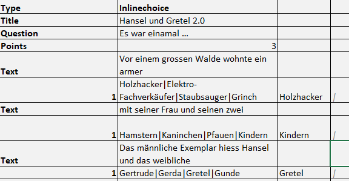
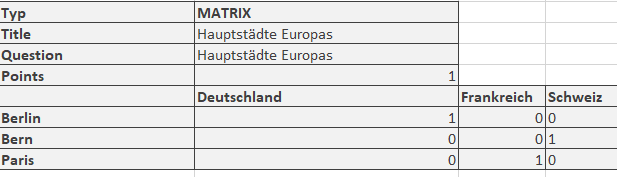
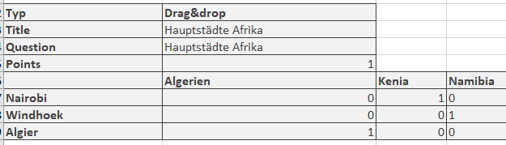
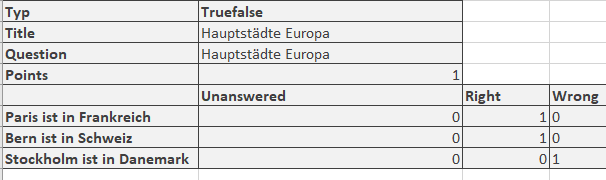

# Fragenpool: Fragen importieren {: #question_bank_import}

Fragen, die schon als Datei, in einem Test oder in einer Tabelle vorliegen, müssen Sie im Fragenpool nicht neu erstellen: Sie importieren sie. Den Button "Import" zeigt der Fragenpool Autor:innen, Poolverwalter:innen und Administrator:innen, zum Beispiel über der Tabelle unter "Meine Fragen".

## Import-Möglichkeiten {: #import_options}

Der Button "Import" bietet drei Wege, Fragen im Format QTI 2.1 in den Fragenpool zu holen.

{ class="shadow lightbox" title="Menü des Buttons Import im Fragenpool" }

  *  **ZIP-Datei von lokalem Computer**: 
  Liegt Ihnen ein Set an QTI 2.1-Fragen oder ein Test als ZIP-Datei vor, importieren Sie die Datei hier.
  *  **Test aus Autorenbereich**: 
  Zur Wahl stehen die QTI 2.1-Tests, die Sie kopieren dürfen. Klicken Sie in der Zeile des gewünschten Tests auf seinen Titel. OpenOlat importiert alle Fragen dieses Tests in den Fragenpool.
  *  **QTI 2.1 Excelimport über Copy&Paste**: 
  Sie erfassen die Fragen in einem Tabellenkalkulationsprogramm wie Excel nach der Vorlage, die der Import bereitstellt, und fügen die Zeilen in das Eingabefeld ein. Der folgende Abschnitt beschreibt die Vorlage.

[Zum Seitenanfang ^](#question_bank_import)

## Nutzung der Datei "Vorlage Excelimport" {: #excelimport}

Mit dem Excelimport legen Sie viele Fragen in einem Durchgang an. Sie erfassen die Fragen zeilenweise in einer Tabelle, kopieren die Zeilen und fügen sie in OpenOlat ein. OpenOlat erzeugt daraus Fragen im Format QTI 2.1. So übernehmen Sie auch Fragen aus anderen Systemen, wenn Sie diese zuvor in die Tabelle übertragen.

Die Vorlage erhalten Sie im Import selbst. Im Fragenpool starten Sie ihn unter: 
`Fragenpool > Mein Fragenpool > Meine Fragen > Import > QTI 2.1 Excelimport über Copy&Paste`

Im Schritt "Dateneingabe" steht über dem Feld "Kopierte Zeilen aus Exceldatei (Kommasepariert)" der Link "Vorlage Excelimport". Er liefert eine Excel-Datei mit Beispielfragen zu allen zehn Fragetypen, die der Excelimport kennt, und einem Beispiel für die Metadaten einer Frage. Bauen Sie Ihre Fragen nach diesem Muster auf.

Denselben Import mit derselben Vorlage bietet der [Testeditor](../learningresources/Test_editor_QTI_2.1.de.md), wenn Sie Fragen direkt in einen Test übernehmen: 
`Test > Administration > Testeditor > Elemente hinzufügen > Fragen aus Excel importieren`

So importieren Sie die Fragen:

1. Laden Sie über den Link "Vorlage Excelimport" die Vorlage herunter und erfassen Sie Ihre Fragen nach ihrem Muster.
2. Markieren Sie in der Tabelle die Zeilen Ihrer Fragen und kopieren Sie sie.
3. Fügen Sie die Zeilen in das Feld "Kopierte Zeilen aus Exceldatei (Kommasepariert)" ein. OpenOlat liest die Zeilen tabulatorgetrennt oder kommagetrennt.
4. Klicken Sie auf "Weiter". Der Schritt "Übersicht" listet die erkannten Fragen mit Fragetyp, Titel und Punkten.
5. Klicken Sie auf "Fertigstellen".

Kann OpenOlat eine Zeile nicht verarbeiten, nennt das Feld die Zeilennummer: "Problem auf Zeile …".

Die Vorlage ist eine Tabelle mit vier Spalten:

Spalte | Inhalt
---|---
Keyword / Punkte | Das Schlüsselwort der Zeile, zum Beispiel "Type", "Title" oder "Points". In den Zeilen für Antworten und Lücken stehen hier die Punkte.
Value | Der Wert oder Text der Zeile.
Extra | Zusatzangaben einzelner Fragetypen, zum Beispiel die Lückenlänge beim Lückentext oder die Toleranz beim Lückentext numerisch.
Erklärung | Erläuterungen zur Zeile, zum Beispiel, ob eine Angabe optional ist.

Die Vorlage enthält Beispiele für die folgenden Fragetypen. Vor der Klammer steht der Wert, den Sie in der Zeile "Type" eintragen, in der Klammer der Name des Fragetyps in OpenOlat. Mehr zu den Fragetypen selbst finden Sie unter [Test Fragetypen](../learningresources/Test_question_types.de.md).

  * [MC (Multiple Choice)](#template_mc)
  * [SC (Single Choice)](#template_sc)
  * [FIB (Lückentext)](#template_fip)
  * [Numerical (Lückentext numerisch)](#template_numerical)
  * [Inlinechoice (Lückentext mit Dropdown)](#template_inlinechoice)
  * [KPRIM (Kprim)](#template_kprim)
  * [Essay (Freitext)](#template_essay)
  * [Matrix](#template_matrix)
  * [Drag&drop (Drag and Drop)](#template_dragdrop)
  * [Truefalse (True/false)](#template_truefalse)

In der Vorlage stehen die Fragen untereinander, getrennt durch eine Leerzeile. Jede neue Frage beginnt mit der Zeile "Type". Die Schlüsselwörter dürfen auch deutsch lauten, zum Beispiel "Typ", "Titel", "Frage" oder "Punkte". Gross- und Kleinschreibung spielt keine Rolle.

Die folgenden Abschnitte beschreiben die Zeilen je Fragetyp.

---

### Multiple Choice {: #template_mc}

**Type**|MC
---|---
**Title**|Titel der Frage, zum Beispiel das Themengebiet
**Question**|Der Fragetext. Einfache HTML-Formatierung ist erlaubt.
**Max answers**|Max. Anzahl möglicher Antworten, die Teilnehmende wählen dürfen
**Min answers**|Min. Anzahl möglicher Antworten, die Teilnehmende wählen müssen
**Points**|Maximal erreichbare Punktzahl. Die minimale Punktzahl ist 0.

Danach folgen die Antworten, jede in einer eigenen Zeile: in der ersten Spalte die Punkte, in der zweiten der Antworttext. Antworten mit mehr als 0 Punkten gelten als richtig, negative Punkte ziehen bei der Wahl dieser Antwort Punkte ab. Die Zahl der Antworten ist frei.

{ class="shadow lightbox" title="Multiple-Choice-Frage in der Vorlage" }

[Zum Seitenanfang ^](#question_bank_import)

---

### Single Choice {: #template_sc}

**Type**|SC
---|---
**Title**|Titel der Frage, zum Beispiel das Themengebiet
**Question**|Der Fragetext. Einfache HTML-Formatierung ist erlaubt.
**Points**|Maximal erreichbare Punktzahl. Die minimale Punktzahl ist 0.

Danach folgen die Antworten, jede in einer eigenen Zeile: in der ersten Spalte die Punkte, in der zweiten der Antworttext. Die richtige Antwort trägt mehr als 0 Punkte, zum Beispiel "1", die übrigen Antworten "0". Die Zahl der Antworten ist frei.

[Zum Seitenanfang ^](#question_bank_import)

---

### Lückentext {: #template_fip}

**Type**|FIB
---|---
**Title**|Titel der Frage, zum Beispiel das Themengebiet
**Points**|Maximal erreichbare Punktzahl. Die minimale Punktzahl ist 0.
**Text**|Ein Textteil der Frage vor, zwischen oder nach den Lücken
**Punkte der Lücke, z. B. "1"**|Die Lösung der Lücke. Weitere richtige Varianten folgen, getrennt durch ";". In der Spalte "Extra" steht die Lückenlänge, zum Beispiel "20".

Textzeilen und Lückenzeilen wechseln sich ab, in beliebiger Zahl.

[Zum Seitenanfang ^](#question_bank_import)

---

### Lückentext numerisch [:octicons-tag-16:{ title="ab Release 16.1.0 (OO-5573)" }](https://track.frentix.com/issue/OO-5573) {: #template_numerical}

**Type**|Numerical
---|---
**Title**|Titel der Frage, zum Beispiel das Themengebiet
**Points**|Maximal erreichbare Punktzahl. Die minimale Punktzahl ist 0.
**Text**|Ein Textteil der Frage, zum Beispiel die Fragestellung
**Punkte der Lücke, z. B. "1"**|Die Lösung als Zahl. Für eine Toleranz steht hier "Lösung;untere Grenze;obere Grenze" und in der Spalte "Extra" "absolute" oder "relative".

Ohne Grenzen zählt nur die exakte Lösung. Mit "absolute" sind die Grenzen Zahlen: "1.41;1.40;1.42" lässt alle Werte zwischen 1.40 und 1.42 gelten. Mit "relative" sind die Grenzen Prozentwerte: "20;10;10" lässt alle Werte zwischen 18 und 22 gelten.

{ class="shadow lightbox" title="Lückentext numerisch in der Vorlage" }

[Zum Seitenanfang ^](#question_bank_import)

---

### Lückentext mit Dropdown {: #template_inlinechoice}

**Type**|Inlinechoice
---|---
**Title**|Titel der Frage, zum Beispiel das Themengebiet
**Question**|Die Fragestellung oder der erste Textteil der Frage
**Points**|Maximal erreichbare Punktzahl. Die minimale Punktzahl ist 0.
**Text**|Ein Textteil der Frage vor, zwischen oder nach den Lücken
**Punkte der Lücke, z. B. "1"**|Die Antwortmöglichkeiten des Dropdowns, getrennt durch ";". In der Spalte "Extra" steht die Lösung.

Soll ein anderes Zeichen die Antwortmöglichkeiten trennen, tragen Sie es in die vierte Spalte ein. Die Vorlage nutzt dafür "|" und führt die Erklärungen bei diesem Fragetyp deshalb in der fünften Spalte.

{ class="shadow lightbox" title="Lückentext mit Dropdown in der Vorlage" }

[Zum Seitenanfang ^](#question_bank_import)

---

### Kprim [:octicons-tag-16:{ title="ab Release 11.2 (OO-2364)" }](https://track.frentix.com/issue/OO-2364) {: #template_kprim}

**Type**|KPRIM
---|---
**Title**|Titel der Frage, zum Beispiel das Themengebiet
**Question**|Der Fragetext
**Points**|Maximal erreichbare Punktzahl. Die minimale Punktzahl ist 0.
+|richtige Antwort
-|falsche Antwort
-|falsche Antwort
+|richtige Antwort

Eine Kprim-Frage hat genau vier Antworten. Richtige Antworten tragen in der ersten Spalte ein "+", falsche ein "-". Weitere Antwortzeilen übernimmt OpenOlat nicht.

[Zum Seitenanfang ^](#question_bank_import)

---

### Freitext [:octicons-tag-16:{ title="ab Release 12.3 (OO-3174)" }](https://track.frentix.com/issue/OO-3174) {: #template_essay}

**Type**|ESSAY
---|---
**Title**|Titel der Frage, zum Beispiel das Themengebiet
**Question**|Der Fragetext
**Points**|Maximal erreichbare Punktzahl. Die minimale Punktzahl ist 0.
**Min**|Mindestanzahl Wörter der Antwort
**Max**|Höchstanzahl Wörter der Antwort

[Zum Seitenanfang ^](#question_bank_import)

---

### Matrix {: #template_matrix}

**Type**|MATRIX
---|---
**Title**|Titel der Frage, zum Beispiel das Themengebiet
**Question**|Der Fragetext
**Points**|Maximal erreichbare Punktzahl. Die minimale Punktzahl ist 0.

Danach folgt die Matrix. In ihrer ersten Zeile bleibt die erste Spalte leer, die weiteren Spalten tragen die Spaltentitel. Jede folgende Zeile beginnt mit dem Zeilentitel, danach stehen je Spalte die Punkte. Eine Zuordnung mit mehr als 0 Punkten gilt als richtig. Ein Beispiel mit drei Spalten und drei Zeilen:

{ class="shadow lightbox" title="Matrixfrage in der Vorlage" }

[Zum Seitenanfang ^](#question_bank_import)

---

### Drag and Drop {: #template_dragdrop}

**Type**|Drag&drop
---|---
**Title**|Titel der Frage, zum Beispiel das Themengebiet
**Question**|Der Fragetext
**Points**|Maximal erreichbare Punktzahl. Die minimale Punktzahl ist 0.

Die Zeilen danach sind gleich aufgebaut wie bei der Matrix: eine Zeile mit den Spaltentiteln, dann je Zeile der Zeilentitel und die Punkte je Spalte. Ein Beispiel mit drei Spalten und drei Zeilen:

{ class="shadow lightbox" title="Drag-and-Drop-Frage in der Vorlage" }

[Zum Seitenanfang ^](#question_bank_import)

---

### True/false {: #template_truefalse}

**Type**|Truefalse
---|---
**Title**|Titel der Frage, zum Beispiel das Themengebiet
**Question**|Der Fragetext
**Points**|Maximal erreichbare Punktzahl. Die minimale Punktzahl ist 0.

Danach folgt in der Vorlage eine Kopfzeile mit den Spalten "Unanswered", "Right" und "Wrong". Jede weitere Zeile beginnt mit einer Aussage, danach stehen die Punkte in dieser festen Reihenfolge:

Spalte | Punkte, wenn Teilnehmende …
---|---
Unanswered | die Aussage nicht beantworten ("Unbeantwortet"). Auch ein Abzug ist möglich.
Right | "Richtig" wählen
Wrong | "Falsch" wählen

Die Antwort mit mehr als 0 Punkten gilt als richtig.

{ class="shadow lightbox" title="True/false-Frage in der Vorlage" }

[Zum Seitenanfang ^](#question_bank_import)

---

!!! info "Wichtig"
    Neben den aufgeführten Zeilen kennt die Vorlage optionale Zeilen für Feedback und Metadaten, zum Beispiel "Hint", "Correct solution", "Feedback correct answer", "Topic", "Keywords" oder "License". Die Vorlage zeigt sie im ersten Lückentext-Beispiel, Sie können sie bei jedem Fragetyp ergänzen. Die Spalte "Erklärung" nennt zu jeder dieser Zeilen, ob sie nur im Fragenpool gilt.

## Weiterführende Informationen {: #further_information}

**Auf dieser Seite erwähnt** 
[Testeditor >](../learningresources/Test_editor_QTI_2.1.de.md) 
[Test Fragetypen >](../learningresources/Test_question_types.de.md)

**Weiterführend** 
[Fragenpool: Fragen erstellen >](Question_Bank_Create_Questions.de.md) 
[Fragenpool: Detailansicht einer Frage >](Item_Detailed_View.de.md) 
[Fragenpool: Beurteilungsprozess >](Question_Bank_Review_Process.de.md) 
[Fragenpool: Freigabemöglichkeiten >](Question_Pool_Sharing_Options.de.md) 
[Wie gehe ich vor, wenn ich einen Test erstelle? >](../../manual_how-to/test_creation_procedure/test_creation_procedure.de.md) 
[Importvorlagen >](../basic_concepts/Import_Templates.de.md)

[Zum Seitenanfang ^](#question_bank_import)
