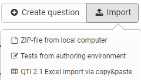

# Question Bank: Import Questions {: #question_bank_import}

Questions that already exist as a file, in a test or in a table do not have to be created again in the question bank: you import them. The question bank shows the "Import" button to authors, question bank managers and administrators, for example above the table under "My questions".

## Import options {: #import_options}

The "Import" button offers three ways to bring questions in the QTI 2.1 format into the question bank.

{ class="shadow lightbox" title="Menu of the Import button in the question bank" }

  *  **ZIP-file from local computer**: 
  If you have a set of QTI 2.1 questions or a test as a ZIP file, import the file here.
  *  **Tests from authoring environment**: 
  The list offers the QTI 2.1 tests that you are allowed to copy. In the row of the test you want, click its title. OpenOlat imports all questions of this test into the question bank.
  *  **QTI 2.1 Excel import via copy&paste**: 
  You enter the questions in a spreadsheet program such as Excel, following the template that the import provides, and paste the rows into the input field. The next section describes the template.

[To the top of the page ^](#question_bank_import)

## Usage of the file "Excel Import Template" {: #excelimport}

With the Excel import you create many questions in one go. You enter the questions row by row in a table, copy the rows and paste them into OpenOlat. OpenOlat creates questions in the QTI 2.1 format from them. This way you can also take over questions from other systems, provided you transfer them into the table first.

You get the template in the import itself. In the question bank, you start it under: 
`Question bank > My question bank > My questions > Import > QTI 2.1 Excel import via copy&paste`

In the "Data input" step, the link "Template excel import" is located above the field "Copied columns from Excel (comma separated)". It provides an Excel file with example questions for all ten question types that the Excel import supports, and an example of the metadata of a question. Build your questions according to this pattern.

The [test editor](../learningresources/Test_editor_QTI_2.1.md) offers the same import with the same template when you add questions directly to a test: 
`Test > Administration > Test editor > Add elements > Import questions from Excel`

How to import the questions:

1. Download the template via the link "Template excel import" and enter your questions according to its pattern.
2. In the table, select the rows of your questions and copy them.
3. Paste the rows into the field "Copied columns from Excel (comma separated)". OpenOlat reads the rows tab-separated or comma-separated.
4. Click "Next". The "Overview" step lists the recognized questions with question type, title and points.
5. Click "Finish".

If OpenOlat cannot process a row, the field names the row number: "Issue with line …".

The template is a table with four columns:

Column | Content
---|---
Keyword / Punkte | The keyword of the row, for example "Type", "Title" or "Points". In the rows for answers and gaps, this column holds the points.
Value | The value or text of the row.
Extra | Additional information for individual question types, for example the gap size for a gap text or the tolerance for a numerical gap text.
Erklärung | Explanations of the row, for example whether an entry is optional.

The template contains examples for the following question types. Before the parentheses is the value you enter in the "Type" row, in the parentheses the name of the question type in OpenOlat. You find more about the question types themselves under [Test question types](../learningresources/Test_question_types.md).

  * [MC (Multiple choice)](#template_mc)
  * [SC (Single choice)](#template_sc)
  * [FIB (Gap FIB text)](#template_fip)
  * [Numerical (Gap FIB numerical)](#template_numerical)
  * [Inlinechoice (Gap with dropdown)](#template_inlinechoice)
  * [KPRIM (Kprim)](#template_kprim)
  * [Essay](#template_essay)
  * [Matrix (Match)](#template_matrix)
  * [Drag&drop (Drag and Drop)](#template_dragdrop)
  * [Truefalse (True/false)](#template_truefalse)

In the template, the questions are listed one below the other, separated by an empty row. Each new question starts with the "Type" row. The keywords may also be in German, for example "Typ", "Titel", "Frage" or "Punkte". Upper and lower case do not matter.

The following sections describe the rows for each question type.

---

### Multiple choice {: #template_mc}

**Type**|MC
---|---
**Title**|Title of the question, for example the subject area
**Question**|The question text. Simple HTML formatting is allowed.
**Max answers**|Max. number of possible answers that participants may select
**Min answers**|Min. number of possible answers that participants must select
**Points**|Maximum achievable score. The minimum score is 0.

The answers follow, each in its own row: the points in the first column, the answer text in the second. Answers with more than 0 points count as correct; negative points are deducted when this answer is selected. The number of answers is up to you.

{ class="shadow lightbox" title="Multiple-choice question in the template" }

[To the top of the page ^](#question_bank_import)

---

### Single choice {: #template_sc}

**Type**|SC
---|---
**Title**|Title of the question, for example the subject area
**Question**|The question text. Simple HTML formatting is allowed.
**Points**|Maximum achievable score. The minimum score is 0.

The answers follow, each in its own row: the points in the first column, the answer text in the second. The correct answer carries more than 0 points, for example "1", the other answers "0". The number of answers is up to you.

[To the top of the page ^](#question_bank_import)

---

### Gap FIB text {: #template_fip}

**Type**|FIB
---|---
**Title**|Title of the question, for example the subject area
**Points**|Maximum achievable score. The minimum score is 0.
**Text**|A text part of the question before, between or after the gaps
**Points of the gap, e.g. "1"**|The solution of the gap. Further correct alternatives follow, separated by ";". The "Extra" column holds the gap size, for example "20".

Text rows and gap rows alternate, in any number.

[To the top of the page ^](#question_bank_import)

---

### Gap FIB numerical [:octicons-tag-16:{ title="from Release 16.1.0 (OO-5573)" }](https://track.frentix.com/issue/OO-5573) {: #template_numerical}

**Type**|Numerical
---|---
**Title**|Title of the question, for example the subject area
**Points**|Maximum achievable score. The minimum score is 0.
**Text**|A text part of the question, for example the question itself
**Points of the gap, e.g. "1"**|The solution as a number. For a tolerance, enter "solution;lower bound;upper bound" here and "absolute" or "relative" in the "Extra" column.

Without bounds, only the exact solution counts. With "absolute", the bounds are numbers: "1.41;1.40;1.42" accepts all values between 1.40 and 1.42. With "relative", the bounds are percentages: "20;10;10" accepts all values between 18 and 22.

{ class="shadow lightbox" title="Numerical gap text in the template" }

[To the top of the page ^](#question_bank_import)

---

### Gap with dropdown {: #template_inlinechoice}

**Type**|Inlinechoice
---|---
**Title**|Title of the question, for example the subject area
**Question**|The question or the first text part of the question
**Points**|Maximum achievable score. The minimum score is 0.
**Text**|A text part of the question before, between or after the gaps
**Points of the gap, e.g. "1"**|The answer options of the dropdown, separated by ";". The "Extra" column holds the solution.

If another character is to separate the answer options, enter it in the fourth column. The template uses "|" for this and therefore places the explanations for this question type in the fifth column.

{ class="shadow lightbox" title="Gap with dropdown in the template" }

[To the top of the page ^](#question_bank_import)

---

### Kprim [:octicons-tag-16:{ title="from Release 11.2 (OO-2364)" }](https://track.frentix.com/issue/OO-2364) {: #template_kprim}

**Type**|KPRIM
---|---
**Title**|Title of the question, for example the subject area
**Question**|The question text
**Points**|Maximum achievable score. The minimum score is 0.
+|correct answer
-|incorrect answer
-|incorrect answer
+|correct answer

A Kprim question has exactly four answers. Correct answers carry a "+" in the first column, incorrect answers a "-". OpenOlat does not take over further answer rows.

[To the top of the page ^](#question_bank_import)

---

### Essay [:octicons-tag-16:{ title="from Release 12.3 (OO-3174)" }](https://track.frentix.com/issue/OO-3174) {: #template_essay}

**Type**|ESSAY
---|---
**Title**|Title of the question, for example the subject area
**Question**|The question text
**Points**|Maximum achievable score. The minimum score is 0.
**Min**|Minimum number of words of the answer
**Max**|Maximum number of words of the answer

[To the top of the page ^](#question_bank_import)

---

### Match {: #template_matrix}

**Type**|MATRIX
---|---
**Title**|Title of the question, for example the subject area
**Question**|The question text
**Points**|Maximum achievable score. The minimum score is 0.

The matrix follows. In its first row, the first column remains empty and the other columns hold the column titles. Each following row starts with the row title, followed by the points for each column. An assignment with more than 0 points counts as correct. An example with three columns and three rows:

{ class="shadow lightbox" title="Match question in the template" }

[To the top of the page ^](#question_bank_import)

---

### Drag and Drop {: #template_dragdrop}

**Type**|Drag&drop
---|---
**Title**|Title of the question, for example the subject area
**Question**|The question text
**Points**|Maximum achievable score. The minimum score is 0.

The following rows are structured like those of the match question: one row with the column titles, then for each row the row title and the points for each column. An example with three columns and three rows:

{ class="shadow lightbox" title="Drag and Drop question in the template" }

[To the top of the page ^](#question_bank_import)

---

### True/false {: #template_truefalse}

**Type**|Truefalse
---|---
**Title**|Title of the question, for example the subject area
**Question**|The question text
**Points**|Maximum achievable score. The minimum score is 0.

The template then shows a header row with the columns "Unanswered", "Right" and "Wrong". Each further row starts with a statement, followed by the points in this fixed order:

Column | Points if participants …
---|---
Unanswered | do not answer the statement ("Unanswered"). A deduction is also possible.
Right | select "Right"
Wrong | select "Wrong"

The answer with more than 0 points counts as correct.

{ class="shadow lightbox" title="True/false question in the template" }

[To the top of the page ^](#question_bank_import)

---

!!! info "Important"
    In addition to the listed rows, the template knows optional rows for feedback and metadata, for example "Hint", "Correct solution", "Feedback correct answer", "Topic", "Keywords" or "License". The template shows them in the first gap text example, and you can add them to every question type. The "Erklärung" column states for each of these rows whether it applies only in the question bank.

## Further information {: #further_information}

[Test editor >](../learningresources/Test_editor_QTI_2.1.md) 
[Test question types >](../learningresources/Test_question_types.md) 
[Question Bank: Create Questions >](Question_Bank_Create_Questions.md) 
[Item Detailed View >](Item_Detailed_View.md) 
[Question Bank Review Process >](Question_Bank_Review_Process.md) 
[Question Bank: Sharing Options >](Question_Pool_Sharing_Options.md) 
[How do I proceed when I create a test? >](../../manual_how-to/test_creation_procedure/test_creation_procedure.md)

[To the top of the page ^](#question_bank_import)
