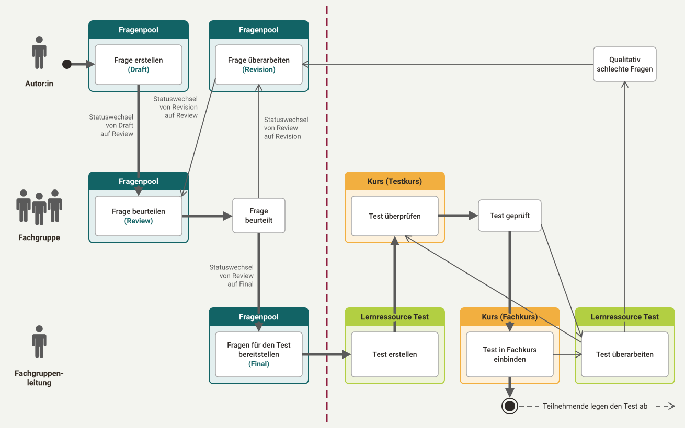
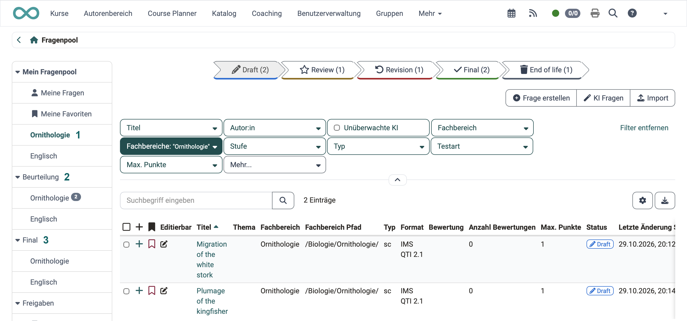
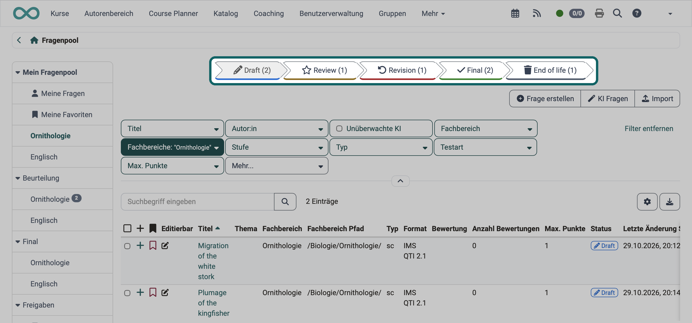
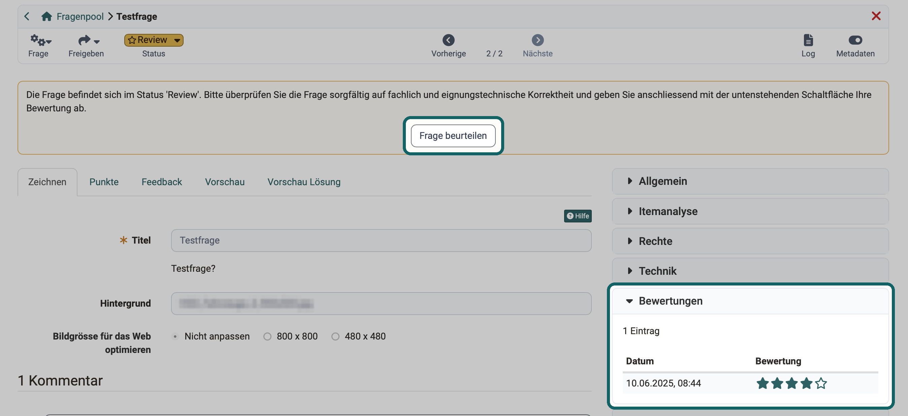
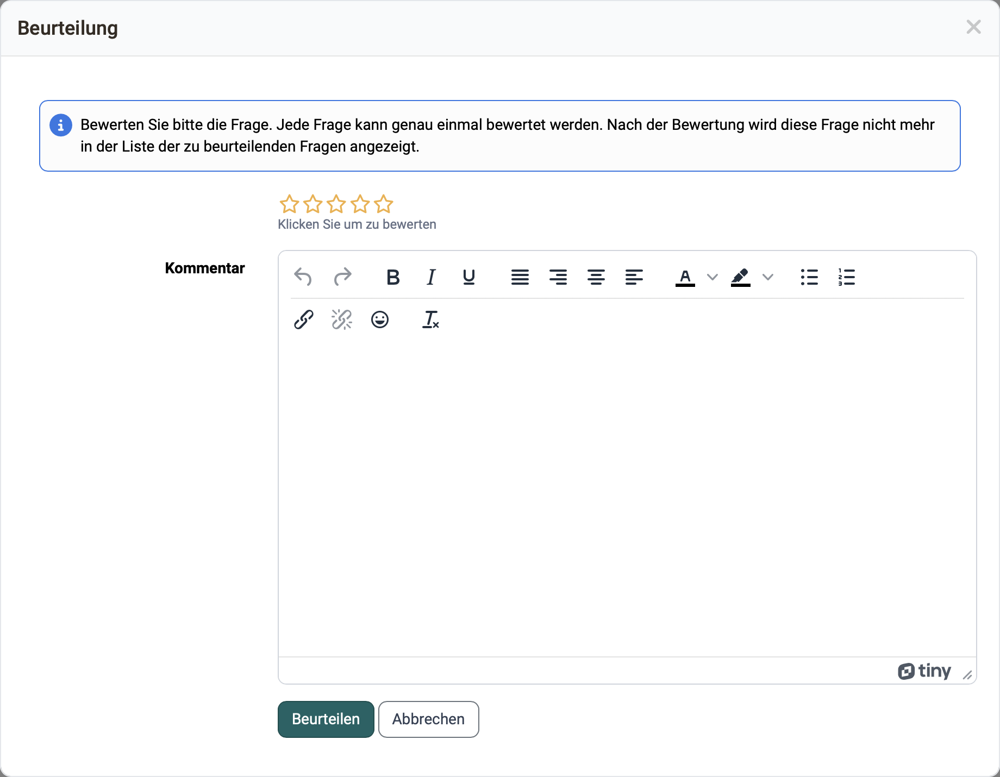

# Fragenpool: Beurteilungsprozess {: #review_process}

Alle Fragen des Fragenpools können einen Beurteilungsprozess durchlaufen. Dadurch kann die Qualitätssicherung gewährleistet werden.

## Voraussetzungen

Der Beurteilungsprozess wird in der System-Administration aktiviert: `Administration > e-Assessment > Fragenpool`. Details dazu finden Sie auf der Seite [e-Assessment Administration: Fragenpool](../../manual_admin/administration/eAssessment_Question_bank.de.md).

Um mit dem Beurteilungsprozess arbeiten zu können, muss ausserdem zwingend eine sogenannte Taxonomiestruktur (auch Fachbereiche) definiert werden. Alle Fragen werden einem Fachbereich zugeordnet. Die Benutzer:innen des Fragenpools erhalten Rechte auf gewisse Fachbereiche. Auf diese Fachbereiche haben die Benutzer:innen Zugriff und diese Fachbereiche sind im Fragenpool sichtbar. Die Abbildungen unten zeigen dafür einen Beispiel-Fachbereich.

## Prozess [:octicons-tag-16:{ title="ab Release 12.3 (OO-3111)" }](https://track.frentix.com/issue/OO-3111){:target="_blank"}

In der folgenden Grafik ist ein beispielhafter Prozessablauf dargestellt.

{ class="shadow lightbox" title="Beispielhafter Ablauf des Beurteilungsprozesses · 2026.11.11" }

Folgende Prozessschritte sind also im Beurteilungsprozess des Fragenpools abgebildet:

  1. Fragen werden entweder unter "Meine Fragen" oder direkt im eigenen Fachbereich (oder Kompetenz, Handlungsfeld...) erstellt. Die Frage befindet sich im Status "Draft".
  2. Die Frage wird in die Beurteilung gegeben. Der Status der Frage wechselt auf Review.
  3. Die Fragen werden beurteilt. Die eigenen Fragen können nicht beurteilt werden, sondern nur die Fragen der anderen Benutzer:innen, welche derselben Fachgruppe angehören.
  4. a) Die Beurteilung ist ungenügend. Das heisst, die Untergrenze der Bewertung mit den Sternen wird nicht erreicht. Die Frage geht zurück an die Ersteller:in in den Status Revision. Hier kann die Frage überarbeitet und erneut in die Beurteilung gegeben werden. 
b) Die Beurteilung durch die Sterne ist genügend. Die definierte Anzahl Personen hat eine genügende Bewertung abgegeben. Die Frage wechselt in den Status "Final".
  5. Die Fragen aus dem Bereich "Final" können in den Test eingebunden werden.

Im Menü links erscheint ein Fachbereich an bis zu drei Orten. Die Nummern in der Abbildung gehören zu den Einträgen der folgenden Liste.

{ class="shadow lightbox" title="Bereiche eines Fachbereichs im Menü des Fragenpools · 2026.11.11" }

  * **Mein Fragenpool** (1): Hier sehen Sie den Fachbereich mit allen eigenen Fragen, aufgelistet nach Status.
  * **Beurteilung** (2): Hier erscheint derselbe Fachbereich ein zweites Mal. Aufgelistet sind die Fragen anderer Benutzer:innen mit Rechten auf diesen Fachbereich, die sich im Status "Review" befinden. Ihre eigenen Fragen erscheinen hier nicht, da Sie Ihre eigenen Fragen nicht selbst beurteilen. Ebenso fehlen die Fragen, die Sie schon bewertet haben. Hier beurteilen Sie die Fragen.
  * **Final** (3): Sobald die Beurteilungskriterien erfüllt sind, kommt die Frage in den Bereich "Final". Es ist möglich, dass Sie nicht über genügend Rechte verfügen und Sie deshalb den Bereich "Final" nicht sehen. Fragen unter "Beurteilung" können Sie trotzdem beurteilen.

[Zum Seitenanfang ^](#review_process)

## Status

Wenn Sie unter "Mein Fragenpool" einen Fachbereich auswählen, wird ein Prozessablauf mit verschiedenen Status abgebildet (in der Abbildung markiert). Hier bekommen Sie einen Überblick, welche Ihrer Fragen sich in welchem Status befindet.

{ class="shadow lightbox" title="Statusleiste eines Fachbereichs im Fragenpool · 2026.11.11" }

  * **Draft:** Alle Fragen, die noch in Bearbeitung sind und noch nicht in den Beurteilungsprozess gegeben wurden. Sobald eine Frage aus "Meine Fragen" mit dem entsprechenden Fachbereich verknüpft ist, taucht sie hier im Status Draft auf.
  * **Review:** Hier sehen Sie alle Ihre Fragen, die sich momentan gerade im Status Review befinden. Diese Fragen müssen also von den anderen Personen Ihrer Fachgruppe beurteilt werden. Sie selbst können Ihre Fragen nicht beurteilen.
  * **Revision:** Hierhin gelangen alle Fragen, welche im Reviewprozess die Untergrenze der Beurteilung nicht erreicht haben. Die Untergrenze bezieht sich auf die Bewertung durch die Sterne und kann durch die Administration definiert werden. Die Fragen, welche sich hier befinden, müssen von Ihnen überarbeitet und wieder in die Beurteilung gegeben werden.
  * **Final:** Wenn eine Frage die Beurteilungskriterien erfüllt, gelangt sie in den Status Final. Hier sind nun die Fragen, welche die Qualitätssicherung überstanden haben und in Tests eingebunden werden können.
  * **End of life:** Hierhin kommen Fragen, welche durch Poolverwalter:innen oder Administrator:innen im Status Final in den Status End of life gesetzt worden sind. Nun ist es Ihnen überlassen, ob Sie die Fragen hier belassen oder löschen möchten. Wenn Sie die Frage wieder bearbeiten möchten, müssen Sie eine Kopie davon erstellen. Anschliessend befindet sich die Frage wieder im Status Draft und der Prozess kann von vorne beginnen.

[Zum Seitenanfang ^](#review_process)

**Beurteilung**

Im Bereich "Beurteilung" können Sie nun die Fragen der anderen Personen aus Ihrer Fachgruppe beurteilen. Die Frage befindet sich im Lesemodus. Sie können also die gesamte Frage anschauen, inklusive Punkte, Feedback und Metadaten. Sie können jedoch nichts editieren.

Die Beurteilung starten Sie mit "Frage beurteilen" in der Hinweisbox über der Frage. Rechts im Abschnitt "Bewertungen" sehen Sie die bisher abgegebenen Bewertungen mit Datum und Sternen.

{ class="shadow lightbox" title="Zu beurteilende Frage im Bereich Beurteilung · 2026.11.11" }

Anschliessend öffnet sich der Dialog "Beurteilung":

{ class="shadow lightbox" title="Dialog zum Beurteilen einer Frage · 2026.11.11" }

Hier bewerten Sie die Frage mit den Sternen und fügen einen Kommentar hinzu. Jede Frage können Sie genau einmal bewerten. Danach erscheint sie nicht mehr in Ihrer Liste unter "Beurteilung". Vor allem wenn die Bewertung unter dem Grenzwert liegt, ist ein Kommentar zentral. Nur so hat die Ersteller:in der Frage die Möglichkeit, die Frage anhand Ihrer Rückmeldung zu verbessern. Mit "Beurteilen" speichern Sie Ihre Beurteilung.

[Zum Seitenanfang ^](#review_process)

## Weiterführende Informationen {: #further_information}

[e-Assessment Administration: Fragenpool >](../../manual_admin/administration/eAssessment_Question_bank.de.md) 
[Fragen erstellen >](Question_Bank_Create_Questions.de.md) 
[Fragenpool: Fragen importieren >](Question_Bank_Import_Questions.de.md) 
[Fragenpool: Detailansicht einer Frage und Metadaten >](Item_Detailed_View.de.md) 
[Weitere Möglichkeiten zur Verwendung der Fragen >](Question_bank_possible_operations.de.md) 
[Details zur Freigabe >](Question_Pool_Sharing_Options.de.md) 
[Anleitung zur Testerstellung >](../../manual_how-to/test_creation_procedure/test_creation_procedure.de.md)

[Zum Seitenanfang ^](#review_process)
