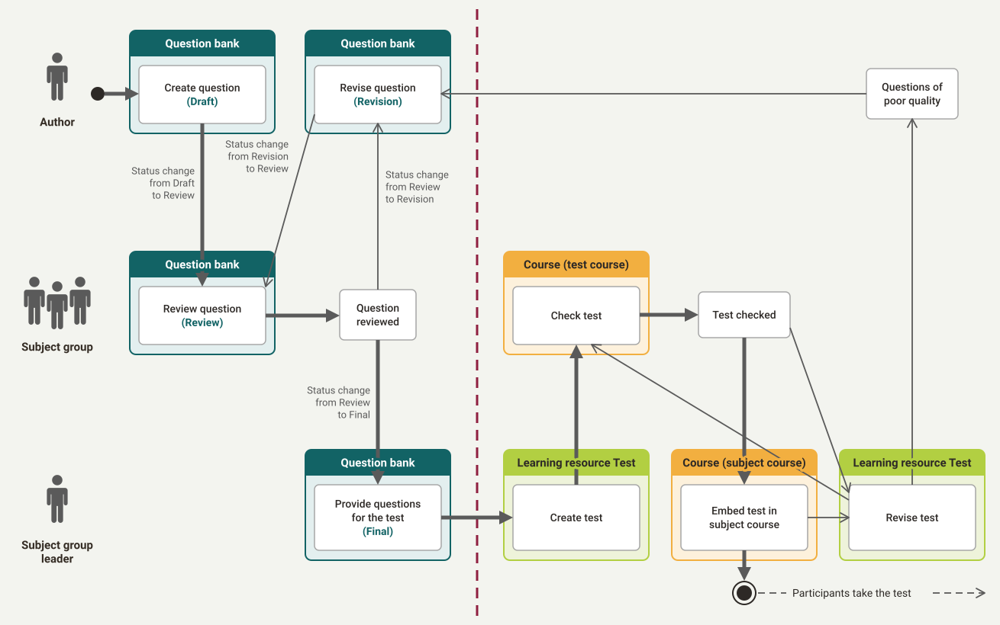
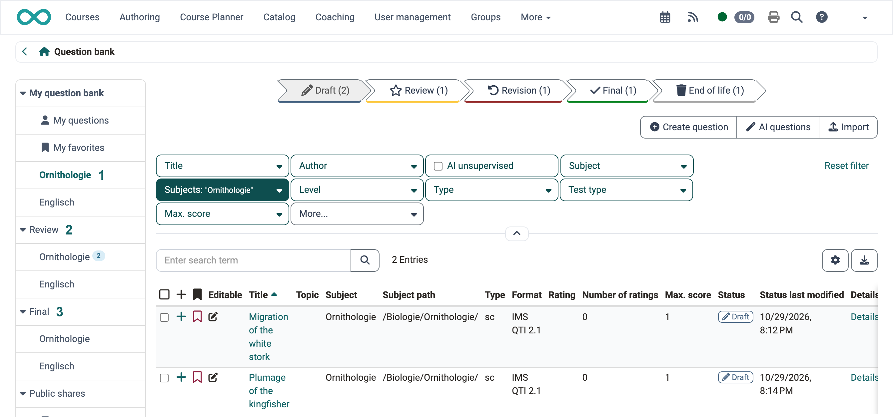
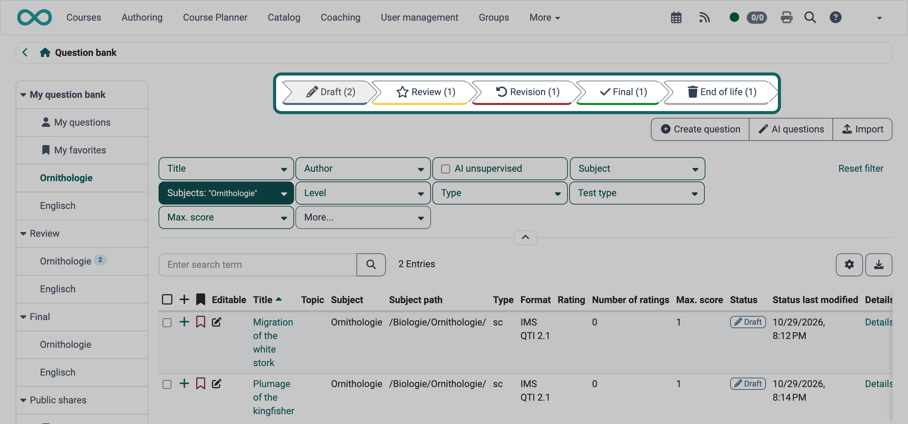
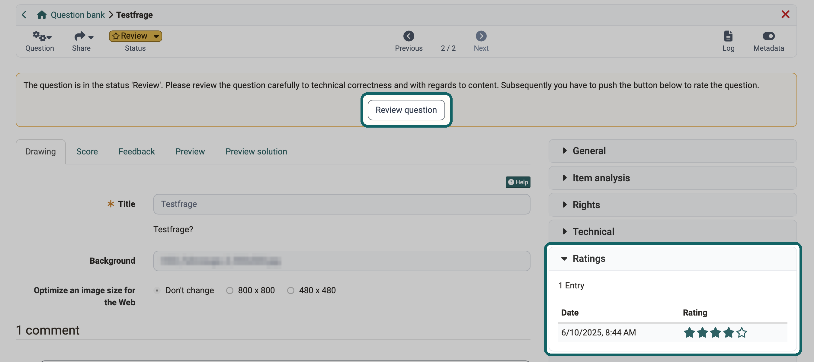
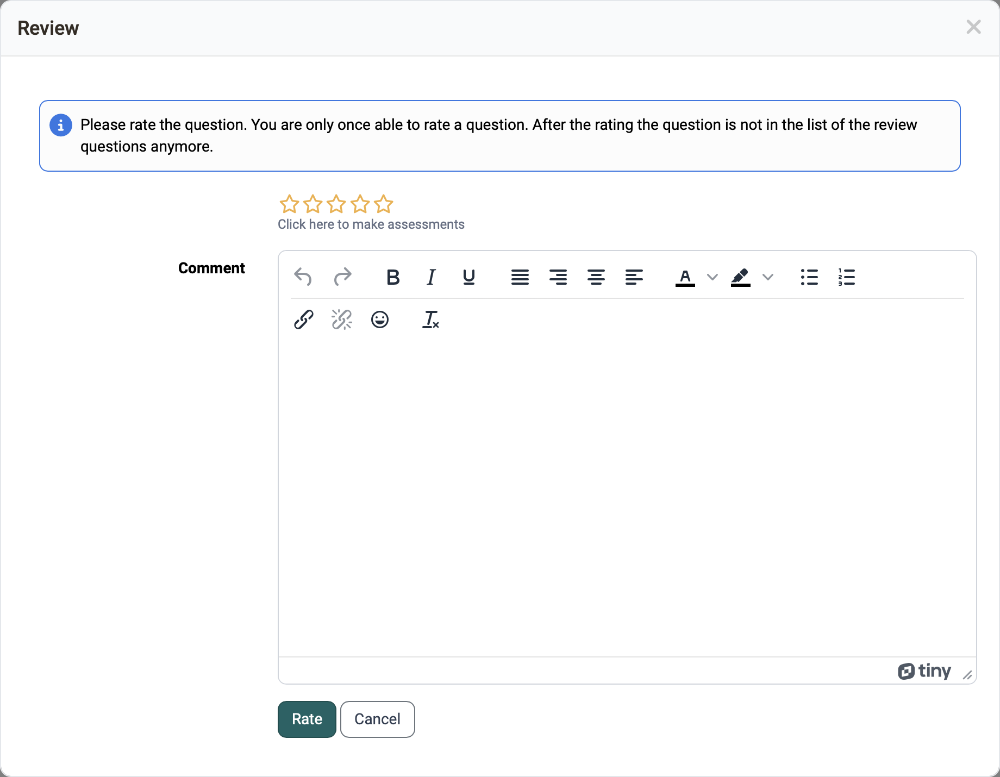

# Question Bank Review Process {: #review_process}

With the review process, the users of the question bank check each other's questions before the questions are used in tests. Other users with rights to the same subject rate a question with stars and give feedback with a comment. If the question receives enough good ratings, it changes to the status "Final". This way you ensure the quality of your questions.

## Requirements

System administrators switch on the review process in the system administration: `Administration > e-Assessment > Question bank`. You can find details on the page [e-Assessment Administration: Question bank](../../manual_admin/administration/eAssessment_Question_bank.md).

The review process also needs subjects. A subject is a field or topic, for example biology or ornithology. Every question is assigned to a subject. Users receive rights to a subject through a competence in this subject. They only see the subjects they have rights to in the question bank:

  * **Teach**: They see the subject under "My question bank" and under "Review" and review the questions of other users there.
  * **Manage**: They also see the subject, plus the ratings of a question. They can change the status of a question, for example to "Final" or "End of life".

The page [Question Bank: Administration](Question_Bank_Administration.md#subject) explains how to create subjects. You assign the competences in the tab "Competences" of a taxonomy level, see [Module Taxonomy](../../manual_admin/administration/Modules_Taxonomy.md#taxonomy). The figures below show the example subject "Ornithologie".

## Process [:octicons-tag-16:{ title="from Release 12.3 (OO-3111)" }](https://track.frentix.com/issue/OO-3111){:target="_blank"}

The following graphic shows an exemplary process flow.

{ class="shadow lightbox" title="Example flow of the review process · 2026.11.11" }

The following process steps are therefore depicted in the review process of the question bank:

  1. Questions are created either under "My questions" or directly in one of your own subjects under "My question bank". The question has the status "Draft".
  2. The author submits the question for review with "Start review process" in the notice above the question and selects the subject in the dialog. The status of the question changes to "Review". From now on the question can no longer be edited, and ratings from an earlier round are deleted.
  3. The questions are reviewed. Your own questions cannot be reviewed, only the questions of other users with rights to the same subject.
  4. a) The review is insufficient. This means that a rating is below the lower limit of the stars. The question goes back to the author in the status "Revision". Here the question can be revised and submitted for review again. 
b) The star rating is sufficient. The defined number of persons has rated the question, and no rating is below the lower limit. The question changes to the status "Final".
  5. The questions from the "Final" area can be integrated into tests.

In the menu on the left, a subject appears in up to three places. The numbers in the figure belong to the entries of the following list.

{ class="shadow lightbox" title="Areas of a subject in the question bank menu · 2026.10.29" }

  * **My question bank** (1): Here you see the subject with all your own questions, listed by status.
  * **Review** (2): Here the same subject appears a second time. Listed are the questions of other users with rights to this subject that are in the status "Review". Your own questions do not appear here, because you do not review your own questions yourself. The questions you have already rated are missing as well. Here you review the questions.
  * **Final** (3): As soon as the review criteria are fulfilled, the question moves to the "Final" area. The "Final" area is visible to persons with the competence "Manage" and, depending on the setting of the review process, also to persons with the competence "Teach". You can review questions under "Review" even without the "Final" area.

[To the top of the page ^](#review_process)

## Status

If you select a subject under "My question bank", a process flow with different statuses is shown (highlighted in the figure). Here you get an overview of which of your questions is in which status.

{ class="shadow lightbox" title="Status bar of a subject in the question bank · 2026.10.29" }

  * **Draft:** All questions that are still being edited and have not yet been submitted to the review process. As soon as a question from "My questions" is linked to the corresponding subject, it appears here in the status Draft.
  * **Review:** Here you see all your questions that are currently in the status Review. Other users with rights to the same subject review these questions. You cannot review your own questions.
  * **Revision:** All questions that did not reach the lower limit of the review in the review process go here. The lower limit refers to the star rating. Administrators and authorised question bank managers define it under `Question bank > Administration > Review Process`, see [Question Bank: Administration](Question_Bank_Administration.md#assessment_process). The questions located here must be revised by you and submitted for review again.
  * **Final:** If a question fulfils the review criteria, it moves to the status Final. Here are the questions that have passed quality assurance and can be integrated into tests.
  * **End of life:** Questions go here that administrators, persons with the competence "Manage" in the subject or authorized question bank managers have set to the status End of life. It is now up to you whether you want to leave the questions here or delete them. If you want to edit the question again, you must create a copy of it. The copy has the status Draft, and the process can start again.

[To the top of the page ^](#review_process)

## Reviewing questions {: #review_questions}

In the "Review" area you review the questions of other users with rights to the same subject. The question is in read mode. You can therefore view the entire question, including score, feedback and metadata. However, you cannot edit anything.

Start the review with "Review question" in the notice above the question. Administrators and persons with the competence "Manage" in the subject see on the right in the section "Ratings" the ratings given so far with date and stars.

{ class="shadow lightbox" title="Question to review in the area Review · 2026.11.11" }

The dialog "Review" then opens:

{ class="shadow lightbox" title="Dialog for rating a question · 2026.11.11" }

Here you rate the question with the stars and add a comment. You can rate each question exactly once. After that it no longer appears in your list under "Review". Especially if the rating is below the lower limit, a comment is essential. Your comment appears below the question with the comments. This way the author can improve the question based on your feedback. Click "Rate" to save your review.

[To the top of the page ^](#review_process)

## Further information {: #further_information}

**Mentioned on this page** 
[e-Assessment Administration: Question bank >](../../manual_admin/administration/eAssessment_Question_bank.md) 
[Question Bank: Administration >](Question_Bank_Administration.md) 
[Module Taxonomy >](../../manual_admin/administration/Modules_Taxonomy.md)

**Further reading** 
[Question Bank: Create Questions >](Question_Bank_Create_Questions.md) 
[Question Bank: Import Questions >](Question_Bank_Import_Questions.md) 
[Question bank: Details of a question and metadata >](Item_Detailed_View.md) 
[Question bank: Use questions >](Question_bank_possible_operations.md) 
[Question Bank: Sharing Options >](Question_Pool_Sharing_Options.md) 
[How do I proceed when I create a test? >](../../manual_how-to/test_creation_procedure/test_creation_procedure.md)

[To the top of the page ^](#review_process)
