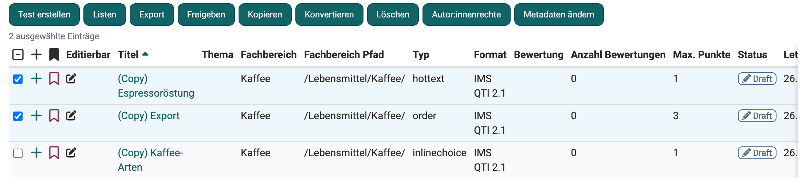
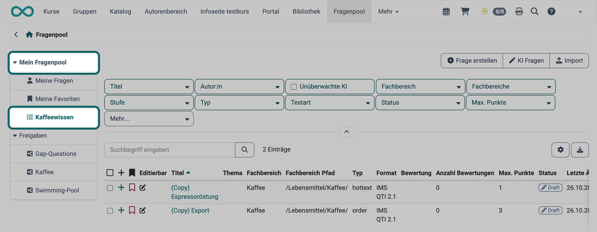
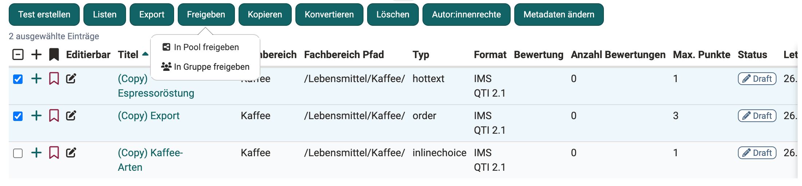
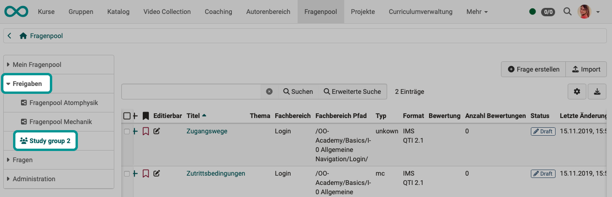
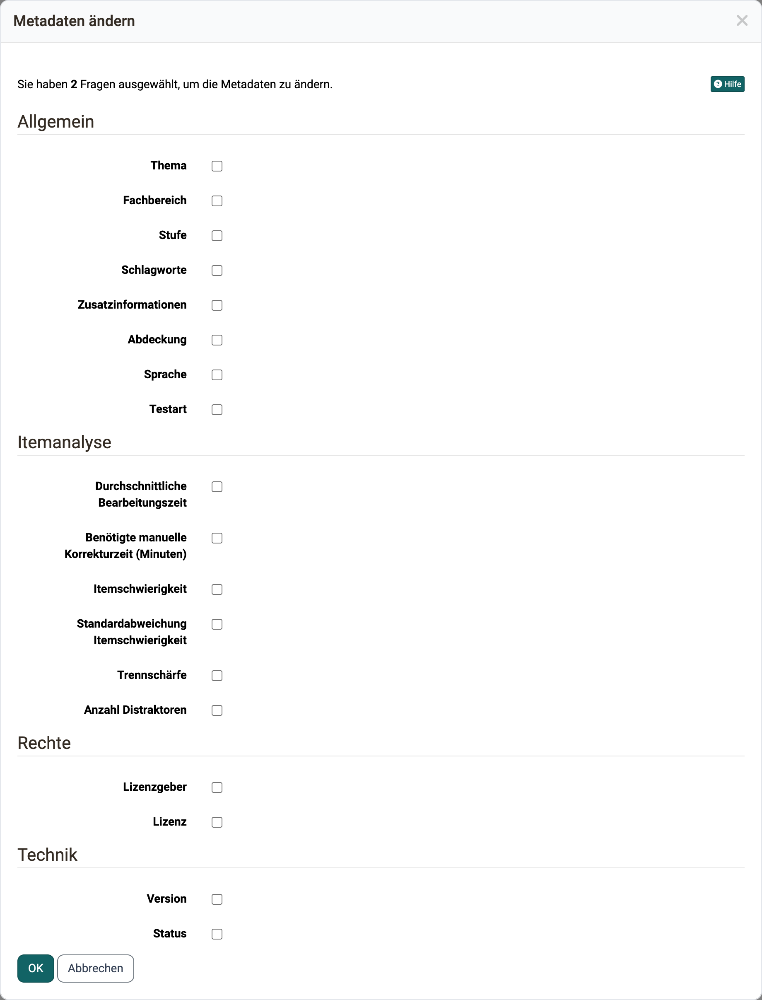
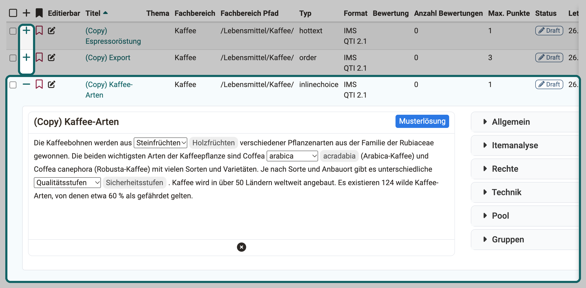

# Fragenpool: Fragen verwenden {: #using_the_questions}

Sobald Sie in der Liste eine oder mehrere Fragen auswählen, erscheinen über der Liste die Buttons, mit denen Sie die ausgewählten Fragen weiter verwenden.

{ class="shadow lightbox" title="Buttons über der Fragenliste · 2026.11.02" }

## Test erstellen {: #learning_resource_test}

Mit dem Button "Test erstellen" erstellen Sie aus den ausgewählten Fragen direkt eine neue [Lernressource Test](../learningresources/Test.de.md). Dabei tragen Sie gleich den Titel der Lernressource ein. Den Test finden Sie danach im Autorenbereich unter "Meine Einträge".

[Zum Seitenanfang ^](#using_the_questions)

## Listen {: #lists}

Mit Listen sammeln Sie Fragen nach Ihren eigenen Kriterien. Wählen Sie dazu unter "Meine Fragen" oder einem Pool die entsprechenden Fragen aus, und klicken Sie im Anschluss auf die Schaltfläche "Listen" oberhalb der Tabelle. Erstellen Sie eine neue Liste oder fügen Sie die Frage einer bestehenden Liste hinzu.

{ class="shadow lightbox" title="Menü Listen über der Fragenliste · 2026.11.02" }

Eine Liste ist nur für Sie sichtbar. Eine Frage, die Sie zu einer Liste hinzufügen, verweist auf das Original, OpenOlat kopiert sie nicht. Ändern Sie eine Frage in einer Liste, ändern Sie deshalb auch das Original unter "Meine Fragen". Ihre Liste finden Sie im Anschluss links im Menü unterhalb von "Meine Favoriten".

{ class="shadow lightbox" title="Eigene Liste im Bereich Mein Fragenpool · 2026.11.02" }

Ist eine Liste geöffnet, enthält das Menü des Buttons "Listen" zusätzlich "Liste umbenennen" und "Liste löschen". Entfernen Sie eine Frage aus einer Liste, bleibt die Frage selbst erhalten.

[Zum Seitenanfang ^](#using_the_questions)

## Export {: #export}

Ausgewählte Fragen exportieren Sie mit dem Button "Export" in verschiedene Formate:

* Word Datei für offline Prüfung (inkl. Korrekturblatt)
* QTI Testdatei für Austausch mit anderen kompatiblen LMS
* ZIP Datei für Austausch mit anderen OpenOlat Systemen oder Archivierung

[Zum Seitenanfang ^](#using_the_questions)

## Freigeben [:octicons-tag-16:{ title="ab Release 9.0.0 (OO-533)" }](https://track.frentix.com/issue/OO-533){:target="_blank"} {: #share}

Mit dem Button "Freigeben" geben Sie ausgewählte Fragen in Gruppen oder Pools frei, auf die andere Benutzer:innen Zugriff haben.

{ class="shadow lightbox" title="Menü Freigeben über der Fragenliste · 2026.11.02" }

**In Gruppe freigeben**

Gruppenmitglieder der von Ihnen ausgewählten Gruppen erhalten dadurch Zugriff auf die entsprechenden Fragen. Sie können entscheiden, ob die Gruppenmitglieder Ihre Fragen auch bearbeiten dürfen.

Wurden eine oder mehrere Fragen für eine oder mehrere Gruppen freigegeben, erscheinen die Gruppennamen im Menü des Fragenpools unter "Freigaben".

{ class="shadow lightbox" title="Bereich Freigaben im Fragenpool" }

**In Pool freigeben**

Geben Sie Fragen in einen Pool frei, erhalten alle Benutzer:innen mit Zugriff auf diesen Pool auch Zugriff auf die freigegebenen Fragen.

!!! info "Wichtig"

    Beachten Sie, dass auch bei der Freigabe in einen Pool oder für eine Gruppe die jeweiligen Personen grundsätzlich zunächst das Recht auf den Zugriff zum Fragenpool besitzen müssen. Beispielsweise besitzen normale Benutzer:innen standardmässig nicht das Zugriffsrecht auf die Fragenpools.

Administrator:innen und [Poolverwalter:innen](Question_Bank_Administration.de.md) (eine spezifische OpenOlat-Rolle) mit dem Recht für die Pool-Verwaltung legen beliebig viele Pools an. Diese können entweder öffentlich, und damit für alle zugriffsberechtigten Benutzer:innen sichtbar sein, oder privat. Die Anzahl der angezeigten Pools kann daher von Benutzer:in zu Benutzer:in unterschiedlich sein. Wenden Sie sich an Ihre Poolverwalter:innen, falls Sie auf einen Pool keinen Zugriff haben.

Bei der Freigabe legen Sie fest, ob die Frage am neuen Ort bearbeitet werden darf oder nicht.

!!! tip "Tipp"

    Fragen, die Sie in der Gruppe oder im Pool nicht bearbeiten dürfen, bearbeiten Sie nach dem Kopieren in "Meine Fragen".

[Zum Seitenanfang ^](#using_the_questions)

## Kopieren {: #copy}

Kopieren Sie Fragen aus Pools, um eine Kopie in Ihrer Fragendatenbank unter "Meine Fragen" zu erstellen. Der Titel einer Kopie beginnt mit "(Copy)".

Die Kopie von Fragen, welche in Listen oder Freigaben erstellt wird, kann zusätzlich zu "Meine Fragen" auch unter der jeweiligen Liste oder Freigabe abgespeichert werden.

[Zum Seitenanfang ^](#using_the_questions)

## Konvertieren [:octicons-tag-16:{ title="ab Release 11.1 (OO-2314)" }](https://track.frentix.com/issue/OO-2314){:target="_blank"} {: #convert}

Konvertieren Sie Fragen im QTI Standard 1.2 in den QTI Standard 2.1. Wählen Sie dazu die gewünschten Fragen in der Liste aus. Klicken Sie anschliessend auf "Konvertieren". Nachdem Sie den Dialog bestätigt haben, stehen die konvertierten Fragen im Standard 1.2 und zusätzlich im Standard 2.1 zur Verfügung.

Die Fragen, welche in Listen oder Freigaben konvertiert werden, sind zusätzlich zu "Meine Fragen" auch unter der jeweiligen Liste oder Freigabe abgespeichert. Fragen, die bereits im QTI Format 2.1 vorliegen brauchen nicht konvertiert zu werden.

Weitere Informationen zum Konvertieren finden Sie unter [Von QTI 1.2 zu QTI 2.1](../learningresources/Changing_from_QTI_1.2_to_QTI_2.1.de.md).

[Zum Seitenanfang ^](#using_the_questions)

## Löschen (bzw. Entfernen) {: #delete}

Aus Listen, Pools und Gruppenfreigaben entfernen Sie Fragen, ohne die Originalfrage unter "Meine Fragen" zu löschen. Die Schaltfläche "Entfernen" entfernt nur den Verweis auf die Frage, die Frage selbst bleibt erhalten. Eine Frage wird immer nur aus dem jeweiligen Kontext entfernt, in dem Sie sich gerade befinden. Indem Sie eine Frage von einer Liste, aus einer Gruppe oder einem Pool entfernen, ändern Sie nichts an eventuellen anderen Freigaben.

Um eine Frage endgültig von allen Listen, Gruppen und Pools zu löschen, müssen Sie die entsprechende Frage in Ihrem Fragenpool unter "Meine Fragen" löschen. Dort wird sie endgültig gelöscht und kann nicht mehr wiederhergestellt werden.

[Zum Seitenanfang ^](#using_the_questions)

## Autor:innenrechte {: #rights}

Mit dem Button "Autor:innenrechte" fügen Sie weitere Co-Autor:innen hinzu und erteilen ihnen damit Zugriffsrechte zu den ausgewählten Fragen.

In der Detailansicht der Fragen werden die weiteren Autor:innen in den [Metadaten im Abschnitt "Rechte"](Item_Detailed_View.de.md#metadata_rights) angezeigt und können dort auch wieder entfernt werden.

[Zum Seitenanfang ^](#using_the_questions)

## Metadaten ändern {: #metadata}

Die Metadaten von Fragen ändern Sie hier oder in der [Detailansicht](Item_Detailed_View.de.md) einer Frage.

Mit dem Button "Metadaten ändern" ändern Sie einzelne Angaben bei mehreren Fragen gleichzeitig, ohne die Detailansicht zu öffnen. Diese Änderungen lassen sich hier nicht rückgängig machen.

{ class="shadow lightbox" title="Dialog Metadaten ändern · 2026.11.02" }

Für weitere Anpassungen öffnen Sie jede Frage einzeln.

Klicken Sie auf das "+"-Icon zu Beginn einer Zeile der Fragenliste. Es öffnen sich die Vorschau der Frage und die Bereiche ihrer Metadaten.

{ class="shadow lightbox" title="Aufgeklappte Zeile in der Fragenliste · 2026.11.02" }

Weitere Informationen zu den einzelnen Metadaten finden Sie im Kapitel [Fragenpool: Detailansicht einer Frage und Metadaten](Item_Detailed_View.de.md#metadata).

[Zum Seitenanfang ^](#using_the_questions)

## Weiterführende Informationen {: #further_information}

**Auf dieser Seite erwähnt** 
[Tests erstellen >](../learningresources/Test.de.md) 
[Fragenpool: Administration >](Question_Bank_Administration.de.md) 
[Von QTI 1.2 zu QTI 2.1 >](../learningresources/Changing_from_QTI_1.2_to_QTI_2.1.de.md) 
[Fragenpool: Detailansicht einer Frage und Metadaten >](Item_Detailed_View.de.md)

**Weiterführend** 
[Fragenpool: Fragen erstellen >](Question_Bank_Create_Questions.de.md) 
[Fragenpool: Fragen importieren >](Question_Bank_Import_Questions.de.md) 
[Fragenpool: Beurteilungsprozess >](Question_Bank_Review_Process.de.md) 
[Fragenpool: Freigabemöglichkeiten >](Question_Pool_Sharing_Options.de.md) 
[Wie gehe ich vor, wenn ich einen Test erstelle? >](../../manual_how-to/test_creation_procedure/test_creation_procedure.de.md)

[Zum Seitenanfang ^](#using_the_questions)
