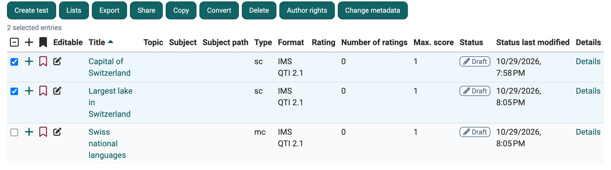
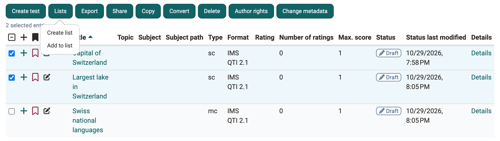
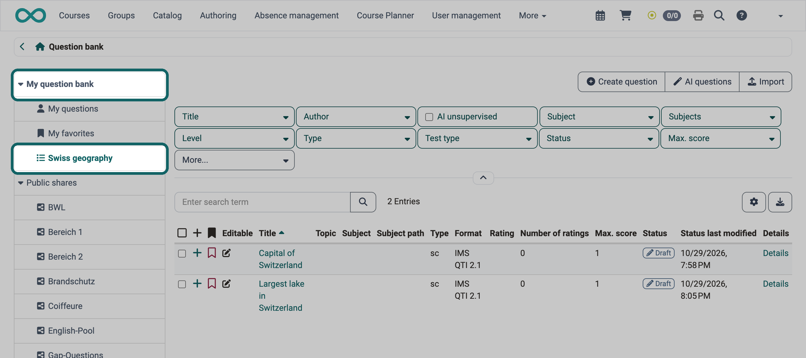
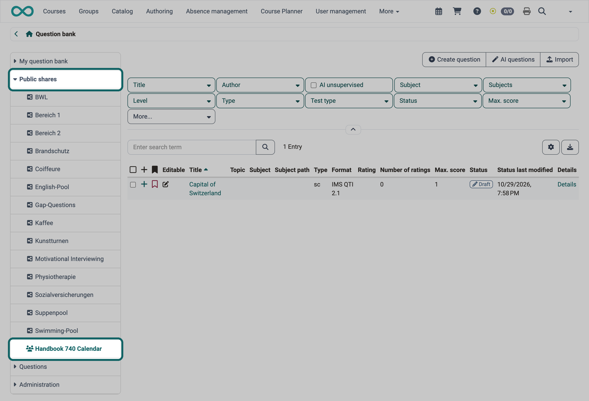
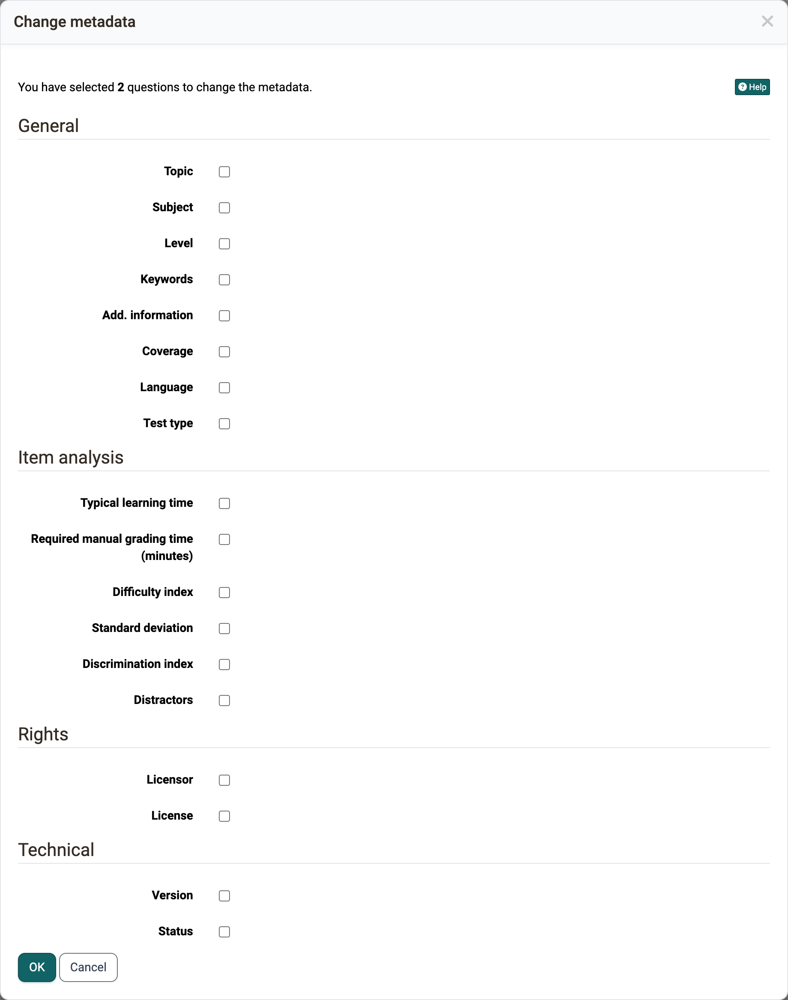
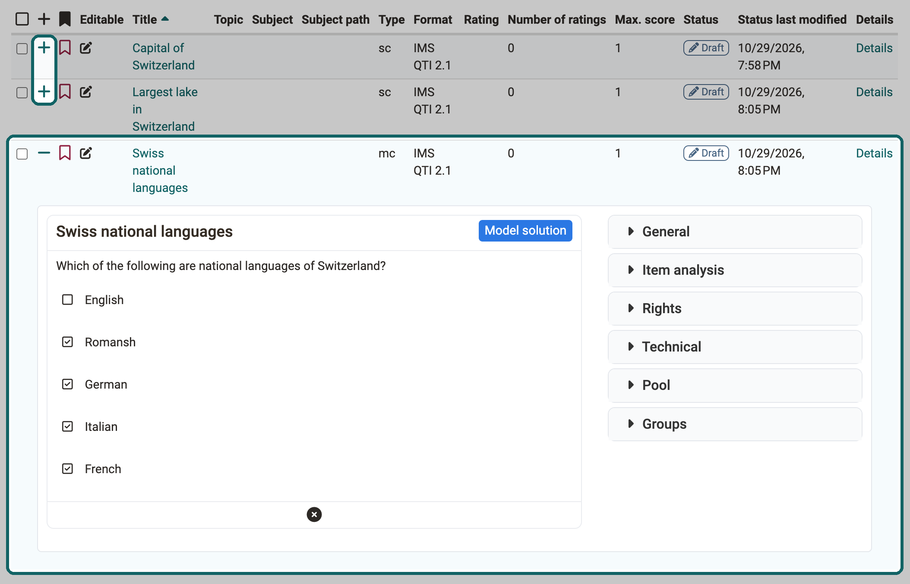

# Question bank: Use questions {: #using_the_questions}

As soon as you select one or more questions in the list, the buttons with which you continue to use the selected questions appear above the list.

{ class="shadow lightbox" title="Buttons above the question list · 2026.11.02" }

## Create test {: #learning_resource_test}

With the button "Create test" you create a new [Learning resource Test](../learningresources/Test/index.md) directly from the selected questions. In doing so, you enter the title of the learning resource right away. You then find the test in Authoring under "My entries".

OpenOlat copies the selected questions into the new test. If you then change a question in the question bank, the test keeps the copied version, see [How do the questions get into a test?](../learningresources/Test/index.md#create_questions_in_tests)

[To the top of the page ^](#using_the_questions)

## Lists {: #lists}

With lists you collect questions according to your own criteria. To do this, select the corresponding questions under "My questions" or a pool and then click the "Lists" button above the table. Create a new list or add the question to an existing list.

{ class="shadow lightbox" title="Lists menu above the question list · 2026.10.29" }

A list is only visible to you. A question that you add to a list refers to the original, OpenOlat does not copy it. If you change a question in a list, you therefore also change the original under "My questions". You will then find your list on the left in the menu below "My favorites".

{ class="shadow lightbox" title="Own list in the My question bank area · 2026.10.29" }

If a list is open, the menu of the "Lists" button additionally contains "Rename list" and "Delete list". If you remove a question from a list, the question itself is kept.

[To the top of the page ^](#using_the_questions)

## Export {: #export}

If you need questions outside the question bank, export them with the "Export" button in one of three formats:

* Word file for offline exams (incl. correction sheet)
* QTI test file for exchange with other compatible LMS
* ZIP file for exchange with other OpenOlat systems or for archiving

[To the top of the page ^](#using_the_questions)

## Share [:octicons-tag-16:{ title="from Release 9.0.0 (OO-533)" }](https://track.frentix.com/issue/OO-533){:target="_blank"} {: #share}

With the button "Share" you share selected questions with groups or pools to which other users have access.

{ class="shadow lightbox" title="Share menu above the question list · 2026.10.29" }

**Share with group**

Group members of the groups you have selected will then have access to the corresponding questions. You can decide whether the group members may also edit your questions.

If one or more questions have been shared with one or more groups, the group names appear in the menu of the question bank under "Public shares".

{ class="shadow lightbox" title="Public shares area in the question bank · 2026.10.29" }

**Share with pool**

If you share questions with a pool, all users with access to this pool also get access to the shared questions.

!!! info "Important"

    Even when sharing with a pool or a group, the persons first need access to the question bank. Persons with the role user do not have this access by default.

Administrators and [question bank managers](Question_Bank_Administration.md) (a specific OpenOlat role) with the right for the pool administration create any number of pools. A pool is either public and therefore visible to all persons with access to the question bank, or private. Each person therefore only sees the pools they have access to. If you lack access to a pool, contact your question bank managers.

When sharing, you define whether other persons may edit the question in the new location.

!!! tip "Tip"

    Questions that you may not edit in the group or pool can be edited after you have copied them to "My questions".

[To the top of the page ^](#using_the_questions)

## Copy {: #copy}

Copy a question from a pool if you want to edit it independently of the original. You are the owner of the copy, and it is listed under `My question bank > My questions`. The title of a copy begins with "(Copy)".

If you copy questions in a list or share, you can also place the copy there in the dialog "Copy".

[To the top of the page ^](#using_the_questions)

## Convert [:octicons-tag-16:{ title="from Release 11.1 (OO-2314)" }](https://track.frentix.com/issue/OO-2314){:target="_blank"} {: #convert}

If questions are still in the QTI 1.2 standard, convert them to the QTI 2.1 standard. To do this, select the desired questions in the list and click "Convert". After you have confirmed the dialog, the questions are available in the standard 1.2 and additionally in the standard 2.1.

If you convert questions in a list or share, OpenOlat stores the converted questions under "My questions" and additionally in this list or share. Questions in the QTI 2.1 format need no conversion.

For more information on converting, see [Changing from QTI 1.2 to QTI 2.1](../learningresources/Changing_from_QTI_1.2_to_QTI_2.1.md).

[To the top of the page ^](#using_the_questions)

## Delete (or remove) {: #delete}

You remove questions from lists, pools and group shares without deleting the original question under "My questions". The "Remove" button only removes the reference to the question, the question itself is kept. OpenOlat removes the question only from the list, group or pool you are currently in. Other shares of the question remain.

You delete a question permanently under "My questions". OpenOlat then removes it from all lists, groups and pools, and it cannot be restored.

[To the top of the page ^](#using_the_questions)

## Author rights {: #rights}

Use the "Author rights" button to add further co-authors and grant them access rights to the selected questions.

The detailed view of a question shows the other authors in the [metadata in the "Rights" section](Item_Detailed_View.md#metadata_rights). You also remove them there.

[To the top of the page ^](#using_the_questions)

## Change metadata {: #metadata}

You change the metadata of questions here or in the [detailed view](Item_Detailed_View.md) of a question.

With the button "Change metadata" you change individual pieces of information for several questions at the same time without opening the detailed view. These changes cannot be undone here.

{ class="shadow lightbox" title="Dialog Change metadata · 2026.10.29" }

For further adjustments, open each question individually.

Click on the "+" icon at the beginning of a row in the question list. The preview of the question and the sections of its metadata open.

{ class="shadow lightbox" title="Expanded row in the question list · 2026.10.29" }

Further information on the individual metadata can be found in the chapter [Question bank: Details of a question and metadata](Item_Detailed_View.md#metadata).

[To the top of the page ^](#using_the_questions)

## Further information {: #further_information}

**Mentioned on this page** 
[Creating Tests >](../learningresources/Test/index.md) 
[Question Bank: Administration >](Question_Bank_Administration.md) 
[Changing from QTI 1.2 to QTI 2.1 >](../learningresources/Changing_from_QTI_1.2_to_QTI_2.1.md) 
[Question bank: Details of a question and metadata >](Item_Detailed_View.md)

**Further reading** 
[Question Bank: Create Questions >](Question_Bank_Create_Questions.md) 
[Question Bank: Import Questions >](Question_Bank_Import_Questions.md) 
[Question Bank Review Process >](Question_Bank_Review_Process.md) 
[Question Bank: Sharing Options >](Question_Pool_Sharing_Options.md) 
[How do I proceed when I create a test? >](../../manual_how-to/test_creation_procedure/test_creation_procedure.md)

[To the top of the page ^](#using_the_questions)
